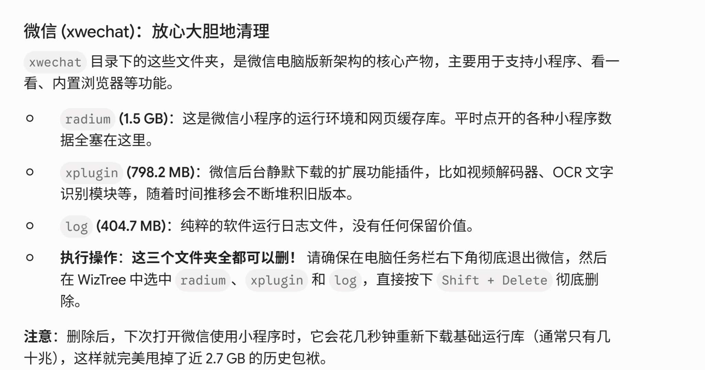
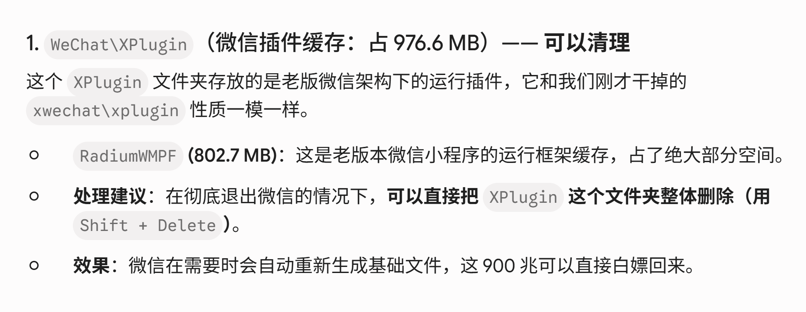

# AI 对话可续接记忆

- 后端：siliconflow
- 模型：Qwen/Qwen3-8B
- 来源：export.md
- 消息数：4
- 分块数：1
- 对话类型：媒体分析、决策讨论、计算推算

## 总览

用户上传了两张关于微信文件夹删除建议的图片，询问建议是否正确。AI 分析指出，图片中的建议存在过于绝对的问题，不建议直接删除整个 XPlugin 文件夹，而是建议清理 RadiumWMPF 中的旧版本目录。AI 还指出删除后可能需要重新下载基础文件，因此不能保证永久释放空间。AI 已给出建议，但用户尚未执行或确认。

## 当前对话断点与工作状态

- 当前活动：用户最近提出：他说得对吗 `[来源：用户明确提供｜状态：已确认｜消息：3]`
- 已到阶段：AI 已给出关于微信文件夹删除建议的详细分析 `[来源：上一 AI 陈述｜状态：上一 AI 已回答｜消息：4]`
- 下一步：AI 建议用户提供 XPlugin 文件夹的截图以进一步判断哪些内容可删 `[来源：上一 AI 陈述｜状态：建议/尚未确认采用｜消息：2, 4]`
- 最后一条用户消息：消息 3；他说得对吗
- 最新消息：消息 4；角色 AI；最后用户轮已获回答：是
- 断点状态：ongoing

### 已完成/已执行

- AI 分析指出图片中的建议过于绝对，不建议直接删除整个 XPlugin 文件夹 `[来源：上一 AI 陈述｜状态：建议/尚未确认采用｜消息：2, 4]`
- AI 指出 RadiumWMPF 是微信小程序运行环境的一部分，删除后可能需要重新下载 `[来源：上一 AI 陈述｜状态：建议/尚未确认采用｜消息：2, 4]`
- AI 建议用户优先清理 RadiumWMPF 中的旧版本目录 `[来源：上一 AI 陈述｜状态：建议/尚未确认采用｜消息：2, 4]`
- AI 指出删除后可能重新生成基础文件，因此不能保证永久释放空间 `[来源：上一 AI 陈述｜状态：建议/尚未确认采用｜消息：2, 4]`

### 待处理/待验证

- 用户未提供具体文件夹大小 `[来源：用户明确提供｜状态：未解决｜消息：1, 3]`
- 用户未确认是否执行建议 `[来源：用户明确提供｜状态：未解决｜消息：1, 3]`

## 分主题摘要

### 用户询问微信文件夹删除建议的准确性

用户上传了两张关于微信文件夹删除建议的图片，询问建议是否正确。AI 分析指出，图片中的建议存在过于绝对的问题，不建议直接删除整个 XPlugin 文件夹，而是建议清理 RadiumWMPF 中的旧版本目录。AI 还指出删除后可能需要重新下载基础文件，因此不能保证永久释放空间。

- 来源消息：1~4

### RadiumWMPF 的性质与清理建议

AI 指出 RadiumWMPF 是微信小程序运行环境的一部分，删除后可能需要重新下载。AI 建议用户优先清理 RadiumWMPF 中的旧版本目录。

- 来源消息：1~4

### 删除后是否永久释放空间

AI 指出删除后可能重新生成基础文件，因此不能保证永久释放空间。

- 来源消息：1~4

### 用户上传的图片内容

用户上传了两张图片，分别指出 radium、xplugin、log 三个文件夹可安全删除，以及 XPlugin 文件夹可直接删除。AI 分析指出这些建议存在过于绝对的问题。

- 来源消息：1~4

### AI 对图片建议的评价

AI 认为图片中的建议过于绝对，不建议直接删除整个 XPlugin 文件夹，而是建议清理 RadiumWMPF 中的旧版本目录。

- 来源消息：1~4

### 删除后是否永久释放空间

AI 指出删除后可能重新生成基础文件，因此不能保证永久释放空间。

- 来源消息：1~4

### 微信文件夹删除建议的分析

用户上传了两张关于微信文件夹删除建议的图片，询问建议是否正确。AI 分析指出，图片中的建议存在过于绝对的问题，不建议直接删除整个 XPlugin 文件夹，而是建议清理 RadiumWMPF 中的旧版本目录。AI 还指出删除后可能需要重新下载基础文件，因此不能保证永久释放空间。

- 来源消息：1~4

## 媒体与附件说明（开发检查）

### M001｜消息 1｜image

- 来源：用户消息
- 标签：用户附件
- 图片：
- 状态：described；本地可访问，可重新验证
- 内容说明：用户上传了一张图片“用户附件”；以下为模型视觉识别结果，其中 OCR 字符可能存在误差：标题为“微信 (xwechat)：放心大胆地清理”，内容说明 xwechat 目录下的 radium、xplugin、log 三个文件夹可安全删除，分别占用 1.5 GB、798.2 MB、404.7 MB。操作步骤为：先彻底退出微信，再用 WizTree 选中并按 Shift + Delete 删除。删除后，下次使用小程序时会重新下载基础运行库，可节省约 2.7 GB 空间。
- 上一 AI 结论（消息 2）（suggested）：RadiumWMPF 是微信小程序运行环境的一部分，删除后可能需要重新下载

### M002｜消息 3｜image

- 来源：用户消息
- 标签：用户附件
- 图片：
- 状态：described；本地可访问，可重新验证
- 内容说明：用户上传了一张图片“用户附件”；以下为模型视觉识别结果，其中 OCR 字符可能存在误差：标题为“1. WeChat\XPlugin（微信插件缓存：占 976.6 MB）—— 可以清理”，内容指出 XPlugin 文件夹存放老版微信架构下的运行插件，与已删除的 xwechat\xplugin 性质相同，可直接删除。同时提及 RadiumWMPF 文件夹（802.7 MB）是老版本微信小程序的运行框架缓存，建议在彻底退出微信后，用 Shift + Delete 删除 XPlugin 文件夹以释放 900 MB 空间。
- 上一 AI 结论（消息 4）（suggested）：XPlugin 文件夹包含多个版本的插件缓存，删除后可能需要重新下载

## 细节记忆（可选）

以下仅保留有助于继续任务的关键细节，已合并重复内容：

- **附件信息｜用户上传的第二张图片内容**：用户上传了第二张图片，标题为“1. WeChat\XPlugin（微信插件缓存：占 976.6 MB）—— 可以清理”，内容指出 XPlugin 文件夹存放老版微信架构下的运行插件，与已删除的 xwechat\xplugin 性质相同，可直接删除。
- **附件信息｜用户上传的图片内容**：用户上传了一张图片，标题为“微信 (xwechat)：放心大胆地清理”，内容说明 xwechat 目录下的 radium、xplugin、log 三个文件夹可安全删除，分别占用 1.5 GB、798.2 MB、404.7 MB。
- **重要建议｜RadiumWMPF 的性质**：AI 指出 RadiumWMPF 是微信小程序运行环境的一部分，删除后可能需要重新下载
- **重要建议｜XPlugin 文件夹的清理建议**：AI 建议用户不要直接删除整个 XPlugin 文件夹，而是清理其中的旧版本目录
- **重要建议｜删除后是否永久释放空间**：AI 指出删除后可能重新生成基础文件，因此不能保证永久释放空间
- **重要建议｜AI 对第二张图片建议的评价**：AI 认为图片中的建议不够严谨，不建议直接删除整个 XPlugin 文件夹
- **重要建议｜RadiumWMPF 的清理建议**：AI 建议用户优先清理 RadiumWMPF 中的旧版本目录
- **重要建议｜AI 对图片建议的评价**：AI 认为图片中的建议过于绝对，不建议直接删除整个 XPlugin 文件夹
