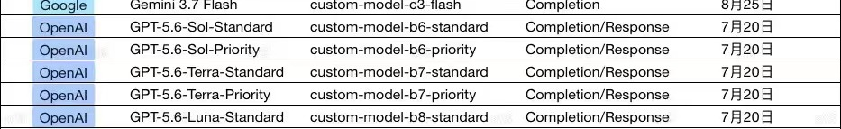

# AI 对话可续接记忆

- 后端：siliconflow
- 模型：Qwen/Qwen3-8B
- 来源：export.md
- 消息数：2
- 分块数：1
- 对话类型：媒体分析、决策讨论

## 总览

用户上传了一张图片，显示多个 AI 模型的名称、版本、自定义模型标识符和完成/响应日期。AI 分析了这些模型的区别，指出核心区别是‘模型能力档位 + 速度/成本 + 优先级’，并推荐了不同任务场景下的最佳模型选择。AI 还提到 Standard 和 Priority 不是两个完全不同的模型，而是同一个模型的不同优先级。同时，AI 指出 b6/b7/b8 是平台对官方模型的内部映射名称，需要进一步确认具体对应关系。AI 还建议用户如果愿意，可以进一步解释这些内部映射名称及其适用场景。

## 当前对话断点与工作状态

- 当前活动：用户最近提出：这几个模型有什么区别 `[来源：用户明确提供｜状态：已确认｜消息：1]`
- 已到阶段：模型区别分析 `[来源：上一 AI 陈述｜状态：上一 AI 已提供｜消息：2]`
- 下一步：如果用户愿意，AI 可以进一步解释 b6/b7/b8 内部映射名称及其适用场景 `[来源：上一 AI 陈述｜状态：建议/尚未确认采用｜消息：2]`
- 最后一条用户消息：消息 1；这几个模型有什么区别
- 最新消息：消息 2；角色 AI；最后用户轮已获回答：是
- 断点状态：complete

### 已完成/已执行

- 用户上传一张图片，显示多个 AI 模型的名称、版本、自定义模型标识符和完成/响应日期。 `[来源：用户明确提供｜状态：已确认｜消息：1]`
- AI 分析模型区别，指出核心区别是‘模型能力档位 + 速度/成本 + 优先级’。 `[来源：上一 AI 陈述｜状态：上一 AI 已提供｜消息：2]`

### 待处理/待验证

- Standard 和 Priority 的区别 `[来源：上一 AI 陈述｜状态：未解决｜消息：2]`
- b6/b7/b8 内部映射名称 `[来源：上一 AI 陈述｜状态：未解决｜消息：2]`

## 分主题摘要

（没有需要单独拆分的历史主题。）

## 媒体与附件说明（开发检查）

### M001｜消息 1｜image

- 来源：用户消息
- 标签：已上传的图片
- 图片：
- 状态：described；本地可访问，可重新验证
- 内容说明：用户上传了一张图片“已上传的图片”；以下为模型视觉识别结果，其中 OCR 字符可能存在误差：一张表格截图，显示了多个 AI 模型的名称、版本、自定义模型标识符和完成/响应日期。表格中包含 Google 的 Gemini 3.7 Flash 模型（8月25日）和 OpenAI 的多个 GPT-5.6 系列模型（7月20日），所有模型的完成/响应类型均为 'Completion/Response'。
- AI 结论绑定：（未生成）

## 细节记忆（可选）

以下仅保留有助于继续任务的关键细节，已合并重复内容：

- **用户信息｜用户原始请求**：用户提出： 这几个模型有什么区别
- **重要建议｜模型区别**：模型区别其实是‘模型能力档位 + 速度/成本 + 优先级’。
- **重要建议｜模型能力档位**：GPT-5.6 Sol 是旗舰，Terra 是能力/成本平衡，Luna 是最快和最便宜。
- **重要建议｜Standard 和 Priority 的区别**：Standard 和 Priority 不是两个完全不同的模型，而是同一个模型的不同优先级。
- **重要建议｜Gemini 3.7 Flash 的特点**：Gemini 3.7 Flash 支持文本、图片、音频、视频和 PDF，并且上下文最高约 1M token。
- **重要建议｜b6/b7/b8 的含义**：b6/b7/b8 是平台对官方模型的内部映射名称，需要进一步确认具体对应关系。
- **重要建议｜数学建模任务推荐模型**：如果任务是数学建模、复杂推理、科研、编程、优化算法等，推荐使用 GPT-5.6 Sol-Priority。
- **重要建议｜Sol 用量有限时推荐模型**：如果 Sol 用量比较贵/有限，推荐使用 GPT-5.6 Terra-Priority。
