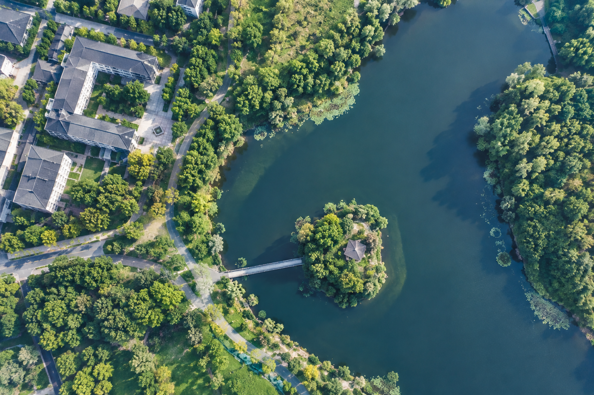

# AI 对话可续接记忆

- 后端：siliconflow
- 模型：Qwen/Qwen3-8B
- 来源：export.md
- 消息数：2
- 分块数：1
- 对话类型：媒体分析、普通对话

## 总览

用户请求生成无人机视角图像，AI 已生成图像并提供视觉描述

## 当前对话断点与工作状态

- 当前活动：用户最近提出：无人机视角 `[来源：用户明确提供｜状态：已确认｜消息：1]`
- 已到阶段：AI 生成图像并提供视觉描述 `[来源：上一 AI 陈述｜状态：上一 AI 已提供｜消息：2]`
- 下一步：未明确 `[来源：上一 AI 陈述｜状态：上一 AI 已回答｜消息：无]`
- 最后一条用户消息：消息 1；无人机视角
- 最新消息：消息 2；角色 AI；最后用户轮已获回答：是
- 断点状态：complete

### 已完成/已执行

- AI 生成无人机视角图像 `[来源：上一 AI 陈述｜状态：上一 AI 已提供｜消息：2]`

## 分主题摘要

（没有需要单独拆分的历史主题。）

## 媒体与附件说明（开发检查）

### M001｜消息 2｜image

- 来源：AI 回答
- 标签：已生成图像 1
- 图片：
- 状态：described；本地可访问，可重新验证
- 内容说明：AI 回答中包含一张图片“已生成图像 1”；以下为模型视觉识别结果，其中 OCR 字符可能存在误差：一张俯瞰视角的航拍图，展示了一个被深绿色湖水环绕的岛屿。岛上有一座中式风格的六角亭，屋顶为深灰色瓦片。岛屿通过一座窄桥与岸边相连。湖岸线曲折，周围是茂密的树林和绿地。岸边有几栋现代风格的多层建筑，屋顶为深灰色，建筑间有道路和绿化带。阳光从左上方照射，在湖面和树木上投下清晰的阴影。
- AI 结论绑定：（未生成）

## 细节记忆（可选）

以下仅保留有助于继续任务的关键细节，已合并重复内容：

- **历史问答｜图像生成请求**：用户请求生成无人机视角图像
- **附件信息｜图像内容描述**：图像显示俯瞰视角的航拍画面，包含深绿色湖水环绕的岛屿、中式六角亭、现代建筑群等元素
- **重要建议｜图像生成响应**：AI 生成图像并附带视觉识别描述
