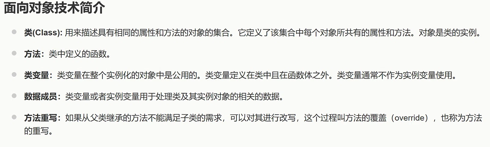

# AI 对话可续接记忆

- 后端：siliconflow
- 模型：Qwen/Qwen3-8B
- 来源：export.md
- 消息数：10
- 分块数：1
- 对话类型：编程学习、文档分析

## 总览

用户正在学习 Python 面向对象编程中的数据成员、类变量、实例变量和局部变量的区别，以及 Python 之禅的核心理念。AI 已对数据成员的定义、类变量与实例变量的区别、局部变量的作用范围进行了详细讲解，并介绍了 Python 之禅的全文内容和核心原则，包括优美胜于丑陋、明确胜于隐晦、简单胜于复杂、可读性重要、实用性胜过纯粹性、面对歧义时不要猜测等。AI 还通过示例和对比表格帮助用户理解这些概念。

## 当前对话断点与工作状态

- 当前活动：用户最近提出：介绍一下Python 之禅（import this） `[来源：用户明确提供｜状态：已确认｜消息：9]`
- 已到阶段：讲解Python之禅的后半部分 `[来源：上一 AI 陈述｜状态：上一 AI 已回答｜消息：10]`
- 下一步：总结Python之禅的关键原则 `[来源：上一 AI 陈述｜状态：上一 AI 已回答｜消息：10]`
- 最后一条用户消息：消息 9；介绍一下Python 之禅（import this）
- 最新消息：消息 10；角色 AI；最后用户轮已获回答：是
- 断点状态：complete

### 已完成/已执行

- 解释数据成员 `[来源：上一 AI 陈述｜状态：上一 AI 已回答｜消息：2, 4, 6, 8, 10]`
- 区分类变量、局部变量、实例变量 `[来源：上一 AI 陈述｜状态：上一 AI 已回答｜消息：8]`

## 分主题摘要

### Python面向对象技术与Python之禅讲解对话记忆整理

Python 中的数据成员是对象用来存储状态或属性的变量，分为类变量和实例变量。类变量属于整个类，所有对象共享；实例变量属于具体对象，每个对象拥有独立的一份。局部变量则限制在方法内部使用，仅在方法执行期间有效。类的实例就是对象，是根据类这个模板创建出的具体实体。Python 之禅是 Python 设计哲学的一组原则，一共 19 条，强调代码应优美、明确、简单且结构清晰。

- 来源消息：1~10

### 用户原始请求

用户提出： 解释一下数据成员；用户提出：区分一下类变量、局部变量、实例变量

- 来源消息：1, 2, 5~8

## 媒体与附件说明（开发检查）

### M001｜消息 1｜image

- 来源：用户消息
- 标签：已上传的图片
- 图片：
- 状态：described；本地可访问，可重新验证
- 内容说明：用户上传了一张图片“已上传的图片”；以下为模型视觉识别结果，其中 OCR 字符可能存在误差：图片标题为“面向对象技术简介”，内容为五个要点：1. 类(Class)：用于描述具有相同属性和方法的对象集合，定义了每个对象共有的属性和方法，对象是类的实例。2. 方法：类中定义的函数。3. 类变量：在整个实例化对象中公用，定义在类中且在函数体之外，通常不作为实例变量使用。4. 数据成员：类变量或实例变量用于处理类及其实例对象的相关数据。5. 方法重写：如果从父类继承的方法不能满足子类需求，可以对其进行改写，称为方法的覆盖（override）或方法的重写。
- 上一 AI 结论（消息 2）（uncertain）：数据成员 = 对象用来“存数据”的变量。
