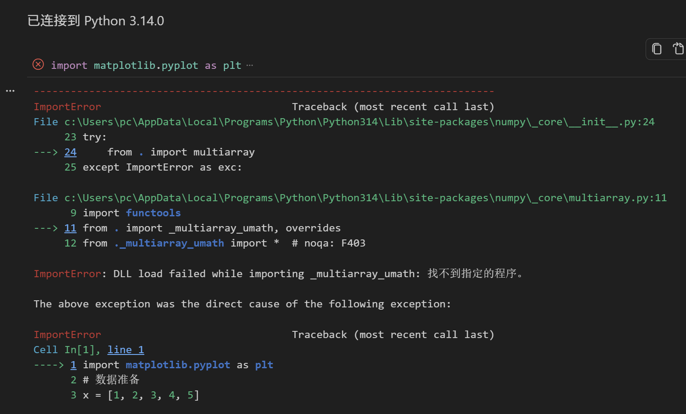
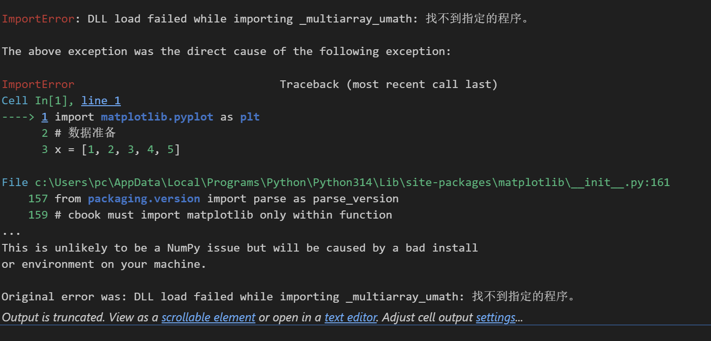

# AI 对话可续接记忆

- 后端：deepseek
- 模型：deepseek-v4-pro
- 来源：export.md
- 消息数：2
- 分块数：1
- 对话类型：编程任务、媒体分析

## 总览

用户上传两张截图，显示在 Python 3.14 环境中运行 import matplotlib.pyplot as plt 时出现 ImportError: DLL load failed while importing _multiarray_umath。AI 诊断认为不是绘图代码问题，而是 NumPy 二进制/DLL 安装损坏或版本不匹配，并给出卸载重装 NumPy 和 Matplotlib 的命令、验证方法以及备选的 Python 3.13 或虚拟环境方案。用户尚未确认执行任何修复操作。

## 当前对话断点与工作状态

- 当前活动：最近一轮用户问题已由上一 AI 回答 `[来源：总结器推断｜状态：不确定｜消息：1]`
- 已到阶段：AI 已给出诊断：问题出在 Python 3.14 环境中的 NumPy 二进制/DLL，并提供了重新安装 NumPy 和 Matplotlib 的具体命令、验证步骤以及备选的降级 Python 3.13 或创建虚拟环境方案。 `[来源：上一 AI 陈述｜状态：上一 AI 已提供｜消息：2]`
- 下一步：未明确 `[来源：总结器推断｜状态：不确定｜消息：无]`
- 最后一条用户消息：消息 1；查询： 
- 最新消息：消息 2；角色 AI；最后用户轮已获回答：是
- 断点状态：complete

### 已完成/已执行

- AI 识别错误链：matplotlib -> numpy -> numpy._core.multiarray -> _multiarray_umath.dll 加载失败。 `[来源：上一 AI 陈述｜状态：上一 AI 已提供｜消息：2]`
- AI 诊断为 NumPy 安装不完整、版本/架构不匹配或 DLL 依赖损坏，而非 Python 3.14 天生不能装 NumPy。 `[来源：上一 AI 陈述｜状态：建议/尚未确认采用｜消息：2]`
- AI 提供了重装 NumPy 和 Matplotlib 的命令及验证方法。 `[来源：上一 AI 陈述｜状态：建议/尚未确认采用｜消息：2]`

## 分主题摘要

（没有需要单独拆分的历史主题。）

## 媒体与附件说明（开发检查）

### M001｜消息 1｜image

- 来源：用户消息
- 标签：用户附件
- 图片：
- 状态：described；本地可访问，可重新验证
- 内容说明：用户上传了一张图片“用户附件”；以下为模型视觉识别结果，其中 OCR 字符可能存在误差：显示了在 Jupyter Notebook 中执行 import matplotlib.pyplot as plt 时发生的 ImportError。错误链显示 numpy 的 _multiarray_umath 模块因 DLL 加载失败而无法导入，最终导致 matplotlib 无法导入。错误信息为“找不到指定的程序”。
- 上一 AI 结论（消息 2）（suggested）：AI 识别到用户执行 import matplotlib.pyplot as plt 时出现 ImportError，错误链指向 numpy 的 _multiarray_umath DLL 加载失败，判断为 NumPy 安装问题而非 Matplotlib 代码问题。

### M002｜消息 1｜image

- 来源：用户消息
- 标签：用户附件
- 图片：
- 状态：described；本地可访问，可重新验证
- 内容说明：用户上传了一张图片“用户附件”；以下为模型视觉识别结果，其中 OCR 字符可能存在误差：显示了与 M001 相同的 ImportError 错误，但更详细地指出了错误发生在 Cell In[1] 的第 1 行，即 import matplotlib.pyplot as plt 语句。错误信息同样为“找不到指定的程序”，并提示“这不太可能是 NumPy 问题，而是由您机器上的不良安装或环境引起”。
- 上一 AI 结论（消息 2）（suggested）：AI 识别到错误发生在 import matplotlib.pyplot as plt 的 Cell In[1] 第 1 行，错误信息同样为“找不到指定的程序”，并判断不是 NumPy 本身问题而是本机安装或环境问题。

## 细节记忆（可选）

以下仅保留有助于继续任务的关键细节，已合并重复内容：

- **用户信息｜用户报告的环境与错误**：用户上传截图，显示在 Python 3.14.0 环境（路径 C:\Users\pc\AppData\Local\Programs\Python\Python314\）中执行 import matplotlib.pyplot as plt 时出现 ImportError。错误提示为 DLL load failed while importing _mult…
- **重要建议｜AI 对错误根因的诊断**：AI 诊断认为不是绘图代码有问题，而是 Python 3.14 环境里的 NumPy 安装/二进制 DLL 出了问题。具体可能是 NumPy 安装不完整、版本/架构不匹配或 DLL 依赖损坏。AI 指出 NumPy 2.4.x、2.5.x 已支持 Python 3.14，因此不是 Python 3.14 天生不能装 NumPy。
- **重要建议｜重新安装 NumPy 的建议**：AI 建议先确认 Python 环境，然后卸载并重装 NumPy：python -m pip uninstall numpy -y；python -m pip install --upgrade pip；python -m pip install --no-cache-dir numpy。
- **重要建议｜重新安装 Matplotlib 的建议**：AI 建议在 NumPy 修复后重新安装 Matplotlib：python -m pip uninstall matplotlib -y；python -m pip install --no-cache-dir matplotlib，并测试 python -c "import matplotlib; print(matplotlib.__version_…
- **重要建议｜验证 NumPy 是否正常的步骤**：AI 建议先运行 python --version 和 python -m pip --version 确认环境；然后运行 import sys; print(sys.version); import numpy; print(numpy.__version__); print(numpy.__file__)，如果这里就报同样的 _multiarray_u…
- **重要建议｜备选方案：降级 Python 3.13 或创建虚拟环境**：AI 提出如果重装后仍然报错，建议安装 Python 3.13 并为数据科学单独建立环境，或为当前 Python 3.14 创建 .venv 虚拟环境，避免全局环境污染。
- **重要事实｜错误调用链**：错误链为 matplotlib -> numpy -> numpy._core.multiarray -> _multiarray_umath.dll 加载失败，最终导致 import matplotlib.pyplot as plt 失败。
