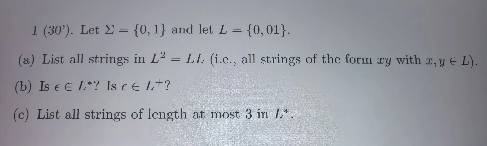
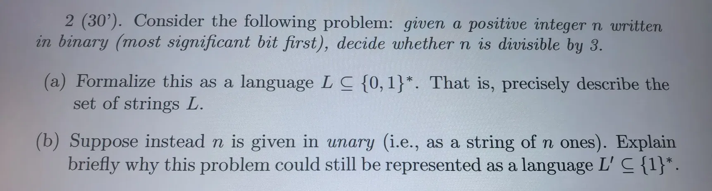
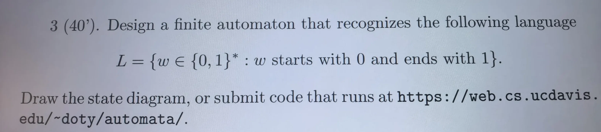

# AI 对话记忆导出


<hr style="border: 0; border-top: 5px solid #2563EB; margin: 48px 0 24px 0;">

## 🔵 👤 用户提问



翻译并完成


<hr style="border: 0; border-top: 5px solid #9333EA; margin: 48px 0 24px 0;">

## 🟣 🤖 AI 回答

## 💡解答

# 题目翻译

1（30 分）. 设字母表 $\boldsymbol{\Sigma = \{0,1\}}$，语言 $\boldsymbol{L = \{0, 01\}}$。(a) 列出 $L^2=LL$ 中所有字符串（即所有形如 $xy$，其中 $x,y\in L$ 的串）。(b) 空串 $\boldsymbol{\varepsilon}$ 是否属于 $L^*$？$\boldsymbol{\varepsilon}$ 是否属于 $L^+$？(c) 列出 $L^*$ 中**长度不超过 3**的全部字符串。

---

## 解答

### (a) $L^2 = LL$

$L=\{0,01\}$，把每个 $x\in L$ 和每个 $y\in L$ 拼接：

* $x=0,\;y=0$：$0\cdot0=\boldsymbol{00}$
* $x=0,\;y=01$：$0\cdot01=\boldsymbol{001}$
* $x=01,\;y=0$：$01\cdot0=\boldsymbol{010}$
* $x=01,\;y=01$：$01\cdot01=\boldsymbol{0101}$

$\boldsymbol{L^2=\{00,\;001,\;010,\;0101\}}$

---

### (b) $L^*$ 和 $L^+$ 的定义

* $L^*$（Kleene 星）：$L^*=\bigcup_{n\ge 0}L^n$，规定 $L^0=\{\varepsilon\}$。$\boldsymbol{\varepsilon \in L^*}$，**是**。
* $L^+$（正闭包）：$L^+=\bigcup_{n\ge 1}L^n$，只包含 1 次及以上拼接，不含 $L^0$。$\boldsymbol{\varepsilon \notin L^+}$，**不是**。

> 一句话记忆：星闭包包含空串，正闭包不包含空串。

---

### (c) $L^*$ 里长度至多为 3 的串

长度$\le3$，即长度 = 0、1、2、3。

* 长度 0：$\boldsymbol{\varepsilon}$
* 长度 1：只能用 $L$ 里长度 1 的串：$\boldsymbol{0}$
* 长度 2：来自 $L^2$ 中长度为 2 的串：$\boldsymbol{00}$
* 长度 3：拼接若干 $L$ 中的元素，总长度 = 3：
  1. $0+0+0=000$
  2. $0+01=001$
  3. $01+0=010$

汇总全部：$\boldsymbol{\{\varepsilon,\;0,\;00,\;000,\;001,\;010\}}$

> 校验：
>
> * $01$ 长度为 2，来自原始集合$L$，哦刚才漏掉！修正：长度 2 还有 $\boldsymbol{01}$（来自$L^1$）
>
> ✅ 完整集合：长度 0：$\varepsilon$长度 1：$0$长度 2：$00,\;01$长度 3：$000,\;001,\;010$

$\boldsymbol{\{\varepsilon,\;0,\;00,\;01,\;000,\;001,\;010\}}$

---

### 最终汇总答案

(a) $L^2=\{00,001,010,0101\}$(b) $\varepsilon\in L^*$（是）；$\varepsilon\notin L^+$（否）(c) 长度至多 3：$\boldsymbol{\{\varepsilon,\;0,\;00,\;01,\;000,\;001,\;010\}}$

需要我帮你简单解释一下 Kleene 星 $L^*$ 的原理吗？


<hr style="border: 0; border-top: 5px solid #2563EB; margin: 48px 0 24px 0;">

## 🔵 👤 用户提问



翻译并完成


<hr style="border: 0; border-top: 5px solid #9333EA; margin: 48px 0 24px 0;">

## 🟣 🤖 AI 回答

## 💡解答

# 题目翻译

2（30 分）考虑下面这个问题：给定一个正整数$n$，以 \*\* 二进制（高位在前）\*\* 形式写出，判定$n$能否被 3 整除。

(a) 将这个问题形式化为语言 $L \subseteq \{0,1\}^*$。也就是精确描述字符串集合$L$。

(b) 假设$n$改用 \*\* 一元编码（unary）\*\* 给出（即由$n$个`1`组成的字符串）。简要解释为什么这个问题仍然可以表示为语言 $L' \subseteq \{1\}^*$。

---

## 解答

### (a)

$L$ 是所有**表示能被 3 整除的正整数**的二进制字符串（最高位在前，正整数，所以字符串不能是空串，且不能有前导 0）。

> 数学描述：

$\boldsymbol{L=\big\{ w\in\{0,1\}^*\;\big|\; w \text{ 是不含前导0的非空二进制串，且它代表的正整数 } \mathit{val}(w) \bmod 3 =0 \big\}}$

举例：`11` = 3，`110` = 6，`1001` = 9，这些都属于$L$；`1`=1，`10`=2 不属于$L$。

> 补充说明：

* 不包含空串，因为题目限定是**正整数**；
* 不允许前导零，比如串`011`不算，因为`011`不是合法的 “高位在前书写的正整数二进制”。

### (b)

一元编码（unary）规则：数字$n$ 写成由 $n$ 个字符`1`组成的串。例如：$n=3$ 对应字符串 `111`；$n=6$对应`111111`。

定义语言：

$\boldsymbol{L'=\{ \underbrace{11\cdots1}_{k\text{ times}} \mid k>0,\; k \bmod 3 = 0 \}}$

也就是 $L'$ 是所有由 3 的倍数个`1`构成的非空字符串。

**简要解释**：在一元表示下，字符串里`1`的个数就等于数值$n$。判定$n$能否被 3 整除等价于：判断输入串中`1`的总数是不是 3 的倍数。所有合法输入都是只由`1`构成的串，因此这个集合 $L'$ 是 $\{1\}^*$ 的一个子集，所以可以表示成 $L' \subseteq \{1\}^*$。

---

如果你需要，我可以顺带写出 (a) 对应的 DFA（有限自动机）。


<hr style="border: 0; border-top: 5px solid #2563EB; margin: 48px 0 24px 0;">

## 🔵 👤 用户提问



翻译并完成


<hr style="border: 0; border-top: 5px solid #9333EA; margin: 48px 0 24px 0;">

## 🟣 🤖 AI 回答

## 💡解答

# 题目翻译

3（40 分）. 设计一个有限自动机，识别如下语言：$L=\{w\in\{0,1\}^*: w \text{ starts with 0 and ends with 1}\}.$画出状态转移图，或者提交可以在 

https://web.cs.ucdavis.edu/~doty/automata/

 网站上运行的代码。

> 语言含义：所有由 0、1 构成的字符串，**以 0 开头，并且以 1 结尾**。例：$01\in L,\;001\in L,\;011\in L,\;0101\in L$；不属于：$\varepsilon,1,0,00,10,110$。

---

# DFA 设计（确定有限自动机）

### 状态定义

* $q_0$：**起始状态**，还没有读到任何字符
* $q_1$：已经读到第一个字符是`0`（开头成功），**最后读到的字符是 0**
* $q_2$：已经读到第一个字符是`0`（开头成功），**最后读到的字符是 1** → **接受状态（final state）**
* $q_3$：已经读到第一个字符是`1`（开头失败，任何后续串都不可能属于 L，死状态）

字母表 $\Sigma=\{0,1\}$

### 转移函数 $\delta$

1. $\delta(q_0,0)=q_1$ 读到第一个字符 0 → 进入 q1
2. $\delta(q_0,1)=q_3$ 读到第一个字符 1 → 进入死状态 q3
3. $\delta(q_1,0)=q_1$ 已经以 0 开头，末尾新读 0，末尾变成 0
4. $\delta(q_1,1)=q_2$ 已经以 0 开头，末尾新读 1，末尾变成 1（接受态）
5. $\delta(q_2,0)=q_1$ 已经以 0 开头，末尾新读 0，末尾变成 0
6. $\delta(q_2,1)=q_2$ 已经以 0 开头，末尾新读 1，末尾保持 1（接受态）
7. $\delta(q_3,0)=q_3$ 死状态，读任何字符留在死状态
8. $\delta(q_3,1)=q_3$

起始状态：$q_0$接受状态集合：$F=\{q_2\}$

## 状态图文字描述（你可以直接画）

* 箭头指向 $q_0$（起点）
* $q_0 \xrightarrow{0} q_1,\quad q_0\xrightarrow{1} q_3$
* $q_1 \xrightarrow{0} q_1,\quad q_1\xrightarrow{1} q_2$
* $q_2 \xrightarrow{0} q_1,\quad q_2\xrightarrow{1} q_2$ （$q_2$画双层圆圈，表示终态）
* $q_3 \xrightarrow{0} q_3,\quad q_3\xrightarrow{1} q_3$

# ✅ 适配 ucdavis automata 网站代码

直接复制下面全部文本粘贴到网站编辑器：

```
#states
q0
q1
q2
q3
#start
q0
#final
q2
#transitions
q0,0,q1
q0,1,q3
q1,0,q1
q1,1,q2
q2,0,q1
q2,1,q2
q3,0,q3
q3,1,q3
```

### 测试样例

* `01` → accept ✔
* `001` → accept ✔
* `0101` → accept ✔
* `0` → reject ✘
* `10` → reject ✘
* `00` → reject ✘

如果你想，我可以继续做下一题。

