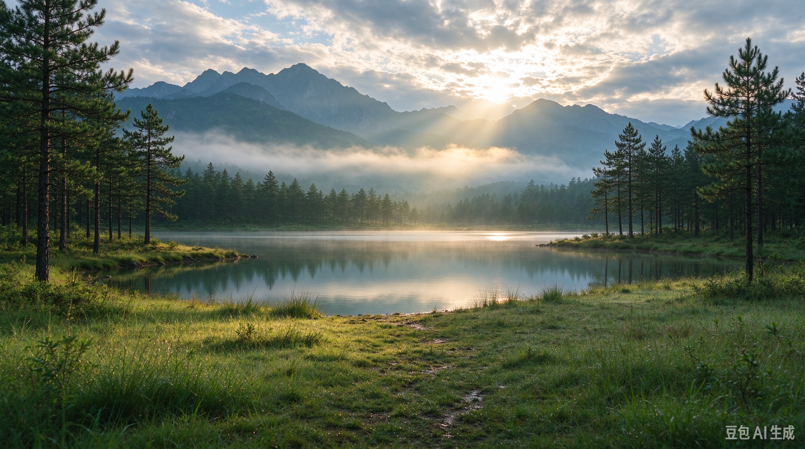

# AI 对话记忆导出

## 🔵 👤 用户提问

生成一张图片给我

## 🟣 🤖 AI 回答

当然可以。你想要什么类型的图片？比如：

1. 风景 / 城市 / 自然
2. 动漫人物 / 插画角色
3. 写实美女 / 帅哥肖像
4. 产品海报 / 封面图
5. 可爱萌宠 / 动物
6. 赛博朋克 / 科幻 / 国风等特定风格

你直接回一个方向，我就为你生成一张。

## 🔵 👤 用户提问

1

## 🟣 🤖 AI 回答

我将为你生成一张自然风景图，采用写实摄影质感，突出山川、湖泊与清晨雾气的宁静氛围。

已为你生成一张写实自然风景图，画面包含山脉、湖泊、晨雾和清晨阳光，适合作为横版壁纸或背景图使用。

