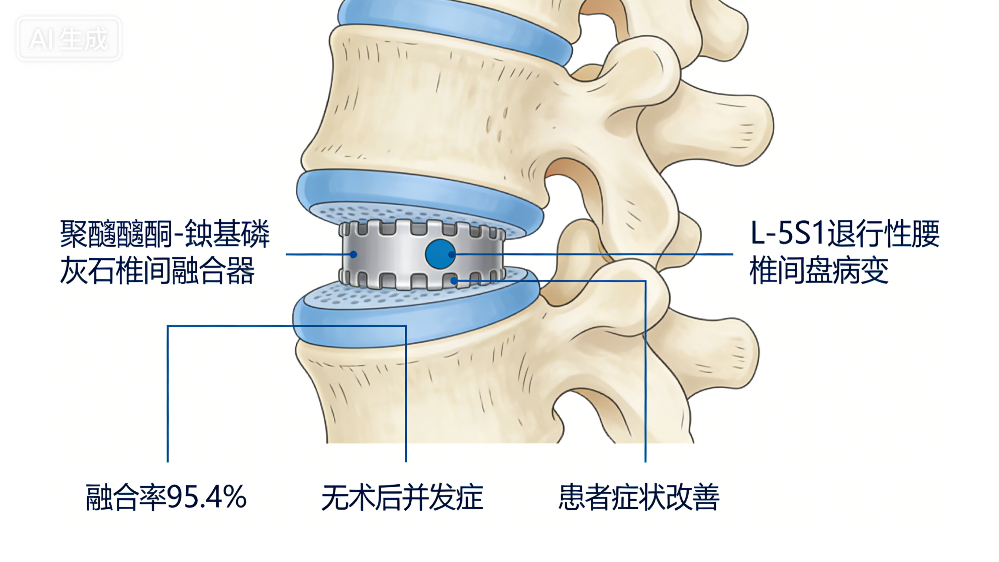
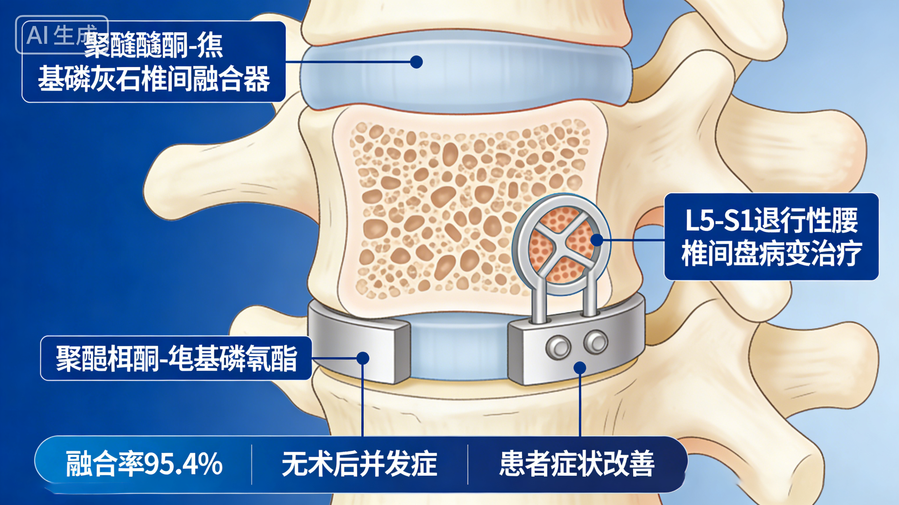
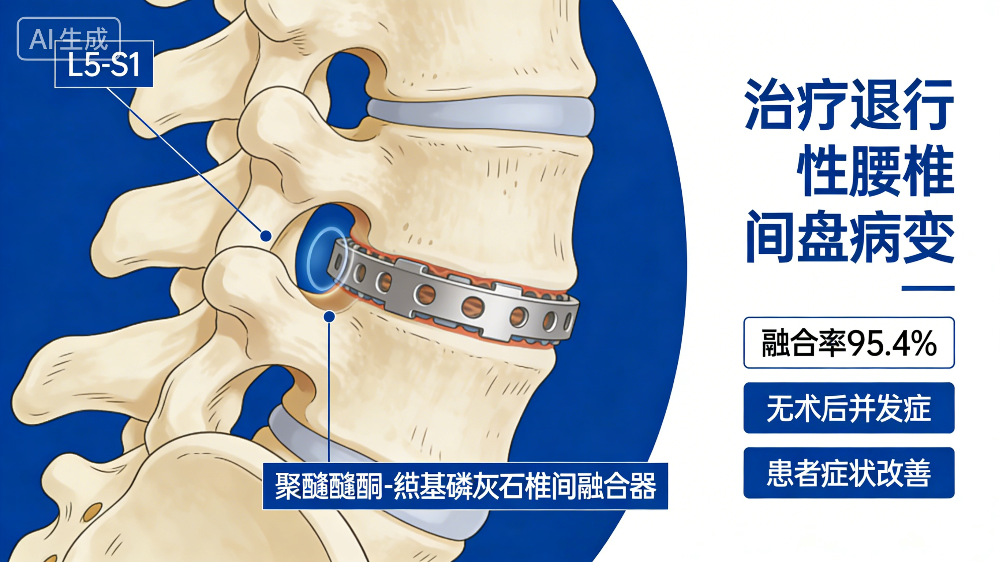
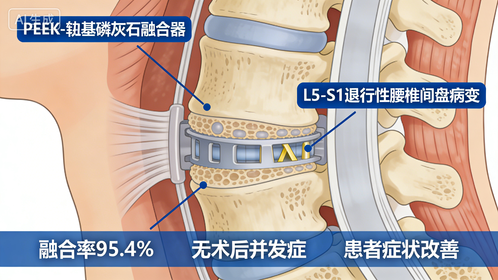
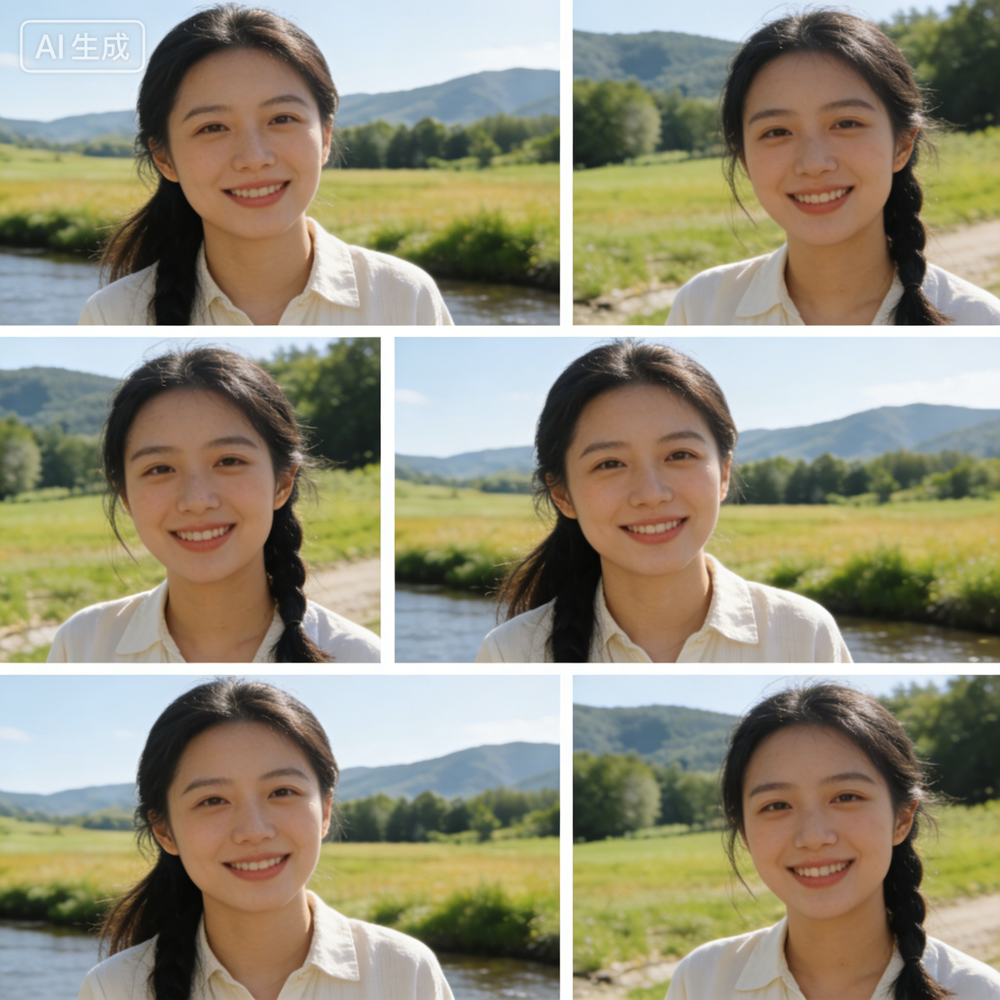
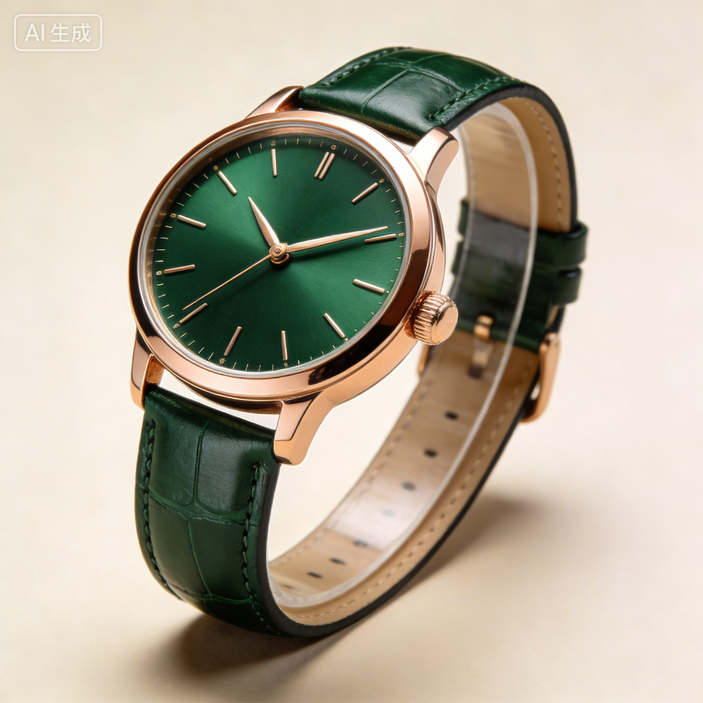

# AI 对话记忆导出

## 🔵 👤 用户提问

帮我生成图片：帮我生成 peek 材料一下内容的配图，去掉水印：应用案例二：腰椎椎间融合术
NOROTTE 等研究者开展了一项关于聚醚醚酮 - 羟基磷灰石椎间融合器治疗 L5-S1 退行性腰椎间盘病变的临床研究。研究结果如下：
融合率：术后 12-24 个月随访显示，椎间融合率高达 95.4%[19]。
安全性：所有患者术后均无明显并发症，未见植入物移位或断裂。
临床疗效：患者腰痛和下肢放射痛症状显著改善，满意度高。
该研究表明，PEEK - 羟基磷灰石复合材料融合器在腰椎退行性疾病治疗中具有良好的安全性和有效性。

## 🟣 🤖 AI 回答

我会为你生成这篇腰椎椎间融合术相关内容的配图。

## 🔵 👤 用户提问

帮我生成图片：去掉 ai 生成的水印

## 🟣 🤖 AI 回答

我会为你去掉图片上的 AI 生成水印。

以下是为你生成的图片：

