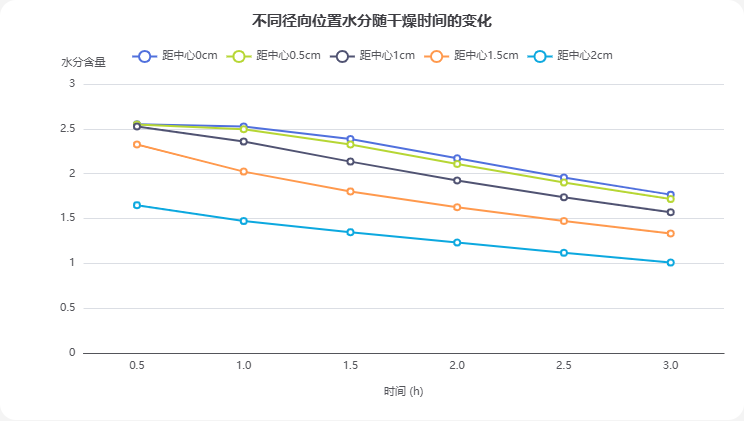
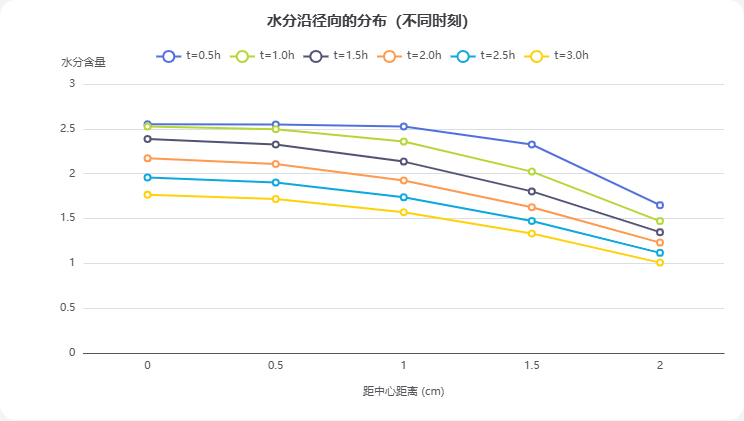

# AI 对话记忆导出

## 🔵 👤 用户提问

## 🟣 🤖 AI 回答

# 论文里的综述（文献综述）是什么

综述全称**文献综述（Literature Review）**，简单讲：**对某一个研究主题，把前人已经发表的相关研究收集、梳理、归纳，并且做出评述**。

## “综” 和 “述” 两层含义

1. **综**：综合整理。广泛阅读相关文献，把不同学者的研究成果、观点、实验结论分类汇总，理清领域发展脉络。不是简单摘抄一堆论文摘要。
2. **述**：评述分析。评价前人研究：哪些结论已经达成共识、存在哪些矛盾、还有哪些空白和不足。

## 两种常见场景

1. **学位论文 / 研究论文里的综述章节（绪论 / 文献综述部分）**放在论文开头，用来交代研究背景：这个课题前人做到哪一步？还有什么问题没解决？**用来引出你自己论文的研究意义**。
2. **综述型论文（Review Article）**整篇文章就是综述，不做原创实验，专门系统性总结一个领域的进展，方便同行快速了解整个方向全貌。

## ✅ 综述的核心目的

* 梳理该领域的研究历史与现状
* 总结已有成果，对比不同学派观点
* 指出当前研究存在的缺陷、空白点
* 说明你的研究为什么值得做（你的研究立足点）

## ❌ 常见误区

综述≠文献清单，不能只是 “A 做了 XX，B 做了 XX” 单纯罗列文献，**必须带有自己的归纳、对比与批判性评价**。

如果你需要，我可以再给你一段简短的综述写作模板。

## 🔵 👤 用户提问

[📄 problem2_moisture.csv](./documents/problem2_moisture.csv)

## 🟣 🤖 AI 回答

收到数据文件了。先看一下可视化规范，然后帮你分析这份水分随时间、随距中心距离变化的数据。

这是烘干 / 干燥过程的数据（水分随时间和距中心距离的变化）。核心是数值趋势对比，我用 ECharts 来做可视化。先读一下图表规范。

文件已读取，这是一组**干燥过程的水分数据**：记录了 0.5–3.0 h 内，距中心 0–2 cm 五个径向位置的水分含量随时间的变化（数值单位文件未注明）。

**核心规律**

* **所有位置水分随时间持续下降**：3 小时内中心从 2.550 降到 1.766，边缘从 1.649 降到 1.008。
* **存在明显的 "中心 — 边缘" 水分梯度**：同一时刻越靠近中心水分越高、越靠边缘越低，且这个梯度全程保持 —— 符合干燥时内部水分向表面迁移、表面先脱水的物理过程。
* **降幅由外向内逐渐加大**：3 h 内距中心 1.5 cm 处水分下降约 42.7%、1 cm 处约 37.8%，而中心仅下降约 30.7%，说明干燥初期边缘脱湿更快。

先看不同径向位置的水分随时间变化曲线：

数据来自用户上传的 problem2\_moisture.csv（干燥过程水分数据，单位未注明）。

再看同一时刻水分沿径向的分布（直观展示 "中心 — 边缘" 梯度）：

**一句话结论**：这是一组典型的非均匀干燥曲线 —— 水分从中心到边缘始终存在递减梯度，越靠外脱湿越快，3 h 后边缘水分（1.008）已接近中心（1.766）的一半，说明干燥主要受内部水分向表面扩散控制。

需要的话，我可以进一步：拟合干燥速率、换算成水分比 / 干基含水率曲线，或把这张图整理成可直接放进论文 / 报告的形式。你这份数据是想做哪方面的分析？

## 🔵 👤 用户提问

[📄 复旦大学计算与智能创新学院2025级人工智能领军人才班2025-2026学年本科优秀学生奖学金评定细则-公示版.pdf](./documents/%E5%A4%8D%E6%97%A6%E5%A4%A7%E5%AD%A6%E8%AE%A1%E7%AE%97%E4%B8%8E%E6%99%BA%E8%83%BD%E5%88%9B%E6%96%B0%E5%AD%A6%E9%99%A22025%E7%BA%A7%E4%BA%BA%E5%B7%A5%E6%99%BA%E8%83%BD%E9%A2%86%E5%86%9B%E4%BA%BA%E6%89%8D%E7%8F%AD2025-2026%E5%AD%A6%E5%B9%B4%E6%9C%AC%E7%A7%91%E4%BC%98%E7%A7%80%E5%AD%A6%E7%94%9F%E5%A5%96%E5%AD%A6%E9%87%91%E8%AF%84%E5%AE%9A%E7%BB%86%E5%88%99-%E5%85%AC%E7%A4%BA%E7%89%88.pdf)

## 🟣 🤖 AI 回答

# 复旦大学计算与智能创新学院 2025 级人工智能领军人才班 2025‑2026 学年本科优秀学生奖学金评定细则总结

该细则依据学校、学院两级评审办法制定，面向本班在籍本科生开展奖学金评审。

## 一、不予参评情形

满足任意一条即失去参评资格：

1. 休学无对应学年两学期课程成绩（特定交流休学经教务、评审小组审核除外）；
2. 评奖学年修读课程少于 4 门或不足 10 学分（含暑期学期）；
3. 综合素质考核不合格；
4. 课程不及格且补考未通过；
5. 受校纪校规处分；
6. 未通过国家学生体质健康标准测试（因病残等经体育部认可除外）；
7. 参加非法组织活动、存在政治错误。

## 二、评审打分规则（总分由**业务学习 80%+ 综合素质 20%**构成）

### 1. 业务学习（80%）

1. **课程学习成绩（70%）**：学年总绩点（满 4.0）按正态分布折算为 70 分制，区间 35‑70 分。
2. **学术和创新能力（10%）**：针对科研、学科竞赛、科创活动，学院评审小组满分 100 分打分后乘以 10% 计入总分，依据学院配套赋分标准执行。

### 2. 综合素质（20%）

原始满分 100 分，**普通学生折算公式：$Y=10+0.1×原始分$**；寒假转入本班的相辉学堂学生，综合分为原班级 10 分 + 本班按$Y=5+0.05×原始分$算出的 10 分；暑假转入相辉学堂学生在原班级评奖。

综合素质原始分由 4 板块构成：

1. **思想道德 25 分**：团支部活动、团内评优、党章学习小组（15 分）+ 辅导员审核打分（10 分，含政治素质、集体观念、生活作风、道德修养）；
2. **班级生活 15 分**：班会出勤、班级活动参与、思政大课出勤，缺席会扣分；
3. **社会工作 40 分**：分班级职务、其他学生组织职务、社会实践与志愿活动三部分；职务需任职至少一学期且满足活动时长，志愿实践需要佐证材料，同类职务分数互斥，避免重复计分；
4. **体育文艺 20 分**：各占 10 分，按院系 / 校级 / 市级以上，区分参赛、复赛、获奖 / 核心组织者三档赋分，需提交证明材料。

## 三、评定原则

公开公平公正择优；学生自主申请；德智体美劳全面考核。

## 四、关键时间与流程

1. **9 月 20 日（周日）12:00 前**：

   * 参评：提交综合素质评定申请表至指定邮箱；学术创新分由学院统一处理。
   * 放弃参评：提交纸质放弃声明到辅导员信箱。
2. 逾期未提交任一材料，视为自动放弃，不参与排名。
3. 评定小组完成资格审核、分项打分与总分核算；奖学金等级、比例后续另行公示。

## 五、评定小组

组长虞舒甜，组员共 8 人；文件落款时间 2026‑09‑07。

需要我用 **工作任务模式** 帮你提炼一份个人申报自查清单，方便对照填表吗？

## 🔵 👤 用户提问

[📄 工作交接极简版.md](./documents/%E5%B7%A5%E4%BD%9C%E4%BA%A4%E6%8E%A5%E6%9E%81%E7%AE%80%E7%89%88.md)

## 🟣 🤖 AI 回答

已读完这份《工作交接极简版.md》。这是一份面向团队成员的软件开发项目交接说明，我帮你按类别整理成要点，方便快速上手。

## 一、给你的权限边界（对 agent 的三条铁律）

1. **不许 agent 未经允许执行 commit**
2. **不许 agent 自己创建新分支**—— 要开分支需你明确指示
3. 建议**允许 agent 阅读 GitHub 上所有有用公开内容**

## 二、环境与工具

* 项目基于 **uv 环境**，轻量好用，需先下载安装
* 开工前先让 agent 阅读并牢记 `agents.md`（作者后续会发他的版本）
* 建议安装 Codex 插件 **ponytail**，做定点修改时好用
* 每人改自己负责部分时**尽量新开分支改**，避免互相破坏

## 三、功能现状

* 已可总结的 AI：ChatGPT、豆包、DeepSeek
* 可用 API 提供商：Google AI studio、Silicon Flow、DeepSeek
* 支持两种总结方式：**分享链接抓取总结** 与 **选取文件直接总结**（后者支持拖拽）
* 已支持用户自定义 API 调用顺序（如 Silicon→Gemini→DeepSeek）
* 直接总结仅接受 UTF-8 的 `.md`/`.txt`，非空且 ≤10 MB

## 四、⚠️ 已知 bug / 待修正项（交接时特别提醒）

表格

| 位置 | 问题 |
| --- | --- |
| 根目录 `README.md`、`packaging/使用说明.txt` | API 调用顺序仍写成固定 Gemini→SiliconFlow→DeepSeek（**作者忘改了，是错的**） |
| `packaging/版本信息.txt` | 仍是 0.6.5（轻量版源说明是 0.6.0）；**v1.0.0 ZIP 内版本信息和使用说明才是正确的** |

## 五、日常使用与测试

* 日常测试（会弹 GUI）：项目根目录 PowerShell 运行 `uv run python -m gui.app`
* 建议开工前先**玩一玩 v1.0.0 版本**，熟悉各按钮功能

## 六、反复易犯的问题（跑测试务必自查）

1. 写了图片但不下载 / 下载后图片放反 / 假装抓取了文档其实只有一行字 / 这次能抓到下次抓不到 ——**即使让 AI 检查，也建议自己溜一遍**
2. 抓取对话不全可能是浏览器**懒加载**（已修复但可能复发）
3. 总结时**把对话中某个文档拆成多个主题**—— 尤其注意，容易复发
4. 完整版交接文档可直接喂给 AI

需要我把这份交接文档整理成一份**发给队友的正式版 / 待办清单**，或针对某个具体模块深入帮你处理吗？

## 🔵 👤 用户提问

[📄 奖学金综合素质申请表.docx](./documents/%E5%A5%96%E5%AD%A6%E9%87%91%E7%BB%BC%E5%90%88%E7%B4%A0%E8%B4%A8%E7%94%B3%E8%AF%B7%E8%A1%A8.docx)

## 🟣 🤖 AI 回答

# 奖学金综合素质评定申请表总结

这份是**李思恒（学号 25803050354）**的复旦大学 2025 级人工智能领军人才班 2025‑2026 学年奖学金综合素质申报表，综合素质原始满分 100 分，本人申报合计**54 分**。

## 各板块申报情况

1. **思想道德（满分 25 分）**全部项目为无需本人填写，由评审小组、辅导员核查记录打分，申报预填 25 分。包含团支部活动参与、团评优、党章学习小组、辅导员思想道德审核四项。
2. **班级生活（满分 15 分，申请 14 分）**

* 班会、思政大课出勤由评审小组核查；
* 班级活动申报：参与每日幸福小事打卡、春游，申请 2 分。

3. **社会工作（满分 40 分，申请 17 分）**

* 班级工作 C1：无班委任职，得 0 分；
* 其他工作 C2：青苗社社员，申请 3 分；
* 社会实践与志愿活动 C3：①2026 寒假返校宣讲社会实践（其他大型社会实践），申请 4 分；②两项常规志愿：数星阁困境儿童助学 38 小时、青苗社学前科学科普志愿 33 小时，申请 10 分。

4. **体育文艺（满分 20 分，申请 0 分）**体育、文艺赛事均无申报加分，全部填 0。

## 填表要点

1. 本表只申报综合素质原始分；部分项目无需学生填写，由评审方后台核验。
2. 所有申请分值不能为空，无申报填 0；申报项目需要配套证明材料，无材料可填写负责人及联系方式。
3. 评审小组会对填报信息开展严格审核。

## 折算提示（结合之前的评奖细则）

该生普通学生，综合素质最终计入奖学金总分：$Y=10+0.1\times54=\boldsymbol{15.4}$分（占奖学金总分权重 20% 部分）。

如果你需要，我可以帮你检查这份申报单有没有填错、志愿部分分数是否算得合规。

## 🔵 👤 用户提问

[📄 result1.xlsx](./documents/result1.xlsx)

## 🟣 🤖 AI 回答

收到一个 Excel 文件，我先读取内容看看。

这份 `result1.xlsx` 我打开看了，它是一个**空的结果模板**（示意图式），不是已有数据：

* 包含两个工作表：**「温度」** 和 **「水分浓度」**
* 结构一致：行首列是 "时间"，表头是 "到药材中心的距离"，设计为 0 → 0.1 → … → 2（cm，步长 0.1）的距离网格，行是时间 1、2、3…（h）
* 实际只有表头和占位符 `…`，**没有任何填好的数值**，也没有表头说明单位

所以这个模板目前是空白的，我还不知道你想让我往里面填什么。结合你之前上传的 `problem2_moisture.csv`（时间是 0.5–3.0 h、距离只有 0/0.5/1/1.5/2 cm 五档），两者对不上模板里 0.1 步长的精细网格，而且**温度那一页我没有任何数据来源**。

想确认一下你的意图，方便我准确处理：

1. 你是想让我**按这个模板建一张飞书在线表格**，留空待你填写？
2. 还是想让我把 `problem2_moisture.csv` 的水分数据填进「水分浓度」表（需要我把 0/0.5/1/1.5/2 这五档插值到 0.1 步长，或只填已有的 5 列）？
3. 「温度」页的温度数据你这里有吗？需要我预留填表还是怎么处理？

你告诉我具体想做成什么样，我就照做。

