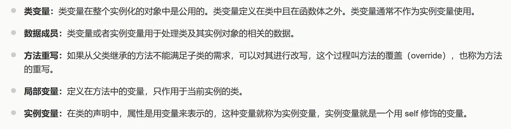
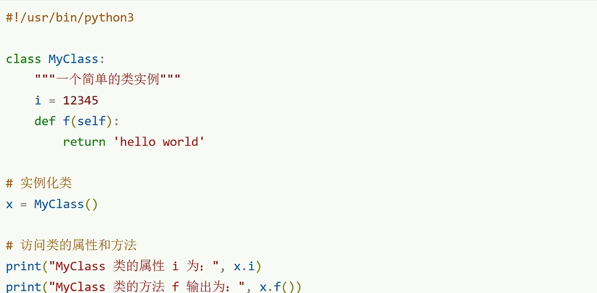

# AI 对话记忆导出


<hr style="border: 0; border-top: 5px solid #2563EB; margin: 48px 0 24px 0;">

## 🔵 👤 用户提问


解释一下数据成员


<hr style="border: 0; border-top: 5px solid #9333EA; margin: 48px 0 24px 0;">

## 🟣 🤖 AI 回答

# 数据成员

**数据成员**就是类里面用来保存数据的变量，分为两种：**类变量** 和 **实例变量**，用来存储类、或者类创建出来的对象的数据。

1. **类变量**定义在类内部、方法（函数）外面，属于类本身，**所有实例对象共用同一份**。修改类变量，所有对象读取到的值都会受影响。
2. **实例变量**定义在类的方法里面（一般写在构造方法中，用`self.变量名`），**只属于单个对象**，每个实例都有自己独立的实例变量，互不干扰。

### 简单例子（Python）

```python
class Person:
    species = "人类"   # 类变量（属于Person类，所有对象共用）
    def __init__(self,name):
        self.name = name # 实例变量（每个对象自己的name）

p1 = Person("小明")
p2 = Person("小红")
```

这里`species`、`name`都属于这个类的**数据成员**。

> 一句话总结：数据成员 = 类中承载数据的变量，包含类变量和实例变量，用来记录对象 / 类的属性信息。

要不要我顺带把图里剩下的：类、方法、类变量、方法重写，也各给一句简短解释？


<hr style="border: 0; border-top: 5px solid #2563EB; margin: 48px 0 24px 0;">

## 🔵 👤 用户提问

类的实例是对象吗


<hr style="border: 0; border-top: 5px solid #9333EA; margin: 48px 0 24px 0;">

## 🟣 🤖 AI 回答

✅ **是的，对象就是类的实例。**

简单理解：

* **类（Class）**：是模板、图纸。比如「汽车」这个类，规定了汽车都有颜色、轮子、能跑。
* **实例（对象）**：按照这个模板造出来的**具体实体**，就是对象。比如一辆红色宝马车，就是「汽车」类的实例。

一句话：**实例 = 对象**，两个词描述同一个东西，只是视角不同：

* 从类创建出来这个动作叫**实例化**，得到的结果叫**实例**；
* 面向对象里，这个实体又叫**对象**。

Python 示例：

```python
class Car:  # 类：图纸
    pass

my_car = Car() # 实例化，my_car 就是Car类的实例，也就是对象
```

> 对应你 PPT 原文：**对象是类的实例**。

要不要我顺便区分一下「实例化、实例、对象」这几个容易混淆的词？


<hr style="border: 0; border-top: 5px solid #2563EB; margin: 48px 0 24px 0;">

## 🔵 👤 用户提问



区分一下类变量、局部变量、实例变量


<hr style="border: 0; border-top: 5px solid #9333EA; margin: 48px 0 24px 0;">

## 🟣 🤖 AI 回答

# 类变量、实例变量、局部变量对比（Python，配合你 PPT）

## 1. 类变量

> PPT 原文：类变量定义在类中且在函数体之外，整个实例化对象公用。

* 位置：**类内部，所有方法外面**
* 归属：属于**类本身**，所有对象共享同一份
* 生命周期：类加载后就存在

```python
class Person:
    species = "人类"  # 类变量
```

* 特点：所有 Person 实例都能读到`species`；修改类变量，所有对象都会受影响。

## 2. 实例变量

> PPT 原文：实例变量就是用 self 修饰的变量

* 位置：**类的方法内部（一般在\_\_init\_\_构造函数）**，`self.xxx`
* 归属：属于**单个对象（实例）**，每个对象独立一份，互不干扰

```python
class Person:
    def __init__(self,name):
        self.name = name  # 实例变量
```

* 特点：p1 的 name 和 p2 的 name 相互独立，修改一个不会影响另一个。

## 3. 局部变量

> PPT 原文：定义在方法中的变量

* 位置：**方法内部，不带 self**，只写变量名
* 归属：不属于类，也不属于对象，**只在当前这个方法执行期间有效**，方法执行完就销毁

```python
class Person:
    def say_hello(self):
        msg = "Hello"  # 局部变量，只有这个方法里面能访问
        print(msg)
```

* 特点：出了这个方法就不能用，对象和类都无法访问这个变量。

# 一句话总结区分

1. **类变量**：类里、方法外 → 属于类，所有对象共用
2. **实例变量**：方法里、带`self.` → 属于单个对象，每个对象独有
3. **局部变量**：方法里、不带`self` → 只在当前方法内临时使用，方法结束消失

# 完整示例一次性看全

```python
class Person:
    species = "人类"  # 类变量

    def __init__(self,name):
        self.name = name  # 实例变量

    def print_info(self):
        age = 18 # 局部变量
        print(age)
        print(self.name)
        print(Person.species)
```

要不要我给你整理一个考试用简短对比表格？


<hr style="border: 0; border-top: 5px solid #2563EB; margin: 48px 0 24px 0;">

## 🔵 👤 用户提问



i 是类变量，对吗？


<hr style="border: 0; border-top: 5px solid #9333EA; margin: 48px 0 24px 0;">

## 🟣 🤖 AI 回答

✅ **对，`i = 12345` 就是类变量**

### 对照定义

* 位置：写在`class MyClass:`里面、**方法`def f(self)`外面**，完全符合类变量定义。
* 归属：属于`MyClass`这个类，所有实例对象共享这个`i`。

### 代码拆解

```python
class MyClass:
    """一个简单的类实例"""
    i = 12345    # ✅ 类变量（类内，方法外）
    def f(self): # 方法
        return 'hello world'
```

```python
x = MyClass() # 实例化，x是MyClass的对象
print(x.i)    # 对象可以访问类变量i，得到12345
print(x.f())  # 调用方法f()
```

> 运行输出：

```plaintext
MyClass 类的属性 i 为： 12345
MyClass 类的方法 f 输出为： hello world
```

💡补充：你既可以用实例`x.i`访问，也可以直接用类名`MyClass.i`访问这个类变量。

要不要我加几行代码演示：修改类变量，看看所有实例都会跟着变？


<hr style="border: 0; border-top: 5px solid #2563EB; margin: 48px 0 24px 0;">

## 🔵 👤 用户提问

介绍一下 Python 之禅（import this）


<hr style="border: 0; border-top: 5px solid #9333EA; margin: 48px 0 24px 0;">

## 🟣 🤖 AI 回答

# Python 之禅（`import this`）

在 Python 交互环境里，输入 `import this`，就会打印出**Python 之禅（The Zen of Python）**，是 Python 的设计哲学，由 Tim Peters 撰写。

## 原文 + 中文翻译

```python
>>> import this
```

```plaintext
Beautiful is better than ugly.
优美胜于丑陋。

Explicit is better than implicit.
明了胜于晦涩。

Simple is better than complex.
简洁胜于复杂。

Complex is better than complicated.
复杂胜于凌乱。

Flat is better than nested.
扁平胜于嵌套。

Sparse is better than dense.
稀疏胜于稠密。

Readability counts.
可读性很重要。

Special cases aren't special enough to break the rules.
即便特殊情况，也不足以打破规则。

Although practicality beats purity.
尽管实用优先于纯粹。

Errors should never pass silently.
错误不应悄无声息地被忽略。

Unless explicitly silenced.
除非明确需要静默。

In the face of ambiguity, refuse the temptation to guess.
遇到歧义，拒绝猜测的诱惑。

There should be one-- and preferably only one --obvious way to do it.
应该有一种——最好只有一种——明显的方式来完成任务。

Although that way may not be obvious at first unless you're Dutch.
尽管这种方式一开始并不直观，除非你是荷兰人。（彩蛋：指Python创始人吉多·范罗苏姆）

Now is better than never.
当下动手胜过永远不做。

Although never is often better than *right* now.
不过，永远不做也好过仓促动手。

If the implementation is hard to explain, it's a bad idea.
如果实现很难解释，那就是坏方案。

If the implementation is easy to explain, it may be a good idea.
如果实现很容易解释，大概率是好方案。

Namespaces are one honking great idea -- let's do more of those!
命名空间是个绝妙的主意，我们应当多多使用！
```

## 核心思想（精简记忆版，适合考试）

1. **重视可读性**：代码是写给人看的，兼顾机器运行。
2. **追求简洁清晰**：尽量用简单直观的写法，不要写晦涩、多层嵌套的代码。
3. **唯一最优解**：一件事尽量只有一种清晰的做法（Python 的设计理念，和 C/JS 等语言不一样）。
4. **实用大于完美**：优先保证实用，不必一味追求理论上的纯粹。
5. **不要猜测**：遇到模糊不清的地方，不要靠猜，要明确处理。

## 小冷知识

`this` 是一个彩蛋模块，它的文本是**藏在模块源码里的加密文本**，当你`import this`时，代码会自动解密并打印这段哲学格言。

要不要我挑几条最常考的句子，给你举简单 Python 代码例子对比理解？

