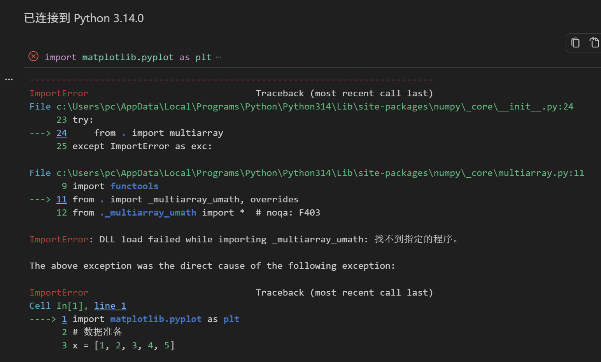
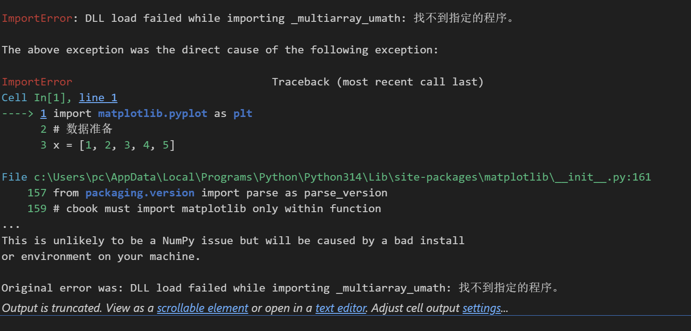

# AI 对话记忆导出


<hr style="border: 0; border-top: 5px solid #2563EB; margin: 48px 0 24px 0;">

## 🔵 👤 用户提问






<hr style="border: 0; border-top: 5px solid #9333EA; margin: 48px 0 24px 0;">

## 🟣 🤖 AI 回答

### 🔍 问题分析

你遇到的是 **NumPy 的 DLL 加载失败** 错误，根源是 `_multiarray_umath` 模块无法加载，这会导致 `matplotlib`（依赖 NumPy）也无法正常导入。错误信息：

```plaintext
ImportError: DLL load failed while importing _multiarray_umath: 找不到指定的程序。
```

这通常是以下原因导致：

* 缺少 **Visual C++ 运行库**（Windows 系统常见）
* NumPy 安装不完整 / 版本与 Python 不兼容
* 环境变量或依赖文件损坏

---

### 🛠️ 解决方案（按推荐顺序尝试）

#### 1. 安装 / 修复 Visual C++ 运行库

这是 Windows 下最常见的原因，NumPy 需要依赖微软的 VC++ 运行库。

* 下载并安装 **Microsoft Visual C++ Redistributable**：

  + 访问 [微软官网下载页](https://link.wtturl.cn/?target=https%3A%2F%2Flearn.microsoft.com%2Fzh-CN%2Fcpp%2Fwindows%2Flatest-supported-vc-redist%3Fview%3Dmsvc-170&scene=im&aid=497858&lang=zh)
  + 选择与你的 Python 版本匹配的架构（x86/x64），Python 3.14 一般用 **x64**
  + 安装后重启电脑，再尝试导入

#### 2. 重新安装 NumPy

如果运行库没问题，尝试干净重装 NumPy：

```bash
pip uninstall numpy -y
pip install numpy --force-reinstall
```

如果使用 `conda` 环境：

```bash
conda remove numpy
conda install numpy
```

#### 3. 检查 Python 与 NumPy 版本兼容性

Python 3.14 是较新版本，部分旧版 NumPy 可能不兼容：

* 尝试安装指定版本：`pip install numpy==2.0.0`（或更新的稳定版）
* 或降级 Python 到 3.12/3.13 等更成熟的版本

#### 4. 检查环境变量与文件完整性

* 确认 Python 安装路径、`site-packages` 路径未被篡改
* 检查 `numpy\_core\_multiarray_umath.cp314-win_amd64.pyd` 文件是否存在
* 若文件缺失，回到步骤 2 重新安装

---

### ✅ 验证方法

修复后在 Python 中执行：

```python
import numpy
print(numpy.__version__)
import matplotlib.pyplot as plt
print("导入成功")
```

如果能正常打印版本和 “导入成功”，说明问题已解决。

---

### 💡 额外建议

* 尽量使用 **虚拟环境**（venv/conda）来隔离项目依赖，避免全局环境混乱
* 不要手动修改 `site-packages` 下的文件，避免破坏依赖结构
* 如果是首次使用 Python 数据科学栈，推荐安装 [Anaconda](https://link.wtturl.cn/?target=https%3A%2F%2Fwww.anaconda.com%2F&scene=im&aid=497858&lang=zh)，它会自动处理大部分依赖问题

---

你要我帮你整理一份**一键修复脚本**（包含检查运行库、重装 NumPy 的命令）吗？直接复制到终端运行就能自动处理大部分情况。

