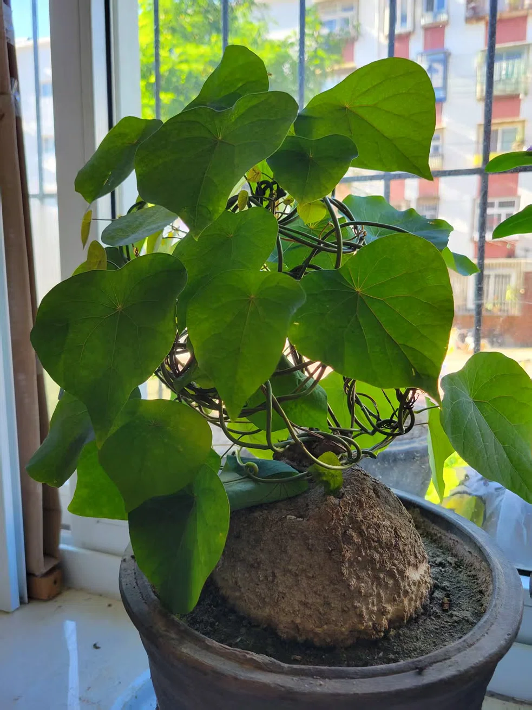

# AI 对话记忆导出

## 🔵 👤 用户提问

这是什么花

## 🟣 🤖 AI 回答

## 🔵 👤 用户提问

这是什么花

## 🟣 🤖 AI 回答

这是<strong>龟甲龙</strong>（学名 <em>Dioscorea elephantipes</em>），是一种非常经典的块根类多肉植物。

<strong>辨识特征：</strong>

* <strong>膨大的块根：</strong> 最明显的就是底部那个巨大、表面龟裂、凹凸不平的木质块茎，看起来非常像乌龟的背甲，这也是它名字的由来。
* <strong>叶片：</strong> 心形叶片，表面光滑，有清晰的放射状掌状叶脉，呈藤蔓状攀援生长（图上用铁丝做了支架）。
* <strong>花：</strong> 补充一下，它虽然叫“龟甲龙”，但<strong>开花极小</strong>，呈黄绿色，没什么观赏性。大家养它主要是为了看它奇特的块根和心形的叶子。

<!-- DeepSeek list boundary -->

<strong>养护小贴士：</strong>

* <strong>光照：</strong> 喜欢明亮的散射光，放窗台很好，但夏天烈日时注意遮阴防暴晒。
* <strong>浇水：</strong> 因为块根极能储水，所以<strong>非常怕积水烂根</strong>。一定要等盆土彻底干透了再浇水（“干透浇透”）。
* <strong>休眠：</strong> 到了秋冬季温度降低时，它可能会进入休眠期，叶子逐渐发黄掉光，这是正常的，此时要减少浇水甚至断水，等春天回暖会重新发芽。

<!-- DeepSeek list boundary -->

## 🔵 👤 用户提问

这个植物有什么作用

## 🟣 🤖 AI 回答

龟甲龙（学名 <em>Dioscorea elephantipes</em>）的作用主要分为<strong>观赏、工业药用</strong>以及<strong>生态</strong>三个方面，但前提是必须了解其<strong>危险性</strong>：

<strong>1\. 核心作用：观赏与盆景收藏（最常用）</strong>  
龟甲龙是块根植物爱好者的“明星品种”。它最大的观赏价值在于底部那<strong>形如龟甲、布满裂纹的巨大块根</strong>，搭配心形藤蔓，非常适合做成窗台小品或案头盆景。它的藤蔓需要人工牵引造型（就像您图中用的铁丝），摆放室内非常别致。

<strong>2\. 工业与药用价值（不推荐自用）</strong>  
它和山药是近亲，其块根中含有<strong>薯蓣皂苷元（Diosgenin）</strong>。在制药工业中，这种物质是<strong>合成甾体激素类药物</strong>（如黄体酮、可的松等）的重要原料。但提取工艺复杂，普通家庭<strong>绝对不能</strong>将其作为药材自行服用。

<strong>3\. 绿化与生态作用</strong>  
作为藤蔓植物，它能进行光合作用释放氧气，叶片有一定的吸尘和调节局部微环境的作用。

---

<strong>⚠️ 非常重要：安全警告（家有宠物/小孩要注意）</strong>

* <strong>全株有毒</strong>：龟甲龙含有皂苷和生物碱，<strong>严禁食用</strong>。误食其块根或叶片，可能会引起口腔刺痛、恶心、呕吐和腹泻等中毒症状。
* <strong>安全摆放</strong>：如果家里有<strong>猫狗</strong>或者<strong>幼儿</strong>，强烈建议把它放在他们绝对够不到的高处或阳台，避免宠物啃咬或小孩误食。

<!-- DeepSeek list boundary -->

<strong>总结建议：</strong>  
它最主要就是一个<strong>高颜值、好养活（见干见湿）的特色室内绿植</strong>。当盆栽养，看龟壳和藤叶就好，千万不要当菜吃或当药材熬汤。

## 🔵 👤 用户提问

它开花吗

## 🟣 🤖 AI 回答

<strong>会开花，但非常不起眼。</strong>

补充一下细节，方便您观察和养护：

* <strong>长什么样：</strong> 花特别小，颜色是<strong>黄绿色</strong>，呈一串串的穗状（穗状花序），花朵直径可能只有几毫米。因为颜色和藤蔓、叶子非常接近，不仔细看很容易忽略过去。
* <strong>雌雄异株：</strong> 它的花分<strong>雄花</strong>和<strong>雌花</strong>，通常长在不同的植株上。如果您的龟甲龙是单株，且恰好只有一种性别的花，那它自己无法授粉结实。
* <strong>花期：</strong> 在合适的养护下，通常在<strong>冬季到初春</strong>（特别是它的原生地南非的冬天）开花。
* <strong>结果：</strong> 如果您的植株恰好有雌雄花，且被授粉成功，之后会结出带翅膀的<strong>三棱形蒴果</strong>，里面会有种子。

<!-- DeepSeek list boundary -->

<strong>💡 养护建议：</strong>  
因为它的花<strong>没有任何颜值和香味</strong>，而且开花会消耗块根一部分养分。<strong>如果您主要就是为了养大那个“乌龟壳”块根</strong>，可以在花穗刚长出来的时候，直接<strong>用手掐掉（剪掉）</strong>，这样能把营养集中回流到块根上，让它长得更壮实。不管它，让它自然开败也完全没问题。

