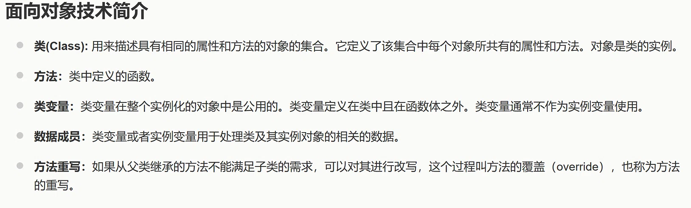
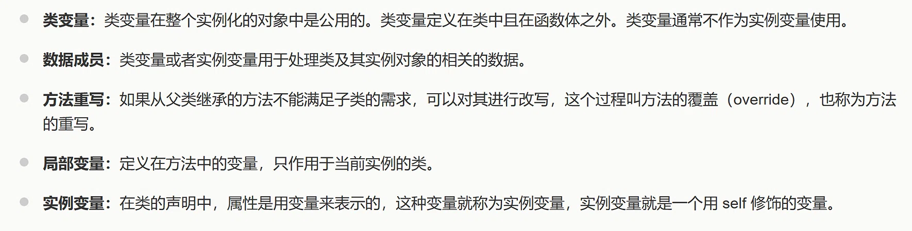
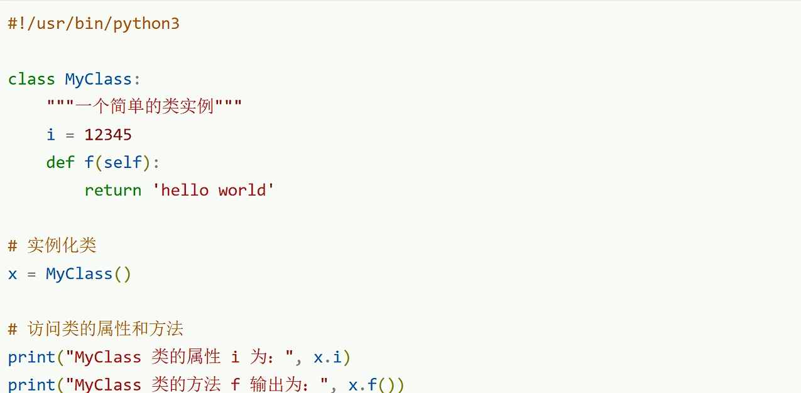
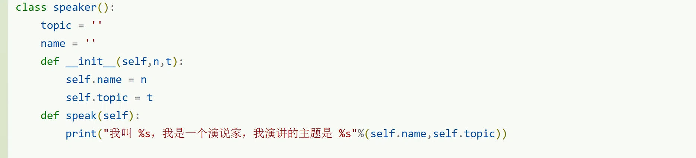
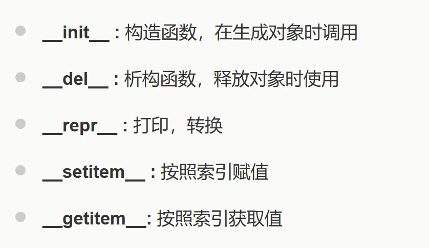
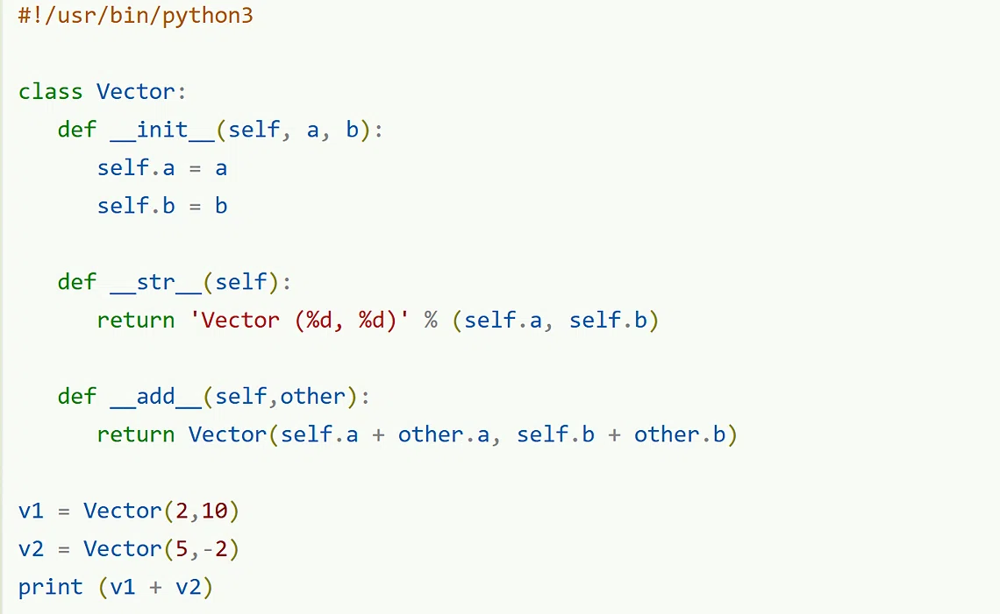

# AI 对话记忆导出


<hr style="border: 0; border-top: 5px solid #2563EB; margin: 48px 0 24px 0;">

## 🔵 👤 用户提问



解释一下数据成员


<hr style="border: 0; border-top: 5px solid #9333EA; margin: 48px 0 24px 0;">

## 🟣 🤖 AI 回答

根据您提供的材料，<strong>数据成员</strong>是一个总称，它指的是<strong>类变量</strong>和<strong>实例变量</strong>，用于存储类及其对象相关的数据。

简单来说，<strong>数据成员就是类或对象中用来保存状态的“容器”</strong>。为了帮你更清楚地理解，我们可以将其拆分为两种类型：

<strong>1\. 类变量（类属性）</strong>

* <strong>定义位置</strong>：定义在类中、所有方法（函数）之外。
* <strong>共享性</strong>：该类的<strong>所有实例对象共用</strong>同一个类变量。如果通过类名修改它，所有对象的该值都会同步改变。
* <strong>用途</strong>：通常用于记录与类整体相关的信息（如实例个数、默认配置等）。


<!-- DeepSeek list boundary -->

<strong>2\. 实例变量（对象属性）</strong>

* <strong>定义位置</strong>：通常在类的方法（如 `__init__` 构造函数）内部定义，通过 `self` 或对象引用进行绑定。
* <strong>独立性</strong>：每个实例对象<strong>独立拥有</strong>自己的实例变量，互不影响。修改一个对象的实例变量，不会改变其他对象的同名变量。
* <strong>用途</strong>：存储每个对象特有的数据（如人的姓名、年龄）。


<!-- DeepSeek list boundary -->

---

<strong>举个简单的例子（Python伪代码）来区分：</strong>

```
class Dog:
    # 1. 类变量（属于类本身，所有狗共享）
    species = "犬科动物"  

    def __init__(self, name):
        # 2. 实例变量（属于具体的某一只狗，各自独立）
        self.name = name  

# 这里的 `species` 和 `name` 都属于数据成员
```

<strong>补充一个小区分</strong>：在面向对象中，<strong>数据成员</strong>（存数据）通常与<strong>方法</strong>（定义行为）相对。方法负责操作数据成员，而数据成员负责承载业务数据。

如果你在方法内部<strong>重写</strong>了父类的数据成员，本质上也是一种数据层面的覆盖，但这与“方法重写”概念不同（方法重写针对的是函数逻辑的改写）。希望这个解释对你有帮助！如果还有疑问，可以随时追问。😊


<hr style="border: 0; border-top: 5px solid #2563EB; margin: 48px 0 24px 0;">

## 🔵 👤 用户提问

类的实例是对象吗


<hr style="border: 0; border-top: 5px solid #9333EA; margin: 48px 0 24px 0;">

## 🟣 🤖 AI 回答

<strong>是的，类的实例就是对象。</strong>

其实你提供的材料第一句话就已经直接给出了这个定义：<strong>“对象是类的实例。”</strong>

为了帮你更透彻地理解这两者的关系，可以记住这个比喻：

* <strong>类（Class）</strong> 相当于 <strong>“建筑设计图”</strong>。它规定了房子应该有几个房间、几个门，但仅仅是一张图纸，不占实际空间。
* <strong>对象（Object）/ 实例（Instance）</strong> 相当于按照这张图纸 <strong>“建造出来的房子”</strong>。它真实存在于内存中，有自己的门牌号（内存地址），并且每栋房子都可以有自己的独立状态（比如刷不同颜色的墙）。


<!-- DeepSeek list boundary -->

<strong>这里有一个日常编程中的小误区需要注意：</strong>

* 在大多数编程语境下，“实例”和“对象”是<strong>完全等价</strong>的，可以互换使用。
* 少数情况下（如C\+\+中），有人可能会用“对象”特指某个具体的变量，而用“实例”特指由 `new` 关键字在堆中创建出来的实体。但在绝大多数面向对象语言（如Java、Python、C#）的日常交流中，<strong>两者指代的是同一回事</strong>。


<!-- DeepSeek list boundary -->

简单总结：<strong>当你使用 `new` 关键字（或调用类的构造方法）创建出一个具体的东西时，这个东西既是该类的“实例”，也是一个“对象”。</strong>

如果你还想了解“引用”和“对象”在内存中的区别，我可以继续为你解释。😊


<hr style="border: 0; border-top: 5px solid #2563EB; margin: 48px 0 24px 0;">

## 🔵 👤 用户提问

我不特别指出时，默认问的是python


<hr style="border: 0; border-top: 5px solid #9333EA; margin: 48px 0 24px 0;">

## 🟣 🤖 AI 回答

收到！<strong>明白了，后续你所有不特别指出的提问，我都默认以 Python 语言为准</strong>来回答。

基于这个新规则，我把刚才的两个概念在 <strong>Python 语境</strong>下再给你精准对齐一下：

<strong>1\. 关于“数据成员”（Python 中更常叫“属性”）</strong>

在 Python 官方文档和社区习惯中，你材料里提到的“数据成员”通常直接叫 <strong>属性（Attribute）</strong>，具体分为：

* <strong>类属性（Class Attribute）</strong>：定义在类缩进内、方法之外的变量（如 `species`）。所有实例共享一份，可以通过 `类名.属性` 或 `self.__class__.属性` 访问。
* <strong>实例属性（Instance Attribute）</strong>：通常在 `__init__` 方法里通过 `self.属性名 = ...` 绑定。每个实例独自拥有，互不干扰。


<!-- DeepSeek list boundary -->

<strong>Python 独有注意点</strong>：Python 是动态语言，实例属性<strong>不要求在 `__init__` 里提前声明</strong>，你可以在类外直接给实例对象动态绑定新属性（虽然不太推荐，但语法允许）。

<strong>2\. 关于“类的实例是对象吗”（Python 里答案是绝对肯定的）</strong>

在 Python 中，<strong>“一切皆为对象”</strong>。

* 类的实例（比如 `dog = Dog("旺财")`）当然是对象。
* 甚至<strong>类本身</strong>（比如 `Dog`）也是对象（它是 `type` 类的实例）。
* 函数、方法、模块，甚至整数 `1` 和字符串 `"hi"`，在 Python 底层统统都是对象。


<!-- DeepSeek list boundary -->

所以，在 Python 里讨论时，你可以放心地把“实例”和“对象”划等号。它们都在堆内存中分配，并且都拥有自己的 `__dict__`（属性字典，除非使用了 `__slots__`）。

---

既然默认语言切换为 Python，接下来如果你问到继承、方法重写（Override）、`super()`、`@property`装饰器，或者 `__slots__` 内存优化等话题，我会全部给你 <strong>Python 专属的实现细节</strong>。你想接着深入哪个方向？😊


<hr style="border: 0; border-top: 5px solid #2563EB; margin: 48px 0 24px 0;">

## 🔵 👤 用户提问



区分一下类变量、局部变量、实例变量


<hr style="border: 0; border-top: 5px solid #9333EA; margin: 48px 0 24px 0;">

## 🟣 🤖 AI 回答

好的，在 <strong>Python</strong> 语境下，我先把材料里一个<strong>容易误导</strong>的点纠正过来，然后再给你清晰地区分这三者：

> 材料里说局部变量“只作用于当前实例的类”——<strong>这种说法在 Python 中不准确</strong>。  
> Python 中，局部变量<strong>只作用于当前方法（函数）内部</strong>，与“类”或“实例”没有归属关系，方法执行完它就销毁了。

下面我用<strong>定义位置、作用域（谁能用）、生命周期（存活多久）</strong>三个维度，帮你彻底分清：

---

### 1\. 类变量（Class Variable）

* <strong>定义位置</strong>：直接写在类缩进内部、<strong>所有方法之外</strong>。
* <strong>特征</strong>：由<strong>该类的所有实例共享</strong>。一份数据，大家共用。
* <strong>访问方式</strong>：推荐用 `类名.变量名` 访问或修改；用 `self.变量名` 读可以，但<strong>赋值时会变成创建实例属性</strong>，容易踩坑。
* <strong>生命周期</strong>：从类定义开始存在，直到程序结束。


<!-- DeepSeek list boundary -->

---

### 2\. 实例变量（Instance Variable）

* <strong>定义位置</strong>：在方法（通常是 `__init__`）内部，通过 <strong>`self.变量名 = ...`</strong> 绑定。
* <strong>特征</strong>：<strong>每个实例独有</strong>，互不影响。张三的`name`改了，李四的`name`不变。
* <strong>访问方式</strong>：只能通过实例（`self` 或 `obj`）访问。
* <strong>生命周期</strong>：随实例对象的创建而诞生，随实例被垃圾回收而销毁。


<!-- DeepSeek list boundary -->

---

### 3\. 局部变量（Local Variable）

* <strong>定义位置</strong>：在方法（函数）<strong>内部</strong>，<strong>不带 `self.`</strong>，直接写 `变量名 = ...`。
* <strong>特征</strong>：<strong>临时工</strong>，只在当前方法内有效。
* <strong>访问方式</strong>：方法外部<strong>完全无法访问</strong>它。
* <strong>生命周期</strong>：方法被调用时创建，方法执行结束后<strong>立即销毁</strong>（除非被返回或闭包捕获）。


<!-- DeepSeek list boundary -->

---

### 🧪 一眼看穿的代码示例

```
class Dog:
    # 1. 类变量（所有狗共享）
    species = "犬科动物"  

    def __init__(self, name):
        # 2. 实例变量（每只狗独有的名字）
        self.name = name  

    def bark(self, times):
        # 3. 局部变量（只在这个方法里有效）
        sound = "汪汪"  
        print(sound * times)  

# 测试
dog1 = Dog("旺财")
dog2 = Dog("来福")

print(Dog.species)  # 访问类变量：犬科动物
print(dog1.name)    # 实例变量：旺财
print(dog2.name)    # 实例变量：来福

dog1.bark(3)        # 汪汪汪汪汪汪（局部变量 sound 只在 bark 里存在）

# 下面这行会报错 NameError，因为局部变量 sound 在方法外部不存在
# print(sound)  
```

---

### 📊 速查对比表

| 变量类型 | 定义位置 | 是否带 `self.` | 属于谁 | 生命周期 |
| --- | --- | --- | --- | --- |
| <strong>类变量</strong> | 类内部、方法外部 | 否 | 属于类（所有实例共享） | 程序运行期间一直存在 |
| <strong>实例变量</strong> | 方法内部（通常`__init__`） | <strong>是</strong>（`self.`） | 属于具体的某一个实例对象 | 随实例创建而创建，随实例销毁而销毁 |
| <strong>局部变量</strong> | 方法内部 | <strong>否</strong>（直接写变量名） | 谁也不属于，仅属于当前函数调用 | 方法调用时临时存在，调用结束即消失 |

---

### ⚠️ 一个 Python 特有的坑（帮你避雷）

如果你<strong>读取</strong>一个不存在的实例变量，Python 会去类里找类变量作为备选；但如果你<strong>赋值</strong> `self.变量 = ...`，Python 会直接创建一个新的实例变量，<strong>不会</strong>修改类变量。

```
dog1 = Dog("旺财")
print(dog1.species)  # 输出：犬科动物（实例没有，去类里找到了）

dog1.species = "猫科"  # 注意：这不是改类变量，而是在 dog1 上创建了一个同名的实例变量！
print(dog1.species)   # 输出：猫科（实例变量遮住了类变量）
print(Dog.species)    # 输出：犬科动物（类变量原封不动）
```

记住黄金口诀：<strong>带 `self.` 且在 `__init__` 里的是实例变量；不带 `self.` 且缩进在方法里的是局部变量；缩进在类里但不在方法里的是类变量。</strong>

现在分清楚了吗？如果还想了解类变量和实例变量在内存中的存储区别（比如 `__dict__` 底层），我可以继续给你深挖。😊


<hr style="border: 0; border-top: 5px solid #2563EB; margin: 48px 0 24px 0;">

## 🔵 👤 用户提问



i 是类变量，对吗？


<hr style="border: 0; border-top: 5px solid #9333EA; margin: 48px 0 24px 0;">

## 🟣 🤖 AI 回答

<strong>是的，完全正确！</strong>

在代码中，`i = 12345` 定义在类体内部、且在所有方法（`def f`）的外部，这完全符合你之前材料里“类变量定义在类中且在函数体之外”的定义。

---

为了帮你在这个具体代码中<strong>精准区分</strong>开其他概念，可以看一下这个对照：

* <strong>`i = 12345`</strong>：<strong>类变量</strong>。属于 `MyClass` 这个类本身，所有实例共享。你在代码里通过 `x.i` 访问，是因为实例对象没找到自己的实例属性，于是去类里找到了它（向上查找）。
* <strong>`self`</strong>（方法参数里的）：它本身不是变量，而是<strong>实例对象本身</strong>的引用，用来操作实例数据。
* <strong>`f`</strong>：<strong>实例方法</strong>（不是变量，是方法），需要通过实例调用。
* <strong>代码中没有任何局部变量</strong>（因为没有在方法内部定义 `变量名 = 值` 这种写法）。


<!-- DeepSeek list boundary -->

---

### ⚠️ 一个基于这段代码的关键避坑提醒

虽然你通过 `x.i` 读到了 `12345`，但 <strong>`i` 的内存归属是类，而不是 `x`</strong>。如果你尝试修改：

```
x.i = 999  # 这不会改类变量！而是在 x 这个实例上新建了一个实例属性
print(x.i)      # 输出 999（实例属性遮住了类变量）
print(MyClass.i) # 输出 12345（类变量纹丝不动）
```

如果你想修改真正的类变量，必须通过类名操作：

```
MyClass.i = 888
print(x.i)  # 此时 x 没有自己的 i，去类里找，输出 888
```

所以你的判断非常准确，继续按这个思路理解就行！如果想把这段代码里的 `f` 方法完善一下，或者看看如何定义实例变量，可以随时告诉我。😊


<hr style="border: 0; border-top: 5px solid #2563EB; margin: 48px 0 24px 0;">

## 🔵 👤 用户提问

#!/usr/bin/python3
 
#类定义
class people:
    #定义基本属性
    name = ''
    age = 0
    #定义私有属性,私有属性在类外部无法直接进行访问
    __weight = 0
    #定义构造方法
    def __init__(self,n,a,w):
        self.name = n
        self.age = a
        self.__weight = w
    def speak(self):
        print("%s 说: 我 %d 岁。" %(self.name,self.age))
 
# 实例化类
p = people('runoob',10,30)
p.speak()
self后面写n,a,w这些简称有什么后果？


<hr style="border: 0; border-top: 5px solid #9333EA; margin: 48px 0 24px 0;">

## 🟣 🤖 AI 回答

<strong>直接回答：在运行结果上没有任何负面后果</strong>，代码功能完全正常，`p.speak()` 照样能正确输出 `runoob 说: 我 10 岁。`

但是，<strong>在代码的可读性、维护性和工程实践上，后果是比较明显的“坏味道”</strong>。我把这叫做 <strong>“语义断连”</strong>——参数名和属性名对不上号，阅读代码的人要多绕一个弯子。

具体来说，有以下几方面影响：

### 1\. 可读性变差（最主要的问题）

阅读代码的人看到 `def __init__(self, n, a, w):` 时，必须费力猜测 `n` 是 name 还是 number，`a` 是 age 还是 address，`w` 是 weight 还是 width。

* <strong>现在的代码</strong>：`self.name = n` → 读者需要反应 0.5 秒：“哦，`n` 是 name 的缩写”。
* <strong>推荐写法</strong>：`self.name = name` → 读者瞬间理解，无需脑内翻译。


<!-- DeepSeek list boundary -->

在 Python 之禅（`import this`）里有一句：<strong>“Explicit is better than implicit.”（显式优于隐式。）</strong> 直接写全称就是最显式的做法。

### 2\. IDE 智能提示和重构受影响

如果你使用 PyCharm、VSCode 等现代 IDE：

* 当你把参数写成 `n` 时，IDE 很难推断这个参数未来会赋给 `name`，你在调用 `people('runoob', 10, 30)` 时，IDE 不会提示你第一个参数是 `name`。
* 将来如果要用“重构”功能（比如把 `name` 属性改名为 `username`），IDE 无法自动把传参处的 `n` 关联起来，必须手动全局搜索替换，容易漏改。


<!-- DeepSeek list boundary -->

### 3\. 调试时日志不友好

如果代码报错或者你在调试时打印 `n`，你看到的是 `n` 这个无意义的字母。而如果写成 `name`，报错信息会直接告诉你“变量 `name` 出了问题”，定位 bug 会快很多。

### 4\. 多余的“脑内映射”增加维护成本

假如几个月后你回来修改代码，或者别人接手你的代码，看到 `__init__(self, n, a, w)` 得先翻回去看 `self.name = n` 那一行，才能确定 `n` 是什么。<strong>代码的维护成本比编写成本高得多</strong>，这种简写长期来看得不偿失。

---

### ✅ 推荐的 Python 标准写法

直接让参数名和属性名<strong>保持一致</strong>，是最 Pythonic（地道）的做法：

```
class people:
    name = ''
    age = 0
    __weight = 0

    def __init__(self, name, age, weight):  # 参数用全称
        self.name = name                    # 一一对应，毫无歧义
        self.age = age
        self.__weight = weight

    def speak(self):
        print("%s 说: 我 %d 岁。" % (self.name, self.age))
```

这样调用 `people('runoob', 10, 30)` 时，甚至不用看文档，光看参数名就知道第一个传名字、第二个传年龄、第三个传体重。

---

### 🤔 什么时候用短参数名是可以接受的？

只有一种极端情况：<strong>参数名和类中已有属性或内置函数冲突</strong>（比如想叫 `type` 但和内置函数重了，可能会用 `typ`）。但即使这样，也更推荐加一个下划线后缀（如 `type_`），而不是缩写成单字母。

<strong>总结：功能上没毛病，但专业程序员看了一定会皱眉。建议你养成“参数名与属性名一致”的好习惯。</strong> 现在你的代码还短，改起来很容易。如果继续往下学，将来写框架时尤其要注意这点。😊


<hr style="border: 0; border-top: 5px solid #2563EB; margin: 48px 0 24px 0;">

## 🔵 👤 用户提问

介绍一下Python 之禅（import this）


<hr style="border: 0; border-top: 5px solid #9333EA; margin: 48px 0 24px 0;">

## 🟣 🤖 AI 回答

`import this` 是 Python 里一个著名的<strong>彩蛋（Easter Egg）</strong>。运行它不会加载任何功能模块，而是会打印出一首由 <strong>Tim Peters</strong> 撰写的诗，名为 <strong>《Python 之禅》（The Zen of Python）</strong>。

这首诗一共 19 条（有的版本列出 20 条，但通常核心是 19 条），是 Python 语言设计的核心指导哲学。它不是强制性的语法规则，而是 <strong>“道”层面的编程美学</strong>，用来指导 Python 开发者写出优雅、易读、可维护的代码。

你可以在任何 Python 交互环境（IDLE、Jupyter、终端）中输入：

```
import this
```

会得到如下输出：

```
The Zen of Python, by Tim Peters

Beautiful is better than ugly.
Explicit is better than implicit.
Simple is better than complex.
Complex is better than complicated.
Flat is better than nested.
Sparse is better than dense.
Readability counts.
Special cases aren't special enough to break the rules.
Although practicality beats purity.
Errors should never pass silently.
Unless explicitly silenced.
In the face of ambiguity, refuse the temptation to guess.
There should be one-- and preferably only one --obvious way to do it.
Although that way may not be obvious at first unless you're Dutch.
Now is better than never.
Although never is often better than *right* now.
If the implementation is hard to explain, it's a bad idea.
If the implementation is easy to explain, it may be a good idea.
Namespaces are one honking great idea -- let's do more of those!
```

---

### 🧘 结合你的学习进度，解读几条最重要的“禅意”

| 禅句 | 翻译 | 结合你之前写的代码（`people`类）如何理解？ |
| --- | --- | --- |
| <strong>Explicit is better than implicit.</strong> | <strong>显式优于隐式。</strong> | 这就是我之前建议你把 `def __init__(self, n, a, w)` 改成 `name, age, weight` 的<strong>终极理论依据</strong>。让代码意图一目了然，不要让人去猜 `n` 是什么。 |
| <strong>Readability counts.</strong> | <strong>可读性很重要。</strong> | 代码主要是给人读的，顺便给机器执行。你的 `self.name = n` 可读性差，而 `self.name = name` 读起来就像自然语言。 |
| <strong>Simple is better than complex.</strong> <br><strong>Complex is better than complicated.</strong> | <strong>简单优于复杂。<br>复杂优于杂乱。</strong> | 解决问题时，先找最简单的写法。如果必须复杂，也要保证逻辑清晰、结构有序，不能写成“屎山”一团乱麻。 |
| <strong>Errors should never pass silently.</strong> <br><strong>Unless explicitly silenced.</strong> | <strong>错误永远不应该悄悄忽略。<br>除非你明确要这样做。</strong> | 写代码时不要用 `try...except` 把报错全部吞掉不处理。除非你非常清楚为什么要忽略这个错误，否则要让报错暴露出来，方便调试。 |
| <strong>Now is better than never.</strong> <br><strong>Although never is often better than <em>right</em> now.</strong> | <strong>现在做总比不做好。<br>虽然“不做”往往比“瞎做”要好。</strong> | 鼓励你动手实践（现在就去敲代码），但如果没想清楚架构就匆忙乱写，不如先停下来思考。 |
| <strong>There should be one—and preferably only one—obvious way to do it.</strong> | <strong>应该有一个——最好只有一个——显而易见的方法来做这件事。</strong> | Python 追求“大道至简”，对于同一个功能，通常只有一种最推荐的写法（不像 Perl 或 C\+\+ 那样有多种奇技淫巧）。 |

---

### 🤔 最后补充两个冷知识

1. <strong>作者是荷兰人</strong>：诗里那句 “Unless you're Dutch”（除非你是荷兰人）是调侃 Python 之父 <strong>Guido van Rossum</strong>（他是荷兰人）。意思是，这个“显而易见的方法”可能吉多（Guido）一看就知道，但普通人要多想一会儿。
2. <strong>这不是强制规范</strong>：PEP 8（Python 官方代码风格指南）是<strong>强制执行</strong>的规范（比如缩进几个空格），而《Python 之禅》是<strong>精神指引</strong>。一个管“形”，一个管“神”。


<!-- DeepSeek list boundary -->

如果你对其中某一条特别感兴趣（比如“命名空间 Namespaces”），我可以结合 Python 底层原理给你展开讲讲。现在，你可以打开电脑终端，自己敲一下 `import this` 感受一下这种仪式感！😊


<hr style="border: 0; border-top: 5px solid #2563EB; margin: 48px 0 24px 0;">

## 🔵 👤 用户提问

Who's Time Peter


<hr style="border: 0; border-top: 5px solid #9333EA; margin: 48px 0 24px 0;">

## 🟣 🤖 AI 回答

你的问题里把名字写反了，正确的拼写是 <strong>Tim Peters</strong>（蒂姆·彼得斯），不是 Time Peter。

### Tim Peters 是谁？

他是 <strong>Python 社区的资深核心开发者</strong>，也是早期的“Python 教父级”人物之一。他对 Python 的贡献非常大，但普通用户可能只知道两个最出名的东西：

1. <strong>《Python 之禅》（The Zen of Python）</strong>：就是你刚用 `import this` 看到的那首诗，他是作者。
2. <strong>TimSort 排序算法</strong>：Python 自 2.3 版本起使用的内置排序算法（`list.sort()` 和 `sorted()` 的底层实现），就是他发明的。后来这个算法也被 Java 和 Android 等平台采纳为默认排序算法，因为它在实际数据中表现极其稳定高效。


<!-- DeepSeek list boundary -->

---

### 他在 Python 社区的地位

* 他是 <strong>Python 软件基金会（PSF）</strong> 的早期成员，参与了 Python 核心语言和标准库的大量设计和代码审查。
* 他在邮件列表里以<strong>毒舌但逻辑严谨</strong>闻名，经常一针见血地指出设计缺陷。他的评论和代码提交，深刻影响了 Python 的语言风格——<strong>简洁、明确、不搞花哨</strong>。


<!-- DeepSeek list boundary -->

---

### 关于《Python 之禅》的创作背景

这首诗写于 <strong>1999 年 8 月</strong>，当时 Tim Peters 在 Python 邮件列表中回复一个关于 Python 哲学讨论的帖子时，随手写下了这 19 条格言。后来 Guido van Rossum 觉得非常有价值，就把它做成彩蛋内置进了 Python 解释器，算是对这位老战友的致敬。

所以当你运行 `import this` 时，看到的不仅是一首诗，更是<strong>几十年来 Python 核心团队共同信仰的编码价值观的精华浓缩</strong>。😊


<hr style="border: 0; border-top: 5px solid #2563EB; margin: 48px 0 24px 0;">

## 🔵 👤 用户提问

python之禅逐行翻译


<hr style="border: 0; border-top: 5px solid #9333EA; margin: 48px 0 24px 0;">

## 🟣 🤖 AI 回答

好的，下面是 <strong>《Python 之禅》</strong>（The Zen of Python）的<strong>逐行中英对照翻译</strong>。为了让你更好地理解，我还在每句后面附上了一句<strong>结合 Python 编程的通俗解释</strong>。

---

<strong>第 1 句</strong>

> <strong>Beautiful is better than ugly.</strong>  
> <strong>翻译：</strong> 美丽优于丑陋。  
> <strong>解读：</strong> 写出优雅、整洁、赏心悦目的代码，不要搞成乱糟糟的一团。

<strong>第 2 句</strong>

> <strong>Explicit is better than implicit.</strong>  
> <strong>翻译：</strong> 显式优于隐式。  
> <strong>解读：</strong> 代码意图要清晰直白（比如参数名写全 `name`，不要缩写为 `n`），不要让读代码的人去猜“潜规则”。

<strong>第 3 句</strong>

> <strong>Simple is better than complex.</strong>  
> <strong>翻译：</strong> 简单优于复杂。  
> <strong>解读：</strong> 能用 5 行解决的问题，别绕弯子写 50 行。优先找最简单的实现路径。

<strong>第 4 句</strong>

> <strong>Complex is better than complicated.</strong>  
> <strong>翻译：</strong> 复杂（但有条理）优于杂乱（且难懂）。  
> <strong>解读：</strong> 如果问题本身确实很复杂，那就用结构清晰的复杂代码去解决，但绝不能写成自己都看不懂的“意大利面条式”乱码。

<strong>第 5 句</strong>

> <strong>Flat is better than nested.</strong>  
> <strong>翻译：</strong> 扁平优于嵌套。  
> <strong>解读：</strong> 尽量减少 `if` 和 `for` 的层层嵌套（比如超过 3 层）。能提前 `return` 就提前返回，把逻辑铺平，别让读者陷入“箭头形代码”的地狱。

<strong>第 6 句</strong>

> <strong>Sparse is better than dense.</strong>  
> <strong>翻译：</strong> 稀疏优于密集。  
> <strong>解读：</strong> 一行代码别塞太多操作（比如连续套 5 个函数调用）。该换行就换行，该空行就空行，给代码留点“呼吸感”。

<strong>第 7 句</strong>

> <strong>Readability counts.</strong>  
> <strong>翻译：</strong> 可读性很重要。  
> <strong>解读：</strong> <strong>这句是核心</strong>。代码首先是给人看的，顺便给机器执行。为了可读性，牺牲一点点性能或打字量都是值得的。

<strong>第 8 句</strong>

> <strong>Special cases aren't special enough to break the rules.</strong>  
> <strong>翻译：</strong> 特殊情况也不应该特殊到打破规则。  
> <strong>解读：</strong> 不要为了迎合某个稀奇古怪的输入，就去破坏整体的代码结构。尽量让规则统一，特殊情况用参数处理，而不是用 `if` 把逻辑搅乱。

<strong>第 9 句</strong>

> <strong>Although practicality beats purity.</strong>  
> <strong>翻译：</strong> 尽管实用性胜过纯粹性。  
> <strong>解读：</strong> 上面说的“规则”不是死的。如果纯粹为了“优雅”导致代码极其复杂，而现实中项目急着上线，那可以适当妥协，先保证能跑通。

<strong>第 10 句</strong>

> <strong>Errors should never pass silently.</strong>  
> <strong>翻译：</strong> 错误永远不应该悄悄被忽略。  
> <strong>解读：</strong> 写 `try...except` 时，不要只写个 `pass` 把报错吞掉。让错误暴露出来，你才知道哪里坏了。

<strong>第 11 句</strong>

> <strong>Unless explicitly silenced.</strong>  
> <strong>翻译：</strong> 除非你明确地要忽略它。  
> <strong>解读：</strong> 承接上一句。如果你确定这个错误不重要（比如读取临时文件，没有就算了），那可以在 `except` 里明确写日志记录一下，而不是无脑 `pass`。

<strong>第 12 句</strong>

> <strong>In the face of ambiguity, refuse the temptation to guess.</strong>  
> <strong>翻译：</strong> 面对歧义，拒绝猜测的诱惑。  
> <strong>解读：</strong> 当你不确定某种写法是否安全时，不要抱着“可能行吧”的心态去猜。去查文档、做小实验，确定之后再写。

<strong>第 13 句</strong>

> <strong>There should be one-- and preferably only one --obvious way to do it.</strong>  
> <strong>翻译：</strong> 应该有一种——而且最好是唯一一种——显而易见的方法去做一件事。  
> <strong>解读：</strong> Python 信奉“大道至简”。不像 Perl 那样“条条大路通罗马”，Python 提倡官方推荐的“最标准写法”（比如列表推导式），让大家代码风格趋同，方便互相阅读。

<strong>第 14 句</strong>

> <strong>Although that way may not be obvious at first unless you're Dutch.</strong>  
> <strong>翻译：</strong> 尽管这种（显而易见的）方法一开始可能不那么明显，除非你是荷兰人。  
> <strong>解读：</strong> 纯调侃。Python 之父 Guido van Rossum 是荷兰人，他脑子里觉得“理所当然”的写法，普通人可能要多练练才能掌握。😄

<strong>第 15 句</strong>

> <strong>Now is better than never.</strong>  
> <strong>翻译：</strong> （动手）现在做总比永远不做要好。  
> <strong>解读：</strong> 不要光看书不动手。想到一个功能，现在就去敲代码验证。

<strong>第 16 句</strong>

> <strong>Although never is often better than <em>right</em> now.</strong>  
> <strong>翻译：</strong> 尽管“永远不做”往往比“（不加思考）立刻动手”要好。  
> <strong>解读：</strong> 承接上一句。如果你完全没想清楚架构就急着乱写一通（`right now` 强调仓促），那还不如先不做。先思考，再行动。

<strong>第 17 句</strong>

> <strong>If the implementation is hard to explain, it's a bad idea.</strong>  
> <strong>翻译：</strong> 如果实现方案很难向别人解释清楚，那它就是个坏主意。  
> <strong>解读：</strong> 写完一段代码，如果你没法跟同事描述它的逻辑，说明它太绕了，应该重构。

<strong>第 18 句</strong>

> <strong>If the implementation is easy to explain, it may be a good idea.</strong>  
> <strong>翻译：</strong> 如果实现方案很容易解释清楚，那它可能是个好主意。  
> <strong>解读：</strong> 能用大白话说明白的逻辑，转成代码通常也不会太差。（注意这里用了 `may be`，因为简单也有可能太低级，但至少方向是对的。）

<strong>第 19 句</strong>

> <strong>Namespaces are one honking great idea \-- let's do more of those!</strong>  
> <strong>翻译：</strong> 命名空间是个非常棒的主意——让我们多多使用吧！  
> <strong>解读：</strong> 这句是压轴！命名空间（即模块、包、类、函数的作用域）能有效避免名字冲突。鼓励你多用模块封装代码，不要把所有变量都堆在全局环境下。

---

如果你对某一句的哲学背景或实际应用还想深挖（比如“扁平 vs 嵌套”的具体重构例子），可以随时问我，我再给你展开细讲。😊


<hr style="border: 0; border-top: 5px solid #2563EB; margin: 48px 0 24px 0;">

## 🔵 👤 用户提问



这种情况下两个属性到底是类变量还是实例变量？


<hr style="border: 0; border-top: 5px solid #9333EA; margin: 48px 0 24px 0;">

## 🟣 🤖 AI 回答

<strong>直接回答：两者都有，但在实际运行中，起决定性作用的是“实例变量”。</strong>

这串代码极具迷惑性，因为它同时定义了<strong>同名的类变量和实例变量</strong>。我帮你拆开来看就清楚了：

### 1\. 代码上半部分（定义阶段）：它们是类变量

```
class speaker():
    topic = ''   # 这里是类变量
    name = ''    # 这里是类变量
```

因为它们<strong>直接写在类缩进内部、方法的外部</strong>。这两个变量属于 `speaker` 这个类本身，所有实例一开始都共用这一份。

### 2\. 代码下半部分（执行阶段）：`__init__` 把它们变成了实例变量

```
def __init__(self,n,t):
    self.name = n    # 这里是在给实例绑定属性（实例变量）
    self.topic = t   # 这里是在给实例绑定属性（实例变量）
```

当执行 `p = speaker('Alice', 'AI')` 时，`__init__` 里的 `self.name = ...` 会<strong>在实例对象 `p` 上新建两个实例变量</strong>。

---

### 🔍 关键机制：实例变量“遮罩”了类变量

在 Python 中，当你通过实例（`self`）访问属性时，查找顺序是：<strong>先找实例自己的属性（实例变量） → 找不到时再找类属性（类变量）</strong>。

* 创建对象后，`p.name` 和 `p.topic` 指向的是<strong>实例变量</strong>（你传进来的 `n` 和 `t`）。
* 类变量 `speaker.name` 和 `speaker.topic` 依然存在，只是被同名的实例变量挡住了，所以 `speak()` 方法打印出来的是你传入的新值。


<!-- DeepSeek list boundary -->

---

### 🧪 验证一下（你可以复制这段去跑跑看）

```
class speaker():
    topic = '默认主题'   # 类变量
    name = '默认姓名'    # 类变量

    def __init__(self, n, t):
        self.name = n    # 实例变量
        self.topic = t   # 实例变量

p = speaker('Alice', 'AI')

# 通过实例访问，拿到的是实例变量的值（传进来的）
print(p.name)    # 输出: Alice
print(p.topic)   # 输出: AI

# 通过类名访问，拿到的是类变量的值（原始的默认值）
print(speaker.name)    # 输出: 默认姓名
print(speaker.topic)   # 输出: 默认主题
```

---

### ⚠️ 这段代码的“坏味道”（避坑建议）

既然你在 `__init__` 里<strong>强制</strong>给每个实例都绑定了 `name` 和 `topic`，那么顶部定义的 `name = ''` 和 `topic = ''` 就<strong>永远派不上用场</strong>了（纯属僵尸代码）。

<strong>改进建议：</strong> 直接删掉顶部的类变量，代码会更干净、更符合 “Explicit is better than implicit”（显式优于隐式）的禅意：

```
class speaker():
    def __init__(self, name, topic):  # 参数直接写全称
        self.name = name
        self.topic = topic
    def speak(self):
        print("我叫 %s，我是一个演说家，我演讲的主题是 %s" % (self.name, self.topic))
```

只有在<strong>你想给所有实例提供一个默认值，且允许某个实例不传参</strong>的时候，才保留顶部的类变量（比如 `topic = ''` 作为备胎）。但你现在每次都传参，所以顶部的定义纯属多余。😊


<hr style="border: 0; border-top: 5px solid #2563EB; margin: 48px 0 24px 0;">

## 🔵 👤 用户提问

#!/usr/bin/python3
 
#类定义
class people:
    #定义基本属性
    name = ''
    age = 0
    #定义私有属性,私有属性在类外部无法直接进行访问
    __weight = 0
    #定义构造方法
    def __init__(self,n,a,w):
        self.name = n
        self.age = a
        self.__weight = w
    def speak(self):
        print("%s 说: 我 %d 岁。" %(self.name,self.age))
 
#单继承示例
class student(people):
    grade = ''
    def __init__(self,n,a,w,g):
        #调用父类的构函
        people.__init__(self,n,a,w)
        self.grade = g
    #覆写父类的方法
    def speak(self):
        print("%s 说: 我 %d 岁了，我在读 %d 年级"%(self.name,self.age,self.grade))
 
#另一个类，多继承之前的准备
class speaker():
    topic = ''
    name = ''
    def __init__(self,n,t):
        self.name = n
        self.topic = t
    def speak(self):
        print("我叫 %s，我是一个演说家，我演讲的主题是 %s"%(self.name,self.topic))
 
#多继承
class sample(speaker,student):
    a =''
    def __init__(self,n,a,w,g,t):
        student.__init__(self,n,a,w,g)
        speaker.__init__(self,n,t)
 
test = sample("Tim",25,80,4,"Python")
test.speak()   #方法名同，默认调用的是在括号中参数位置排前父类的方法
sample中哪个name起作用？


<hr style="border: 0; border-top: 5px solid #9333EA; margin: 48px 0 24px 0;">

## 🟣 🤖 AI 回答

直接回答你：<strong>最终起作用的是 `speaker.__init__` 里赋值的那个实例变量 `self.name`</strong>（值为 `"Tim"`）。但因为这个变量赋值发生在最后，且两个父类传入的 `name` 值相同（都是 `"Tim"`），所以表面上看不出冲突。

为了让你彻底明白，我按 <strong>Python 的执行顺序</strong> 和 <strong>属性查找规则</strong> 给你拆解：

### 1\. 实例变量永远优先于类变量

无论 `people` 还是 `speaker` 顶部定义了 `name = ''`（类变量），在实例化 `test` 时，`__init__` 里的 `self.name = ...` 都会在实例对象 `test` 上<strong>新建实例变量</strong>。之后的任何访问（如 `test.name` 或 `speak()` 里的 `self.name`）都会<strong>优先读取实例变量</strong>，类变量被彻底遮罩，完全派不上用场。

### 2\. 追踪执行顺序：谁覆盖了谁？

`sample` 的 `__init__` 里有两次调用：

```
def __init__(self,n,a,w,g,t):
    student.__init__(self,n,a,w,g)   # ① 先执行
    speaker.__init__(self,n,t)       # ② 后执行
```

* <strong>① 执行 `student.__init__`</strong> → 它调用 `people.__init__`，执行 `self.name = "Tim"`。此时实例上有了 `name = "Tim"`。
* <strong>② 执行 `speaker.__init__`</strong> → 它执行 `self.name = "Tim"`（又赋了一次值，覆盖了①，但值相同）。


<!-- DeepSeek list boundary -->

<strong>结论</strong>：虽然赋值了两次，但最终实例 `test` 上只有一个 `name` 属性，值就是最后一次赋值的 `"Tim"`。

### 3\. 如果两个父类传入的 `name` 不同，会怎样？

假设你把调用改成这样（故意制造冲突）：

```
student.__init__(self, "Alice", a, w, g)  # 先设为 Alice
speaker.__init__(self, "Bob", t)          # 后设为 Bob
```

那么最终 `test.name` 会输出 <strong>"Bob"</strong>，因为 `speaker.__init__` 是后执行的，后写的覆盖先写的。

### 4\. 为什么代码中打印的是 "Tim" 而不是报错？

因为 Python 的实例属性（`self.xxx`）是<strong>动态绑定</strong>在一个字典（`__dict__`）里的，后面赋值直接覆盖前面的键值，不会报错。

---

### 📌 总结一句话

* <strong>谁写的最后，谁说了算</strong>（后执行的 `__init__` 覆盖先前的）。
* 顶部的 `name = ''` 在你有 `self.name = ...` 的情况下，<strong>纯属摆设</strong>（僵尸代码），不会起作用。


<!-- DeepSeek list boundary -->

如果你想验证，可以在代码最后加一句：

```
print(test.__dict__)  # 输出实例的所有属性字典
```

你会看到只包含 `{'name': 'Tim', 'age': 25, '_people__weight': 80, 'grade': 4, 'topic': 'Python'}`，根本没有类变量的影子。😊


<hr style="border: 0; border-top: 5px solid #2563EB; margin: 48px 0 24px 0;">

## 🔵 👤 用户提问



解释两个索引函数


<hr style="border: 0; border-top: 5px solid #9333EA; margin: 48px 0 24px 0;">

## 🟣 🤖 AI 回答

这两个方法（`__getitem__` 和 `__setitem__`）是 Python 中<strong>将对象伪装成容器（如列表、字典）</strong>的核心魔法方法。它们让自定义类的实例能够像内置集合一样，通过 <strong>`[索引/键]`</strong> 这种直观的语法进行<strong>读取</strong>和<strong>写入</strong>。

为了让你更好理解，我把它们分别称为<strong>“取物器”</strong>和<strong>“放物器”</strong>：

---

### 1\. `__getitem__(self, key)` —— 取物器（读取）

* <strong>触发时机</strong>：当你使用 `对象[键]` 进行<strong>取值</strong>时调用。
* <strong>作用</strong>：根据给定的 `key`（可以是整数索引、字符串键名，甚至是切片对象）返回对应的值。
* <strong>返回值</strong>：必须返回找到的结果。
* <strong>特别之处</strong>：如果类实现了这个方法，该类的实例就<strong>支持迭代</strong>（即可以用 `for ... in` 遍历，Python 会从索引 `0` 开始逐个调用此方法直到报 `IndexError`）。


<!-- DeepSeek list boundary -->

---

### 2\. `__setitem__(self, key, value)` —— 放物器（写入）

* <strong>触发时机</strong>：当你使用 `对象[键] = 新值` 进行<strong>赋值</strong>时调用。
* <strong>作用</strong>：将 `value` 存储到指定的 `key` 位置上。
* <strong>返回值</strong>：不需要返回值（即 `return None`）。


<!-- DeepSeek list boundary -->

---

### 🧪 实战对比代码（用一个自定义列表来演示）

下面我写一个最简单的 <strong>“带日志的列表”</strong>，当你读写索引时，它会打印提示，让你亲眼看到这两个方法怎么工作：

```
class LogList:
    def __init__(self, data):
        self.data = list(data)  # 内部用一个真列表存数据

    # 读取：实现 对象[索引]
    def __getitem__(self, index):
        print(f"【读取】正在获取索引 {index} 的值")
        return self.data[index]

    # 写入：实现 对象[索引] = 值
    def __setitem__(self, index, value):
        print(f"【写入】正在将索引 {index} 设为 {value}")
        self.data[index] = value

# 测试
my_list = LogList([10, 20, 30])

# 1. 触发 __getitem__
print(my_list[1])   # 控制台打印： 【读取】正在获取索引 1 的值 \n 20

# 2. 触发 __setitem__
my_list[0] = 999    # 控制台打印： 【写入】正在将索引 0 设为 999

# 验证修改结果
print(my_list.data) # 输出：[999, 20, 30]

# 3. 额外彩蛋：实现了 __getitem__ 就能直接 for 遍历
for item in my_list:
    print(item)     # 会依次触发三次 __getitem__ (索引0,1,2)
```

---

### ⚠️ 两个容易被忽略的 Python 细节

1. <strong>键（`key`）不只是整数</strong>：

   * 如果你模仿字典，`key` 可以是字符串（如 `obj['name']`）。
   * 如果你写 `obj[1:3]` 这种切片，`key` 会是一个 `slice` 对象（类型为 `slice`），你需要自己处理它。
2. <strong>配套使用 `__delitem__`</strong>：

   * 既然有“取”和“放”，通常还需要“删”，即 `del 对象[键]`，对应的方法是 `__delitem__(self, key)`。虽然你的材料里没列，但它一般和这两个一起出现。


<!-- DeepSeek list boundary -->

---

### 🧠 一句话记住它们

* `__getitem__`：当你想让对象支持 <strong>`变量 = 对象[键]`</strong> 时写它。
* `__setitem__`：当你想让对象支持 <strong>`对象[键] = 变量`</strong> 时写它。


<!-- DeepSeek list boundary -->

在你的学习材料中，这两个方法通常用于实现<strong>序列（Sequence）</strong>或<strong>映射（Mapping）</strong>协议，学完它们，你就可以写出像 `list` 或 `dict` 一样好用且带自定义逻辑的数据结构了。😊


<hr style="border: 0; border-top: 5px solid #2563EB; margin: 48px 0 24px 0;">

## 🔵 👤 用户提问



str 是特有方法吗？什么叫重载？我没看懂


<hr style="border: 0; border-top: 5px solid #9333EA; margin: 48px 0 24px 0;">

## 🟣 🤖 AI 回答

别着急，这个代码里确实藏了两个容易混淆的概念。你问到了点子上！

我把你的问题拆成两个部分，<strong>先讲 `__str__`，再重点讲什么是“重载”</strong>，保证你听完就通透了。

---

### 1\. `__str__` 是“特有方法”吗？

<strong>是的</strong>，在 Python 里，像 `__str__`、`__init__`、`__add__` 这种<strong>前后都有双下划线</strong>的方法，统一叫 <strong>“魔法方法”（Magic Methods）</strong> 或 <strong>“特殊方法”（Special Methods）</strong>。

* <strong>它的特殊之处</strong>：不需要你手动调用。当你对这个对象使用 `print()` 或者 `str()` 时，Python 会自动去找它。
* <strong>没有它会怎样？</strong> 如果你把代码里的 `__str__` 删掉，直接 `print(v1 + v2)`，控制台会输出一堆看不懂的东西，比如：`<__main__.Vector object at 0x000001>`（这是对象在内存里的地址）。
* <strong>有了它</strong>：你告诉 Python，“当别人打印我的对象时，请按我这个格式 `Vector (7, 8)` 显示”，大大提高了可读性。


<!-- DeepSeek list boundary -->

---

### 2\. 什么叫“重载”（Overload）？

这是你最困惑的地方。<strong>别被“重载”这个术语吓到，它其实就是“重新定义”或“赋予新含义”的意思。</strong>

在编程里，<strong>“重载”通常指：同一个符号（比如 `+`）或同一个方法名，针对不同的情况，做不同的事情。</strong>

在你这串代码中，<strong>`__add__` 就是对 `+` 运算符的“重载”</strong>，更专业的叫法是 <strong>“运算符重载”</strong>。

#### 🧠 用生活常识类比

* 在数学里，`2 + 3 = 5`（数字相加）。
* 在 Python 里，`"我" + "爱" = "我爱"`（字符串拼接）。
* 现在，你写了一个 `Vector`（向量）类。你希望两个向量也能用 `+` 运算，但数学上向量加法是 <strong>横坐标加横坐标，纵坐标加纵坐标</strong>。


<!-- DeepSeek list boundary -->

如果你<strong>不重载</strong> `+`，Python 不知道该怎么加两个自己定义的 `Vector` 对象，会直接报错。  
所以你写了 `__add__` 方法，<strong>告诉 Python</strong>：“如果遇到 `Vector + Vector`，你就按我下面的规则（`self.a + other.a`）来算！”

---

### 🔍 代码执行过程大揭秘（带你走一遍）

当你执行 `print(v1 + v2)` 时，Python 在后台按以下步骤运行：

1. <strong>遇到 `v1 + v2`</strong>：

   * Python 发现 `v1` 是 `Vector` 类型，于是去 `Vector` 类里找有没有 `__add__` 方法。
   * 找到了！于是调用 `v1.__add__(v2)`。此时 `self` 就是 `v1`，`other` 就是 `v2`。
2. <strong>执行 `__add__` 内部的逻辑</strong>：

   * `self.a + other.a` \= `2 + 5 = 7`
   * `self.b + other.b` \= `10 + (-2) = 8`
   * `return Vector(7, 8)` → 这里<strong>又创建了一个新的 `Vector` 对象</strong>（临时对象）。
3. <strong>准备打印这个新对象</strong>：

   * `print()` 拿到这个新对象，发现它要打印一个对象，于是自动去找 `__str__` 方法。
   * 找到了！调用 `__str__`，返回字符串 `Vector (7, 8)`。
4. <strong>最终输出</strong>：

   * 屏幕显示 `Vector (7, 8)`。


<!-- DeepSeek list boundary -->

---

### ⚠️ 一个容易踩坑的区分（帮你避雷）

很多初学者会把“方法重载”和“方法重写（Override）”搞混（因为你之前的材料里有“方法重写”这个词）：

| 概念 | 英文 | 发生时机 | 简单理解 |
| --- | --- | --- | --- |
| <strong>重写（Override）</strong> | Override | 子类继承父类时 | <strong>子类嫌弃父类的方法不好用，自己改写了逻辑</strong>（比如你之前把 `people` 的 `speak` 改掉）。 |
| <strong>重载（Overload）</strong> | Overload | 同一个类中（或运算符） | <strong>赋予某个符号或方法新的用法</strong>。比如这里让 `+` 号能加向量。 |

<strong>在你这段代码里，没有“重写”，只有“运算符重载”</strong>。你看代码里的 `+`，本来只能加数字或字符串，你通过 `__add__` 让它能“加”向量了。

---

### 📌 总结一句话

* <strong>`__str__`</strong>：定制“打印对象时显示什么文本”的魔术方法。
* <strong>重载</strong>：就是你给 Python 的运算符（`+`、`-`、`*`等）或函数，<strong>额外增加一种处理自定义类的能力</strong>。在这段代码里，你把 `+` 重载成了“向量相加”。


<!-- DeepSeek list boundary -->

现在再回看那段代码，是不是一下子全串起来了？如果还想知道 `__repr__` 和 `__str__` 的具体区别，或者想看看怎么重载 `-` 或 `*`，我也可以继续给你讲！😊

