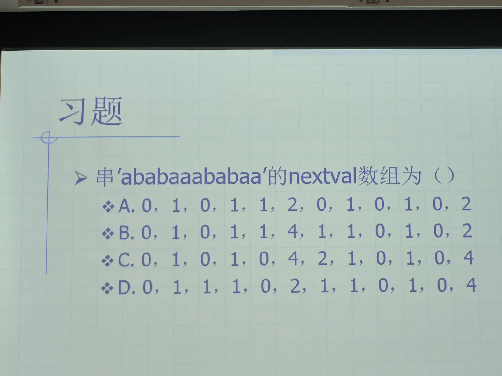

# AI 对话记忆导出

## 🔵 👤 用户提问

## 🟣 🤖 AI 回答

这道题考察的是数据结构中KMP算法的优化数组 `nextval` 的计算。

正确答案是：<strong>C</strong>

### 详细推导过程：

给定字符串 `S = 'ababaaababaa'`，长度为12。为了方便推导，我们假设数组下标从1开始（符合题目选项中第一个数字为0的教材习惯）。

<strong>第一步：计算 `next` 数组</strong>  
`next` 数组的规则是：`next[1] = 0`；`next[j]` 的值等于该位置之前子串的“最长相等前后缀”的长度 \+ 1。

* `j=1` (a): `next = 0`
* `j=2` (b): 前面是'a'，无相等前后缀，`next = 1`
* `j=3` (a): 前面是'ab'，无相等前后缀，`next = 1`
* `j=4` (b): 前面是'aba'，最长相等前后缀为'a'，长度1，`next = 2`
* `j=5` (a): 前面是'abab'，最长相等前后缀为'ab'，长度2，`next = 3`
* `j=6` (a): 前面是'ababa'，最长相等前后缀为'aba'，长度3，`next = 4`
* `j=7` (a): 前面是'ababaa'，最长相等前后缀为'a'，长度1，`next = 2`
* `j=8` (b): 前面是'ababaaa'，最长相等前后缀为'a'，长度1，`next = 2`
* `j=9` (a): 前面是'ababaaab'，最长相等前后缀为'ab'，长度2，`next = 3`
* `j=10` (b): 前面是'ababaaaba'，最长相等前后缀为'aba'，长度3，`next = 4`
* `j=11` (a): 前面是'ababaaabab'，最长相等前后缀为'abab'，长度4，`next = 5`
* `j=12` (a): 前面是'ababaaababa'，最长相等前后缀为'ababa'，长度5，`next = 6`

<!-- DeepSeek list boundary -->

此时得到的 `next` 数组为：`0, 1, 1, 2, 3, 4, 2, 2, 3, 4, 5, 6`

<strong>第二步：计算 `nextval` 数组</strong>  
`nextval` 的优化规则是：

1. `nextval[1] = 0`
2. 对于 `j > 1`，如果 `S[j] == S[next[j]]`，则 `nextval[j] = nextval[next[j]]`；否则 `nextval[j] = next[j]`。

<!-- DeepSeek list boundary -->

逐项计算：

* `j=1` (a): `nextval[1] = 0`
* `j=2` (b): `S[2]='b'`, `next[2]=1`。`S[2] != S[1]`（'b' ≠ 'a'），所以 `nextval[2] = next[2] = 1`
* `j=3` (a): `S[3]='a'`, `next[3]=1`。`S[3] == S[1]`（'a' \=\= 'a'），所以 `nextval[3] = nextval[1] = 0`
* `j=4` (b): `S[4]='b'`, `next[4]=2`。`S[4] == S[2]`（'b' \=\= 'b'），所以 `nextval[4] = nextval[2] = 1`
* `j=5` (a): `S[5]='a'`, `next[5]=3`。`S[5] == S[3]`（'a' \=\= 'a'），所以 `nextval[5] = nextval[3] = 0`
* `j=6` (a): `S[6]='a'`, `next[6]=4`。`S[6] != S[4]`（'a' ≠ 'b'），所以 `nextval[6] = next[6] = 4`
* `j=7` (a): `S[7]='a'`, `next[7]=2`。`S[7] != S[2]`（'a' ≠ 'b'），所以 `nextval[7] = next[7] = 2`
* `j=8` (b): `S[8]='b'`, `next[8]=2`。`S[8] == S[2]`（'b' \=\= 'b'），所以 `nextval[8] = nextval[2] = 1`
* `j=9` (a): `S[9]='a'`, `next[9]=3`。`S[9] == S[3]`（'a' \=\= 'a'），所以 `nextval[9] = nextval[3] = 0`
* `j=10` (b): `S[10]='b'`, `next[10]=4`。`S[10] == S[4]`（'b' \=\= 'b'），所以 `nextval[10] = nextval[4] = 1`
* `j=11` (a): `S[11]='a'`, `next[11]=5`。`S[11] == S[5]`（'a' \=\= 'a'），所以 `nextval[11] = nextval[5] = 0`
* `j=12` (a): `S[12]='a'`, `next[12]=6`。`S[12] == S[6]`（'a' \=\= 'a'），所以 `nextval[12] = nextval[6] = 4`

<!-- DeepSeek list boundary -->

最终得到的 `nextval` 数组为：<strong>`0, 1, 0, 1, 0, 4, 2, 1, 0, 1, 0, 4`</strong>

与选项对比，完全符合 <strong>选项 C</strong>。

