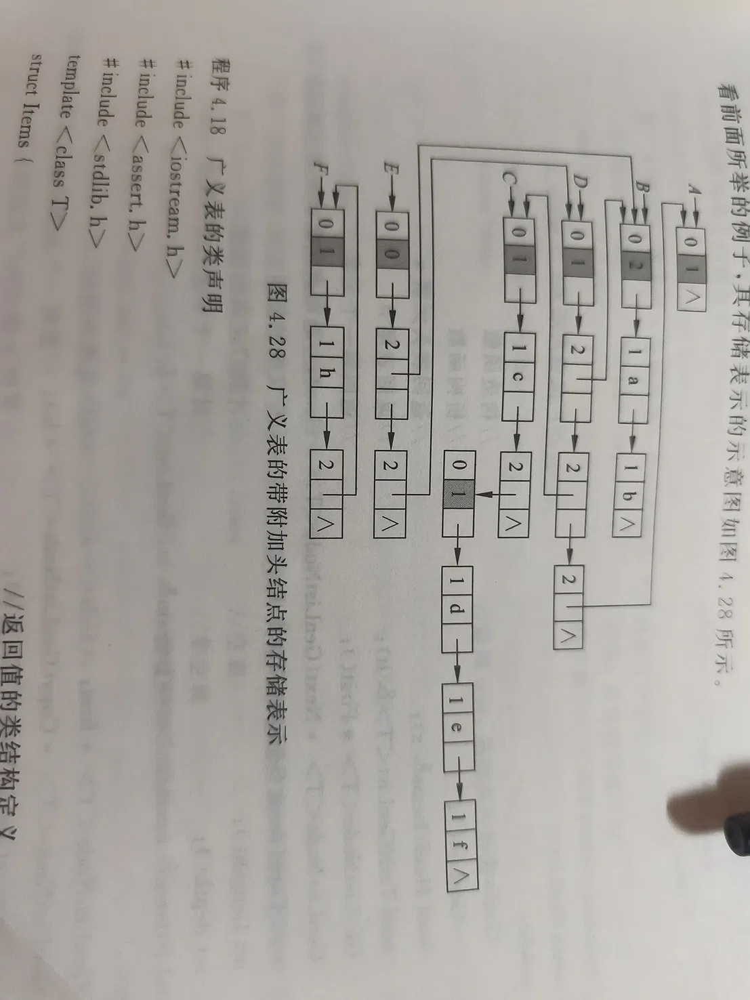

# AI 对话记忆导出

## 🔵 👤 用户提问

转为表形式

## 🟣 🤖 AI 回答

根据图片中“广义表的带附加头结点的存储表示”示意图，可以将其转换为清晰的表格形式。

在图中，每个节点由两部分组成：<strong>Tag（标志位）</strong> 和 <strong>Data/Link（数据或指针）</strong>，以及指向下一个节点的 <strong>Next（尾指针）</strong>。

* <strong>Tag \= 0</strong>：附加头结点。
* <strong>Tag \= 1</strong>：原子节点（存放具体数据，如 a, b, c...）。
* <strong>Tag \= 2</strong>：子表节点（存放指向子表的指针）。
* <strong>^</strong>：表示空指针（NULL）。

<!-- DeepSeek list boundary -->

以下是各个广义表（A\~F）的节点结构详情及对应的广义表表达式：

### 1\. 节点明细表

| 所在表 | 节点类型 (Tag) | 数据/指针 (Data/Link) | 尾指针 (Next) | 说明 |
| --- | --- | --- | --- | --- |
| <strong>A</strong> | 0 (头结点) | 1 | -\> 原子 a | 指向表头 |
|  | 1 (原子) | a | -\> 原子 b |  |
|  | 1 (原子) | b | ^ |  |
| <strong>B</strong> | 0 (头结点) | 2 | -\> 原子 a | 指向表头 |
|  | 1 (原子) | a | -\> 原子 b |  |
|  | 1 (原子) | b | ^ |  |
| <strong>C</strong> | 0 (头结点) | 1 | -\> 原子 c | 指向表头 |
|  | 1 (原子) | c | -\> 空子表 |  |
|  | 2 (子表) | ^ | ^ | 共享节点(空表) |
| <strong>D</strong> | 0 (头结点) | 1 | -\> 子表节点 | 指向表头 |
|  | 2 (子表) | 1 | -\> 共享空表 |  |
|  | 2 (子表) | ^ | -\> 原子 d | 共享节点(空表) |
|  | 1 (原子) | d | -\> 原子 e |  |
|  | 1 (原子) | e | -\> 原子 f |  |
|  | 1 (原子) | f | ^ |  |
| <strong>E</strong> | 0 (头结点) | 0 | -\> 子表节点 | 指向表头 |
|  | 2 (子表) | 2 | ^ | 指向空子表 |
| <strong>F</strong> | 0 (头结点) | 1 | -\> 原子 h | 指向表头 |
|  | 1 (原子) | h | -\> 空子表 |  |
|  | 2 (子表) | ^ | ^ | 共享节点(空表) |

---

### 2\. 广义表表达式推导

根据上述节点关系，可以推导出各个广义表的实际逻辑结构：

* <strong>表 A</strong>：`(a, b)`
* <strong>表 B</strong>：`(a, b)` （注：与 A 结构相同，但头结点指针指向不同）
* <strong>表 C</strong>：`(c, ())` （包含原子 c 和一个空表）
* <strong>表 D</strong>：`((), d, e, f)` （包含一个空子表，以及原子 d, e, f）
* <strong>表 E</strong>：`(())` （包含一个空表）
* <strong>表 F</strong>：`(h, ())` （包含原子 h 和一个空表）

<!-- DeepSeek list boundary -->

<strong>补充说明：</strong>  
从图中可以看出，图中有多个节点通过箭头指向了同一个 `[2|^]` 节点（位于 C、D、E、F 下方），这在内存表示中说明<strong>空子表节点是被多个广义表共享的</strong>（节省内存）。

## 🔵 👤 用户提问

我是说转为广义表

## 🟣 🤖 AI 回答

根据图 4.28 “广义表的带附加头结点的存储表示”，各字母所代表的广义表表达式如下：

* <strong>表 A</strong>：`(a, b)`  
  <em>(头结点指向原子 a，a 的 next 指向原子 b)</em>
* <strong>表 B</strong>：`(a, b)`  
  <em>(结构同 A，头结点指向原子 a，a 的 next 指向原子 b)</em>
* <strong>表 C</strong>：`(c, ())`  
  <em>(头结点指向原子 c，c 的 next 指向一个子表节点，该子表节点指向共享的空表头结点)</em>
* <strong>表 D</strong>：`((), d, e, f)`  
  <em>(头结点指向一个空子表节点，该子表节点 next 依次指向原子 d, e, f)</em>
* <strong>表 E</strong>：`(())`  
  <em>(头结点指向一个子表节点，该子表节点指向共享的空表，且没有后续节点)</em>
* <strong>表 F</strong>：`(h, ())`  
  <em>(头结点指向原子 h，h 的 next 指向一个空子表节点)</em>

<!-- DeepSeek list boundary -->

> <strong>补充说明：</strong>
>
> * 图中所有 `[2|...]` 向下指向同一个灰底的 `[0|^]` 节点，这是一个<strong>共享的空表</strong>，代表广义表中的 `()`。
> * `Tag = 0` 为附加头结点；`Tag = 1` 为原子节点；`Tag = 2` 为子表节点。
>
>
> <!-- DeepSeek list boundary -->

