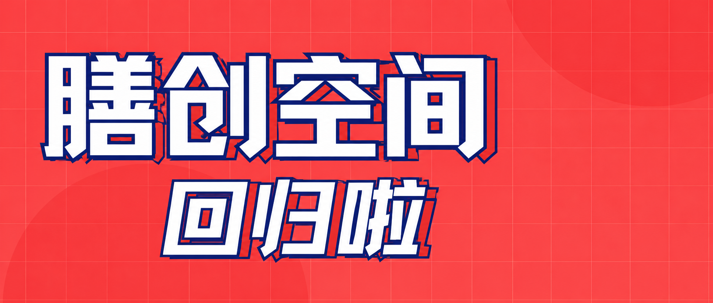
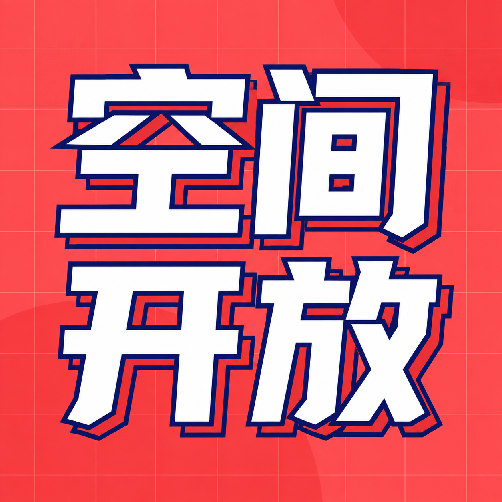
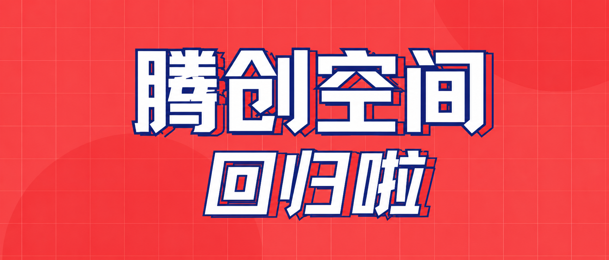
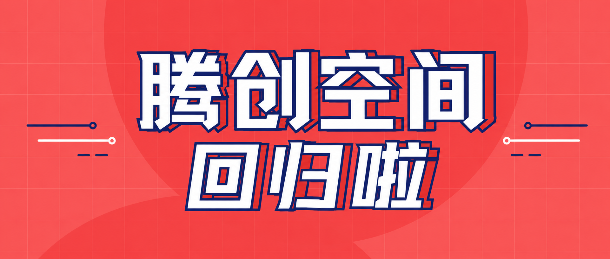
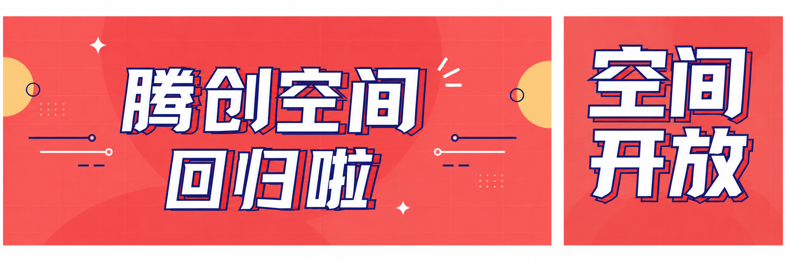

# AI 对话记忆导出

## 🔵 👤 用户提问

生成一张 2.35:1 的图片，已上传的图片为基础，把右侧的任务和图画去掉，把左侧的文字摆到合适位置；另外再生成一张风格相同的 1:1 的图片，居中写“空间开放”四个大字（分两行写）

## 🟣 🤖 AI 回答

## 🔵 👤 用户提问

1:1 图片很好，保持不动，2.35:1 图片改一下：第一个字应为“腾”，然后整个两行文字要居中，现在文字偏左，往右移动一些

## 🟣 🤖 AI 回答

## 🔵 👤 用户提问

文字两侧加些装饰，要符合主题的

## 🟣 🤖 AI 回答

## 🔵 👤 用户提问

换一种装饰，要简朴踏实一些的，最开始上传给你的那个图片可以参考

## 🟣 🤖 AI 回答

## 🔵 👤 用户提问

这个又太单调了，稍微再花哨一点，你要找到这两者之间的平衡

## 🟣 🤖 AI 回答

## 🔵 👤 用户提问

稍微调整背景色使两侧图片看起来更加和谐融洽，仅仅调整背景色不要干扰其他内容

## 🟣 🤖 AI 回答

