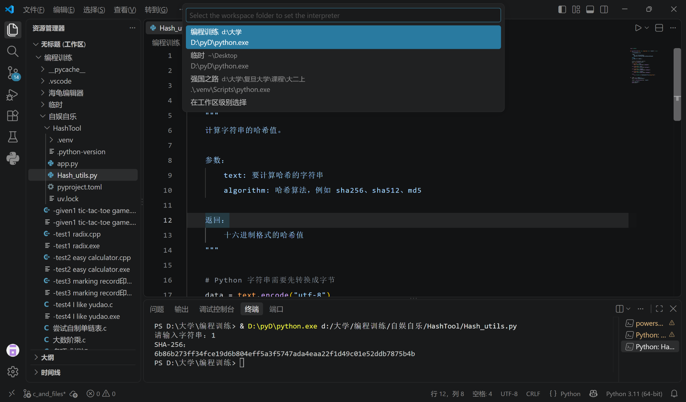
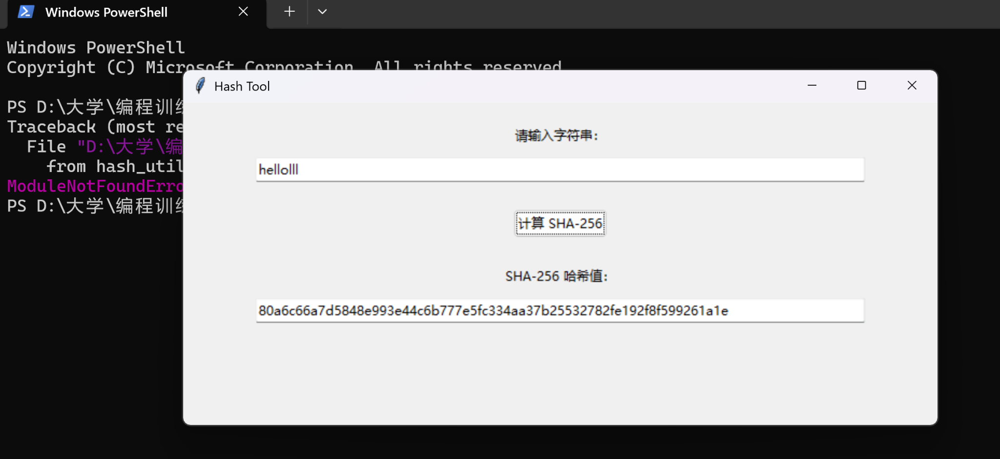
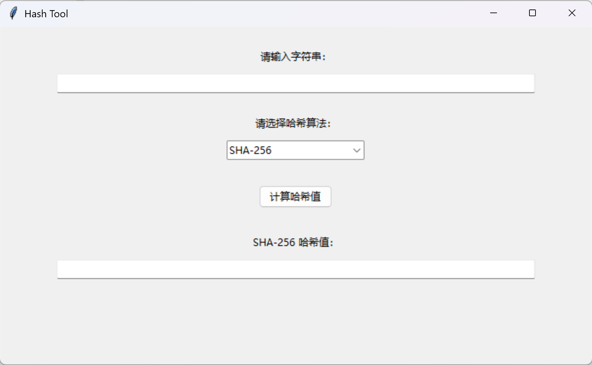
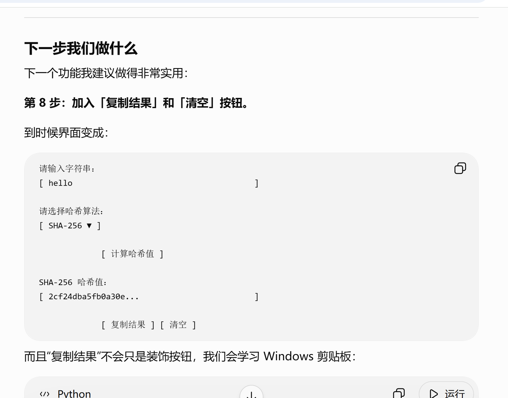
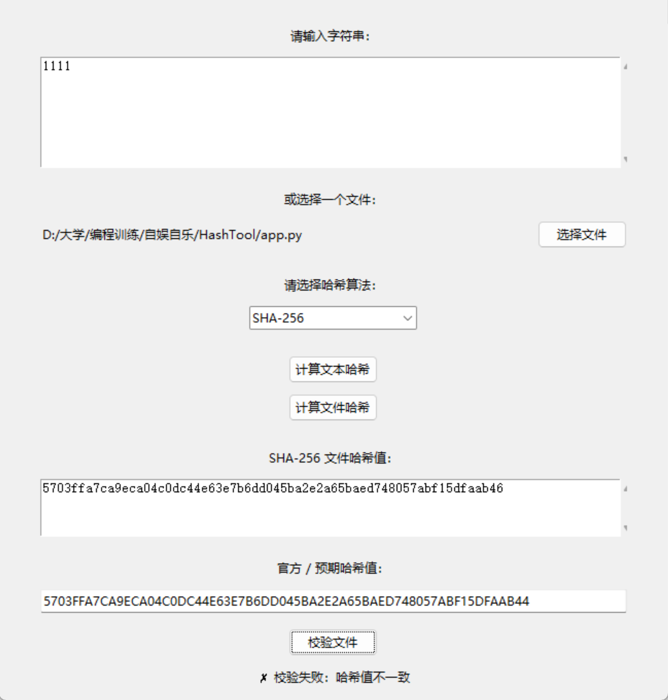
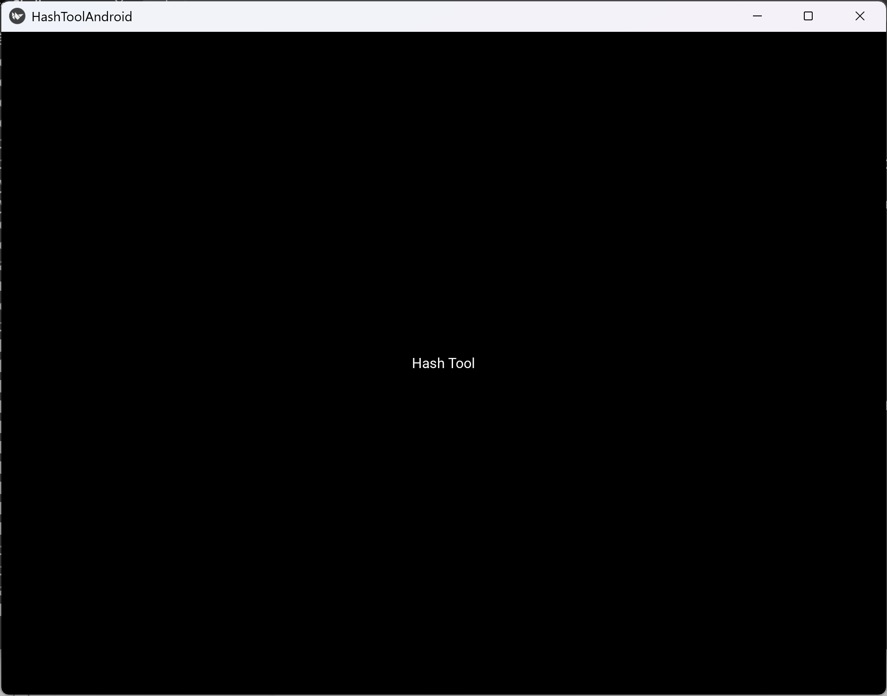
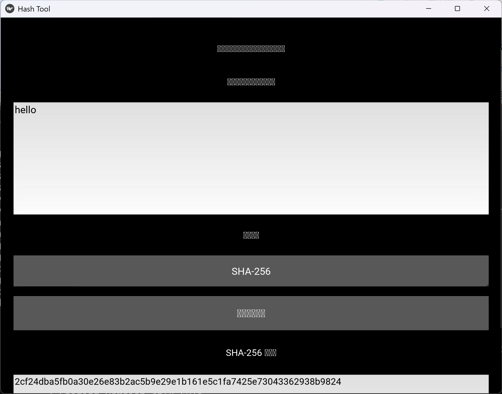

# AI 对话记忆导出


<hr style="border: 0; border-top: 5px solid #2563EB; margin: 48px 0 24px 0;">

## 🔵 👤 用户提问

我要做一个输入字符串输出哈希值的软件，暂定为Windows exe形式，语言用Python，包含前后端，从第一步写代码开始手把手教我


<hr style="border: 0; border-top: 5px solid #9333EA; margin: 48px 0 24px 0;">

## 🟣 🤖 AI 回答

我们先定一个非常清晰的最终目标：

> 做一个 Windows 桌面程序：用户输入任意字符串 → 选择 SHA-256 / SHA-512 / MD5 等算法 → 点击按钮 → 显示哈希值 → 可以一键复制 → 最终打包成 `.exe`，双击即可运行。

技术栈先保持简单：

- **语言**：Python
- **后端逻辑**：Python 标准库 `hashlib`
- **前端 GUI**：Python 标准库 `tkinter`
- **打包**：后面用 PyInstaller
- **第一版不联网、不需要数据库、不需要前端框架**
- 最终项目会把“界面”和“哈希逻辑”分开，方便以后继续开发

## 第 1 步：创建项目文件夹

在你想放项目的位置新建一个文件夹，比如：

```text
HashTool
```

然后用 VS Code 打开这个文件夹。

最终我们先建立这两个文件：

```text
HashTool/
│
├── app.py
└── hash_utils.py
```

其中：

```text
app.py
```

负责**前端界面**。

```text
hash_utils.py
```

负责**后端哈希计算**。

---

# 第 2 步：先写后端

先新建：

```text
hash_utils.py
```

把下面代码完整复制进去：

```python
import hashlib


def calculate_hash(text: str, algorithm: str = "sha256") -> str:
    """
    计算字符串的哈希值。

    参数：
        text: 要计算哈希的字符串
        algorithm: 哈希算法，例如 sha256、sha512、md5

    返回：
        十六进制格式的哈希值
    """

    # Python 字符串需要先转换成字节
    data = text.encode("utf-8")

    if algorithm == "md5":
        return hashlib.md5(data).hexdigest()

    elif algorithm == "sha1":
        return hashlib.sha1(data).hexdigest()

    elif algorithm == "sha256":
        return hashlib.sha256(data).hexdigest()

    elif algorithm == "sha512":
        return hashlib.sha512(data).hexdigest()

    else:
        raise ValueError(f"不支持的哈希算法：{algorithm}")
```

保存。

---

## 这段代码到底干了什么？

最核心的其实只有这一句：

```python
hashlib.sha256(data).hexdigest()
```

假设输入：

```text
hello
```

Python 原本拿到的是字符串：

```python
"hello"
```

但哈希函数处理的是**字节**，所以先：

```python
data = text.encode("utf-8")
```

得到类似：

```python
b'hello'
```

然后：

```python
hashlib.sha256(data)
```

计算 SHA-256。

最后：

```python
.hexdigest()
```

把计算结果转换成人类比较容易查看的十六进制字符串。

例如：

```text
hello
```

SHA-256 是：

```text
2cf24dba5fb0a30e26e83b2ac5b9e29e1b161e5c1fa7425e73043362938b9824
```

注意一个重要概念：

**哈希 ≠ 加密。**

例如：

```text
hello
↓ SHA-256
2cf24dba...
```

正常情况下不能再通过这个哈希值“解密”回：

```text
hello
```

这和之前你接触的 AES 是完全不同的东西。

---

# 第 3 步：单独测试后端

现在先别急着做窗口。

我们验证后端有没有写对。

在 `hash_utils.py` 最下面临时加：

```python
if __name__ == "__main__":
    text = input("请输入字符串：")

    result = calculate_hash(text, "sha256")

    print("SHA-256：")
    print(result)
```

于是整个文件现在是：

```python
import hashlib


def calculate_hash(text: str, algorithm: str = "sha256") -> str:
    """
    计算字符串的哈希值。

    参数：
        text: 要计算哈希的字符串
        algorithm: 哈希算法，例如 sha256、sha512、md5

    返回：
        十六进制格式的哈希值
    """

    data = text.encode("utf-8")

    if algorithm == "md5":
        return hashlib.md5(data).hexdigest()

    elif algorithm == "sha1":
        return hashlib.sha1(data).hexdigest()

    elif algorithm == "sha256":
        return hashlib.sha256(data).hexdigest()

    elif algorithm == "sha512":
        return hashlib.sha512(data).hexdigest()

    else:
        raise ValueError(f"不支持的哈希算法：{algorithm}")


if __name__ == "__main__":
    text = input("请输入字符串：")

    result = calculate_hash(text, "sha256")

    print("SHA-256：")
    print(result)
```

---

# 第 4 步：运行

在 VS Code 里打开终端。

确保当前目录是：

```text
HashTool
```

然后运行：

```powershell
python hash_utils.py
```

如果你的电脑上习惯使用：

```powershell
py
```

也可以：

```powershell
py hash_utils.py
```

应该出现：

```text
请输入字符串：
```

输入：

```text
hello
```

回车。

正确输出应该是：

```text
SHA-256：
2cf24dba5fb0a30e26e83b2ac5b9e29e1b161e5c1fa7425e73043362938b9824
```

如果得到这个结果，说明我们的**后端第一版已经完成了**。

---

# 第 5 步：开始做真正的 Windows 界面

现在打开：

```text
app.py
```

先写最简单的 GUI：

```python
import tkinter as tk
from tkinter import ttk

from hash_utils import calculate_hash


def generate_hash():
    text = input_text.get()

    result = calculate_hash(text, "sha256")

    output_text.delete(0, tk.END)
    output_text.insert(0, result)


# 创建主窗口
root = tk.Tk()

# 窗口标题
root.title("Hash Tool")

# 窗口大小
root.geometry("700x300")

# 输入文字
input_label = ttk.Label(
    root,
    text="请输入字符串："
)
input_label.pack(pady=(20, 5))

# 输入框
input_text = ttk.Entry(
    root,
    width=80
)
input_text.pack(pady=5)

# 计算按钮
generate_button = ttk.Button(
    root,
    text="计算 SHA-256",
    command=generate_hash
)
generate_button.pack(pady=20)

# 输出文字
output_label = ttk.Label(
    root,
    text="SHA-256 哈希值："
)
output_label.pack(pady=5)

# 输出框
output_text = ttk.Entry(
    root,
    width=80
)
output_text.pack(pady=5)

# 启动 GUI
root.mainloop()
```

保存。

---

# 第 6 步：运行第一个 GUI 程序

终端执行：

```powershell
python app.py
```

现在应该会弹出来一个真正的 Windows 窗口。

大概结构是：

```text
┌───────────────────────────────────────────────────┐
│                    Hash Tool                      │
│                                                   │
│  请输入字符串：                                   │
│  [ hello                                       ]  │
│                                                   │
│              [ 计算 SHA-256 ]                    │
│                                                   │
│  SHA-256 哈希值：                                 │
│  [ 2cf24dba5fb0a30e26e83b2ac5...              ] │
│                                                   │
└───────────────────────────────────────────────────┘
```

输入：

```text
hello
```

点击：

```text
计算 SHA-256
```

下面应该出现：

```text
2cf24dba5fb0a30e26e83b2ac5b9e29e1b161e5c1fa7425e73043362938b9824
```

到这里，你其实已经拥有了一个**完整的最小可运行桌面哈希软件**。

---

# 现在项目的结构

你的项目应该是：

```text
HashTool/
│
├── app.py
└── hash_utils.py
```

调用关系是：

```text
                    用户
                     │
                     ▼
              ┌─────────────┐
              │   app.py    │
              │    前端     │
              └──────┬──────┘
                     │
              calculate_hash()
                     │
                     ▼
          ┌─────────────────────┐
          │    hash_utils.py    │
          │        后端         │
          │                     │
          │ hashlib.sha256()    │
          └──────────┬──────────┘
                     │
                     ▼
                  哈希值
                     │
                     ▼
                  app.py
                     │
                     ▼
                显示给用户
```

这就是为什么我没有把所有代码一股脑写在 `app.py` 里。

我们已经开始形成正规的程序结构了。

---

## 接下来我们会逐步把它做成这样

第一阶段我们已经完成最基础的：

```text
输入字符串
    ↓
SHA-256
    ↓
输出哈希
```

接下来我建议我们**一项一项加，而不是一次塞一大堆代码**：

1. 加入算法选择框：

```text
┌──────────────┐
│ SHA-256    ▼ │
├──────────────┤
│ MD5          │
│ SHA-1        │
│ SHA-256      │
│ SHA-512      │
└──────────────┘
```

2. 加入“复制哈希值”按钮。

3. 支持多行字符串，例如：

```text
hello
world
复旦大学
123456
```

4. 显示：

```text
输入长度：14 字符
输出长度：64 个十六进制字符
```

5. 增加：

```text
清空
复制
重新计算
```

6. 改善 Windows UI。

7. 加程序图标：

```text
HashTool.ico
```

8. 完善项目结构：

```text
HashTool/
│
├── app.py
├── hash_utils.py
├── assets/
│   └── icon.ico
├── README.md
└── requirements.txt
```

9. 最后打包：

```text
HashTool.exe
```

最终可以做到：

```text
HashTool.exe
```

直接双击运行，**使用者不需要打开 VS Code，也不需要自己敲 `python app.py`**。

你现在就先做到 **第 6 步：成功弹出窗口并算出 `hello` 的 SHA-256**。如果运行过程中出现任何报错，把终端报错或截图直接发给我；如果成功，我们下一步就开始做**算法下拉选择器 + MD5/SHA-1/SHA-256/SHA-512 动态切换**。


<hr style="border: 0; border-top: 5px solid #2563EB; margin: 48px 0 24px 0;">

## 🔵 👤 用户提问

我现在做完了前四步，我突然想到我需要使用uv环境，我该怎样做》？


<hr style="border: 0; border-top: 5px solid #9333EA; margin: 48px 0 24px 0;">

## 🟣 🤖 AI 回答

可以，而且现在切换正合适。你目前只有 `app.py` 和 `hash_utils.py`，还没有复杂依赖，所以几乎没有迁移成本。

我建议你不要直接 `uv init`，因为现在新版 `uv init` 默认会额外创建 `src/` 等项目结构。你已经有现成代码了，用：

```powershell
uv init --bare
```

最干净。官方文档说明，`--bare` 只创建 `pyproject.toml`，不会动你的现有目录结构。[Commands | uv](https://docs.astral.sh/uv/reference/cli/?utm_source=chatgpt.com)

## 现在从你当前的 `HashTool` 文件夹开始

你现在大概是：

```text
HashTool/
├── app.py
└── hash_utils.py
```

在 VS Code 中打开这个文件夹，然后打开终端。

先确认终端位置：

```powershell
pwd
```

应该指向你的：

```text
...\HashTool
```

然后执行：

```powershell
uv --version
```

如果能看到类似：

```text
uv 0.x.x
```

说明你已经装好了 uv。

如果提示：

```text
uv : 无法将“uv”项识别为...
```

那就告诉我，我再带你安装。

---

## 第 1 步：把现有文件夹初始化成 uv 项目

执行：

```powershell
uv init --bare
```

这时候目录会变成：

```text
HashTool/
├── app.py
├── hash_utils.py
└── pyproject.toml
```

打开 `pyproject.toml`，你会看到类似：

```toml
[project]
name = "hashtool"
version = "0.1.0"
requires-python = ">=3.x"
dependencies = []
```

这就是以后这个项目的核心配置文件。

uv 使用 `pyproject.toml` 管理项目本身和依赖。[Working on projects | uv](https://docs.astral.sh/uv/guides/projects/?utm_source=chatgpt.com) [Structure and files | uv](https://docs.astral.sh/uv/concepts/projects/layout/?utm_source=chatgpt.com)

---

# 第 2 步：确定 Python 版本

这里我建议这个项目使用：

```text
Python 3.13
```

而不是刻意追最新版本。

原因很简单：以后你要用 PyInstaller 打包 Windows `.exe`，选择成熟一些的 Python 版本通常更省事。

执行：

```powershell
uv python install 3.13
```

uv 可以自己管理 Python；如果指定版本不存在，它也能够自动下载。[Installing and managing Python | uv](https://docs.astral.sh/uv/guides/install-python/?utm_source=chatgpt.com)

然后：

```powershell
uv python pin 3.13
```

现在目录里通常会增加：

```text
.python-version
```

内容就是：

```text
3.13
```

意思就是：

> 这个项目指定使用 Python 3.13。

---

# 第 3 步：创建 uv 虚拟环境

执行：

```powershell
uv sync
```

uv 会自动建立：

```text
.venv/
```

以及：

```text
uv.lock
```

官方推荐的 uv 项目就是在项目根目录使用 `.venv` 作为项目环境。[Working on projects | uv](https://docs.astral.sh/uv/guides/projects/?utm_source=chatgpt.com) [Structure and files | uv](https://docs.astral.sh/uv/concepts/projects/layout/?utm_source=chatgpt.com)

于是你的项目现在大概变成：

```text
HashTool/
│
├── .venv/
│
├── .python-version
├── app.py
├── hash_utils.py
├── pyproject.toml
└── uv.lock
```

其中：

```text
.venv
```

就是你的**隔离 Python 环境**。

以后这个项目安装的第三方包，基本都放这里。

---

# 第 4 步：确认 uv 正在使用正确 Python

执行：

```powershell
uv run python --version
```

应该看到：

```text
Python 3.13.x
```

再执行：

```powershell
uv run python -c "import sys; print(sys.executable)"
```

你应该看到类似：

```text
D:\...\HashTool\.venv\Scripts\python.exe
```

重点就是中间出现：

```text
HashTool\.venv\
```

这说明你已经不是在随便调用电脑上的某个全局 Python，而是在用：

```text
这个项目自己的 Python
```

---

# 第 5 步：重新运行我们刚才写好的程序

之前我让你运行：

```powershell
python hash_utils.py
```

现在有 uv 之后，我建议你改成：

```powershell
uv run python hash_utils.py
```

输入：

```text
hello
```

仍然应该得到：

```text
2cf24dba5fb0a30e26e83b2ac5b9e29e1b161e5c1fa7425e73043362938b9824
```

这说明：

```text
原来的代码
+
新的 uv 环境
```

已经成功结合。

官方实际上也推荐项目里通过 `uv run` 执行命令，因为它会确保虚拟环境和项目依赖处于同步状态。[Running commands | uv](https://docs.astral.sh/uv/concepts/projects/run/?utm_source=chatgpt.com) [From pip to a uv project | uv](https://docs.astral.sh/uv/guides/migration/pip-to-project/?utm_source=chatgpt.com)

---

# 你其实不必每次激活 `.venv`

这是 `uv` 和传统 Python 教程一个很重要的区别。

传统方法经常是：

```powershell
.venv\Scripts\activate
python app.py
```

uv 当然也支持：

```powershell
.venv\Scripts\activate
```

官方 Windows 用法也是如此。[Using environments | uv](https://docs.astral.sh/uv/pip/environments/?utm_source=chatgpt.com)

激活以后终端前面通常变成：

```text
(.venv) PS D:\...\HashTool>
```

然后可以：

```powershell
python hash_utils.py
```

但我更推荐你以后养成这种习惯：

```powershell
uv run python hash_utils.py
```

以及：

```powershell
uv run python app.py
```

这样甚至不需要先执行：

```powershell
.venv\Scripts\activate
```

---

# 第 6 步：VS Code 也要选这个解释器

这个很重要。

按：

```text
Ctrl + Shift + P
```

搜索：

```text
Python: Select Interpreter
```

然后选择类似：

```text
HashTool\.venv\Scripts\python.exe
```

以后 VS Code 的：

- 自动补全
- Pylance
- 调试
- 运行 Python 文件
- import 检查

都会针对这个项目自己的环境。

---

# 现在不需要安装 hashlib 和 tkinter

你可能会想到执行：

```powershell
uv add hashlib
```

千万不要。

因为：

```python
import hashlib
```

是 **Python 标准库**。

同样，后面使用的：

```python
import tkinter
```

也不是普通 PyPI 第三方包。

所以目前：

```toml
dependencies = []
```

完全正常。

你当前这个项目实际上**一个第三方 Python 依赖都没有**。

---

# 等以后需要 PyInstaller 时

比如之后我们需要：

```text
PyInstaller
```

那时就不要：

```powershell
pip install pyinstaller
```

而是：

```powershell
uv add --dev pyinstaller
```

然后 `pyproject.toml` / `uv.lock` 会由 uv 记录下来。

对于正式 uv 项目，官方建议使用 `uv add` 管理项目依赖，而不是直接往项目 `.venv` 里 `uv pip install`。[Structure and files | uv](https://docs.astral.sh/uv/concepts/projects/layout/?utm_source=chatgpt.com)

之后运行：

```powershell
uv run pyinstaller ...
```

---

## 所以你现在只需要依次做这几个命令

假设你已经安装 uv：

```powershell
uv init --bare
```

然后：

```powershell
uv python install 3.13
```

然后：

```powershell
uv python pin 3.13
```

然后：

```powershell
uv sync
```

验证：

```powershell
uv run python --version
```

最后重新运行你刚刚完成的后端：

```powershell
uv run python hash_utils.py
```

你的开发流程就从原来的：

```text
Windows
   │
   └── 全局 Python
          │
          └── HashTool
```

正式升级成：

```text
Windows
│
├── 其他 Python 项目
│
└── HashTool
     │
     ├── pyproject.toml
     ├── uv.lock
     ├── .python-version
     │
     ├── .venv
     │    └── Python 3.13
     │
     ├── app.py
     └── hash_utils.py
```

**你刚才前四步一行代码都不用删。**

等你执行完这几个命令之后，我们就从原教程的**第 5 步继续**，但接下来我会把所有命令统一改成 `uv` 工作流，例如以后运行 GUI 就统一使用：

```powershell
uv run python app.py
```

而不是裸的 `python app.py`。


<hr style="border: 0; border-top: 5px solid #2563EB; margin: 48px 0 24px 0;">

## 🔵 👤 用户提问



为什么VS Code 识别不出来我的虚拟环境？


<hr style="border: 0; border-top: 5px solid #9333EA; margin: 48px 0 24px 0;">

## 🟣 🤖 AI 回答

原因基本已经从你的截图里暴露出来了：**你的 `.venv` 没问题，问题在于 VS Code 当前打开的是一个“多文件夹工作区”，而 `HashTool` 只是某个工作区文件夹下面的子目录。**

你截图里的结构实际上类似这样：

```text
无标题（工作区）
│
├── 编程训练        ← VS Code 认为这是一个工作区文件夹
│   ├── ...
│   └── 自娱自乐
│       └── HashTool
│           ├── .venv       ← 你的 uv 虚拟环境在这里
│           ├── .python-version
│           ├── app.py
│           ├── Hash_utils.py
│           ├── pyproject.toml
│           └── uv.lock
│
├── 临时
└── 强国之路
```

而你现在弹出的窗口写的是：

> **Select the workspace folder to set the interpreter**

下面只出现：

```text
编程训练
临时
强国之路
```

**没有 `HashTool`。**

这正是关键。

VS Code 当前认为：

```text
编程训练
```

才是一个 Python 项目范围，而：

```text
编程训练/自娱自乐/HashTool
```

只是它里面的普通子文件夹。

所以 Python 扩展优先找到的是你之前给整个：

```text
D:\大学\编程训练
```

设置的：

```text
D:\pyD\python.exe
```

而不是：

```text
D:\大学\编程训练\自娱自乐\HashTool\.venv\Scripts\python.exe
```

这也解释了你下面终端为什么运行的是：

```text
& D:\pyD\python.exe d:/大学/编程训练/自娱自乐/HashTool/Hash_utils.py
```

而右下角仍显示：

```text
Python 3.11 (64-bit)
```

---

# 最推荐的解决方法

既然 `HashTool` 是一个独立的 uv 项目，**最好把 `HashTool` 本身作为 VS Code 打开的项目根目录。**

### 第一步

点：

**文件 → 打开文件夹**

然后选择：

```text
D:\大学\编程训练\自娱自乐\HashTool
```

VS Code 可能问你是否在当前窗口打开。

都可以，我更建议：

> **在新窗口打开**

这样你的其他“编程训练”文件不会受到影响。

---

## 打开以后你左边应该直接变成

```text
HASHTOOL
│
├── .venv
├── .python-version
├── app.py
├── Hash_utils.py
├── pyproject.toml
└── uv.lock
```

而不是现在这种：

```text
编程训练
    ↓
自娱自乐
    ↓
HashTool
```

这点很重要。

---

# 第二步：重新选择解释器

打开 `HashTool` 文件夹以后：

```text
Ctrl + Shift + P
```

输入：

```text
Python: Select Interpreter
```

这时大概率会自动出现类似：

```text
Python 3.13.x ('.venv': venv)
```

路径应该是：

```text
D:\大学\编程训练\自娱自乐\HashTool\.venv\Scripts\python.exe
```

选择它。

---

# 如果还是没有自动出现

不要紧，直接手动指定。

还是：

```text
Ctrl + Shift + P
```

选择：

```text
Python: Select Interpreter
```

然后选择：

```text
Enter interpreter path...
```

或者中文版可能是：

```text
输入解释器路径...
```

再选择：

```text
Find...
```

找到：

```text
D:\大学\编程训练\自娱自乐\HashTool\.venv\Scripts\python.exe
```

选中这个：

```text
python.exe
```

即可。

---

# 第三步：检查是否真的切成功

选择以后，看 VS Code **右下角**。

你现在截图显示：

```text
Python 3.11 (64-bit)
```

切换成功后应该变成类似：

```text
Python 3.13.x ('.venv')
```

然后：

**终端 → 新建终端**

注意最好关闭旧终端再开一个新的。

运行：

```powershell
python -c "import sys; print(sys.executable)"
```

如果成功，应该输出：

```text
D:\大学\编程训练\自娱自乐\HashTool\.venv\Scripts\python.exe
```

而**不应该再是**：

```text
D:\pyD\python.exe
```

---

# 第四步：再检查 uv

执行：

```powershell
uv run python --version
```

应该类似：

```text
Python 3.13.x
```

然后：

```powershell
uv run python -c "import sys; print(sys.executable)"
```

应该同样指向：

```text
...\HashTool\.venv\Scripts\python.exe
```

这样我们就有：

```text
                 HashTool
                    │
          ┌─────────┴─────────┐
          │                   │
       VS Code               uv
          │                   │
          ▼                   ▼
    .venv\Scripts\python.exe
          │
          ▼
       Python 3.13
```

这才是我们想要的状态。

---

## 为什么 `强国之路` 能识别 `.venv`？

你的截图里还有一个非常有价值的线索。

解释器选择框显示：

```text
强国之路  d:\大学\复旦大学\课程\大二上
.\.venv\Scripts\python.exe
```

这说明那个项目的 `.venv` **就在 VS Code 认为的工作区根目录下面**：

```text
强国之路/
├── .venv/
└── ...
```

所以它识别得很好。

而你的 `HashTool` 是：

```text
编程训练/              ← 工作区根目录
└── 自娱自乐/
    └── HashTool/
        └── .venv/     ← 隔了两层
```

所以 VS Code 没把它当成这个 workspace folder 的默认虚拟环境。

**这不是 uv 出问题，也不是你 `.venv` 创建失败。**

---

## 还有一种办法，但我不推荐你现在用

你也可以保持现在这个“大杂烩工作区”，然后给 `编程训练` 强行指定：

```text
D:\大学\编程训练\自娱自乐\HashTool\.venv\Scripts\python.exe
```

但这样做会产生一个问题：

以后你在：

```text
编程训练
```

里的其他 Python 项目，例如：

```text
项目A
项目B
HashTool
```

都有可能默认继承 HashTool 的 Python 环境。

这显然不漂亮。

所以从现在开始，我建议你养成一个非常好的开发习惯：

> **一个真正的 Python 项目 = 一个独立 VS Code 文件夹/工作区。**

例如：

```text
HashTool/
├── .venv/
├── .python-version
├── pyproject.toml
├── uv.lock
├── app.py
└── hash_utils.py
```

那么 VS Code、uv、Pylance、PyInstaller 后面都会省心很多。

### 你现在最该做的只有三件事

1. **文件 → 打开文件夹 → `HashTool`**
2. **Ctrl+Shift+P → Python: Select Interpreter → `.venv\Scripts\python.exe`**
3. 新终端执行：

```powershell
python -c "import sys; print(sys.executable)"
```

只要最后显示的是：

```text
...\HashTool\.venv\Scripts\python.exe
```

就彻底解决了。

另外你截图里的 `.venv`、`.python-version`、`pyproject.toml`、`uv.lock` 都已经存在，所以可以判断：**你刚才的 uv 初始化实际上是成功的，不用重新 `uv init` 或重新创建虚拟环境。** 


<hr style="border: 0; border-top: 5px solid #2563EB; margin: 48px 0 24px 0;">

## 🔵 👤 用户提问



Let's continue


<hr style="border: 0; border-top: 5px solid #9333EA; margin: 48px 0 24px 0;">

## 🟣 🤖 AI 回答

很好，从截图看，你已经成功完成了第一版 GUI：

- 输入框正常
- 点击按钮可以计算
- SHA-256 输出正确显示
- Tkinter 窗口正常运行
- 前端已经能调用 `hash_utils.py`

所以我们正式进入下一阶段：**让用户自己选择哈希算法，而不是固定只能算 SHA-256。**

这一步我们只增加一个功能：**算法下拉选择框**。暂时不加复制、清空等功能，避免一下改太多。

---

# 第 7 步：加入哈希算法选择器

最终界面会从现在这样：

```text
请输入字符串：
[ hello                             ]

          [计算 SHA-256]

SHA-256 哈希值：
[ 2cf24d...                         ]
```

变成：

```text
请输入字符串：
[ hello                             ]

哈希算法：
[ SHA-256 ▼ ]

          [计算哈希值]

哈希值：
[ 2cf24d...                         ]
```

用户可以选择：

```text
MD5
SHA-1
SHA-256
SHA-512
```

---

## 7.1 先检查 `hash_utils.py`

你现在的 `hash_utils.py` 应该大致是这样：

```python
import hashlib


def calculate_hash(text: str, algorithm: str = "sha256") -> str:
    """
    计算字符串的哈希值。

    参数：
        text: 要计算哈希的字符串
        algorithm: 哈希算法，例如 sha256、sha512、md5

    返回：
        十六进制格式的哈希值
    """

    data = text.encode("utf-8")

    if algorithm == "md5":
        return hashlib.md5(data).hexdigest()

    elif algorithm == "sha1":
        return hashlib.sha1(data).hexdigest()

    elif algorithm == "sha256":
        return hashlib.sha256(data).hexdigest()

    elif algorithm == "sha512":
        return hashlib.sha512(data).hexdigest()

    else:
        raise ValueError(f"不支持的哈希算法：{algorithm}")
```

如果下面还有我们之前测试用的：

```python
if __name__ == "__main__":
    text = input("请输入字符串：")

    result = calculate_hash(text, "sha256")

    print("SHA-256：")
    print(result)
```

**可以保留。**

因为：

```python
if __name__ == "__main__":
```

保证了只有你直接运行：

```powershell
uv run python hash_utils.py
```

时才执行测试代码。

当 `app.py`：

```python
from hash_utils import calculate_hash
```

导入它的时候，不会弹出“请输入字符串”。

---

# 7.2 修改 `app.py`

现在把你的 `app.py` **整体替换为下面这一版**：

```python
import tkinter as tk
from tkinter import ttk

from hash_utils import calculate_hash


def generate_hash():
    # 获取用户输入的字符串
    text = input_text.get()

    # 获取用户选择的算法
    selected_algorithm = algorithm_box.get()

    # GUI 显示名称 → 后端使用名称
    algorithm_map = {
        "MD5": "md5",
        "SHA-1": "sha1",
        "SHA-256": "sha256",
        "SHA-512": "sha512",
    }

    algorithm = algorithm_map[selected_algorithm]

    # 计算哈希值
    result = calculate_hash(text, algorithm)

    # 清空原有输出
    output_text.delete(0, tk.END)

    # 显示新的哈希值
    output_text.insert(0, result)

    # 修改输出标签
    output_label.config(
        text=f"{selected_algorithm} 哈希值："
    )


# =========================
# 创建主窗口
# =========================

root = tk.Tk()

root.title("Hash Tool")

root.geometry("700x400")


# =========================
# 输入区域
# =========================

input_label = ttk.Label(
    root,
    text="请输入字符串："
)

input_label.pack(
    pady=(25, 5)
)


input_text = ttk.Entry(
    root,
    width=80
)

input_text.pack(
    pady=5
)


# =========================
# 算法选择
# =========================

algorithm_label = ttk.Label(
    root,
    text="请选择哈希算法："
)

algorithm_label.pack(
    pady=(20, 5)
)


algorithm_box = ttk.Combobox(
    root,
    values=[
        "MD5",
        "SHA-1",
        "SHA-256",
        "SHA-512",
    ],
    state="readonly",
    width=20,
)

algorithm_box.pack(
    pady=5
)

# 默认选择 SHA-256
algorithm_box.set("SHA-256")


# =========================
# 计算按钮
# =========================

generate_button = ttk.Button(
    root,
    text="计算哈希值",
    command=generate_hash,
)

generate_button.pack(
    pady=25
)


# =========================
# 输出区域
# =========================

output_label = ttk.Label(
    root,
    text="SHA-256 哈希值："
)

output_label.pack(
    pady=5
)


output_text = ttk.Entry(
    root,
    width=80
)

output_text.pack(
    pady=5
)


# =========================
# 启动程序
# =========================

root.mainloop()
```

---

# 7.3 用 uv 启动

因为我们现在已经使用 uv，所以以后统一执行：

```powershell
uv run python app.py
```

不要再优先使用：

```powershell
python app.py
```

虽然后者在虚拟环境激活以后也能运行，但现在我们希望你养成：

```text
uv 项目
    ↓
uv run
    ↓
项目自己的 .venv
    ↓
Python
```

这样的习惯。

---

# 7.4 运行以后测试

窗口打开后，你应该看到：

```text
                Hash Tool


            请输入字符串：

[ hello                                             ]


           请选择哈希算法：

              [ SHA-256 ▼ ]


              [ 计算哈希值 ]


            SHA-256 哈希值：

[ 2cf24dba5fb0a30e26e83b2ac5b9e29e...             ]
```

现在我们逐个测试。

### 测试 SHA-256

输入：

```text
hello
```

选择：

```text
SHA-256
```

应该输出：

```text
2cf24dba5fb0a30e26e83b2ac5b9e29e1b161e5c1fa7425e73043362938b9824
```

---

### 测试 MD5

下拉选择：

```text
MD5
```

点击：

```text
计算哈希值
```

应该输出：

```text
5d41402abc4b2a76b9719d911017c592
```

同时界面的文字会自动从：

```text
SHA-256 哈希值：
```

变成：

```text
MD5 哈希值：
```

---

### 测试 SHA-1

选择：

```text
SHA-1
```

应该输出：

```text
aaf4c61ddcc5e8a2dabede0f3b482cd9aea9434d
```

---

### 测试 SHA-512

选择：

```text
SHA-512
```

这次输出会非常长：

```text
9b71d224bd62f3785d96d46ad3ea3d73...
```

这是正常的。

SHA-512 输出 **128 个十六进制字符**。

---

# 这里有一段代码非常值得理解

这部分：

```python
algorithm_map = {
    "MD5": "md5",
    "SHA-1": "sha1",
    "SHA-256": "sha256",
    "SHA-512": "sha512",
}
```

实际上是在做一张“翻译表”。

用户看到：

```text
SHA-256
```

但我们的后端代码需要：

```python
"sha256"
```

所以：

```python
selected_algorithm = algorithm_box.get()
```

假如得到：

```python
"SHA-256"
```

然后：

```python
algorithm = algorithm_map[selected_algorithm]
```

就会得到：

```python
"sha256"
```

最终：

```python
calculate_hash(text, algorithm)
```

实际上执行：

```python
calculate_hash(text, "sha256")
```

于是整个流程就是：

```text
用户
 │
 │ 选择
 ▼
"SHA-256"
 │
 │ algorithm_map
 ▼
"sha256"
 │
 │
 ▼
calculate_hash()
 │
 ▼
hashlib.sha256()
 │
 ▼
哈希结果
```

---

# `Combobox` 又是什么？

我们新认识了一个 Tkinter 控件：

```python
ttk.Combobox
```

也就是：

> 下拉选择框。

这里：

```python
values=[
    "MD5",
    "SHA-1",
    "SHA-256",
    "SHA-512",
]
```

规定有哪些选项。

这里：

```python
state="readonly"
```

非常重要。

它意味着：

> 用户只能从我们提供的算法中选择，不能自己乱输入。

否则用户可能输入：

```text
SHA-999999
```

程序就不知道该怎么算。

---

# 为什么有：

```python
algorithm_box.set("SHA-256")
```

因为我们希望程序启动时默认是：

```text
SHA-256
```

而不是一个空白框。

SHA-256 也比较适合作为这个软件默认算法。

---

# 到这里我们的软件已经有真正的软件逻辑了

第一版：

```text
用户
 │
 ▼
输入字符串
 │
 ▼
固定 SHA-256
 │
 ▼
输出
```

现在变成：

```text
                 用户
                  │
          ┌───────┴───────┐
          ▼               ▼
      输入字符串        选择算法
                          │
              ┌───────────┼───────────┐
              ▼           ▼           ▼
             MD5        SHA-1       SHA-256
                                      │
                                   SHA-512
              └───────────┬───────────┘
                          ▼
                  calculate_hash()
                          │
                          ▼
                       hashlib
                          │
                          ▼
                       哈希值
```

这已经比刚才那个“只能计算 SHA-256”的 Demo 更接近真正的软件了。

---

## 下一步我们做什么

下一个功能我建议做得非常实用：

**第 8 步：加入「复制结果」和「清空」按钮。**

到时候界面变成：

```text
请输入字符串：
[ hello                                      ]

请选择哈希算法：
[ SHA-256 ▼ ]

             [ 计算哈希值 ]

SHA-256 哈希值：
[ 2cf24dba5fb0a30e...                        ]

             [ 复制结果 ] [ 清空 ]
```

而且“复制结果”不会只是装饰按钮，我们会学习 Windows 剪贴板：

```python
root.clipboard_clear()
root.clipboard_append(...)
```

做完以后，就可以点击一次直接把哈希值复制到剪贴板。之后我们再解决你当前界面里已经能看到的另一个问题：**SHA-512 太长时，单行输出框不方便查看**，届时会把输入/输出区域一起升级。


<hr style="border: 0; border-top: 5px solid #2563EB; margin: 48px 0 24px 0;">

## 🔵 👤 用户提问



我可不可以从这里进行输入破坏以入侵目标计算机？例如输入“execute（。。。）”


<hr style="border: 0; border-top: 5px solid #9333EA; margin: 48px 0 24px 0;">

## 🟣 🤖 AI 回答


<hr style="border: 0; border-top: 5px solid #2563EB; margin: 48px 0 24px 0;">

## 🔵 👤 用户提问

不，我的意思是，如果可以被入侵，那我们应该加入输入保护啊？我没有要当黑客的意思


<hr style="border: 0; border-top: 5px solid #9333EA; margin: 48px 0 24px 0;">

## 🟣 🤖 AI 回答

对，你这个思路是对的：**在继续加功能之前，先想清楚“用户输入最后会流向哪里”**，这就是最基本的安全设计。

不过对于你现在这个版本，有一个很重要的结论：

> **目前输入框里写 `execute(...)`、`rm ...`、`del ...`、Python 代码、SQL、PowerShell 命令等，都不会被执行。**

因为你的程序目前实际上只是：

```python
用户输入
   ↓
text.encode("utf-8")
   ↓
hashlib.sha256(...)
   ↓
哈希值
```

例如用户输入：

```text
execute("format C:")
```

你的程序不会理解它是命令，而只会把这些字符当成普通文本：

```python
b'execute("format C:")'
```

然后计算它的 SHA-256。

所以现在**不应该做“禁止输入 execute、cmd、python 之类关键词”这种过滤**。这不仅没有必要，而且会破坏哈希工具本来的用途——用户可能本来就想计算一段源代码或命令文本的哈希值。

真正应该防的是下面这些问题。

## 第一层保护：限制输入大小

这是现在最值得加入的。

如果有人粘贴非常大的文本，例如几百 MB，可能让界面卡死、占用大量内存。

我们可以暂时限制为：

```text
最多 1,000,000 个字符
```

约一百万字符。

修改 `generate_hash()`：

```python
def generate_hash():
    text = input_text.get()

    # 输入长度保护
    max_length = 1_000_000

    if len(text) > max_length:
        messagebox.showerror(
            "输入过长",
            f"输入内容不能超过 {max_length:,} 个字符。"
        )
        return

    selected_algorithm = algorithm_box.get()

    algorithm_map = {
        "MD5": "md5",
        "SHA-1": "sha1",
        "SHA-256": "sha256",
        "SHA-512": "sha512",
    }

    algorithm = algorithm_map[selected_algorithm]

    try:
        result = calculate_hash(text, algorithm)

    except Exception as error:
        messagebox.showerror(
            "计算失败",
            f"发生错误：{error}"
        )
        return

    output_text.delete(0, tk.END)
    output_text.insert(0, result)

    output_label.config(
        text=f"{selected_algorithm} 哈希值："
    )
```

同时把最上面的：

```python
from tkinter import ttk
```

改成：

```python
from tkinter import ttk, messagebox
```

这样程序至少不会因为异常直接崩掉。

---

## 第二层：不要过滤所谓“危险字符”

例如这些都应该允许：

```text
execute(...)
<script>
SELECT * FROM users
&&
|
;
"
'
{}
()
```

因为在你的哈希软件里，它们只是：

> **需要计算哈希的普通字符串。**

比如：

```text
SELECT * FROM users
```

我们就应该老老实实给它算哈希，而不是判断：

> “出现 SELECT，好危险！”

安全的关键不是字符串长什么样，而是：

> **你的程序之后拿这串字符串去做什么。**

这是一个非常重要的软件安全概念。

---

## 真正危险的代码是什么样的？

比如以后你千万不要这么写：

```python
eval(text)
```

用户如果输入 Python 表达式，它就可能真的被解释。

也不要：

```python
exec(text)
```

因为这是直接执行 Python 代码。

更不要把输入直接送进系统 Shell，例如：

```python
import subprocess

subprocess.run(
    text,
    shell=True
)
```

这时输入：

```text
某些系统命令
```

才可能真的变成操作系统命令。

所以：

```text
危险输入
```

本身其实并不是问题。

真正的问题是：

```text
不可信输入
     ↓
危险执行函数
     ↓
操作系统 / 数据库 / 解释器
```

---

## 而我们现在是

```text
不可信输入
     ↓
UTF-8 编码
     ↓
hashlib
     ↓
哈希值
```

这条路径相当安全。

`hashlib` 不会突然看到：

```text
execute(...)
```

就说：

> “收到，我执行一下。”

它根本不认识什么是 `execute`。

---

## 举个特别直观的例子

假设用户输入：

```text
print("hello")
```

我们的程序做：

```python
data = text.encode("utf-8")
```

得到：

```python
b'print("hello")'
```

之后：

```python
hashlib.sha256(data).hexdigest()
```

最终只会得到类似：

```text
18a6066e...
```

整个过程：

```text
print("hello")
      ↓
    字符串
      ↓
     字节
      ↓
 SHA-256 数学运算
      ↓
    哈希值
```

**Python 从来没有把里面的 `print()` 当成程序执行。**

---

# 我建议我们把安全原则直接定下来

从这个项目现在开始，遵守这几条：

1. **输入默认视为不可信数据。**
2. **不使用 `eval()`。**
3. **不使用 `exec()` 执行用户输入。**
4. **不把用户输入直接拼进 Shell 命令。**
5. **限制异常巨大的输入。**
6. **对可能失败的操作使用异常处理。**
7. **如果以后加入文件哈希，对文件大小、路径和读取异常单独处理。**
8. **如果以后加入网络功能，再专门做服务端输入验证和资源限制。**

其中最关键的是一句：

> **不要试图识别“坏字符串”，而要控制“不可信字符串能进入哪些危险操作”。**

这比建立一个：

```python
blacklist = [
    "execute",
    "cmd",
    "powershell",
    "python",
    ...
]
```

要靠谱得多。

而且你的程序目前是**本地 Windows GUI**。在没有网络服务器、远程接口等功能的情况下，其他人也不能仅仅通过你的输入框从网络上“入侵目标计算机”；他们首先得能在这台机器上操作这个程序。

所以我们可以很自然地把**输入长度限制 + 异常处理**作为第 7.5 步加进去，然后继续第 8 步的“复制结果 / 清空”功能。


<hr style="border: 0; border-top: 5px solid #2563EB; margin: 48px 0 24px 0;">

## 🔵 👤 用户提问



先不考虑安全问题，先执行第八步


<hr style="border: 0; border-top: 5px solid #9333EA; margin: 48px 0 24px 0;">

## 🟣 🤖 AI 回答

好，我们先不扩展安全部分，直接继续 **第 8 步：加入「复制结果」和「清空」按钮**。

这一步我们**只改 `app.py`，`hash_utils.py` 不动**。

完成以后界面功能会变成：

```text
输入字符串：
[ hello                                      ]

请选择哈希算法：
[ SHA-256 ▼ ]

             [ 计算哈希值 ]

SHA-256 哈希值：
[ 2cf24dba5fb0a30e...                        ]

          [ 复制结果 ]   [ 清空 ]
```

其中：

- **复制结果**：把完整哈希值复制到 Windows 剪贴板
- **清空**：清空输入和输出
- 复制以后可以直接去记事本、微信、浏览器等地方按 `Ctrl + V`

---

# 第 8.1 步：先增加「复制结果」函数

在你的：

```python
def generate_hash():
```

函数下面，添加：

```python
def copy_result():
    # 获取输出框中的哈希值
    result = output_text.get()

    # 如果输出框是空的，就不进行复制
    if not result:
        return

    # 清空 Windows 剪贴板
    root.clipboard_clear()

    # 把哈希值写入剪贴板
    root.clipboard_append(result)

    # 更新剪贴板内容
    root.update()
```

这里最重要的是：

```python
result = output_text.get()
```

它把当前输出框中的哈希值读取出来。

例如输出框现在是：

```text
2cf24dba5fb0a30e26e83b2ac5b9e29e...
```

那么：

```python
result
```

里面就是：

```python
"2cf24dba5fb0a30e26e83b2ac5b9e29e..."
```

---

# 第 8.2 步：理解 Windows 剪贴板

这一句：

```python
root.clipboard_clear()
```

意思是：

> 清空当前剪贴板。

然后：

```python
root.clipboard_append(result)
```

意思是：

> 把哈希值放进去。

所以：

```text
哈希结果
    ↓
output_text.get()
    ↓
Python 字符串
    ↓
clipboard_append()
    ↓
Windows 剪贴板
    ↓
Ctrl + V
```

因此以后用户点击：

```text
复制结果
```

再打开记事本：

```text
Ctrl + V
```

就能直接粘贴哈希。

---

# 第 8.3 步：加入「清空」函数

继续在下面写：

```python
def clear_all():
    # 清空输入框
    input_text.delete(0, tk.END)

    # 清空输出框
    output_text.delete(0, tk.END)

    # 恢复默认标签
    output_label.config(
        text="SHA-256 哈希值："
    )

    # 恢复默认算法
    algorithm_box.set("SHA-256")

    # 把光标重新放回输入框
    input_text.focus()
```

这里我们一次完成了四件事。

点击：

```text
清空
```

以后：

### 输入框清空

```python
input_text.delete(0, tk.END)
```

其中：

```text
0
```

代表从第一个字符开始。

```python
tk.END
```

代表一直删除到最后。

也就是：

```text
hello world
↑         ↑
0        END
```

全部删除。

---

### 输出框也清空

```python
output_text.delete(0, tk.END)
```

---

### 算法恢复 SHA-256

```python
algorithm_box.set("SHA-256")
```

比如原来用户选择：

```text
SHA-512
```

点击清空以后会恢复：

```text
SHA-256
```

---

### 光标自动回到输入框

```python
input_text.focus()
```

这一点虽然小，但很好用。

用户点击：

```text
清空
```

以后不用再拿鼠标点输入框，可以直接开始打字。

---

# 第 8.4 步：加入两个按钮

找到你现在的：

```python
output_text.pack(
    pady=5
)
```

在它**下面**加入：

```python
# =========================
# 操作按钮区域
# =========================

button_frame = ttk.Frame(root)

button_frame.pack(
    pady=25
)


copy_button = ttk.Button(
    button_frame,
    text="复制结果",
    command=copy_result,
)

copy_button.pack(
    side=tk.LEFT,
    padx=10
)


clear_button = ttk.Button(
    button_frame,
    text="清空",
    command=clear_all,
)

clear_button.pack(
    side=tk.LEFT,
    padx=10
)
```

这里出现了一个新东西：

```python
ttk.Frame
```

---

# Frame 是什么？

你可以把：

```python
Frame
```

理解成一个**透明的小盒子**。

我们没有直接：

```text
主窗口
├── 复制结果
└── 清空
```

而是：

```text
主窗口
│
└── button_frame
      │
      ├── 复制结果
      └── 清空
```

这样就很方便让两个按钮横着排。

因为：

```python
copy_button.pack(
    side=tk.LEFT
)
```

和：

```python
clear_button.pack(
    side=tk.LEFT
)
```

告诉 Tkinter：

> 两个按钮都从左向右排列。

所以最终就是：

```text
[ 复制结果 ] [ 清空 ]
```

而不是：

```text
[ 复制结果 ]

[ 清空 ]
```

---

# 第 8.5 步：直接给你完整 `app.py`

如果你担心自己插错位置，可以直接把目前的 `app.py` **整体替换成下面这一版**：

```python
import tkinter as tk
from tkinter import ttk

from hash_utils import calculate_hash


def generate_hash():
    # 获取用户输入的字符串
    text = input_text.get()

    # 获取用户选择的算法
    selected_algorithm = algorithm_box.get()

    # GUI 显示名称 → 后端使用名称
    algorithm_map = {
        "MD5": "md5",
        "SHA-1": "sha1",
        "SHA-256": "sha256",
        "SHA-512": "sha512",
    }

    algorithm = algorithm_map[selected_algorithm]

    # 计算哈希值
    result = calculate_hash(text, algorithm)

    # 清空原有输出
    output_text.delete(0, tk.END)

    # 显示新的哈希值
    output_text.insert(0, result)

    # 修改输出标签
    output_label.config(
        text=f"{selected_algorithm} 哈希值："
    )


def copy_result():
    # 获取输出框中的哈希值
    result = output_text.get()

    # 如果没有结果，就不复制
    if not result:
        return

    # 清空 Windows 剪贴板
    root.clipboard_clear()

    # 将哈希结果写入剪贴板
    root.clipboard_append(result)

    # 更新剪贴板
    root.update()


def clear_all():
    # 清空输入框
    input_text.delete(0, tk.END)

    # 清空输出框
    output_text.delete(0, tk.END)

    # 恢复默认算法
    algorithm_box.set("SHA-256")

    # 恢复默认输出标题
    output_label.config(
        text="SHA-256 哈希值："
    )

    # 光标重新回到输入框
    input_text.focus()


# =========================
# 创建主窗口
# =========================

root = tk.Tk()

root.title("Hash Tool")

root.geometry("700x450")


# =========================
# 输入区域
# =========================

input_label = ttk.Label(
    root,
    text="请输入字符串："
)

input_label.pack(
    pady=(25, 5)
)


input_text = ttk.Entry(
    root,
    width=80
)

input_text.pack(
    pady=5
)


# =========================
# 算法选择区域
# =========================

algorithm_label = ttk.Label(
    root,
    text="请选择哈希算法："
)

algorithm_label.pack(
    pady=(20, 5)
)


algorithm_box = ttk.Combobox(
    root,
    values=[
        "MD5",
        "SHA-1",
        "SHA-256",
        "SHA-512",
    ],
    state="readonly",
    width=20,
)

algorithm_box.pack(
    pady=5
)

# 默认选择 SHA-256
algorithm_box.set("SHA-256")


# =========================
# 计算按钮
# =========================

generate_button = ttk.Button(
    root,
    text="计算哈希值",
    command=generate_hash,
)

generate_button.pack(
    pady=25
)


# =========================
# 输出区域
# =========================

output_label = ttk.Label(
    root,
    text="SHA-256 哈希值："
)

output_label.pack(
    pady=5
)


output_text = ttk.Entry(
    root,
    width=80
)

output_text.pack(
    pady=5
)


# =========================
# 操作按钮区域
# =========================

button_frame = ttk.Frame(root)

button_frame.pack(
    pady=25
)


copy_button = ttk.Button(
    button_frame,
    text="复制结果",
    command=copy_result,
)

copy_button.pack(
    side=tk.LEFT,
    padx=10
)


clear_button = ttk.Button(
    button_frame,
    text="清空",
    command=clear_all,
)

clear_button.pack(
    side=tk.LEFT,
    padx=10
)


# =========================
# 启动程序
# =========================

root.mainloop()
```

---

# 第 8.6 步：运行

保存以后，在项目根目录执行：

```powershell
uv run python app.py
```

窗口应该变成类似：

```text
┌──────────────────────────────────────────────┐
│                  Hash Tool                   │
│                                              │
│               请输入字符串：                 │
│                                              │
│ [ hello                                    ] │
│                                              │
│              请选择哈希算法：                │
│                                              │
│                 [ SHA-256 ▼ ]                │
│                                              │
│                 [ 计算哈希值 ]               │
│                                              │
│                SHA-256 哈希值：              │
│                                              │
│ [ 2cf24dba5fb0a30e...                     ] │
│                                              │
│          [ 复制结果 ]    [ 清空 ]             │
│                                              │
└──────────────────────────────────────────────┘
```

---

# 第 8.7 步：测试复制功能

输入：

```text
hello
```

选择：

```text
SHA-256
```

点击：

```text
计算哈希值
```

应该得到：

```text
2cf24dba5fb0a30e26e83b2ac5b9e29e1b161e5c1fa7425e73043362938b9824
```

然后点击：

```text
复制结果
```

打开 Windows 记事本，按：

```text
Ctrl + V
```

如果出现完整的：

```text
2cf24dba5fb0a30e26e83b2ac5b9e29e1b161e5c1fa7425e73043362938b9824
```

说明**剪贴板功能成功**。

注意：即使你的输出框因为宽度不够，只显示了一部分：

```text
2cf24dba5fb0a30e26...
```

复制出去的仍然是**完整哈希值**。

---

# 第 8.8 步：测试清空功能

现在随便输入：

```text
Fudan University
```

选择：

```text
SHA-512
```

计算一次。

然后点击：

```text
清空
```

应该发生：

```text
输入框        → 空
输出框        → 空
算法          → SHA-256
输出标题      → SHA-256 哈希值：
输入框        → 自动获得焦点
```

这就意味着第 8 步完成。

---

## 现在我们的版本已经发展到这里了

```text
                    Hash Tool
                        │
         ┌──────────────┴──────────────┐
         │                             │
      输入字符串                    选择算法
                                       │
                        ┌──────────────┼──────────────┐
                        ▼              ▼              ▼
                       MD5           SHA-1         SHA-256
                                                       │
                                                    SHA-512
                        └──────────────┬──────────────┘
                                       ▼
                               calculate_hash()
                                       │
                                       ▼
                                    哈希值
                                       │
                 ┌─────────────────────┼────────────────────┐
                 ▼                     ▼                    ▼
              显示结果             复制到剪贴板             清空
```

接下来的**第 9 步我建议升级输入输出框**：现在 `ttk.Entry` 只能单行输入，而真正实用的哈希工具应该允许用户粘贴一整段文章、JSON、代码等多行文本。届时我们会第一次使用 `tk.Text`，并给长内容加入滚动条。


<hr style="border: 0; border-top: 5px solid #2563EB; margin: 48px 0 24px 0;">

## 🔵 👤 用户提问

必须要先清空剪贴板吗？不清空行不行


<hr style="border: 0; border-top: 5px solid #9333EA; margin: 48px 0 24px 0;">

## 🟣 🤖 AI 回答

不一定“必须”，但对于我们这个“复制结果”按钮，**应该先清空**。

原因在于这两句的语义不同：

```python
root.clipboard_clear()
root.clipboard_append(result)
```

其中：

```python
clipboard_clear()
```

是“把剪贴板原来的内容清掉”，而：

```python
clipboard_append(result)
```

顾名思义是“向剪贴板追加内容”。

所以我们真正想实现的是：

```text
剪贴板原来：hello

点击“复制结果”

↓ 清空

剪贴板：空

↓ append 哈希值

剪贴板：
2cf24dba5fb0a30e...
```

如果你只写：

```python
root.clipboard_append(result)
```

而不清空，行为就不再明确等于“用新的哈希值替换剪贴板”，有可能把新内容追加到已有剪贴板数据上。因此对于一个名叫：

> **复制结果**

的按钮，通常标准写法就是：

```python
def copy_result():
    result = output_text.get()

    if not result:
        return

    root.clipboard_clear()
    root.clipboard_append(result)
```

可以把它理解成文件写入时的两种语义：

```text
clipboard_clear() + clipboard_append()
≈ 覆盖写入

clipboard_append()
≈ 追加写入
```

所以这里的 `clear()` 不是为了“安全”，而是为了确保**用户按一次复制，剪贴板里就只有这一次的哈希值**。

比如用户原来复制了：

```text
复旦大学
```

然后点击我们的“复制结果”。

我们当然希望 `Ctrl + V` 得到：

```text
2cf24dba5fb0a30e...
```

而不是让之前的剪贴板内容影响结果。

另外，`clipboard_clear()` **不会把 Windows 的剪贴板历史全部删掉**。如果你开启了 `Win + V` 的“剪贴板历史记录”，以前复制过的项目通常仍然会在那里。这里清掉的是**当前剪贴板内容**，不是把 Windows 的整个剪贴板历史一键抹除。

所以我们第 8 步里的：

```python
root.clipboard_clear()
root.clipboard_append(result)
```

建议保持不动。


<hr style="border: 0; border-top: 5px solid #2563EB; margin: 48px 0 24px 0;">

## 🔵 👤 用户提问

我已经完全按你说的做了，现在开始第九步


<hr style="border: 0; border-top: 5px solid #9333EA; margin: 48px 0 24px 0;">

## 🟣 🤖 AI 回答

好，我们进入 **第 9 步：把单行输入/输出框升级成多行文本框，并加入滚动条**。

这一阶段很重要，因为前面用的 `ttk.Entry` 有一个明显限制：**只能处理单行文本**。现在我们要让程序能够直接处理一整段文章、代码、JSON 等多行内容。

例如以后可以直接输入：

```text
Hello
Fudan University
123456
这是一段多行文本
```

程序会把其中的**换行符也作为内容的一部分**参与哈希计算。

---

# 第 9 步：多行输入 + 多行输出 + 滚动条

我们最终希望界面大概变成：

```text
请输入字符串：

┌────────────────────────────────────────────┐ ↑
│ hello                                      │ │
│ world                                      │ │
│ 这里可以输入很多行……                       │ │
└────────────────────────────────────────────┘ ↓

请选择哈希算法：
          [ SHA-256 ▼ ]

          [ 计算哈希值 ]

SHA-256 哈希值：

┌────────────────────────────────────────────┐
│ 2cf24dba5fb0a30e26e83b2ac5b9e29...        │
└────────────────────────────────────────────┘

       [ 复制结果 ]   [ 清空 ]
```

---

## 第 9.1 步：为什么 `Entry` 不够用了？

你现在写的是：

```python
input_text = ttk.Entry(
    root,
    width=80
)
```

`Entry` 本质上就是：

```text
[ 只能在这一行里面输入内容                         ]
```

即使按 Enter，也不能真正输入第二行。

所以我们要换成：

```python
tk.Text
```

`Text` 是 Tkinter 专门用于**多行文本**的控件。

---

# 第 9.2 步：先修改输入框

我们原来是：

```python
input_text = ttk.Entry(
    root,
    width=80
)

input_text.pack(
    pady=5
)
```

现在不能直接换成一个 `Text` 就完事，因为我们还需要右边的滚动条。

所以我们先创建一个容器：

```python
input_frame = ttk.Frame(root)

input_frame.pack(
    padx=40,
    pady=5,
    fill="x"
)
```

然后把：

```text
文本框 + 滚动条
```

一起放进去：

```python
input_text = tk.Text(
    input_frame,
    height=6,
    wrap="word"
)

input_text.pack(
    side=tk.LEFT,
    fill="both",
    expand=True
)
```

再创建滚动条：

```python
input_scrollbar = ttk.Scrollbar(
    input_frame,
    orient="vertical",
    command=input_text.yview
)

input_scrollbar.pack(
    side=tk.RIGHT,
    fill="y"
)
```

最后把文本框和滚动条连接起来：

```python
input_text.config(
    yscrollcommand=input_scrollbar.set
)
```

于是它们之间的关系就是：

```text
┌──────────────────────────────┬───┐
│                              │ ▲ │
│          tk.Text             │ │ │
│                              │ ▼ │
└──────────────────────────────┴───┘
                                 ↑
                            Scrollbar
```

---

# 第 9.3 步：`wrap="word"` 是什么意思？

这里：

```python
wrap="word"
```

表示：

> 一行太长时，尽量按照单词边界自动换行。

例如：

```text
Hello Fudan University this is a very long sentence...
```

窗口装不下的时候会自动显示成：

```text
Hello Fudan University this is
a very long sentence...
```

而不是让文字无限向右延伸。

对于输入文章，这种体验比较好。

---

# 第 9.4 步：最重要的变化——`.get()` 写法不同了

以前 `Entry` 获取内容非常简单：

```python
text = input_text.get()
```

但是 `Text` 不行。

`Text` 必须告诉 Tkinter：

> 从什么位置读取到什么位置。

以后要写：

```python
text = input_text.get("1.0", "end-1c")
```

这个写法第一次看比较奇怪，我们拆开看。

---

## `"1.0"` 是什么意思？

`Text` 的位置不是单纯用：

```text
0
1
2
3
```

表示。

而是：

```text
行号.字符位置
```

所以：

```python
"1.0"
```

表示：

> 第 1 行，第 0 个字符。

也就是文本最开始的位置。

假设：

```text
hello
world
```

可以粗略理解为：

```text
1.0  h
1.1  e
1.2  l
1.3  l
1.4  o

2.0  w
2.1  o
2.2  r
...
```

---

# `"end-1c"` 又是什么意思？

`Text` 控件有一个特殊现象：

它会在文本最后自动保留一个换行符。

例如用户实际上输入：

```text
hello
```

直接：

```python
input_text.get("1.0", tk.END)
```

得到的实际上类似：

```python
"hello\n"
```

但是我们不希望 Tkinter 凭空给用户多算一个换行符。

所以我们使用：

```python
"end-1c"
```

意思是：

> 从结尾往前退一个字符。

于是：

```python
input_text.get("1.0", "end-1c")
```

得到的才真正是：

```python
"hello"
```

这一点对于哈希工具**尤其重要**。

因为：

```text
hello
```

和：

```text
hello\n
```

得到的哈希值完全不同。

---

# 第 9.5 步：删除内容的写法也要修改

以前：

```python
input_text.delete(0, tk.END)
```

现在要改成：

```python
input_text.delete("1.0", tk.END)
```

因为 Text 使用：

```text
行号.字符号
```

作为位置。

---

# 第 9.6 步：输出框也升级

我们的输出虽然本质上是一行哈希值，但 SHA-512 很长。

所以也把它换成：

```python
tk.Text
```

并且使用：

```python
wrap="char"
```

这里我没有用：

```python
wrap="word"
```

因为哈希值是：

```text
9b71d224bd62f3785d96d46ad3ea3d73...
```

整个东西根本没有空格，没有所谓“单词”。

所以：

```python
wrap="char"
```

表示：

> 到边界以后直接按字符换行。

例如：

```text
9b71d224bd62f3785d96d46ad3ea3d73f...
```

可能显示成：

```text
9b71d224bd62f3785d96d46ad3ea3
d73f...
```

但注意：

**只是界面显示换行，哈希字符串本身没有被修改。**

---

# 第 9.7 步：我们顺便把输出框做成只读

这是一个小升级。

用户应该：

```text
输入内容 → 计算 → 查看结果
```

而不是随便修改程序计算出来的哈希。

所以我们让输出框：

```python
state="disabled"
```

这样用户不能直接编辑它。

但是这里产生了一个问题：

如果连程序自己都不能编辑，那怎么放进去新的哈希？

解决方法就是：

```text
临时开启
↓
修改结果
↓
重新锁定
```

代码是：

```python
output_text.config(state="normal")

output_text.delete("1.0", tk.END)
output_text.insert("1.0", result)

output_text.config(state="disabled")
```

流程就是：

```text
disabled
   ↓
normal
   ↓
写入哈希
   ↓
disabled
```

---

# 第 9.8 步：现在直接修改完整的 `app.py`

为了避免你漏改 `.get()`、`.delete()` 等地方，这一次建议你**直接把 `app.py` 整体替换成下面这一版**。

`hash_utils.py` 仍然完全不用改。

```python
import tkinter as tk
from tkinter import ttk

from hash_utils import calculate_hash


def generate_hash():
    # 获取用户输入的多行字符串
    text = input_text.get("1.0", "end-1c")

    # 获取用户选择的算法
    selected_algorithm = algorithm_box.get()

    # GUI 显示名称 → 后端使用名称
    algorithm_map = {
        "MD5": "md5",
        "SHA-1": "sha1",
        "SHA-256": "sha256",
        "SHA-512": "sha512",
    }

    algorithm = algorithm_map[selected_algorithm]

    # 计算哈希值
    result = calculate_hash(text, algorithm)

    # 临时解除输出框的只读状态
    output_text.config(state="normal")

    # 清空原来的结果
    output_text.delete("1.0", tk.END)

    # 显示新的结果
    output_text.insert("1.0", result)

    # 恢复只读状态
    output_text.config(state="disabled")

    # 修改输出标签
    output_label.config(
        text=f"{selected_algorithm} 哈希值："
    )


def copy_result():
    # 获取完整哈希值
    result = output_text.get("1.0", "end-1c")

    # 如果没有结果，就不复制
    if not result:
        return

    # 清空当前剪贴板
    root.clipboard_clear()

    # 将哈希值写入剪贴板
    root.clipboard_append(result)

    # 更新剪贴板
    root.update()


def clear_all():
    # 清空输入框
    input_text.delete("1.0", tk.END)

    # 临时解除输出框只读状态
    output_text.config(state="normal")

    # 清空输出框
    output_text.delete("1.0", tk.END)

    # 恢复只读
    output_text.config(state="disabled")

    # 恢复默认算法
    algorithm_box.set("SHA-256")

    # 恢复默认输出标题
    output_label.config(
        text="SHA-256 哈希值："
    )

    # 光标重新回到输入框
    input_text.focus_set()


# =========================
# 创建主窗口
# =========================

root = tk.Tk()

root.title("Hash Tool")

root.geometry("800x600")


# =========================
# 输入区域
# =========================

input_label = ttk.Label(
    root,
    text="请输入字符串："
)

input_label.pack(
    pady=(25, 5)
)


# 输入框和滚动条的容器
input_frame = ttk.Frame(root)

input_frame.pack(
    padx=40,
    pady=5,
    fill="both"
)


# 多行输入框
input_text = tk.Text(
    input_frame,
    height=8,
    wrap="word"
)

input_text.pack(
    side=tk.LEFT,
    fill="both",
    expand=True
)


# 输入框滚动条
input_scrollbar = ttk.Scrollbar(
    input_frame,
    orient="vertical",
    command=input_text.yview
)

input_scrollbar.pack(
    side=tk.RIGHT,
    fill="y"
)


# 将滚动条和输入框连接
input_text.config(
    yscrollcommand=input_scrollbar.set
)


# =========================
# 算法选择区域
# =========================

algorithm_label = ttk.Label(
    root,
    text="请选择哈希算法："
)

algorithm_label.pack(
    pady=(20, 5)
)


algorithm_box = ttk.Combobox(
    root,
    values=[
        "MD5",
        "SHA-1",
        "SHA-256",
        "SHA-512",
    ],
    state="readonly",
    width=20,
)

algorithm_box.pack(
    pady=5
)

algorithm_box.set("SHA-256")


# =========================
# 计算按钮
# =========================

generate_button = ttk.Button(
    root,
    text="计算哈希值",
    command=generate_hash,
)

generate_button.pack(
    pady=20
)


# =========================
# 输出区域
# =========================

output_label = ttk.Label(
    root,
    text="SHA-256 哈希值："
)

output_label.pack(
    pady=5
)


# 输出框和滚动条的容器
output_frame = ttk.Frame(root)

output_frame.pack(
    padx=40,
    pady=5,
    fill="both"
)


# 多行输出框
output_text = tk.Text(
    output_frame,
    height=4,
    wrap="char",
    state="disabled"
)

output_text.pack(
    side=tk.LEFT,
    fill="both",
    expand=True
)


# 输出框滚动条
output_scrollbar = ttk.Scrollbar(
    output_frame,
    orient="vertical",
    command=output_text.yview
)

output_scrollbar.pack(
    side=tk.RIGHT,
    fill="y"
)


# 将滚动条和输出框连接
output_text.config(
    yscrollcommand=output_scrollbar.set
)


# =========================
# 操作按钮区域
# =========================

button_frame = ttk.Frame(root)

button_frame.pack(
    pady=25
)


copy_button = ttk.Button(
    button_frame,
    text="复制结果",
    command=copy_result,
)

copy_button.pack(
    side=tk.LEFT,
    padx=10
)


clear_button = ttk.Button(
    button_frame,
    text="清空",
    command=clear_all,
)

clear_button.pack(
    side=tk.LEFT,
    padx=10
)


# =========================
# 启动程序
# =========================

root.mainloop()
```

---

# 第 9.9 步：运行

保存。

然后仍然用 uv：

```powershell
uv run python app.py
```

程序窗口应该明显比之前大一些，因为我们把：

```python
root.geometry("700x450")
```

改成了：

```python
root.geometry("800x600")
```

---

# 第 9.10 步：先测试普通字符串

输入：

```text
hello
```

SHA-256 应该依旧是：

```text
2cf24dba5fb0a30e26e83b2ac5b9e29e1b161e5c1fa7425e73043362938b9824
```

如果结果不同，先不要继续，要检查是否意外输入了空格或者换行。

---

# 第 9.11 步：测试真正的多行文本

现在在输入框输入：

```text
hello
world
```

注意这里是真的按一次 Enter：

```text
hello↵
world
```

然后计算 SHA-256。

这时候结果**不会等于**：

```text
helloworld
```

的 SHA-256。

因为实际上进入后端的是：

```python
"hello\nworld"
```

也就是：

```text
hello
 ↑
这里存在一个换行符
 ↓
world
```

哈希算法对每一个字节都非常敏感。

所以：

```text
hello world
```

```text
helloworld
```

```text
hello
world
```

三个输入的哈希值都不同。

这正是哈希函数应该有的行为。

---

# 第 9.12 步：测试滚动条

可以复制一大段文本进去，例如重复几十行：

```text
这是第一行
这是第二行
这是第三行
这是第四行
...
```

超过输入框高度以后，右侧滚动条应该自动可以移动。

你也可以直接使用鼠标滚轮。

---

# 第 9.13 步：测试 SHA-512 输出

选择：

```text
SHA-512
```

输入：

```text
hello
```

计算。

SHA-512 有：

```text
128 个十六进制字符
```

现在如果窗口宽度不够，它应该自动换行，而不是像以前的 `Entry` 一样只能左右看其中一部分。

然后点击：

```text
复制结果
```

粘贴到记事本。

仍然应该是完整的 **128 个字符**。

---

## 第 9 步里你新学到了 5 个关键东西

这一阶段实际上比“增加一个滚动条”重要得多：

```text
ttk.Entry
     ↓
   tk.Text
     ↓
支持多行文本

"1.0"
     ↓
Text 的第一个字符

"end-1c"
     ↓
真正的文本结尾

Scrollbar
     ↓
与 Text 联动

state="disabled"
     ↓
只读输出
```

尤其记住这一组对比：

```python
# Entry
text = input_text.get()
input_text.delete(0, tk.END)
```

换成 `Text` 后：

```python
# Text
text = input_text.get("1.0", "end-1c")
input_text.delete("1.0", tk.END)
```

以后你写 Tkinter，经常会遇到这个区别。

---

完成第 9 步后，我们的软件已经从“小 Demo”开始向真正的工具靠近了：

```text
                     Hash Tool
                         │
              ┌──────────┴──────────┐
              │                     │
        多行文本输入             算法选择
              │                     │
              └──────────┬──────────┘
                         ▼
                 calculate_hash()
                         │
                         ▼
                   多行结果显示
                         │
             ┌───────────┴───────────┐
             ▼                       ▼
          复制结果                   清空
```

**第 10 步我建议做“实时状态信息”**：在界面下面增加“输入字符数 / UTF-8 字节数 / 当前算法 / 哈希长度”，例如 `输入：12 字符 / 14 字节 | SHA-256 | 输出：64 字符`。这一步会顺便教你 Tkinter 的 `StringVar` 和事件绑定，让界面开始具备“实时响应用户输入”的能力。


<hr style="border: 0; border-top: 5px solid #2563EB; margin: 48px 0 24px 0;">

## 🔵 👤 用户提问

完美实现，开始第十步


<hr style="border: 0; border-top: 5px solid #9333EA; margin: 48px 0 24px 0;">

## 🟣 🤖 AI 回答

很好。现在进入 **第 10 步：加入实时状态栏**。

这一步不会改变哈希核心逻辑，而是让界面开始“实时感知”用户正在做什么。完成后，窗口底部会出现类似：

```text
输入：12 字符 / 16 字节   |   算法：SHA-256   |   输出：64 字符
```

而且这些数字会**实时变化**。

---

# 第 10 步：实时状态信息

我们要实现四件事：

```text
用户输入/删除文字
        ↓
自动更新字符数、字节数

切换 SHA-256 / SHA-512
        ↓
自动更新当前算法

点击计算
        ↓
自动显示输出长度

点击清空
        ↓
全部恢复到 0
```

这一阶段会学两个很重要的 Tkinter 概念：

```python
tk.StringVar()
```

和：

```python
.bind(...)
```

---

## 10.1 先理解“字符数”和“字节数”为什么不同

假设输入：

```text
hello
```

那么：

```text
字符数：5
UTF-8 字节数：5
```

但如果输入：

```text
复旦
```

那么：

```text
字符数：2
UTF-8 字节数：6
```

因为一个普通汉字在 UTF-8 中通常占：

```text
3 字节
```

所以：

```text
复 → 3 bytes
旦 → 3 bytes

总计 → 6 bytes
```

这对于我们的哈希工具很有意义，因为 `hashlib` 真正处理的是：

```python
text.encode("utf-8")
```

产生的**字节**。

所以显示这两个值，可以帮助用户理解：

```text
人看到的是“字符”
            ↓
程序哈希的是 UTF-8 字节
```

---

# 10.2 什么是 `StringVar`？

以前我们直接写：

```python
output_label = ttk.Label(
    root,
    text="SHA-256 哈希值："
)
```

这里的文字基本是直接塞进去的。

而：

```python
status_var = tk.StringVar()
```

可以理解成一个：

> **专门和 GUI 文字绑定的变量。**

例如：

```python
status_var.set("输入：0 字符")
```

界面显示：

```text
输入：0 字符
```

然后程序执行：

```python
status_var.set("输入：15 字符")
```

界面就会自动变成：

```text
输入：15 字符
```

不需要重新创建 Label。

---

# 10.3 我们先建立一个统一的状态更新函数

在你的函数区域加入：

```python
def update_status():
    # 获取当前输入
    text = input_text.get("1.0", "end-1c")

    # 字符数量
    char_count = len(text)

    # UTF-8 字节数量
    byte_count = len(text.encode("utf-8"))

    # 当前选择的算法
    selected_algorithm = algorithm_var.get()

    # 获取当前输出
    result = output_text.get("1.0", "end-1c")

    # 输出字符数量
    output_length = len(result)

    # 更新状态栏
    status_var.set(
        f"输入：{char_count} 字符 / {byte_count} 字节"
        f"   |   算法：{selected_algorithm}"
        f"   |   输出：{output_length} 字符"
    )
```

例如输入：

```text
hello
```

计算 SHA-256 后：

```python
char_count
```

是：

```text
5
```

而：

```python
byte_count
```

也是：

```text
5
```

输出 SHA-256：

```text
2cf24dba...
```

长度为：

```text
64
```

最终：

```text
输入：5 字符 / 5 字节 | 算法：SHA-256 | 输出：64 字符
```

---

# 10.4 让程序知道“用户修改了输入框”

现在有一个问题。

`update_status()` 写好了，但是：

> 谁来调用它？

当然不能要求用户每输入一个字都点击某个按钮。

我们要告诉 Tkinter：

> **只要输入框发生变化，就自动执行这个函数。**

新增：

```python
def on_input_modified(event=None):
    if input_text.edit_modified():
        update_status()

        # 重置修改标志
        input_text.edit_modified(False)
```

然后后面把它绑定到输入框：

```python
input_text.bind(
    "<<Modified>>",
    on_input_modified
)
```

这就是：

```python
.bind()
```

---

## bind 可以理解成什么？

就是：

```text
某件事情发生
      ↓
自动调用某个函数
```

例如：

```python
input_text.bind(
    "<<Modified>>",
    on_input_modified
)
```

就是：

```text
输入框发生修改
      ↓
on_input_modified()
      ↓
update_status()
      ↓
状态栏刷新
```

以后你还会经常遇到：

```python
"<Button-1>"
```

鼠标左键点击。

```python
"<Return>"
```

按 Enter。

```python
"<KeyRelease>"
```

松开键盘按键。

```python
"<<ComboboxSelected>>"
```

选择下拉框项目。

所以 `bind()` 是 GUI 编程里非常重要的东西。

---

# 10.5 算法选择也改成 `StringVar`

你现在应该有：

```python
algorithm_box = ttk.Combobox(
    root,
    values=[
        "MD5",
        "SHA-1",
        "SHA-256",
        "SHA-512",
    ],
    state="readonly",
    width=20,
)
```

我们现在增加：

```python
algorithm_var = tk.StringVar(
    value="SHA-256"
)
```

然后 Combobox 改成：

```python
algorithm_box = ttk.Combobox(
    root,
    textvariable=algorithm_var,
    values=[
        "MD5",
        "SHA-1",
        "SHA-256",
        "SHA-512",
    ],
    state="readonly",
    width=20,
)
```

于是：

```text
algorithm_var
      ↕
Combobox
```

两边绑定起来了。

以后获取当前算法：

```python
algorithm_var.get()
```

而不是：

```python
algorithm_box.get()
```

两种其实都能用，但既然我们开始学习 `StringVar`，以后统一使用：

```python
algorithm_var.get()
```

---

# 10.6 算法变化也自动刷新状态栏

加入：

```python
def on_algorithm_changed(event=None):
    update_status()
```

然后：

```python
algorithm_box.bind(
    "<<ComboboxSelected>>",
    on_algorithm_changed
)
```

这样：

```text
SHA-256
   ↓ 用户选择
SHA-512
   ↓
<<ComboboxSelected>>
   ↓
on_algorithm_changed()
   ↓
update_status()
```

状态栏马上变化。

---

# 10.7 创建真正的状态栏

在按钮区域下面加入：

```python
status_var = tk.StringVar()

status_label = ttk.Label(
    root,
    textvariable=status_var,
    anchor="w"
)

status_label.pack(
    fill="x",
    padx=40,
    pady=(5, 15)
)
```

注意这里：

```python
textvariable=status_var
```

而不是：

```python
text="xxx"
```

这意味着 Label 的内容由：

```python
status_var
```

控制。

---

# 10.8 修改 `generate_hash()`

现在计算成功以后，也需要通知状态栏：

> 输出已经从 0 字符变成了 64 字符。

所以在 `generate_hash()` 最后加入：

```python
update_status()
```

完整逻辑就是：

```python
def generate_hash():
    text = input_text.get("1.0", "end-1c")

    selected_algorithm = algorithm_var.get()

    algorithm_map = {
        "MD5": "md5",
        "SHA-1": "sha1",
        "SHA-256": "sha256",
        "SHA-512": "sha512",
    }

    algorithm = algorithm_map[selected_algorithm]

    result = calculate_hash(text, algorithm)

    output_text.config(state="normal")

    output_text.delete("1.0", tk.END)

    output_text.insert("1.0", result)

    output_text.config(state="disabled")

    output_label.config(
        text=f"{selected_algorithm} 哈希值："
    )

    # 更新状态栏
    update_status()
```

---

# 10.9 `clear_all()` 也需要更新

清空后应该恢复：

```text
输入：0 字符 / 0 字节 | 算法：SHA-256 | 输出：0 字符
```

因此最后加入：

```python
update_status()
```

并且我们现在用 `algorithm_var`，所以原来的：

```python
algorithm_box.set("SHA-256")
```

可以改成：

```python
algorithm_var.set("SHA-256")
```

---

# 第 10.10 步：完整 `app.py`

这次涉及的地方比较多，我建议直接按照这一版检查你的完整文件。

```python
import tkinter as tk
from tkinter import ttk

from hash_utils import calculate_hash


# =========================
# 哈希计算
# =========================

def generate_hash():
    # 获取用户输入的多行字符串
    text = input_text.get("1.0", "end-1c")

    # 获取当前算法
    selected_algorithm = algorithm_var.get()

    # GUI 名称 → 后端名称
    algorithm_map = {
        "MD5": "md5",
        "SHA-1": "sha1",
        "SHA-256": "sha256",
        "SHA-512": "sha512",
    }

    algorithm = algorithm_map[selected_algorithm]

    # 计算哈希值
    result = calculate_hash(text, algorithm)

    # 临时解除输出框只读
    output_text.config(state="normal")

    # 清除旧结果
    output_text.delete("1.0", tk.END)

    # 写入新结果
    output_text.insert("1.0", result)

    # 恢复只读
    output_text.config(state="disabled")

    # 修改结果标题
    output_label.config(
        text=f"{selected_algorithm} 哈希值："
    )

    # 更新状态栏
    update_status()


# =========================
# 复制结果
# =========================

def copy_result():
    result = output_text.get("1.0", "end-1c")

    if not result:
        return

    root.clipboard_clear()

    root.clipboard_append(result)

    root.update()


# =========================
# 清空
# =========================

def clear_all():
    # 清空输入
    input_text.delete("1.0", tk.END)

    # 清空输出
    output_text.config(state="normal")

    output_text.delete("1.0", tk.END)

    output_text.config(state="disabled")

    # 恢复默认算法
    algorithm_var.set("SHA-256")

    # 恢复默认结果标题
    output_label.config(
        text="SHA-256 哈希值："
    )

    # 焦点回到输入框
    input_text.focus_set()

    # 更新状态栏
    update_status()


# =========================
# 更新状态栏
# =========================

def update_status():
    # 当前输入内容
    text = input_text.get("1.0", "end-1c")

    # 字符数
    char_count = len(text)

    # UTF-8 字节数
    byte_count = len(text.encode("utf-8"))

    # 当前算法
    selected_algorithm = algorithm_var.get()

    # 当前输出内容
    result = output_text.get("1.0", "end-1c")

    # 输出长度
    output_length = len(result)

    # 更新状态文字
    status_var.set(
        f"输入：{char_count} 字符 / {byte_count} 字节"
        f"   |   算法：{selected_algorithm}"
        f"   |   输出：{output_length} 字符"
    )


# =========================
# 输入框修改事件
# =========================

def on_input_modified(event=None):
    if input_text.edit_modified():

        update_status()

        # 必须把修改标志重新设回 False
        input_text.edit_modified(False)


# =========================
# 算法选择事件
# =========================

def on_algorithm_changed(event=None):
    update_status()


# =========================
# 创建主窗口
# =========================

root = tk.Tk()

root.title("Hash Tool")

root.geometry("800x640")


# =========================
# 输入区域
# =========================

input_label = ttk.Label(
    root,
    text="请输入字符串："
)

input_label.pack(
    pady=(25, 5)
)


input_frame = ttk.Frame(root)

input_frame.pack(
    padx=40,
    pady=5,
    fill="both"
)


input_text = tk.Text(
    input_frame,
    height=8,
    wrap="word"
)

input_text.pack(
    side=tk.LEFT,
    fill="both",
    expand=True
)


input_scrollbar = ttk.Scrollbar(
    input_frame,
    orient="vertical",
    command=input_text.yview
)

input_scrollbar.pack(
    side=tk.RIGHT,
    fill="y"
)


input_text.config(
    yscrollcommand=input_scrollbar.set
)


# =========================
# 算法选择区域
# =========================

algorithm_label = ttk.Label(
    root,
    text="请选择哈希算法："
)

algorithm_label.pack(
    pady=(20, 5)
)


# 保存当前算法
algorithm_var = tk.StringVar(
    value="SHA-256"
)


algorithm_box = ttk.Combobox(
    root,
    textvariable=algorithm_var,
    values=[
        "MD5",
        "SHA-1",
        "SHA-256",
        "SHA-512",
    ],
    state="readonly",
    width=20,
)

algorithm_box.pack(
    pady=5
)


# =========================
# 计算按钮
# =========================

generate_button = ttk.Button(
    root,
    text="计算哈希值",
    command=generate_hash,
)

generate_button.pack(
    pady=20
)


# =========================
# 输出区域
# =========================

output_label = ttk.Label(
    root,
    text="SHA-256 哈希值："
)

output_label.pack(
    pady=5
)


output_frame = ttk.Frame(root)

output_frame.pack(
    padx=40,
    pady=5,
    fill="both"
)


output_text = tk.Text(
    output_frame,
    height=4,
    wrap="char",
    state="disabled"
)

output_text.pack(
    side=tk.LEFT,
    fill="both",
    expand=True
)


output_scrollbar = ttk.Scrollbar(
    output_frame,
    orient="vertical",
    command=output_text.yview
)

output_scrollbar.pack(
    side=tk.RIGHT,
    fill="y"
)


output_text.config(
    yscrollcommand=output_scrollbar.set
)


# =========================
# 操作按钮区域
# =========================

button_frame = ttk.Frame(root)

button_frame.pack(
    pady=20
)


copy_button = ttk.Button(
    button_frame,
    text="复制结果",
    command=copy_result,
)

copy_button.pack(
    side=tk.LEFT,
    padx=10
)


clear_button = ttk.Button(
    button_frame,
    text="清空",
    command=clear_all,
)

clear_button.pack(
    side=tk.LEFT,
    padx=10
)


# =========================
# 状态栏
# =========================

status_var = tk.StringVar()


status_label = ttk.Label(
    root,
    textvariable=status_var,
    anchor="w"
)

status_label.pack(
    fill="x",
    padx=40,
    pady=(5, 15)
)


# =========================
# 绑定事件
# =========================

input_text.bind(
    "<<Modified>>",
    on_input_modified
)

algorithm_box.bind(
    "<<ComboboxSelected>>",
    on_algorithm_changed
)


# 清除 Text 创建时可能存在的修改标记
input_text.edit_modified(False)


# 初始化状态栏
update_status()


# =========================
# 启动程序
# =========================

root.mainloop()
```

---

# 第 10.11 步：运行

继续：

```powershell
uv run python app.py
```

程序刚启动时，底部应该显示：

```text
输入：0 字符 / 0 字节   |   算法：SHA-256   |   输出：0 字符
```

---

# 第 10.12 步：测试实时字符统计

输入：

```text
hello
```

**不用点击计算。**

状态栏应该立即变成：

```text
输入：5 字符 / 5 字节   |   算法：SHA-256   |   输出：0 字符
```

继续输入：

```text
hello!
```

马上变：

```text
输入：6 字符 / 6 字节   |   算法：SHA-256   |   输出：0 字符
```

删除一个字符，也会马上降回来。

---

# 第 10.13 步：测试中文

全部清空，然后输入：

```text
复旦
```

应该看到：

```text
输入：2 字符 / 6 字节
```

这正好证明：

```text
字符数量 ≠ 字节数量
```

再输入：

```text
复旦大学
```

通常应该是：

```text
输入：4 字符 / 12 字节
```

---

# 第 10.14 步：测试 Emoji

输入：

```text
😀
```

通常会看到：

```text
输入：1 字符 / 4 字节
```

所以：

```text
ASCII 英文字符
1 字符 ≈ 1 字节

普通汉字
1 字符 ≈ 3 UTF-8 字节

😀
1 字符 ≈ 4 UTF-8 字节
```

这也是为什么在处理文件、网络和哈希时：

```text
“多少字符”
```

和：

```text
“多少字节”
```

是完全不同的两个概念。

---

# 第 10.15 步：测试哈希输出长度

输入：

```text
hello
```

选择：

```text
MD5
```

点击计算。

应该显示：

```text
输出：32 字符
```

选择 SHA-1：

```text
40
```

选择 SHA-256：

```text
64
```

选择 SHA-512：

```text
128
```

它们的关系是：

| 算法 | 位数 | 十六进制输出长度 |
|---|---:|---:|
| MD5 | 128 bit | 32 |
| SHA-1 | 160 bit | 40 |
| SHA-256 | 256 bit | 64 |
| SHA-512 | 512 bit | 128 |

这里也能顺便回答一个很重要的问题。

为什么：

```text
SHA-256
```

不是输出 256 个字符？

因为一个十六进制字符可以表示：

```text
4 bit
```

所以：

```text
256 ÷ 4 = 64
```

因此 SHA-256 的 `.hexdigest()` 正好是：

```text
64 个十六进制字符
```

同理：

```text
SHA-512

512 ÷ 4
= 128

→ 128 个十六进制字符
```

---

# 第 10.16 步：为什么 `edit_modified(False)` 很重要？

这一句：

```python
input_text.edit_modified(False)
```

看起来有点奇怪。

Tkinter 的 `Text` 控件内部有一个：

```text
modified
```

标志。

当内容改变：

```text
False
   ↓
True
```

然后触发：

```text
<<Modified>>
```

我们的函数收到通知：

```python
def on_input_modified(event=None):
```

处理完以后，把它重新改回：

```python
False
```

这样下一次修改：

```text
False
 ↓ 用户继续输入
True
 ↓
再次产生 <<Modified>>
```

所以整个机制是：

```text
输入 A
  ↓
modified=True
  ↓
触发事件
  ↓
更新状态栏
  ↓
modified=False

输入 B
  ↓
modified=True
  ↓
再次触发
  ↓
更新状态栏
```

如果完全不处理这个标志，`<<Modified>>` 的行为就容易变得不符合我们的预期。

---

## 第 10 步完成后，你的软件已经有“事件驱动”的味道了

前面的软件基本是：

```text
用户点击按钮
      ↓
Python 执行函数
```

现在已经变成：

```text
                  用户
                   │
      ┌────────────┼─────────────┐
      │            │             │
    输入文字      选择算法       点击按钮
      │            │             │
      ▼            ▼             ▼
<<Modified>>  <<Combobox...>> command=
      │            │             │
      └────────────┼─────────────┘
                   ▼
              Python 函数
                   │
                   ▼
                GUI 更新
```

这就是桌面 GUI 编程非常核心的：

> **事件驱动编程（Event-driven programming）**

程序不是从第一行一路执行到最后然后退出，而是启动：

```python
root.mainloop()
```

之后一直等待：

```text
鼠标点击了吗？
键盘输入了吗？
下拉框变化了吗？
窗口关闭了吗？
```

有事件发生，再调用相应的函数。

---

## 做完第 10 步后，我们现在拥有

```text
Hash Tool
│
├── 多行文本输入
├── MD5
├── SHA-1
├── SHA-256
├── SHA-512
├── 多行结果显示
├── 滚动条
├── 复制结果
├── 清空
├── 只读结果框
│
└── 实时状态栏
    ├── 输入字符数
    ├── UTF-8 字节数
    ├── 当前算法
    └── 输出长度
```

**第 11 步我建议做键盘快捷键和交互优化**：让 `Ctrl+Enter` 直接计算、`Ctrl+L` 清空、`Ctrl+Shift+C` 复制哈希，并在复制成功后显示一个短暂的“已复制”提示。这样软件就开始从“功能能用”迈向“真正好用”。


<hr style="border: 0; border-top: 5px solid #2563EB; margin: 48px 0 24px 0;">

## 🔵 👤 用户提问

不制作快捷键，建议下一步？


<hr style="border: 0; border-top: 5px solid #9333EA; margin: 48px 0 24px 0;">

## 🟣 🤖 AI 回答

可以，不做快捷键完全没问题。按照你这个软件现在的发展程度，我建议**下一步不要急着美化，也不要马上打包 exe，而是增加一个真正有价值的新能力：文件哈希。**

也就是把第 11 步定成：

# 第 11 步：支持计算文件哈希值

现在你的程序只能：

```text
字符串
  ↓
SHA-256
  ↓
哈希值
```

第 11 步以后可以同时支持：

```text
                 Hash Tool
                     │
          ┌──────────┴──────────┐
          │                     │
       文本哈希              文件哈希
          │                     │
      输入文字              选择文件
          │                     │
          └──────────┬──────────┘
                     ↓
                选择算法
                     ↓
                  哈希值
```

例如用户选择：

```text
Windows11.iso
```

然后选择：

```text
SHA-256
```

程序计算：

```text
文件：
D:\Downloads\Windows11.iso

大小：
5.8 GB

SHA-256：
abc123...
```

这个功能非常实用，因为现实中哈希最常见的用途之一，就是：

> **验证下载文件是否完整、是否被修改。**

---

## 为什么我建议现在做这个

你目前已经掌握了：

```text
函数
Tkinter 控件
Text
Frame
Scrollbar
Combobox
StringVar
事件绑定
剪贴板
前后端分离
uv
```

因此现在继续增加按钮意义已经不大。

文件哈希会让你第一次接触几个非常重要的新东西：

- Windows 文件选择窗口
- 文件路径
- 二进制文件读取
- 大文件分块读取
- 文件大小
- 为什么不能一次把 10GB 文件全部读进内存
- 后端函数进一步模块化

这些比快捷键有价值很多。

---

# 我尤其不建议这样算文件哈希

初学者很容易写：

```python
with open(file_path, "rb") as file:
    data = file.read()
```

然后：

```python
hashlib.sha256(data)
```

小文件虽然能用，但如果用户选择一个：

```text
20 GB
```

的文件，就可能试图把 20GB 全塞进内存。

我们的实现会使用：

```text
文件
 ↓
读取 1 MB
 ↓
更新哈希
 ↓
再读取 1 MB
 ↓
更新哈希
 ↓
……
 ↓
文件结束
 ↓
最终哈希
```

例如后端最终会有类似：

```python
def calculate_file_hash(file_path, algorithm):
    ...
```

从而形成：

```text
hash_utils.py

├── calculate_hash()
│      └── 字符串哈希
│
└── calculate_file_hash()
       └── 文件哈希
```

这样架构就开始更像一个真正的软件项目。

---

## 做完文件哈希后，我建议路线是

我会按这个顺序继续带你：

```text
第 11 步
文件哈希
    ↓
第 12 步
哈希校验 / 比较
    ↓
第 13 步
完善异常处理
    ↓
第 14 步
整理项目结构
    ↓
第 15 步
界面优化
    ↓
第 16 步
程序图标 + 版本信息
    ↓
第 17 步
用 uv 管理 PyInstaller
    ↓
第 18 步
打包 Windows .exe
    ↓
第 19 步
在没有 Python 的环境验证 exe
```

其中**哈希校验**也很实用。

例如官网告诉你：

```text
官方 SHA-256：
3a7bd3e2360a...
```

你的程序计算文件得到：

```text
本地 SHA-256：
3a7bd3e2360a...
```

软件直接显示：

```text
✓ 哈希一致，文件验证通过
```

如果不同：

```text
✗ 哈希不一致
```

这时这个软件就已经不只是“课堂 Demo”，而是一款真正有使用价值的小工具了。

所以我建议：**第 11 步直接做「文件哈希」**，并且仍然保持现有字符串哈希功能不动。下一步我可以继续像前十步一样，从修改 `hash_utils.py` 的第一行开始手把手带你做。


<hr style="border: 0; border-top: 5px solid #2563EB; margin: 48px 0 24px 0;">

## 🔵 👤 用户提问

好


<hr style="border: 0; border-top: 5px solid #9333EA; margin: 48px 0 24px 0;">

## 🟣 🤖 AI 回答

好，我们正式进入 **第 11 步：文件哈希**。这一阶段先不动你已经正常工作的文本哈希功能，而是在它旁边增加“选择文件 → 计算文件哈希”。

第一版我们先做到：

```text
选择文件
   ↓
D:\Downloads\example.zip
   ↓
选择 SHA-256
   ↓
计算文件哈希
   ↓
显示完整 SHA-256
```

而且读取大文件时采用**分块读取**，不会一次把整个文件塞进内存。

## 第 11.1 步：先扩展后端 `hash_utils.py`

打开：

```text
hash_utils.py
```

保留你原来的 `calculate_hash()`，然后在它下面增加：

```python
def calculate_file_hash(
    file_path: str,
    algorithm: str = "sha256",
    chunk_size: int = 1024 * 1024
) -> str:
    """
    计算文件的哈希值。

    参数：
        file_path: 文件路径
        algorithm: 哈希算法
        chunk_size: 每次读取的字节数，默认 1 MB

    返回：
        十六进制格式的哈希值
    """

    # 创建对应的哈希对象
    hash_object = hashlib.new(algorithm)

    # 以二进制只读模式打开文件
    with open(file_path, "rb") as file:
        while True:
            # 每次只读取 1 MB
            chunk = file.read(chunk_size)

            # 如果没有更多数据，说明文件读完了
            if not chunk:
                break

            # 将这一块数据加入哈希计算
            hash_object.update(chunk)

    return hash_object.hexdigest()
```

于是后端现在有两个核心函数：

```text
hash_utils.py

calculate_hash()
    ↓
计算字符串

calculate_file_hash()
    ↓
计算文件
```

这里最值得理解的是：

```python
hash_object = hashlib.new(algorithm)
```

以前我们分别写：

```python
hashlib.md5(...)
hashlib.sha1(...)
hashlib.sha256(...)
hashlib.sha512(...)
```

这里因为文件需要反复调用：

```python
hash_object.update(...)
```

所以用：

```python
hashlib.new("sha256")
```

创建一个 SHA-256 哈希对象会更方便。

例如：

```python
hashlib.new("sha256")
```

相当于：

```python
hashlib.sha256()
```

---

## 第 11.2 步：为什么必须 `"rb"`？

这一句：

```python
open(file_path, "rb")
```

其中：

```text
r = read，只读
b = binary，二进制
```

也就是：

> 以二进制方式读取文件。

这是文件哈希必须采用的思路。

因为一个文件可能是：

```text
.txt
.jpg
.png
.zip
.exe
.pdf
.iso
.mp4
```

我们不能把它们都当“文字”读取。

对于哈希算法来说，文件本质上就是：

```text
010101010101...
```

也就是一串字节。

所以：

```text
文件
 ↓
二进制字节
 ↓
SHA-256
 ↓
哈希值
```

---

# 第 11.3 步：理解分块读取

我们设定：

```python
chunk_size = 1024 * 1024
```

因为：

```text
1024 bytes = 1 KB
1024 KB = 1 MB
```

所以：

```python
1024 * 1024
```

就是：

```text
1 MB
```

假如用户选择一个：

```text
5 GB
```

的 ISO 文件，我们不是：

```text
5 GB 文件
    ↓
一次性塞入 RAM
```

而是：

```text
读取 1 MB
   ↓
hash.update()

读取下一 MB
   ↓
hash.update()

读取下一 MB
   ↓
...

直到文件结束
   ↓
hexdigest()
```

因此无论文件有：

```text
10 MB
500 MB
5 GB
20 GB
```

程序同时放在内存里的文件数据基本都只是约：

```text
1 MB
```

这就是分块处理大文件。

---

# 第 11.4 步：修改 `app.py` 的导入

你现在应该有：

```python
from tkinter import ttk

from hash_utils import calculate_hash
```

改成：

```python
from tkinter import ttk, filedialog

from hash_utils import calculate_hash, calculate_file_hash
```

我们第一次使用：

```python
filedialog
```

它负责调出 Windows 原生的：

> “打开文件”

窗口。

---

# 第 11.5 步：增加保存文件路径的变量

在：

```python
root = tk.Tk()
```

创建以后，增加：

```python
selected_file_path = tk.StringVar(
    value="尚未选择文件"
)
```

它负责保存当前用户选择的文件路径。

例如用户选择：

```text
D:\Downloads\ubuntu.iso
```

以后：

```python
selected_file_path.get()
```

就能得到这个路径。

---

# 第 11.6 步：写“选择文件”函数

在你的函数区域里增加：

```python
def select_file():
    file_path = filedialog.askopenfilename(
        title="选择要计算哈希的文件"
    )

    # 用户可能打开窗口以后又点了“取消”
    if not file_path:
        return

    # 保存选择的文件路径
    selected_file_path.set(file_path)
```

这里：

```python
filedialog.askopenfilename()
```

执行以后，Windows 会弹出类似：

```text
┌───────────────────────────────┐
│ 打开                          │
│                               │
│ 此电脑                        │
│ 下载                          │
│ 桌面                          │
│ 文档                          │
│ ...                           │
│                               │
│                [打开] [取消]  │
└───────────────────────────────┘
```

如果用户选择：

```text
example.zip
```

变量：

```python
file_path
```

就可能变成：

```python
"D:/Downloads/example.zip"
```

---

# 第 11.7 步：增加“计算文件哈希”函数

继续增加：

```python
def generate_file_hash():
    # 获取文件路径
    file_path = selected_file_path.get()

    # 如果还没有选择文件
    if file_path == "尚未选择文件":
        return

    # 当前选择的算法
    selected_algorithm = algorithm_var.get()

    algorithm_map = {
        "MD5": "md5",
        "SHA-1": "sha1",
        "SHA-256": "sha256",
        "SHA-512": "sha512",
    }

    algorithm = algorithm_map[selected_algorithm]

    # 计算文件哈希
    result = calculate_file_hash(
        file_path,
        algorithm
    )

    # 临时解除输出框只读
    output_text.config(state="normal")

    # 清空旧结果
    output_text.delete("1.0", tk.END)

    # 写入文件哈希
    output_text.insert("1.0", result)

    # 恢复只读
    output_text.config(state="disabled")

    # 更新标题
    output_label.config(
        text=f"{selected_algorithm} 文件哈希值："
    )

    # 更新状态栏
    update_status()
```

注意，我们仍然复用了原来的：

```python
algorithm_var
```

所以用户不需要为文本和文件分别选择一次算法。

例如当前选择：

```text
SHA-512
```

那么：

```text
文本计算 → SHA-512
文件计算 → SHA-512
```

---

# 第 11.8 步：在界面加入文件区域

找到你的**输入框区域结束之后、算法选择区域之前**。

也就是大概在：

```python
input_text.config(
    yscrollcommand=input_scrollbar.set
)
```

下面加入：

```python
# =========================
# 文件选择区域
# =========================

file_label = ttk.Label(
    root,
    text="或选择一个文件："
)

file_label.pack(
    pady=(15, 5)
)


file_frame = ttk.Frame(root)

file_frame.pack(
    padx=40,
    pady=5,
    fill="x"
)


file_path_label = ttk.Label(
    file_frame,
    textvariable=selected_file_path,
    anchor="w"
)

file_path_label.pack(
    side=tk.LEFT,
    fill="x",
    expand=True
)


select_file_button = ttk.Button(
    file_frame,
    text="选择文件",
    command=select_file
)

select_file_button.pack(
    side=tk.RIGHT,
    padx=(10, 0)
)
```

这样界面中会出现：

```text
或选择一个文件：

D:\Downloads\example.zip                 [选择文件]
```

---

# 第 11.9 步：增加“计算文件哈希”按钮

你现在已经有：

```python
generate_button = ttk.Button(
    root,
    text="计算哈希值",
    command=generate_hash,
)
```

我们最好把文字稍微说清楚。

改成：

```python
generate_button = ttk.Button(
    root,
    text="计算文本哈希",
    command=generate_hash,
)
```

然后在下面增加：

```python
generate_file_button = ttk.Button(
    root,
    text="计算文件哈希",
    command=generate_file_hash,
)

generate_file_button.pack(
    pady=(0, 20)
)
```

原来的：

```python
generate_button.pack(
    pady=20
)
```

建议改成：

```python
generate_button.pack(
    pady=(20, 10)
)
```

最后就是：

```text
[ 计算文本哈希 ]

[ 计算文件哈希 ]
```

---

# 第 11.10 步：窗口要稍微加高

你现在可能是：

```python
root.geometry("800x640")
```

建议临时改成：

```python
root.geometry("800x720")
```

因为我们又增加了一块文件区域。

以后美化界面时会重新整理布局，现在先保证所有控件都能完整显示。

---

# 第 11.11 步：你当前新增的关键代码汇总

这次不用整体覆盖 `app.py`，因为你已经做到第 10 步了，我们练习自己往已有项目里增加功能。

需要完成的改动只有这一组：

```python
# 1. 修改导入
from tkinter import ttk, filedialog

from hash_utils import calculate_hash, calculate_file_hash


# 2. root 创建以后
selected_file_path = tk.StringVar(
    value="尚未选择文件"
)


# 3. 新函数
def select_file():
    file_path = filedialog.askopenfilename(
        title="选择要计算哈希的文件"
    )

    if not file_path:
        return

    selected_file_path.set(file_path)


def generate_file_hash():
    file_path = selected_file_path.get()

    if file_path == "尚未选择文件":
        return

    selected_algorithm = algorithm_var.get()

    algorithm_map = {
        "MD5": "md5",
        "SHA-1": "sha1",
        "SHA-256": "sha256",
        "SHA-512": "sha512",
    }

    algorithm = algorithm_map[selected_algorithm]

    result = calculate_file_hash(
        file_path,
        algorithm
    )

    output_text.config(state="normal")

    output_text.delete("1.0", tk.END)

    output_text.insert("1.0", result)

    output_text.config(state="disabled")

    output_label.config(
        text=f"{selected_algorithm} 文件哈希值："
    )

    update_status()
```

以及 `hash_utils.py` 新增：

```python
def calculate_file_hash(
    file_path: str,
    algorithm: str = "sha256",
    chunk_size: int = 1024 * 1024
) -> str:

    hash_object = hashlib.new(algorithm)

    with open(file_path, "rb") as file:
        while True:
            chunk = file.read(chunk_size)

            if not chunk:
                break

            hash_object.update(chunk)

    return hash_object.hexdigest()
```

---

# 第 11.12 步：运行

还是：

```powershell
uv run python app.py
```

然后找一个**普通的小文件先测试**。

比如你项目自己的：

```text
app.py
```

点击：

```text
选择文件
```

选中 `app.py`。

界面应该出现类似：

```text
D:/.../HashTool/app.py
```

选择：

```text
SHA-256
```

点击：

```text
计算文件哈希
```

下面应该立即出现一串：

```text
xxxxxxxxxxxxxxxxxxxxxxxxxxxxxxxxxxxxxxxxxxxxxxxxxxxxxxxxxxxxxxxx
```

共：

```text
64 个十六进制字符
```

---

# 第 11.13 步：验证我们的结果到底对不对

Windows 自己就有一个哈希工具，可以拿来交叉验证我们的 Python 软件。

假设文件是：

```text
app.py
```

在 PowerShell 中执行：

```powershell
Get-FileHash .\app.py -Algorithm SHA256
```

Windows 会输出类似：

```text
Algorithm  Hash
---------  ----
SHA256     ABCD1234...
```

将它和你的 Hash Tool 输出比较。

注意：

```text
ABCDEF
```

和：

```text
abcdef
```

只是大小写不同，十六进制值实际上相同。

如果两边一致：

```text
Python Hash Tool
        =
Windows Get-FileHash
```

就证明你的文件哈希功能是真的算对了。

---

## 还有一个很好玩的测试

先计算：

```text
app.py
```

得到：

```text
哈希 A
```

然后随便在 `app.py` 里加一个空格，保存。

重新计算。

会得到：

```text
哈希 B
```

而：

```text
哈希 A ≠ 哈希 B
```

哪怕只是：

```text
一个空格
```

也足以让整个 SHA-256 完全变化。

这能非常直观地体现哈希函数的“雪崩效应”。

---

有一点先提前说明：这一版读取大文件虽然**不会爆内存**，但如果你现在选择一个几十 GB 的文件，Tkinter 界面在计算期间可能暂时表现成“卡住”。原因不是分块读取失败，而是哈希计算仍然运行在 GUI 主线程里。后面如果需要，我们会专门加入**后台线程 + 进度显示**解决这个问题。

你先把第 11 步做到：**能够选择文件，并且计算结果和 PowerShell 的 `Get-FileHash` 完全一致**。做到以后，第 12 步我们就做“输入官方哈希值 → 一键校验文件是否一致”。


<hr style="border: 0; border-top: 5px solid #2563EB; margin: 48px 0 24px 0;">

## 🔵 👤 用户提问

继续


<hr style="border: 0; border-top: 5px solid #9333EA; margin: 48px 0 24px 0;">

## 🟣 🤖 AI 回答

好，我们进入 **第 12 步：哈希校验**。

现在你的软件已经能：

```text
文本 → 哈希
文件 → 哈希
```

下一步把它升级成真正适合“验证下载文件完整性”的工具：

```text
选择文件
   ↓
选择 SHA-256
   ↓
输入官网提供的 SHA-256
   ↓
点击「校验」
   ↓
程序自己计算文件 SHA-256
   ↓
比较两个值
   ↓
一致 / 不一致
```

例如某个软件下载页面写着：

```text
SHA-256:
8f434346648f6b96df89dda901c5176b10a6d83961dd3c1ac88b59b2dc327aa4
```

你把这个值粘贴进我们的软件，然后选择下载好的文件，程序直接告诉你：

```text
✓ 校验通过：哈希值一致
```

或者：

```text
✗ 校验失败：哈希值不一致
```

---

# 第 12.1 步：先确定界面长什么样

我们在原来的“哈希结果”下面增加：

```text
官方 / 预期哈希值：

[ 8f434346648f6b96df89dda901c5176b10a6d... ]

                [ 校验文件 ]

校验结果：尚未校验
```

完整逻辑变成：

```text
                     选择文件
                        │
                        ▼
                     选择算法
                        │
             ┌──────────┴──────────┐
             │                     │
             ▼                     ▼
        计算文件哈希           输入预期哈希
             │                     │
             └──────────┬──────────┘
                        ▼
                       比较
                        │
             ┌──────────┴──────────┐
             ▼                     ▼
           一致                  不一致
```

---

# 第 12.2 步：先写校验函数

这一阶段 **`hash_utils.py` 不需要修改**。

因为后端已经有：

```python
calculate_file_hash()
```

我们只需要在 `app.py` 使用它。

在你的函数区域加入：

```python
def verify_file_hash():
    # 获取当前选择的文件路径
    file_path = selected_file_path.get()

    # 如果还没有选择文件
    if file_path == "尚未选择文件":
        verify_result_var.set("请先选择一个文件")
        return

    # 获取用户输入的预期哈希值
    expected_hash = expected_hash_var.get().strip()

    # 如果没有输入预期哈希
    if not expected_hash:
        verify_result_var.set("请输入预期哈希值")
        return

    # 获取当前选择的算法
    selected_algorithm = algorithm_var.get()

    algorithm_map = {
        "MD5": "md5",
        "SHA-1": "sha1",
        "SHA-256": "sha256",
        "SHA-512": "sha512",
    }

    algorithm = algorithm_map[selected_algorithm]

    # 计算文件真实哈希值
    actual_hash = calculate_file_hash(
        file_path,
        algorithm
    )

    # 同时把真实哈希显示到输出框
    output_text.config(state="normal")

    output_text.delete("1.0", tk.END)

    output_text.insert("1.0", actual_hash)

    output_text.config(state="disabled")

    output_label.config(
        text=f"{selected_algorithm} 文件哈希值："
    )

    # 比较两个哈希值
    if actual_hash.lower() == expected_hash.lower():
        verify_result_var.set(
            "✓ 校验通过：哈希值一致"
        )
    else:
        verify_result_var.set(
            "✗ 校验失败：哈希值不一致"
        )

    update_status()
```

---

# 第 12.3 步：为什么要 `.strip()`？

这里：

```python
expected_hash = expected_hash_var.get().strip()
```

假如你从官网复制：

```text
2cf24dba5fb0...
```

有时候复制过程中可能不小心带上前后空格：

```text
   2cf24dba5fb0...
```

或者：

```text
2cf24dba5fb0...
                    ↑
                  空格
```

`.strip()` 会删除字符串**开头和结尾的空白字符**。

所以：

```python
"   abc123   ".strip()
```

会得到：

```python
"abc123"
```

这不会改变哈希值本身，只是避免复制粘贴产生的无意义空格导致校验失败。

---

# 第 12.4 步：为什么比较时用 `.lower()`？

Windows PowerShell 的：

```powershell
Get-FileHash
```

经常显示：

```text
2CF24DBA5FB0A30E...
```

而 Python：

```python
.hexdigest()
```

一般返回：

```text
2cf24dba5fb0a30e...
```

也就是：

```text
ABCDEF
```

和：

```text
abcdef
```

大小写不同。

但是十六进制里面：

```text
A = a
B = b
...
F = f
```

代表的数值完全相同。

所以我们比较：

```python
actual_hash.lower() == expected_hash.lower()
```

例如：

```python
"ABC123".lower()
```

得到：

```python
"abc123"
```

这样：

```text
ABC123
abc123
```

就会正确判断为：

```text
相同
```

---

# 第 12.5 步：创建“预期哈希值”变量

在你创建：

```python
selected_file_path = tk.StringVar(
    value="尚未选择文件"
)
```

附近，再加入：

```python
expected_hash_var = tk.StringVar()

verify_result_var = tk.StringVar(
    value="校验结果：尚未校验"
)
```

于是现在几个重要的 GUI 状态变量是：

```text
algorithm_var
    → 当前算法

selected_file_path
    → 当前文件

expected_hash_var
    → 用户输入的官方哈希

verify_result_var
    → 校验结果
```

---

# 第 12.6 步：添加校验区域

找到你的：

```text
输出区域
```

也就是 `output_frame` 后面。

在操作按钮区域之前，加入：

```python
# =========================
# 哈希校验区域
# =========================

verify_label = ttk.Label(
    root,
    text="官方 / 预期哈希值："
)

verify_label.pack(
    pady=(15, 5)
)


expected_hash_entry = ttk.Entry(
    root,
    textvariable=expected_hash_var,
    width=90
)

expected_hash_entry.pack(
    padx=40,
    pady=5,
    fill="x"
)


verify_button = ttk.Button(
    root,
    text="校验文件",
    command=verify_file_hash
)

verify_button.pack(
    pady=10
)


verify_result_label = ttk.Label(
    root,
    textvariable=verify_result_var
)

verify_result_label.pack(
    pady=(0, 10)
)
```

现在界面里会出现：

```text
官方 / 预期哈希值：

[                                                  ]

                [ 校验文件 ]

校验结果：尚未校验
```

---

# 第 12.7 步：稍微增大窗口

你的窗口现在大概是：

```python
root.geometry("800x720")
```

因为又多了一块区域，建议暂时改成：

```python
root.geometry("800x820")
```

以后做界面优化时我们还会重新整理，现在先确保所有内容都能看到。

---

# 第 12.8 步：修改「清空」功能

既然现在多了：

```text
预期哈希值
校验结果
```

点击“清空”的时候也应该一起恢复。

在你的：

```python
def clear_all():
```

里面增加：

```python
expected_hash_var.set("")

verify_result_var.set(
    "校验结果：尚未校验"
)
```

建议放在：

```python
algorithm_var.set("SHA-256")
```

附近。

于是 `clear_all()` 可以变成：

```python
def clear_all():
    # 清空文本输入
    input_text.delete("1.0", tk.END)

    # 清空输出
    output_text.config(state="normal")

    output_text.delete("1.0", tk.END)

    output_text.config(state="disabled")

    # 恢复默认算法
    algorithm_var.set("SHA-256")

    # 清空预期哈希
    expected_hash_var.set("")

    # 恢复校验状态
    verify_result_var.set(
        "校验结果：尚未校验"
    )

    # 恢复输出标题
    output_label.config(
        text="SHA-256 哈希值："
    )

    # 光标回到输入框
    input_text.focus_set()

    # 更新状态栏
    update_status()
```

这里暂时**不清除已经选择的文件**。

为什么？

因为这种使用场景很常见：

```text
选择 ubuntu.iso
     ↓
校验 SHA-256
     ↓
想改成 SHA-512 再算一次
```

如果按一下清空就让文件路径也消失，反而比较烦。

后面如果你希望“清空”真正恢复所有内容，我们再调整。

---

# 第 12.9 步：现在检查你的 `app.py`

这一阶段最重要的是，你必须有下面三个东西。

第一，变量：

```python
expected_hash_var = tk.StringVar()

verify_result_var = tk.StringVar(
    value="校验结果：尚未校验"
)
```

第二，函数：

```python
def verify_file_hash():
    file_path = selected_file_path.get()

    if file_path == "尚未选择文件":
        verify_result_var.set("请先选择一个文件")
        return

    expected_hash = expected_hash_var.get().strip()

    if not expected_hash:
        verify_result_var.set("请输入预期哈希值")
        return

    selected_algorithm = algorithm_var.get()

    algorithm_map = {
        "MD5": "md5",
        "SHA-1": "sha1",
        "SHA-256": "sha256",
        "SHA-512": "sha512",
    }

    algorithm = algorithm_map[selected_algorithm]

    actual_hash = calculate_file_hash(
        file_path,
        algorithm
    )

    output_text.config(state="normal")

    output_text.delete("1.0", tk.END)

    output_text.insert("1.0", actual_hash)

    output_text.config(state="disabled")

    output_label.config(
        text=f"{selected_algorithm} 文件哈希值："
    )

    if actual_hash.lower() == expected_hash.lower():
        verify_result_var.set(
            "✓ 校验通过：哈希值一致"
        )
    else:
        verify_result_var.set(
            "✗ 校验失败：哈希值不一致"
        )

    update_status()
```

第三，界面：

```python
verify_label = ttk.Label(
    root,
    text="官方 / 预期哈希值："
)

verify_label.pack(
    pady=(15, 5)
)


expected_hash_entry = ttk.Entry(
    root,
    textvariable=expected_hash_var,
    width=90
)

expected_hash_entry.pack(
    padx=40,
    pady=5,
    fill="x"
)


verify_button = ttk.Button(
    root,
    text="校验文件",
    command=verify_file_hash
)

verify_button.pack(
    pady=10
)


verify_result_label = ttk.Label(
    root,
    textvariable=verify_result_var
)

verify_result_label.pack(
    pady=(0, 10)
)
```

---

# 第 12.10 步：开始真正测试

运行：

```powershell
uv run python app.py
```

我们用你自己的：

```text
app.py
```

做测试最方便。

点击：

```text
选择文件
```

选择：

```text
app.py
```

算法选：

```text
SHA-256
```

---

# 第 12.11 步：使用 Windows 得到“官方答案”

在 PowerShell 中运行：

```powershell
Get-FileHash .\app.py -Algorithm SHA256
```

假设输出类似：

```text
Algorithm       Hash
---------       ----
SHA256          1C2D3E4F...
```

复制其中的：

```text
1C2D3E4F...
```

注意只复制 Hash，不要复制：

```text
SHA256
```

也不要复制整张表。

然后粘贴进：

```text
官方 / 预期哈希值
```

点击：

```text
校验文件
```

应该出现：

```text
✓ 校验通过：哈希值一致
```

---

# 第 12.12 步：故意制造一次失败

这是非常重要的测试。

比如正确 SHA-256 最后一个字符是：

```text
...7a
```

你故意改成：

```text
...7b
```

只改一个字符。

再次点击：

```text
校验文件
```

应该出现：

```text
✗ 校验失败：哈希值不一致
```

这就证明比较逻辑正常。

---

# 第 12.13 步：测试大小写

假设 PowerShell 给你：

```text
ABCD1234EF...
```

你全部改成：

```text
abcd1234ef...
```

再校验。

应该仍然得到：

```text
✓ 校验通过：哈希值一致
```

这是因为我们用了：

```python
.lower()
```

---

# 第 12.14 步：还有一个行为值得你注意

假如你：

```text
选择 SHA-256
↓
复制 SHA-256 官方值
↓
校验通过
```

然后你突然把算法切换成：

```text
SHA-512
```

却没有更换预期哈希值，再点击校验。

当然会得到：

```text
✗ 校验失败
```

因为程序现在比较的是：

```text
文件 SHA-512
        VS
你输入的 SHA-256
```

这不是程序出错，而是用户选择了不匹配的算法。

我们以后可以进一步自动检查：

```text
MD5      → 应该 32 字符
SHA-1    → 应该 40 字符
SHA-256  → 应该 64 字符
SHA-512  → 应该 128 字符
```

然后用户选择 SHA-256，却只输入了 32 位 MD5 时，提前提示：

```text
你输入的哈希长度与 SHA-256 不符
```

但这可以留到“异常处理和交互完善”阶段。

---

# 到这里你的程序已经具备一个完整的实际用途

现在我们不再只是：

```text
输入 hello
↓
算 SHA-256
```

而已经可以真正做：

```text
                     Hash Tool
                         │
       ┌─────────────────┼─────────────────┐
       │                 │                 │
       ▼                 ▼                 ▼
    文本哈希           文件哈希          文件校验
       │                 │                 │
   多行文本         任意二进制文件     官方哈希值
       │                 │                 │
       └─────────────────┼─────────────────┘
                         ▼
                 MD5 / SHA 系列
                         │
                         ▼
                    哈希结果
```

这已经是一款具备实际功能的小工具了。

## 第 13 步我建议做“异常处理和用户提示”

这是现在比继续加新算法更重要的一步。

目前存在一些体验问题，例如没有选文件直接点击“计算文件哈希”时只是毫无反应，计算过程中如果文件突然被删除可能直接报错，输入错误的哈希值也没有明确告诉用户原因。

第 13 步我们可以系统地加入 `messagebox` 和 `try/except`，把“程序可能直接报错退出”升级成真正的软件提示框，比如：

```text
⚠ 尚未选择文件
请先选择需要计算哈希值的文件。
```

以及：

```text
❌ 文件读取失败
文件可能已被删除、移动或没有读取权限。
```

这一阶段做完以后，就很适合开始整理代码结构和准备最终打包。


<hr style="border: 0; border-top: 5px solid #2563EB; margin: 48px 0 24px 0;">

## 🔵 👤 用户提问

[📄 app.py](./documents/app.py)

我已经到了12.9步，请你检查我的app.py


<hr style="border: 0; border-top: 5px solid #9333EA; margin: 48px 0 24px 0;">

## 🟣 🤖 AI 回答

我检查完了，而且还实际做了 Python 语法编译检查：**你的 `app.py` 当前没有语法错误，可以继续运行。**

从第 12.9 步的要求看，你的实现基本完整。

你已经正确导入了文件选择和文件哈希函数：

```python
from tkinter import ttk, filedialog
from hash_utils import calculate_hash, calculate_file_hash
```

这部分正确。[app.py](./documents/app.py)

文件选择、文件哈希计算也都已经加入，而且逻辑正确：未选择文件时直接返回，选择算法后调用 `calculate_file_hash()`，再把结果写进只读输出框。[app.py](./documents/app.py)

你在第 12 步新增的核心 `verify_file_hash()` 也写对了，包括：

- 检查是否选择文件；
- 检查是否填写预期哈希；
- 根据当前算法计算真实文件哈希；
- 把真实哈希显示出来；
- 用 `.lower()` 忽略十六进制大小写；
- 显示“校验通过 / 校验失败”。[app.py](./documents/app.py)

而且这两个新增变量也放对了：

```python
expected_hash_var = tk.StringVar()

verify_result_var = tk.StringVar(
    value="校验结果：尚未校验"
)
```

[app.py](./documents/app.py)

你也正确增加了“官方 / 预期哈希值”输入框、“校验文件”按钮和校验结果标签。[app.py](./documents/app.py)

另外，你的 `clear_all()` 已经按照第 12 步要求加入：

```python
expected_hash_var.set("")
verify_result_var.set("校验结果：尚未校验")
```

所以清空时校验区域也会恢复。[app.py](./documents/app.py)

## 只有一个小问题建议现在改掉

你这里创建了两个按钮：

```python
generate_button = ttk.Button(...)
generate_file_button = ttk.Button(...)
```

但你的 `pack()` 顺序现在是：

```python
generate_file_button.pack(
    pady=(0, 20)
)

generate_button.pack(
    pady=(20, 10)
)
```

[app.py](./documents/app.py)

Tkinter 的 `pack()` **按照执行顺序摆放控件**。

所以你当前实际很可能显示成：

```text
[ 计算文件哈希 ]

[ 计算文本哈希 ]
```

而我们原来设计的是：

```text
[ 计算文本哈希 ]

[ 计算文件哈希 ]
```

因此把这一段改成：

```python
generate_button.pack(
    pady=(20, 10)
)

generate_file_button.pack(
    pady=(0, 20)
)
```

即可。

这不是功能性 Bug，只是显示顺序问题。

## 还有一个目前正常的设计

你点击“清空”以后：

```text
文本输入     → 清空
输出         → 清空
算法         → SHA-256
预期哈希     → 清空
校验结果     → 尚未校验
```

但是：

```text
已选择的文件 → 保留
```

这是我们上一阶段**故意这么设计的**，不是你漏写了代码。以后如果你希望“清空”把文件也取消掉，再加入：

```python
selected_file_path.set("尚未选择文件")
```

就行。

---

## 所以目前检查结果

你的代码状态可以概括成：

```text
✅ Python 语法正确

✅ 文本哈希
✅ 文件选择
✅ 文件哈希
✅ MD5 / SHA-1 / SHA-256 / SHA-512
✅ 文件分块哈希接口调用
✅ 预期哈希输入
✅ 文件校验
✅ 忽略哈希大小写
✅ 校验结果显示
✅ 清空校验内容
✅ 实时状态栏
✅ 复制结果

⚠ 只有两个计算按钮显示顺序建议调整
```

所以你**不需要重写 `app.py`**。把两个 `.pack()` 的顺序交换一下，然后就可以正式进入 **第 12.10 步：运行程序并用 PowerShell `Get-FileHash` 对照测试校验功能**。


<hr style="border: 0; border-top: 5px solid #2563EB; margin: 48px 0 24px 0;">

## 🔵 👤 用户提问



我的清空按钮咋没了？


<hr style="border: 0; border-top: 5px solid #9333EA; margin: 48px 0 24px 0;">

## 🟣 🤖 AI 回答

没丢，**是被你第 12 步新增的“哈希校验区域”挤到窗口下面去了**。

我刚才检查过你的 `app.py`：你现在的布局顺序是：

```text
输入区
↓
文件选择
↓
算法选择
↓
计算按钮
↓
输出区
↓
哈希校验区
↓
复制结果 / 清空      ← 在这里
↓
状态栏
```

你的“复制结果 / 清空”按钮代码仍然存在，而且就在 `verify_result_label` 后面。[app.py](./documents/app.py)

截图里最下面已经显示到了：

```text
✗ 校验失败：哈希值不一致
```

而按钮实际上还在它**下面**，只是超出窗口可见范围了。

### 我建议这样修

不要单纯一直增加窗口高度，而是把：

```python
# =========================
# 操作按钮区域
# =========================

button_frame = ttk.Frame(root)

button_frame.pack(
    pady=20
)


copy_button = ttk.Button(
    button_frame,
    text="复制结果",
    command=copy_result,
)

copy_button.pack(
    side=tk.LEFT,
    padx=10
)


clear_button = ttk.Button(
    button_frame,
    text="清空",
    command=clear_all,
)

clear_button.pack(
    side=tk.LEFT,
    padx=10
)
```

**整个剪切走**。

然后把它放到：

```python
output_text.config(
    yscrollcommand=output_scrollbar.set
)
```

的下面，也就是放在：

```python
# =========================
# 哈希校验区域
# =========================
```

之前。

这样界面顺序就变成：

```text
SHA-256 文件哈希值：
[ 哈希结果                         ]

        [ 复制结果 ] [ 清空 ]

官方 / 预期哈希值：
[                                ]

          [ 校验文件 ]

校验结果：……
```

我觉得这也比现在更合理：**复制和清空本来就是针对上面的计算结果操作的，所以应该紧跟在结果框下面。**

---

另外你的窗口虽然写的是：

```python
root.geometry("800x820")
```

[app.py](./documents/app.py)

但 Windows 显示缩放、字体大小等都会影响 Tkinter 控件实际占用的空间，所以“数学上看着够高”不代表一定装得下所有控件。

你也可以临时改成：

```python
root.geometry("800x950")
```

验证一下——**清空按钮一定会重新出现**。

不过我更推荐前面的方案：**把“复制结果 / 清空”移动到输出框下面**，不要靠无限加高窗口解决。

还有一点：你截图里的文件校验失败不是程序故障。你实际计算结果末尾是：

```text
...5dfaab46
```

而你粘贴的预期值末尾是：

```text
...5dfaab44
```

最后一位就已经不同，所以程序正确地判定了：

```text
✗ 校验失败：哈希值不一致
```

把按钮区域移动之后，我们再继续第 13 步。


<hr style="border: 0; border-top: 5px solid #2563EB; margin: 48px 0 24px 0;">

## 🔵 👤 用户提问

我认为不应该调整按钮位置，应直接做成整个页面可滚动的效果


<hr style="border: 0; border-top: 5px solid #9333EA; margin: 48px 0 24px 0;">

## 🟣 🤖 AI 回答

我同意。你现在这个软件功能越来越多，继续靠“把窗口加高”或者“挪按钮位置”会越来越难维护。**更合理的做法就是把整个主内容区做成可纵向滚动页面。**

你现在所有界面控件基本都是直接 `pack` 到 `root` 上的，例如输入区、文件区、算法区、校验区、操作按钮和状态栏。[app.py](./documents/app.py) 我们第 12.9 步之后正好适合把这个布局升级一下。

这一步我们称为：

# 第 12.9.5 步：让整个页面可以滚动

我们**不调整任何功能顺序**，最终仍然是：

```text
输入字符串
↓
选择文件
↓
选择算法
↓
计算文本哈希
↓
计算文件哈希
↓
哈希结果
↓
预期哈希
↓
校验文件
↓
校验结果
↓
复制结果 / 清空
↓
状态栏
```

只是窗口右边会多出一条：

```text
│ ▲
│ █
│ █
│
│
│ ▼
```

页面装不下时，可以向下滚动看到“复制结果 / 清空”。

---

## 第一步：建立一个“可滚动页面”

找到你现在的：

```python
root = tk.Tk()
```

以及：

```python
root.title("Hash Tool")

root.geometry("800x820")
```

这部分目前在你的文件第 281～293 行。[app.py](./documents/app.py)

在：

```python
root.geometry("800x820")
```

**下面加入这一整段：**

```python
# =========================
# 整体滚动区域
# =========================

# 最外层容器
main_frame = ttk.Frame(root)

main_frame.pack(
    fill="both",
    expand=True
)


# 用 Canvas 承载整个页面
canvas = tk.Canvas(
    main_frame,
    highlightthickness=0
)

canvas.pack(
    side=tk.LEFT,
    fill="both",
    expand=True
)


# 页面右侧滚动条
page_scrollbar = ttk.Scrollbar(
    main_frame,
    orient="vertical",
    command=canvas.yview
)

page_scrollbar.pack(
    side=tk.RIGHT,
    fill="y"
)


# 让 Canvas 和滚动条关联
canvas.configure(
    yscrollcommand=page_scrollbar.set
)


# 真正放所有界面控件的 Frame
content_frame = ttk.Frame(canvas)


# 把 content_frame 放进 Canvas
content_window = canvas.create_window(
    (0, 0),
    window=content_frame,
    anchor="nw"
)
```

现在结构就从：

```text
root
├── 输入框
├── 文件区
├── 算法区
├── ...
└── 清空按钮
```

变成：

```text
root
│
└── main_frame
     │
     ├── canvas
     │    │
     │    └── content_frame
     │         ├── 输入框
     │         ├── 文件区
     │         ├── 算法区
     │         ├── ...
     │         └── 清空按钮
     │
     └── page_scrollbar
```

这里最重要的是：

> **以后所有页面控件都放进 `content_frame`，而不是直接放进 `root`。**

---

# 第二步：让 Canvas 知道整个页面有多高

继续在刚才那段代码下面加入：

```python
def update_scroll_region(event=None):
    canvas.configure(
        scrollregion=canvas.bbox("all")
    )


content_frame.bind(
    "<Configure>",
    update_scroll_region
)
```

什么意思？

假设整个内容实际上高度已经达到：

```text
1200 px
```

但是窗口只有：

```text
820 px
```

`canvas.bbox("all")` 会计算：

> 我的全部内容到底占多大范围？

然后：

```python
scrollregion=...
```

告诉 Canvas：

> 下面其实还有内容，允许用户继续往下滚。

---

# 第三步：让内容宽度跟窗口一致

还有一个小问题。

如果只做到上一步，`content_frame` 可能不会自动撑满 Canvas 的宽度。

继续加入：

```python
def resize_content_frame(event):
    canvas.itemconfigure(
        content_window,
        width=event.width
    )


canvas.bind(
    "<Configure>",
    resize_content_frame
)
```

于是：

```text
窗口变宽
   ↓
Canvas 变宽
   ↓
content_frame 也跟着变宽
```

否则以后可能出现：

```text
┌─────────────────────────────────────────────┐
│ 页面内容只有这么宽 │                         │
└─────────────────────────────────────────────┘
```

现在它会正常铺满。

---

# 第四步：把所有界面的 `root` 改成 `content_frame`

这是这一步最重要的修改。

例如你现在写：

```python
input_label = ttk.Label(
    root,
    text="请输入字符串："
)
```

改成：

```python
input_label = ttk.Label(
    content_frame,
    text="请输入字符串："
)
```

然后原来：

```python
input_frame = ttk.Frame(root)
```

改：

```python
input_frame = ttk.Frame(content_frame)
```

---

## 你现在这些地方都要改

### 输入区

```python
input_label = ttk.Label(
    content_frame,
    ...
)

input_frame = ttk.Frame(
    content_frame
)
```

你现在这部分原本直接挂在 `root` 上。[app.py](./documents/app.py)

---

### 文件选择区

把：

```python
file_label = ttk.Label(
    root,
```

改成：

```python
file_label = ttk.Label(
    content_frame,
```

把：

```python
file_frame = ttk.Frame(root)
```

改：

```python
file_frame = ttk.Frame(content_frame)
```

你现在文件区域在这里。[app.py](./documents/app.py)

---

### 算法选择区

原来：

```python
algorithm_label = ttk.Label(
    root,
```

改：

```python
algorithm_label = ttk.Label(
    content_frame,
```

原来：

```python
algorithm_box = ttk.Combobox(
    root,
```

改：

```python
algorithm_box = ttk.Combobox(
    content_frame,
```

[app.py](./documents/app.py)

---

### 两个计算按钮

原来：

```python
generate_button = ttk.Button(
    root,
```

改：

```python
generate_button = ttk.Button(
    content_frame,
```

以及：

```python
generate_file_button = ttk.Button(
    content_frame,
```

[app.py](./documents/app.py)

---

### 输出区域

改成：

```python
output_label = ttk.Label(
    content_frame,
    ...
)

output_frame = ttk.Frame(
    content_frame
)
```

[app.py](./documents/app.py)

---

### 校验区域

这四个：

```python
verify_label
expected_hash_entry
verify_button
verify_result_label
```

原来父组件都是：

```python
root
```

全部改成：

```python
content_frame
```

也就是：

```python
verify_label = ttk.Label(
    content_frame,
    text="官方 / 预期哈希值："
)
```

```python
expected_hash_entry = ttk.Entry(
    content_frame,
    textvariable=expected_hash_var,
    width=90
)
```

```python
verify_button = ttk.Button(
    content_frame,
    text="校验文件",
    command=verify_file_hash
)
```

```python
verify_result_label = ttk.Label(
    content_frame,
    textvariable=verify_result_var
)
```

[app.py](./documents/app.py)

---

### 复制 / 清空按钮

你的按钮代码**位置完全不用动**。

只把：

```python
button_frame = ttk.Frame(root)
```

改成：

```python
button_frame = ttk.Frame(content_frame)
```

于是你原来在最下面的：

```text
[复制结果] [清空]
```

仍然待在那里。

区别仅仅是现在用户能够滚下来看到它。[app.py](./documents/app.py)

这正好符合你的要求。

---

### 状态栏

最后：

```python
status_label = ttk.Label(
    root,
```

也改成：

```python
status_label = ttk.Label(
    content_frame,
```

[app.py](./documents/app.py)

---

# 哪些 `root` 千万不要改？

不是看到 `root` 就全部替换。

下面这些仍然必须是 `root`：

```python
root = tk.Tk()
```

```python
root.title("Hash Tool")
```

```python
root.geometry("800x820")
```

以及剪贴板：

```python
root.clipboard_clear()
root.clipboard_append(result)
root.update()
```

还有最后：

```python
root.mainloop()
```

这些都不能改。

你只需要修改：

> **创建页面控件时，原来作为父组件的 `root`。**

---

# 第五步：加入鼠标滚轮

如果只有右侧滚动条，其实已经实现“整个页面可滚动”了。

但正常 Windows 软件当然还应该支持：

> 鼠标滚轮。

在：

```python
canvas.bind(
    "<Configure>",
    resize_content_frame
)
```

后面继续加入：

```python
def on_mousewheel(event):
    canvas.yview_scroll(
        int(-1 * (event.delta / 120)),
        "units"
    )


canvas.bind_all(
    "<MouseWheel>",
    on_mousewheel
)
```

Windows 鼠标滚轮会提供：

```python
event.delta
```

通常：

```text
向上滚 → +120
向下滚 → -120
```

我们再通过：

```python
canvas.yview_scroll(...)
```

控制页面移动。

---

# 但是这里有一个小细节

你的输入框和输出框本身也都有自己的滚动条：

```text
整个页面滚动条
+
输入框滚动条
+
输出框滚动条
```

这是正常的。

结构就是：

```text
┌───────────────────────────────┬──┐
│ 整个页面                      │█ │ ← 页面滚动
│                               │█ │
│ ┌─────────────────────────┬─┐ │  │
│ │ 输入框                  │█│ │  │ ← 输入框自己滚
│ │                         │ │ │  │
│ └─────────────────────────┴─┘ │  │
│                               │  │
│ 文件                           │  │
│ 算法                           │  │
│ ...                            │  │
└───────────────────────────────┴──┘
```

以后如果我们发现：

> 鼠标位于输入框上时，究竟应该滚输入框还是整个页面？

体验不够理想，再专门优化鼠标滚轮事件。

**现在先不用增加这层复杂度。**

---

# 我建议你现在的滚动区域代码完整写成这样

也就是在：

```python
root.geometry("800x820")
```

后面直接放：

```python
# =========================
# 整体滚动区域
# =========================

main_frame = ttk.Frame(root)

main_frame.pack(
    fill="both",
    expand=True
)


canvas = tk.Canvas(
    main_frame,
    highlightthickness=0
)

canvas.pack(
    side=tk.LEFT,
    fill="both",
    expand=True
)


page_scrollbar = ttk.Scrollbar(
    main_frame,
    orient="vertical",
    command=canvas.yview
)

page_scrollbar.pack(
    side=tk.RIGHT,
    fill="y"
)


canvas.configure(
    yscrollcommand=page_scrollbar.set
)


content_frame = ttk.Frame(canvas)


content_window = canvas.create_window(
    (0, 0),
    window=content_frame,
    anchor="nw"
)


def update_scroll_region(event=None):
    canvas.configure(
        scrollregion=canvas.bbox("all")
    )


def resize_content_frame(event):
    canvas.itemconfigure(
        content_window,
        width=event.width
    )


def on_mousewheel(event):
    canvas.yview_scroll(
        int(-1 * (event.delta / 120)),
        "units"
    )


content_frame.bind(
    "<Configure>",
    update_scroll_region
)


canvas.bind(
    "<Configure>",
    resize_content_frame
)


canvas.bind_all(
    "<MouseWheel>",
    on_mousewheel
)
```

然后下面原来的界面代码顺序全部保留，只把作为父组件的：

```python
root
```

换成：

```python
content_frame
```

即可。

---

## 改完后你甚至可以故意把窗口缩小测试

比如仍然：

```python
root.geometry("800x820")
```

甚至临时改成：

```python
root.geometry("800x600")
```

你应该看到：

```text
顶部
输入框
文件
算法
……
        ↓ 滚轮

……
校验结果
复制 / 清空
状态栏
```

这样以后就算我们继续往下面增加：

```text
文件大小
进度条
错误提示
算法说明
程序版本
```

也不需要再不停修改：

```python
root.geometry(...)
```

这相当于我们提前把 GUI 的“页面骨架”搭好了。

**这个方向确实比单纯挪动清空按钮更适合你现在这个项目。** 


<hr style="border: 0; border-top: 5px solid #2563EB; margin: 48px 0 24px 0;">

## 🔵 👤 用户提问

全部完成进入下一步


<hr style="border: 0; border-top: 5px solid #9333EA; margin: 48px 0 24px 0;">

## 🟣 🤖 AI 回答

好，现在进入 **第 13 步：异常处理与用户提示**。

到目前为止，你的软件功能已经基本齐了。接下来先不继续堆新功能，而是解决一个真正的软件必须处理的问题：

> **用户操作不符合预期时，程序不能“没反应”或者直接在终端报 Traceback，而应该明确告诉用户发生了什么。**

这一阶段完成以后，我们会开始整理项目结构。

---

# 第 13 步：异常处理与用户提示

我们主要处理这些情况：

```text
没选文件 → 点击“计算文件哈希”
没选文件 → 点击“校验文件”
没输入预期哈希 → 点击校验
SHA-256 却输入了 32 位 MD5
输入了不是十六进制的东西
文件选择后又被删除/移动
文件没有读取权限
输出为空却点击“复制结果”
```

最终不再“静默失败”，而是弹出 Windows 提示框。

---

# 13.1 导入 `messagebox`

你现在最上面应该类似：

```python
from tkinter import ttk, filedialog
```

改成：

```python
from tkinter import ttk, filedialog, messagebox
```

`messagebox` 可以显示 Windows GUI 提示。

例如：

```python
messagebox.showwarning(
    "尚未选择文件",
    "请先选择一个文件。"
)
```

会弹出一个警告框。

常见的有：

```python
messagebox.showinfo(...)
messagebox.showwarning(...)
messagebox.showerror(...)
```

分别适合：

```text
普通信息
⚠ 警告
❌ 错误
```

---

# 13.2 先修改“计算文件哈希”

你现在大概是：

```python
def generate_file_hash():
    file_path = selected_file_path.get()

    if file_path == "尚未选择文件":
        return

    ...
```

这里的问题就是：

> 用户没选文件，点按钮以后什么也没发生。

我们把整个函数改成下面这样：

```python
def generate_file_hash():
    # 获取文件路径
    file_path = selected_file_path.get()

    # 没有选择文件
    if file_path == "尚未选择文件":
        messagebox.showwarning(
            "尚未选择文件",
            "请先选择需要计算哈希值的文件。"
        )
        return

    # 当前算法
    selected_algorithm = algorithm_var.get()

    algorithm_map = {
        "MD5": "md5",
        "SHA-1": "sha1",
        "SHA-256": "sha256",
        "SHA-512": "sha512",
    }

    algorithm = algorithm_map[selected_algorithm]

    try:
        # 尝试计算文件哈希
        result = calculate_file_hash(
            file_path,
            algorithm
        )

    except FileNotFoundError:
        messagebox.showerror(
            "文件不存在",
            "找不到该文件。\n\n文件可能已经被移动、重命名或删除。"
        )
        return

    except PermissionError:
        messagebox.showerror(
            "无法读取文件",
            "没有权限读取该文件。"
        )
        return

    except OSError as error:
        messagebox.showerror(
            "文件读取失败",
            f"读取文件时发生错误：\n\n{error}"
        )
        return

    # 显示结果
    output_text.config(state="normal")

    output_text.delete("1.0", tk.END)

    output_text.insert("1.0", result)

    output_text.config(state="disabled")

    output_label.config(
        text=f"{selected_algorithm} 文件哈希值："
    )

    update_status()
```

---

# 13.3 第一次正式理解 `try / except`

这里是这一阶段最重要的 Python 知识：

```python
try:
    result = calculate_file_hash(...)

except FileNotFoundError:
    ...
```

意思就是：

```text
尝试做这件事情
       ↓
成功了吗？
   ┌───┴───┐
   │       │
  是      否
   │       │
继续      发生什么错误？
           │
      ┌────┼─────┐
      ↓    ↓     ↓
文件不存在 权限不足 其他OS错误
```

例如：

```python
except FileNotFoundError:
```

专门捕捉：

> 文件不存在。

假设用户先选择：

```text
D:\Downloads\a.zip
```

然后在资源管理器把 `a.zip` 删除。

软件里还保留原路径。

这时候再点击：

```text
计算文件哈希
```

以前可能直接出现：

```text
Traceback ...
FileNotFoundError ...
```

现在变成正常 GUI：

```text
┌─────────────────────────────┐
│ ❌ 文件不存在               │
│                             │
│ 找不到该文件。              │
│ 文件可能已经被移动、        │
│ 重命名或删除。              │
│                             │
│                 [确定]      │
└─────────────────────────────┘
```

这就是“脚本”和“软件”之间很重要的区别。

---

# 13.4 修改复制按钮

你现在的：

```python
def copy_result():
    result = output_text.get("1.0", "end-1c")

    if not result:
        return

    root.clipboard_clear()
    root.clipboard_append(result)
    root.update()
```

改成：

```python
def copy_result():
    result = output_text.get("1.0", "end-1c")

    if not result:
        messagebox.showwarning(
            "没有可复制的内容",
            "请先计算一个哈希值。"
        )
        return

    root.clipboard_clear()
    root.clipboard_append(result)
    root.update()
```

现在空结果时点：

```text
复制结果
```

就不会毫无反应了。

---

# 13.5 校验之前先检查哈希长度

这是第 12 步留下来的一个问题。

例如用户选择：

```text
SHA-256
```

却输入一个 MD5：

```text
5d41402abc4b2a76b9719d911017c592
```

现在程序只是说：

```text
✗ 校验失败
```

但其实我们可以更聪明地提前发现：

```text
MD5      → 32 个十六进制字符
SHA-1    → 40
SHA-256  → 64
SHA-512  → 128
```

所以在 `verify_file_hash()` 中加入：

```python
expected_lengths = {
    "MD5": 32,
    "SHA-1": 40,
    "SHA-256": 64,
    "SHA-512": 128,
}
```

然后：

```python
required_length = expected_lengths[selected_algorithm]

if len(expected_hash) != required_length:
    messagebox.showwarning(
        "哈希长度不正确",
        f"{selected_algorithm} 的十六进制哈希值"
        f"应当包含 {required_length} 个字符。\n\n"
        f"当前输入：{len(expected_hash)} 个字符。"
    )
    return
```

---

# 13.6 再检查是不是十六进制

哈希值应该只包含：

```text
0 1 2 3 4 5 6 7 8 9
a b c d e f
A B C D E F
```

如果用户输入：

```text
hello123...
```

那显然不是合法 SHA-256 哈希。

可以这样检查：

```python
try:
    int(expected_hash, 16)

except ValueError:
    messagebox.showwarning(
        "哈希格式不正确",
        "哈希值只能包含十六进制字符：0-9、A-F。"
    )
    return
```

这里：

```python
int(expected_hash, 16)
```

意思是：

> 尝试把它作为十六进制数字解释。

例如：

```python
int("ABC123", 16)
```

可以成功。

但：

```python
int("HELLO", 16)
```

因为：

```text
H
L
O
```

不是十六进制字符，所以抛出：

```python
ValueError
```

我们正好利用这个特性验证格式。

---

# 13.7 现在完整升级 `verify_file_hash()`

建议你直接把当前的 `verify_file_hash()` 整个替换成：

```python
def verify_file_hash():
    # 获取文件路径
    file_path = selected_file_path.get()

    if file_path == "尚未选择文件":
        messagebox.showwarning(
            "尚未选择文件",
            "请先选择需要校验的文件。"
        )
        return

    # 获取预期哈希
    expected_hash = expected_hash_var.get().strip()

    if not expected_hash:
        messagebox.showwarning(
            "缺少预期哈希值",
            "请输入官方 / 预期哈希值。"
        )
        return

    # 当前算法
    selected_algorithm = algorithm_var.get()

    algorithm_map = {
        "MD5": "md5",
        "SHA-1": "sha1",
        "SHA-256": "sha256",
        "SHA-512": "sha512",
    }

    expected_lengths = {
        "MD5": 32,
        "SHA-1": 40,
        "SHA-256": 64,
        "SHA-512": 128,
    }

    # =========================
    # 检查哈希长度
    # =========================

    required_length = expected_lengths[selected_algorithm]

    if len(expected_hash) != required_length:
        messagebox.showwarning(
            "哈希长度不正确",
            f"{selected_algorithm} 的十六进制哈希值"
            f"应当包含 {required_length} 个字符。\n\n"
            f"当前输入：{len(expected_hash)} 个字符。"
        )
        return

    # =========================
    # 检查十六进制格式
    # =========================

    try:
        int(expected_hash, 16)

    except ValueError:
        messagebox.showwarning(
            "哈希格式不正确",
            "哈希值只能包含十六进制字符：0-9、A-F。"
        )
        return

    algorithm = algorithm_map[selected_algorithm]

    # =========================
    # 计算文件哈希
    # =========================

    try:
        actual_hash = calculate_file_hash(
            file_path,
            algorithm
        )

    except FileNotFoundError:
        messagebox.showerror(
            "文件不存在",
            "找不到该文件。\n\n文件可能已经被移动、重命名或删除。"
        )
        return

    except PermissionError:
        messagebox.showerror(
            "无法读取文件",
            "没有权限读取该文件。"
        )
        return

    except OSError as error:
        messagebox.showerror(
            "文件读取失败",
            f"读取文件时发生错误：\n\n{error}"
        )
        return

    # =========================
    # 显示实际哈希
    # =========================

    output_text.config(state="normal")

    output_text.delete("1.0", tk.END)

    output_text.insert("1.0", actual_hash)

    output_text.config(state="disabled")

    output_label.config(
        text=f"{selected_algorithm} 文件哈希值："
    )

    # =========================
    # 比较
    # =========================

    if actual_hash.lower() == expected_hash.lower():
        verify_result_var.set(
            "✓ 校验通过：哈希值一致"
        )
    else:
        verify_result_var.set(
            "✗ 校验失败：哈希值不一致"
        )

    update_status()
```

---

# 13.8 一个容易忽略的问题：旧的“校验通过”可能失效

假设你刚刚：

```text
文件 A
SHA-256
✓ 校验通过
```

然后你重新选择：

```text
文件 B
```

但界面下面还写着：

```text
✓ 校验通过
```

这就容易让用户误解成：

> 文件 B 也已经验证过了。

所以选择新文件以后，我们应该立刻把旧结果作废。

你的：

```python
def select_file():
```

现在大概是：

```python
def select_file():
    file_path = filedialog.askopenfilename(
        title="选择要计算哈希的文件"
    )

    if not file_path:
        return

    selected_file_path.set(file_path)
```

修改为：

```python
def select_file():
    file_path = filedialog.askopenfilename(
        title="选择要计算哈希的文件"
    )

    if not file_path:
        return

    selected_file_path.set(file_path)

    # 新文件尚未校验
    verify_result_var.set(
        "校验结果：尚未校验"
    )
```

这个小改动实际上很重要。

---

# 13.9 换算法以后同样应该作废旧校验结果

例如刚刚：

```text
SHA-256
✓ 校验通过
```

然后用户改成：

```text
SHA-512
```

原来的“校验通过”已经不再代表当前状态。

所以你的：

```python
def on_algorithm_changed(event=None):
    update_status()
```

改成：

```python
def on_algorithm_changed(event=None):
    verify_result_var.set(
        "校验结果：尚未校验"
    )

    update_status()
```

这样切换算法：

```text
SHA-256
   ↓
SHA-512
```

下面会自动变回：

```text
校验结果：尚未校验
```

---

# 13.10 还有一种情况：用户修改了预期哈希

假设：

```text
✓ 校验通过
```

之后用户手动修改了：

```text
官方 / 预期哈希值
```

理论上原来的校验结果也应该失效。

我们可以利用：

```python
StringVar.trace_add()
```

加入一个函数：

```python
def on_expected_hash_changed(*args):
    verify_result_var.set(
        "校验结果：尚未校验"
    )
```

然后在所有变量创建完成之后加入：

```python
expected_hash_var.trace_add(
    "write",
    on_expected_hash_changed
)
```

于是：

```text
预期哈希发生变化
       ↓
trace_add
       ↓
on_expected_hash_changed()
       ↓
校验结果：尚未校验
```

这就是一个很自然的 GUI 状态管理。

### 但有个细节

你的 `clear_all()` 会：

```python
expected_hash_var.set("")
```

这也会触发：

```python
on_expected_hash_changed()
```

不过没关系，因为它本来就应该恢复：

```text
校验结果：尚未校验
```

---

# 13.11 最后测试 7 种情况

保存后运行：

```powershell
uv run python app.py
```

然后依次测试：

| 测试 | 应有结果 |
|---|---|
| 不选文件 → 计算文件哈希 | 弹出“请先选择文件” |
| 不选文件 → 校验 | 弹出“请先选择文件” |
| 选文件但不填预期值 | 弹出“请输入预期哈希值” |
| SHA-256 输入 32 字符 | 提示应该是 64 字符 |
| 输入 64 个 `z` | 提示不是合法十六进制 |
| 输入正确哈希 | `✓ 校验通过` |
| 输入错误但格式合法的哈希 | `✗ 校验失败` |

其中最后两种要区分：

```text
格式错误
例如：
ZZZZ...

→ 用户根本没有输入合法哈希
```

和：

```text
格式正确但内容不同
例如正确值最后一位从 4 改成 5

→ 真正的哈希校验失败
```

我们的程序现在能够把这两种情况区分开了。

---

# 第 13 步完成后的程序状态

现在已经有：

```text
Hash Tool
│
├── 文本哈希
│   ├── MD5
│   ├── SHA-1
│   ├── SHA-256
│   └── SHA-512
│
├── 文件哈希
│   └── 分块读取大文件
│
├── 哈希校验
│   ├── 长度检查
│   ├── 十六进制格式检查
│   ├── 大小写兼容
│   └── 一致 / 不一致
│
├── GUI
│   ├── 多行输入
│   ├── 页面整体滚动
│   ├── 局部滚动
│   ├── 复制
│   ├── 清空
│   └── 实时状态
│
└── 异常处理
    ├── 未选择文件
    ├── 文件不存在
    ├── 权限不足
    ├── 文件读取错误
    ├── 缺少预期值
    └── 哈希格式错误
```

到这里，我建议**暂时停止往 `app.py` 里继续塞功能**。

下一步也就是 **第 14 步：重构项目结构**。现在 `app.py` 已经越来越长，如果继续所有东西都堆在一个文件里，后面美化、打包、维护都会越来越痛苦。

我们下一步会在**不改变现有功能和界面的前提下**，开始把：

```text
算法信息
文件操作
GUI 逻辑
```

合理拆开，同时继续使用你的 `uv` 项目结构。


<hr style="border: 0; border-top: 5px solid #2563EB; margin: 48px 0 24px 0;">

## 🔵 👤 用户提问

你直接把整理好的项目结构和每个文件的内容发给我吧


<hr style="border: 0; border-top: 5px solid #9333EA; margin: 48px 0 24px 0;">

## 🟣 🤖 AI 回答

可以。你现在的 `app.py` 已经超过 600 行，而且输入区、文件区、校验区、状态栏、滚动页面等都塞在同一个文件里；功能本身已经比较完整，正适合现在做一次结构重构。你当前文件里已经包含文本哈希、文件哈希、文件校验、滚动界面和状态栏等模块。[app.py](./documents/app.py) [app.py](./documents/app.py)

我们这次**不改变功能和大体界面，只整理代码**。

我建议整理成：

```text
HashTool/
│
├── app.py
├── gui.py
├── hash_utils.py
├── config.py
│
├── pyproject.toml
├── uv.lock
├── .python-version
└── .gitignore
```

各文件职责非常明确：

```text
app.py
└── 程序入口

gui.py
└── Tkinter 前端

hash_utils.py
└── 哈希计算后端

config.py
└── 算法名称、长度等公共配置
```

下面你可以直接逐个创建/替换。

---

# 一、`config.py`

这是新文件。

创建：

```text
config.py
```

内容：

```python
# =========================
# Hash Tool 公共配置
# =========================


# GUI 中显示的算法名称
# 对应 hashlib 使用的名称
ALGORITHM_MAP = {
    "MD5": "md5",
    "SHA-1": "sha1",
    "SHA-256": "sha256",
    "SHA-512": "sha512",
}


# 各算法十六进制哈希值的正确长度
HASH_LENGTHS = {
    "MD5": 32,
    "SHA-1": 40,
    "SHA-256": 64,
    "SHA-512": 128,
}


# 默认算法
DEFAULT_ALGORITHM = "SHA-256"


# 文件分块读取大小
# 1024 * 1024 = 1 MB
FILE_CHUNK_SIZE = 1024 * 1024
```

为什么单独弄这个文件？

你以前在：

```python
generate_hash()
generate_file_hash()
verify_file_hash()
```

里面反复写：

```python
algorithm_map = {
    "MD5": "md5",
    "SHA-1": "sha1",
    "SHA-256": "sha256",
    "SHA-512": "sha512",
}
```

你的当前代码里确实已经重复出现了多次这张表。[app.py](./documents/app.py) [app.py](./documents/app.py) [app.py](./documents/app.py)

以后统一：

```python
from config import ALGORITHM_MAP
```

就行。

---

# 二、`hash_utils.py`

现在把你的后端整理成这一版。

```python
import hashlib

from config import FILE_CHUNK_SIZE


def calculate_hash(
    text: str,
    algorithm: str = "sha256"
) -> str:
    """
    计算字符串的哈希值。

    参数：
        text:
            要计算哈希的字符串。

        algorithm:
            hashlib 使用的算法名称，
            例如 md5、sha1、sha256、sha512。

    返回：
        十六进制格式的哈希字符串。
    """

    # 将 Python 字符串编码为 UTF-8 字节
    data = text.encode("utf-8")

    # 创建对应的哈希对象
    hash_object = hashlib.new(algorithm)

    # 加入数据
    hash_object.update(data)

    # 返回十六进制哈希
    return hash_object.hexdigest()


def calculate_file_hash(
    file_path: str,
    algorithm: str = "sha256",
    chunk_size: int = FILE_CHUNK_SIZE
) -> str:
    """
    计算文件的哈希值。

    使用分块读取，
    避免一次性把大型文件全部读取到内存。

    参数：
        file_path:
            文件路径。

        algorithm:
            hashlib 使用的算法名称。

        chunk_size:
            每次读取的字节数量。
            默认 1 MB。

    返回：
        十六进制格式的文件哈希值。
    """

    # 创建哈希对象
    hash_object = hashlib.new(algorithm)

    # 二进制只读方式打开文件
    with open(file_path, "rb") as file:
        while True:
            chunk = file.read(chunk_size)

            # 文件读取完毕
            if not chunk:
                break

            # 将当前数据块加入哈希计算
            hash_object.update(chunk)

    return hash_object.hexdigest()
```

这里我顺便把你最早的：

```python
if algorithm == "md5":
    ...
elif algorithm == "sha1":
    ...
```

简化掉了。

现在统一：

```python
hashlib.new(algorithm)
```

这样以后想增加：

```text
SHA-224
SHA-384
```

后端基本不用改。

---

# 三、`gui.py`

这是这次重构的核心。

以后你的绝大多数 Tkinter 内容都搬到这里。

而且我建议从现在开始用一个：

```python
class HashToolApp
```

管理 GUI。

这样以后不会到处出现：

```text
root
input_text
output_text
algorithm_var
selected_file_path
...
```

这种大量全局变量。

创建：

```text
gui.py
```

完整内容如下：

```python
import tkinter as tk
from tkinter import ttk, filedialog, messagebox

from config import (
    ALGORITHM_MAP,
    HASH_LENGTHS,
    DEFAULT_ALGORITHM,
)

from hash_utils import (
    calculate_hash,
    calculate_file_hash,
)


class HashToolApp:
    """
    Hash Tool 图形界面。
    """

    def __init__(self, root: tk.Tk):
        self.root = root

        # =========================
        # 主窗口
        # =========================

        self.root.title("Hash Tool")
        self.root.geometry("800x820")

        # =========================
        # GUI 状态变量
        # =========================

        self.selected_file_path = tk.StringVar(
            value="尚未选择文件"
        )

        self.algorithm_var = tk.StringVar(
            value=DEFAULT_ALGORITHM
        )

        self.expected_hash_var = tk.StringVar()

        self.verify_result_var = tk.StringVar(
            value="校验结果：尚未校验"
        )

        self.status_var = tk.StringVar()

        # =========================
        # 创建界面
        # =========================

        self.create_scrollable_page()

        self.create_input_area()

        self.create_file_area()

        self.create_algorithm_area()

        self.create_calculate_buttons()

        self.create_output_area()

        self.create_verify_area()

        self.create_action_buttons()

        self.create_status_bar()

        self.bind_events()

        # 初始化状态栏
        self.update_status()

        # 输入框默认获得焦点
        self.input_text.focus_set()

    # =====================================================
    # 页面整体滚动
    # =====================================================

    def create_scrollable_page(self):
        """
        创建整个页面的滚动区域。
        """

        self.main_frame = ttk.Frame(
            self.root
        )

        self.main_frame.pack(
            fill="both",
            expand=True
        )

        # Canvas 用来承载整个页面
        self.canvas = tk.Canvas(
            self.main_frame,
            highlightthickness=0
        )

        self.canvas.pack(
            side=tk.LEFT,
            fill="both",
            expand=True
        )

        # 页面滚动条
        self.page_scrollbar = ttk.Scrollbar(
            self.main_frame,
            orient="vertical",
            command=self.canvas.yview
        )

        self.page_scrollbar.pack(
            side=tk.RIGHT,
            fill="y"
        )

        self.canvas.configure(
            yscrollcommand=self.page_scrollbar.set
        )

        # 所有 GUI 控件最终都放在这里
        self.content_frame = ttk.Frame(
            self.canvas
        )

        self.content_window = self.canvas.create_window(
            (0, 0),
            window=self.content_frame,
            anchor="nw"
        )

        # 内容尺寸变化时重新设置滚动范围
        self.content_frame.bind(
            "<Configure>",
            self.update_scroll_region
        )

        # Canvas 尺寸变化时，
        # 让内容区域宽度跟随窗口变化
        self.canvas.bind(
            "<Configure>",
            self.resize_content_frame
        )

        # Windows 鼠标滚轮
        self.canvas.bind_all(
            "<MouseWheel>",
            self.on_mousewheel
        )

    def update_scroll_region(self, event=None):
        self.canvas.configure(
            scrollregion=self.canvas.bbox("all")
        )

    def resize_content_frame(self, event):
        self.canvas.itemconfigure(
            self.content_window,
            width=event.width
        )

    def on_mousewheel(self, event):
        self.canvas.yview_scroll(
            int(-1 * (event.delta / 120)),
            "units"
        )

    # =====================================================
    # 输入区域
    # =====================================================

    def create_input_area(self):
        self.input_label = ttk.Label(
            self.content_frame,
            text="请输入字符串："
        )

        self.input_label.pack(
            pady=(25, 5)
        )

        self.input_frame = ttk.Frame(
            self.content_frame
        )

        self.input_frame.pack(
            padx=40,
            pady=5,
            fill="both"
        )

        self.input_text = tk.Text(
            self.input_frame,
            height=8,
            wrap="word"
        )

        self.input_text.pack(
            side=tk.LEFT,
            fill="both",
            expand=True
        )

        self.input_scrollbar = ttk.Scrollbar(
            self.input_frame,
            orient="vertical",
            command=self.input_text.yview
        )

        self.input_scrollbar.pack(
            side=tk.RIGHT,
            fill="y"
        )

        self.input_text.config(
            yscrollcommand=self.input_scrollbar.set
        )

    # =====================================================
    # 文件区域
    # =====================================================

    def create_file_area(self):
        self.file_label = ttk.Label(
            self.content_frame,
            text="或选择一个文件："
        )

        self.file_label.pack(
            pady=(15, 5)
        )

        self.file_frame = ttk.Frame(
            self.content_frame
        )

        self.file_frame.pack(
            padx=40,
            pady=5,
            fill="x"
        )

        self.file_path_label = ttk.Label(
            self.file_frame,
            textvariable=self.selected_file_path,
            anchor="w"
        )

        self.file_path_label.pack(
            side=tk.LEFT,
            fill="x",
            expand=True
        )

        self.select_file_button = ttk.Button(
            self.file_frame,
            text="选择文件",
            command=self.select_file
        )

        self.select_file_button.pack(
            side=tk.RIGHT,
            padx=(10, 0)
        )

    # =====================================================
    # 算法选择区域
    # =====================================================

    def create_algorithm_area(self):
        self.algorithm_label = ttk.Label(
            self.content_frame,
            text="请选择哈希算法："
        )

        self.algorithm_label.pack(
            pady=(20, 5)
        )

        self.algorithm_box = ttk.Combobox(
            self.content_frame,
            textvariable=self.algorithm_var,
            values=list(ALGORITHM_MAP.keys()),
            state="readonly",
            width=20
        )

        self.algorithm_box.pack(
            pady=5
        )

    # =====================================================
    # 计算按钮
    # =====================================================

    def create_calculate_buttons(self):
        self.generate_button = ttk.Button(
            self.content_frame,
            text="计算文本哈希",
            command=self.generate_text_hash
        )

        self.generate_button.pack(
            pady=(20, 10)
        )

        self.generate_file_button = ttk.Button(
            self.content_frame,
            text="计算文件哈希",
            command=self.generate_file_hash
        )

        self.generate_file_button.pack(
            pady=(0, 20)
        )

    # =====================================================
    # 输出区域
    # =====================================================

    def create_output_area(self):
        self.output_label = ttk.Label(
            self.content_frame,
            text=f"{DEFAULT_ALGORITHM} 哈希值："
        )

        self.output_label.pack(
            pady=5
        )

        self.output_frame = ttk.Frame(
            self.content_frame
        )

        self.output_frame.pack(
            padx=40,
            pady=5,
            fill="both"
        )

        self.output_text = tk.Text(
            self.output_frame,
            height=4,
            wrap="char",
            state="disabled"
        )

        self.output_text.pack(
            side=tk.LEFT,
            fill="both",
            expand=True
        )

        self.output_scrollbar = ttk.Scrollbar(
            self.output_frame,
            orient="vertical",
            command=self.output_text.yview
        )

        self.output_scrollbar.pack(
            side=tk.RIGHT,
            fill="y"
        )

        self.output_text.config(
            yscrollcommand=self.output_scrollbar.set
        )

    # =====================================================
    # 哈希校验区域
    # =====================================================

    def create_verify_area(self):
        self.verify_label = ttk.Label(
            self.content_frame,
            text="官方 / 预期哈希值："
        )

        self.verify_label.pack(
            pady=(15, 5)
        )

        self.expected_hash_entry = ttk.Entry(
            self.content_frame,
            textvariable=self.expected_hash_var,
            width=90
        )

        self.expected_hash_entry.pack(
            padx=40,
            pady=5,
            fill="x"
        )

        self.verify_button = ttk.Button(
            self.content_frame,
            text="校验文件",
            command=self.verify_file_hash
        )

        self.verify_button.pack(
            pady=10
        )

        self.verify_result_label = ttk.Label(
            self.content_frame,
            textvariable=self.verify_result_var
        )

        self.verify_result_label.pack(
            pady=(0, 10)
        )

    # =====================================================
    # 操作按钮
    # =====================================================

    def create_action_buttons(self):
        self.button_frame = ttk.Frame(
            self.content_frame
        )

        self.button_frame.pack(
            pady=20
        )

        self.copy_button = ttk.Button(
            self.button_frame,
            text="复制结果",
            command=self.copy_result
        )

        self.copy_button.pack(
            side=tk.LEFT,
            padx=10
        )

        self.clear_button = ttk.Button(
            self.button_frame,
            text="清空",
            command=self.clear_all
        )

        self.clear_button.pack(
            side=tk.LEFT,
            padx=10
        )

    # =====================================================
    # 状态栏
    # =====================================================

    def create_status_bar(self):
        self.status_label = ttk.Label(
            self.content_frame,
            textvariable=self.status_var,
            anchor="w"
        )

        self.status_label.pack(
            fill="x",
            padx=40,
            pady=(5, 15)
        )

    # =====================================================
    # 事件绑定
    # =====================================================

    def bind_events(self):
        # 输入内容发生变化
        self.input_text.bind(
            "<<Modified>>",
            self.on_input_modified
        )

        # 算法变化
        self.algorithm_box.bind(
            "<<ComboboxSelected>>",
            self.on_algorithm_changed
        )

        # 预期哈希变化
        self.expected_hash_var.trace_add(
            "write",
            self.on_expected_hash_changed
        )

        # 清除 Text 初始修改标志
        self.input_text.edit_modified(False)

    # =====================================================
    # 文本哈希
    # =====================================================

    def generate_text_hash(self):
        text = self.input_text.get(
            "1.0",
            "end-1c"
        )

        selected_algorithm = (
            self.algorithm_var.get()
        )

        algorithm = ALGORITHM_MAP[
            selected_algorithm
        ]

        result = calculate_hash(
            text,
            algorithm
        )

        self.show_hash_result(
            result,
            f"{selected_algorithm} 哈希值："
        )

    # =====================================================
    # 文件选择
    # =====================================================

    def select_file(self):
        file_path = filedialog.askopenfilename(
            title="选择要计算哈希的文件"
        )

        # 用户点击取消
        if not file_path:
            return

        self.selected_file_path.set(
            file_path
        )

        # 新文件还没有校验
        self.verify_result_var.set(
            "校验结果：尚未校验"
        )

    # =====================================================
    # 文件哈希
    # =====================================================

    def generate_file_hash(self):
        file_path = (
            self.selected_file_path.get()
        )

        if file_path == "尚未选择文件":
            messagebox.showwarning(
                "尚未选择文件",
                "请先选择需要计算哈希值的文件。"
            )
            return

        selected_algorithm = (
            self.algorithm_var.get()
        )

        algorithm = ALGORITHM_MAP[
            selected_algorithm
        ]

        try:
            result = calculate_file_hash(
                file_path,
                algorithm
            )

        except FileNotFoundError:
            messagebox.showerror(
                "文件不存在",
                "找不到该文件。\n\n"
                "文件可能已经被移动、重命名或删除。"
            )
            return

        except PermissionError:
            messagebox.showerror(
                "无法读取文件",
                "没有权限读取该文件。"
            )
            return

        except OSError as error:
            messagebox.showerror(
                "文件读取失败",
                f"读取文件时发生错误：\n\n{error}"
            )
            return

        self.show_hash_result(
            result,
            f"{selected_algorithm} 文件哈希值："
        )

    # =====================================================
    # 文件校验
    # =====================================================

    def verify_file_hash(self):
        file_path = (
            self.selected_file_path.get()
        )

        if file_path == "尚未选择文件":
            messagebox.showwarning(
                "尚未选择文件",
                "请先选择需要校验的文件。"
            )
            return

        expected_hash = (
            self.expected_hash_var
            .get()
            .strip()
        )

        if not expected_hash:
            messagebox.showwarning(
                "缺少预期哈希值",
                "请输入官方 / 预期哈希值。"
            )
            return

        selected_algorithm = (
            self.algorithm_var.get()
        )

        # =========================
        # 检查哈希长度
        # =========================

        required_length = HASH_LENGTHS[
            selected_algorithm
        ]

        if len(expected_hash) != required_length:
            messagebox.showwarning(
                "哈希长度不正确",
                f"{selected_algorithm} 的十六进制哈希值"
                f"应当包含 {required_length} 个字符。\n\n"
                f"当前输入：{len(expected_hash)} 个字符。"
            )
            return

        # =========================
        # 检查是否为十六进制
        # =========================

        try:
            int(expected_hash, 16)

        except ValueError:
            messagebox.showwarning(
                "哈希格式不正确",
                "哈希值只能包含十六进制字符："
                "0-9、A-F。"
            )
            return

        algorithm = ALGORITHM_MAP[
            selected_algorithm
        ]

        # =========================
        # 计算真实文件哈希
        # =========================

        try:
            actual_hash = calculate_file_hash(
                file_path,
                algorithm
            )

        except FileNotFoundError:
            messagebox.showerror(
                "文件不存在",
                "找不到该文件。\n\n"
                "文件可能已经被移动、重命名或删除。"
            )
            return

        except PermissionError:
            messagebox.showerror(
                "无法读取文件",
                "没有权限读取该文件。"
            )
            return

        except OSError as error:
            messagebox.showerror(
                "文件读取失败",
                f"读取文件时发生错误：\n\n{error}"
            )
            return

        # 显示真实文件哈希
        self.show_hash_result(
            actual_hash,
            f"{selected_algorithm} 文件哈希值："
        )

        # =========================
        # 比较两个哈希
        # =========================

        if actual_hash.lower() == expected_hash.lower():
            self.verify_result_var.set(
                "✓ 校验通过：哈希值一致"
            )

        else:
            self.verify_result_var.set(
                "✗ 校验失败：哈希值不一致"
            )

    # =====================================================
    # 显示哈希结果
    # =====================================================

    def show_hash_result(
        self,
        result: str,
        label_text: str
    ):
        """
        将哈希结果统一显示到输出区域。

        文本哈希、文件哈希和文件校验
        都通过这个函数更新结果框。
        """

        # 临时解除只读
        self.output_text.config(
            state="normal"
        )

        # 删除旧结果
        self.output_text.delete(
            "1.0",
            tk.END
        )

        # 写入新结果
        self.output_text.insert(
            "1.0",
            result
        )

        # 恢复只读
        self.output_text.config(
            state="disabled"
        )

        self.output_label.config(
            text=label_text
        )

        self.update_status()

    # =====================================================
    # 复制结果
    # =====================================================

    def copy_result(self):
        result = self.output_text.get(
            "1.0",
            "end-1c"
        )

        if not result:
            messagebox.showwarning(
                "没有可复制的内容",
                "请先计算一个哈希值。"
            )
            return

        self.root.clipboard_clear()

        self.root.clipboard_append(
            result
        )

        self.root.update()

    # =====================================================
    # 清空
    # =====================================================

    def clear_all(self):
        # 清空文本输入
        self.input_text.delete(
            "1.0",
            tk.END
        )

        # 清空输出
        self.output_text.config(
            state="normal"
        )

        self.output_text.delete(
            "1.0",
            tk.END
        )

        self.output_text.config(
            state="disabled"
        )

        # 恢复默认算法
        self.algorithm_var.set(
            DEFAULT_ALGORITHM
        )

        # 清空预期哈希
        self.expected_hash_var.set("")

        # 恢复校验状态
        self.verify_result_var.set(
            "校验结果：尚未校验"
        )

        # 恢复默认输出标题
        self.output_label.config(
            text=f"{DEFAULT_ALGORITHM} 哈希值："
        )

        # 文件仍然保留
        # 如果以后希望清空文件，可以加入：
        #
        # self.selected_file_path.set(
        #     "尚未选择文件"
        # )

        self.input_text.focus_set()

        self.update_status()

    # =====================================================
    # 状态栏
    # =====================================================

    def update_status(self):
        text = self.input_text.get(
            "1.0",
            "end-1c"
        )

        char_count = len(text)

        byte_count = len(
            text.encode("utf-8")
        )

        selected_algorithm = (
            self.algorithm_var.get()
        )

        result = self.output_text.get(
            "1.0",
            "end-1c"
        )

        output_length = len(result)

        self.status_var.set(
            f"输入：{char_count} 字符 / "
            f"{byte_count} 字节"
            f"   |   算法：{selected_algorithm}"
            f"   |   输出：{output_length} 字符"
        )

    # =====================================================
    # GUI 事件
    # =====================================================

    def on_input_modified(
        self,
        event=None
    ):
        if self.input_text.edit_modified():
            self.update_status()

            self.input_text.edit_modified(
                False
            )

    def on_algorithm_changed(
        self,
        event=None
    ):
        self.verify_result_var.set(
            "校验结果：尚未校验"
        )

        self.update_status()

    def on_expected_hash_changed(
        self,
        *args
    ):
        self.verify_result_var.set(
            "校验结果：尚未校验"
        )


def run_app():
    """
    创建并启动 Hash Tool。
    """

    root = tk.Tk()

    HashToolApp(root)

    root.mainloop()
```

---

# 四、`app.py`

你原来的 `app.py` 有 643 行。[app.py](./documents/app.py)

重构以后，这个文件会非常爽。

把里面所有内容删掉，只留下：

```python
from gui import run_app


if __name__ == "__main__":
    run_app()
```

没错。

**就 5 行左右。**

以后运行：

```powershell
uv run python app.py
```

工作流程变成：

```text
app.py
  │
  │ import
  ▼
gui.py
  │
  ├── 创建窗口
  ├── 处理按钮
  ├── 文件选择
  ├── 文件校验
  │
  │ 调用
  ▼
hash_utils.py
  │
  ├── 字符串哈希
  └── 文件哈希
       │
       ▼
    hashlib
```

---

# 五、`.python-version`

这个文件你已经有了。

如果按照之前我们使用 Python 3.13，那么内容保持：

```text
3.13
```

不用加别的。

---

# 六、`pyproject.toml`

你目前的软件只用了：

```text
tkinter
hashlib
```

它们都不是需要 `uv add` 安装的第三方依赖。

所以可以保持一个很干净的：

```toml
[project]
name = "hash-tool"
version = "0.1.0"
description = "A Windows desktop hash calculation and verification tool."
requires-python = ">=3.13"
dependencies = []
```

如果你的现有 `pyproject.toml` 还包含 uv 自动产生的其他正常字段，也不需要强行删掉。

---

# 七、`uv.lock`

这个文件：

```text
uv.lock
```

**不要自己写，也不要手动编辑。**

把其他文件改完以后运行：

```powershell
uv sync
```

uv 会负责维护它。

所以这里的原则是：

```text
pyproject.toml
     ↓
   uv sync
     ↓
  uv.lock
```

不是：

```text
你手写 uv.lock
```

---

# 八、`.gitignore`

现在最好正式建立一个。

创建：

```text
.gitignore
```

内容：

```gitignore
# Python 缓存
__pycache__/
*.py[cod]

# uv / Python 虚拟环境
.venv/

# PyInstaller
build/
dist/
*.spec

# VS Code
.vscode/

# Windows
Thumbs.db
Desktop.ini

# 日志
*.log
```

其中尤其重要的是：

```text
.venv/
```

以后如果把项目传 GitHub，**不要上传整个虚拟环境**。

而：

```text
uv.lock
```

不要忽略。

它应该保留在 Git 仓库里。

---

# 九、整理完以后，你的目录应该长这样

```text
HashTool/
│
├── .venv/
│
├── __pycache__/
│
├── app.py
├── gui.py
├── hash_utils.py
├── config.py
│
├── .gitignore
├── .python-version
├── pyproject.toml
└── uv.lock
```

其中：

```text
.venv/
__pycache__/
```

是自动生成的。

真正属于你源代码的是：

```text
app.py
gui.py
hash_utils.py
config.py
```

---

# 十、现在执行 `uv sync`

先保存全部文件，然后在：

```text
HashTool
```

项目根目录执行：

```powershell
uv sync
```

然后：

```powershell
uv run python app.py
```

如果没有报错，你应该看到与之前基本相同的窗口。

---

# 十一、重构以后务必测试这些功能

不要因为窗口能弹出来就认为重构成功。

依次测试：

1. 输入：

```text
hello
```

计算 SHA-256，应该仍然得到：

```text
2cf24dba5fb0a30e26e83b2ac5b9e29e1b161e5c1fa7425e73043362938b9824
```

2. 切换：

```text
MD5
SHA-1
SHA-256
SHA-512
```

全部正常。

3. 多行输入正常。

4. 字符数 / UTF-8 字节数实时更新。

5. “选择文件”正常。

6. “计算文件哈希”正常。

7. PowerShell：

```powershell
Get-FileHash .\app.py -Algorithm SHA256
```

与程序结果一致。

8. 输入正确的预期哈希：

```text
✓ 校验通过：哈希值一致
```

9. 改最后一位：

```text
✗ 校验失败：哈希值不一致
```

10. 输入错误长度时有提示。

11. 输入 `ZZZZ...` 时有格式提示。

12. 删除已经选择的文件再计算，有“文件不存在”提示。

13. “复制结果”正常。

14. “清空”正常。

15. 整个页面可以滚动。

---

## 这次重构真正改善了什么？

你之前的结构其实是：

```text
app.py
│
├── GUI
├── 算法映射
├── 输入事件
├── 文件选择
├── 文件校验
├── 错误处理
├── 剪贴板
├── 滚动页面
├── 状态栏
└── 程序启动
```

全部集中在一起。

现在是：

```text
                 app.py
                    │
                    ▼
                  gui.py
                    │
        ┌───────────┴───────────┐
        ▼                       ▼
    config.py              hash_utils.py
        │                       │
   程序公共配置               哈希逻辑
```

而且我们还消除了两个很明显的重复。

以前三个函数反复定义：

```python
algorithm_map = {...}
```

现在统一：

```python
ALGORITHM_MAP
```

以前：

```text
文本哈希
文件哈希
文件校验
```

都分别写一遍：

```python
output_text.config(...)
output_text.delete(...)
output_text.insert(...)
output_text.config(...)
output_label.config(...)
update_status()
```

现在统一成：

```python
self.show_hash_result(...)
```

这就是**重构（refactoring）**真正的意义：

> 不一定给用户增加新功能，而是在保持行为基本不变的情况下，让程序内部结构更清楚、更容易继续开发。

你完成这一版并测试全部正常以后，我建议下一阶段不要再拆文件了。**第 15 步开始做界面优化**，之后再做程序图标、版本信息，最后进入 `uv + PyInstaller → Windows .exe`。 


<hr style="border: 0; border-top: 5px solid #2563EB; margin: 48px 0 24px 0;">

## 🔵 👤 用户提问

全部测试成功，进入下一步


<hr style="border: 0; border-top: 5px solid #9333EA; margin: 48px 0 24px 0;">

## 🟣 🤖 AI 回答

好，进入 **第 15 步：界面优化**。

这一阶段先遵守一个原则：

> **不增加新功能、不改哈希逻辑，只让现有功能更像一款完整 Windows 工具。**

而且我建议暂时**不引入第三方 UI 库**。继续使用 Tkinter/ttk，这样不会增加打包复杂度。

我们这一轮主要改善：

- 增加软件标题和说明
- 各功能按“区域卡片”分组
- 统一间距
- 统一字体层级
- 主按钮更突出
- 文件路径、结果区布局更规整
- 窗口缩放时表现更合理
- 保留你已经做好的**整个页面滚动**

---

# 第 15 步：重做 `gui.py` 的视觉布局

这一轮：

```text
app.py        不动
hash_utils.py 不动
config.py     不动
```

只修改：

```text
gui.py
```

而且所有功能逻辑继续保留。

我建议你直接把目前的 `gui.py` 替换成下面这一版。

```python
import tkinter as tk
from tkinter import ttk, filedialog, messagebox

from config import (
    ALGORITHM_MAP,
    HASH_LENGTHS,
    DEFAULT_ALGORITHM,
)

from hash_utils import (
    calculate_hash,
    calculate_file_hash,
)


class HashToolApp:
    """
    Hash Tool 图形界面。
    """

    def __init__(self, root: tk.Tk):
        self.root = root

        # =========================
        # 主窗口
        # =========================

        self.root.title("Hash Tool")

        self.root.geometry("900x760")

        self.root.minsize(
            700,
            550
        )

        # =========================
        # GUI 状态变量
        # =========================

        self.selected_file_path = tk.StringVar(
            value="尚未选择文件"
        )

        self.algorithm_var = tk.StringVar(
            value=DEFAULT_ALGORITHM
        )

        self.expected_hash_var = tk.StringVar()

        self.verify_result_var = tk.StringVar(
            value="校验结果：尚未校验"
        )

        self.status_var = tk.StringVar()

        # =========================
        # 配置整体样式
        # =========================

        self.configure_styles()

        # =========================
        # 创建 GUI
        # =========================

        self.create_scrollable_page()

        self.create_header()

        self.create_input_area()

        self.create_file_area()

        self.create_algorithm_area()

        self.create_output_area()

        self.create_verify_area()

        self.create_action_buttons()

        self.create_status_bar()

        self.bind_events()

        # 初始化状态栏
        self.update_status()

        # 默认焦点
        self.input_text.focus_set()

    # =====================================================
    # 样式
    # =====================================================

    def configure_styles(self):
        self.style = ttk.Style()

        # Windows 上优先使用 vista 主题
        if "vista" in self.style.theme_names():
            self.style.theme_use("vista")

        # 软件主标题
        self.style.configure(
            "Title.TLabel",
            font=(
                "Microsoft YaHei UI",
                20,
                "bold"
            )
        )

        # 副标题
        self.style.configure(
            "Subtitle.TLabel",
            font=(
                "Microsoft YaHei UI",
                10
            )
        )

        # 区域标题
        self.style.configure(
            "Section.TLabelframe.Label",
            font=(
                "Microsoft YaHei UI",
                11,
                "bold"
            )
        )

        # 普通按钮
        self.style.configure(
            "TButton",
            font=(
                "Microsoft YaHei UI",
                10
            ),
            padding=(12, 6)
        )

        # 主要操作按钮
        self.style.configure(
            "Primary.TButton",
            font=(
                "Microsoft YaHei UI",
                10,
                "bold"
            ),
            padding=(16, 8)
        )

        # 普通标签
        self.style.configure(
            "TLabel",
            font=(
                "Microsoft YaHei UI",
                10
            )
        )

        # 状态栏
        self.style.configure(
            "Status.TLabel",
            font=(
                "Microsoft YaHei UI",
                9
            )
        )

        # 下拉框
        self.style.configure(
            "TCombobox",
            font=(
                "Microsoft YaHei UI",
                10
            )
        )

    # =====================================================
    # 页面整体滚动
    # =====================================================

    def create_scrollable_page(self):
        self.main_frame = ttk.Frame(
            self.root
        )

        self.main_frame.pack(
            fill="both",
            expand=True
        )

        self.canvas = tk.Canvas(
            self.main_frame,
            highlightthickness=0
        )

        self.canvas.pack(
            side=tk.LEFT,
            fill="both",
            expand=True
        )

        self.page_scrollbar = ttk.Scrollbar(
            self.main_frame,
            orient="vertical",
            command=self.canvas.yview
        )

        self.page_scrollbar.pack(
            side=tk.RIGHT,
            fill="y"
        )

        self.canvas.configure(
            yscrollcommand=self.page_scrollbar.set
        )

        self.content_frame = ttk.Frame(
            self.canvas
        )

        self.content_window = (
            self.canvas.create_window(
                (0, 0),
                window=self.content_frame,
                anchor="nw"
            )
        )

        self.content_frame.bind(
            "<Configure>",
            self.update_scroll_region
        )

        self.canvas.bind(
            "<Configure>",
            self.resize_content_frame
        )

        self.canvas.bind_all(
            "<MouseWheel>",
            self.on_mousewheel
        )

    def update_scroll_region(
        self,
        event=None
    ):
        self.canvas.configure(
            scrollregion=self.canvas.bbox(
                "all"
            )
        )

    def resize_content_frame(
        self,
        event
    ):
        self.canvas.itemconfigure(
            self.content_window,
            width=event.width
        )

    def on_mousewheel(
        self,
        event
    ):
        self.canvas.yview_scroll(
            int(
                -1 * (
                    event.delta / 120
                )
            ),
            "units"
        )

    # =====================================================
    # 顶部标题
    # =====================================================

    def create_header(self):
        header_frame = ttk.Frame(
            self.content_frame
        )

        header_frame.pack(
            fill="x",
            padx=50,
            pady=(30, 20)
        )

        title_label = ttk.Label(
            header_frame,
            text="Hash Tool",
            style="Title.TLabel"
        )

        title_label.pack(
            anchor="w"
        )

        subtitle_label = ttk.Label(
            header_frame,
            text=(
                "计算文本与文件哈希，并验证文件完整性"
            ),
            style="Subtitle.TLabel"
        )

        subtitle_label.pack(
            anchor="w",
            pady=(5, 0)
        )

    # =====================================================
    # 文本输入区域
    # =====================================================

    def create_input_area(self):
        section = ttk.LabelFrame(
            self.content_frame,
            text="文本哈希",
            style="Section.TLabelframe"
        )

        section.pack(
            fill="x",
            padx=50,
            pady=10
        )

        description = ttk.Label(
            section,
            text="输入需要计算哈希值的文本："
        )

        description.pack(
            anchor="w",
            padx=20,
            pady=(15, 8)
        )

        input_frame = ttk.Frame(
            section
        )

        input_frame.pack(
            fill="both",
            expand=True,
            padx=20,
            pady=(0, 15)
        )

        self.input_text = tk.Text(
            input_frame,
            height=7,
            wrap="word",
            font=(
                "Consolas",
                10
            ),
            undo=True
        )

        self.input_text.pack(
            side=tk.LEFT,
            fill="both",
            expand=True
        )

        input_scrollbar = ttk.Scrollbar(
            input_frame,
            orient="vertical",
            command=self.input_text.yview
        )

        input_scrollbar.pack(
            side=tk.RIGHT,
            fill="y"
        )

        self.input_text.config(
            yscrollcommand=input_scrollbar.set
        )

    # =====================================================
    # 文件区域
    # =====================================================

    def create_file_area(self):
        section = ttk.LabelFrame(
            self.content_frame,
            text="文件哈希",
            style="Section.TLabelframe"
        )

        section.pack(
            fill="x",
            padx=50,
            pady=10
        )

        description = ttk.Label(
            section,
            text="选择需要计算或校验哈希值的文件："
        )

        description.pack(
            anchor="w",
            padx=20,
            pady=(15, 8)
        )

        file_frame = ttk.Frame(
            section
        )

        file_frame.pack(
            fill="x",
            padx=20,
            pady=(0, 15)
        )

        self.file_path_label = ttk.Label(
            file_frame,
            textvariable=self.selected_file_path,
            anchor="w"
        )

        self.file_path_label.pack(
            side=tk.LEFT,
            fill="x",
            expand=True
        )

        self.select_file_button = ttk.Button(
            file_frame,
            text="选择文件",
            command=self.select_file
        )

        self.select_file_button.pack(
            side=tk.RIGHT,
            padx=(15, 0)
        )

    # =====================================================
    # 算法与计算
    # =====================================================

    def create_algorithm_area(self):
        section = ttk.LabelFrame(
            self.content_frame,
            text="哈希算法",
            style="Section.TLabelframe"
        )

        section.pack(
            fill="x",
            padx=50,
            pady=10
        )

        algorithm_frame = ttk.Frame(
            section
        )

        algorithm_frame.pack(
            pady=(15, 10)
        )

        algorithm_label = ttk.Label(
            algorithm_frame,
            text="算法："
        )

        algorithm_label.pack(
            side=tk.LEFT,
            padx=(0, 8)
        )

        self.algorithm_box = ttk.Combobox(
            algorithm_frame,
            textvariable=self.algorithm_var,
            values=list(
                ALGORITHM_MAP.keys()
            ),
            state="readonly",
            width=18
        )

        self.algorithm_box.pack(
            side=tk.LEFT
        )

        button_frame = ttk.Frame(
            section
        )

        button_frame.pack(
            pady=(5, 15)
        )

        self.generate_button = ttk.Button(
            button_frame,
            text="计算文本哈希",
            command=self.generate_text_hash,
            style="Primary.TButton"
        )

        self.generate_button.pack(
            side=tk.LEFT,
            padx=8
        )

        self.generate_file_button = ttk.Button(
            button_frame,
            text="计算文件哈希",
            command=self.generate_file_hash,
            style="Primary.TButton"
        )

        self.generate_file_button.pack(
            side=tk.LEFT,
            padx=8
        )

    # =====================================================
    # 输出区域
    # =====================================================

    def create_output_area(self):
        section = ttk.LabelFrame(
            self.content_frame,
            text="计算结果",
            style="Section.TLabelframe"
        )

        section.pack(
            fill="x",
            padx=50,
            pady=10
        )

        self.output_label = ttk.Label(
            section,
            text=(
                f"{DEFAULT_ALGORITHM} "
                "哈希值："
            )
        )

        self.output_label.pack(
            anchor="w",
            padx=20,
            pady=(15, 8)
        )

        output_frame = ttk.Frame(
            section
        )

        output_frame.pack(
            fill="both",
            padx=20,
            pady=(0, 10)
        )

        self.output_text = tk.Text(
            output_frame,
            height=4,
            wrap="char",
            state="disabled",
            font=(
                "Consolas",
                10
            )
        )

        self.output_text.pack(
            side=tk.LEFT,
            fill="both",
            expand=True
        )

        output_scrollbar = ttk.Scrollbar(
            output_frame,
            orient="vertical",
            command=self.output_text.yview
        )

        output_scrollbar.pack(
            side=tk.RIGHT,
            fill="y"
        )

        self.output_text.config(
            yscrollcommand=(
                output_scrollbar.set
            )
        )

        result_button_frame = ttk.Frame(
            section
        )

        result_button_frame.pack(
            pady=(0, 15)
        )

        self.copy_button = ttk.Button(
            result_button_frame,
            text="复制结果",
            command=self.copy_result
        )

        self.copy_button.pack(
            side=tk.LEFT,
            padx=8
        )

        self.clear_button = ttk.Button(
            result_button_frame,
            text="清空",
            command=self.clear_all
        )

        self.clear_button.pack(
            side=tk.LEFT,
            padx=8
        )

    # =====================================================
    # 哈希校验区域
    # =====================================================

    def create_verify_area(self):
        section = ttk.LabelFrame(
            self.content_frame,
            text="文件完整性校验",
            style="Section.TLabelframe"
        )

        section.pack(
            fill="x",
            padx=50,
            pady=10
        )

        description = ttk.Label(
            section,
            text=(
                "输入官方或可信来源提供的"
                "预期哈希值："
            )
        )

        description.pack(
            anchor="w",
            padx=20,
            pady=(15, 8)
        )

        self.expected_hash_entry = ttk.Entry(
            section,
            textvariable=self.expected_hash_var
        )

        self.expected_hash_entry.pack(
            fill="x",
            padx=20,
            pady=(0, 10)
        )

        self.verify_button = ttk.Button(
            section,
            text="校验文件",
            command=self.verify_file_hash,
            style="Primary.TButton"
        )

        self.verify_button.pack(
            pady=8
        )

        self.verify_result_label = ttk.Label(
            section,
            textvariable=self.verify_result_var
        )

        self.verify_result_label.pack(
            pady=(5, 15)
        )

    # =====================================================
    # 操作按钮区域
    # =====================================================

    def create_action_buttons(self):
        """
        目前复制与清空按钮已经放在结果区域。

        保留这个方法，方便以后继续加入
        全局操作按钮。
        """
        pass

    # =====================================================
    # 状态栏
    # =====================================================

    def create_status_bar(self):
        separator = ttk.Separator(
            self.content_frame,
            orient="horizontal"
        )

        separator.pack(
            fill="x",
            padx=50,
            pady=(15, 8)
        )

        self.status_label = ttk.Label(
            self.content_frame,
            textvariable=self.status_var,
            style="Status.TLabel",
            anchor="w"
        )

        self.status_label.pack(
            fill="x",
            padx=50,
            pady=(0, 25)
        )

    # =====================================================
    # 事件绑定
    # =====================================================

    def bind_events(self):
        self.input_text.bind(
            "<<Modified>>",
            self.on_input_modified
        )

        self.algorithm_box.bind(
            "<<ComboboxSelected>>",
            self.on_algorithm_changed
        )

        self.expected_hash_var.trace_add(
            "write",
            self.on_expected_hash_changed
        )

        self.input_text.edit_modified(
            False
        )

    # =====================================================
    # 文本哈希
    # =====================================================

    def generate_text_hash(self):
        text = self.input_text.get(
            "1.0",
            "end-1c"
        )

        selected_algorithm = (
            self.algorithm_var.get()
        )

        algorithm = ALGORITHM_MAP[
            selected_algorithm
        ]

        result = calculate_hash(
            text,
            algorithm
        )

        self.show_hash_result(
            result,
            f"{selected_algorithm} 哈希值："
        )

    # =====================================================
    # 选择文件
    # =====================================================

    def select_file(self):
        file_path = (
            filedialog.askopenfilename(
                title="选择要计算哈希的文件"
            )
        )

        if not file_path:
            return

        self.selected_file_path.set(
            file_path
        )

        self.verify_result_var.set(
            "校验结果：尚未校验"
        )

    # =====================================================
    # 文件哈希
    # =====================================================

    def generate_file_hash(self):
        file_path = (
            self.selected_file_path.get()
        )

        if file_path == "尚未选择文件":
            messagebox.showwarning(
                "尚未选择文件",
                "请先选择需要计算哈希值的文件。"
            )
            return

        selected_algorithm = (
            self.algorithm_var.get()
        )

        algorithm = ALGORITHM_MAP[
            selected_algorithm
        ]

        try:
            result = calculate_file_hash(
                file_path,
                algorithm
            )

        except FileNotFoundError:
            messagebox.showerror(
                "文件不存在",
                "找不到该文件。\n\n"
                "文件可能已经被移动、"
                "重命名或删除。"
            )
            return

        except PermissionError:
            messagebox.showerror(
                "无法读取文件",
                "没有权限读取该文件。"
            )
            return

        except OSError as error:
            messagebox.showerror(
                "文件读取失败",
                f"读取文件时发生错误："
                f"\n\n{error}"
            )
            return

        self.show_hash_result(
            result,
            f"{selected_algorithm} "
            "文件哈希值："
        )

    # =====================================================
    # 文件校验
    # =====================================================

    def verify_file_hash(self):
        file_path = (
            self.selected_file_path.get()
        )

        if file_path == "尚未选择文件":
            messagebox.showwarning(
                "尚未选择文件",
                "请先选择需要校验的文件。"
            )
            return

        expected_hash = (
            self.expected_hash_var
            .get()
            .strip()
        )

        if not expected_hash:
            messagebox.showwarning(
                "缺少预期哈希值",
                "请输入官方 / 预期哈希值。"
            )
            return

        selected_algorithm = (
            self.algorithm_var.get()
        )

        required_length = HASH_LENGTHS[
            selected_algorithm
        ]

        if (
            len(expected_hash)
            != required_length
        ):
            messagebox.showwarning(
                "哈希长度不正确",
                f"{selected_algorithm} "
                f"的十六进制哈希值"
                f"应当包含 "
                f"{required_length} 个字符。"
                f"\n\n当前输入："
                f"{len(expected_hash)} 个字符。"
            )
            return

        try:
            int(expected_hash, 16)

        except ValueError:
            messagebox.showwarning(
                "哈希格式不正确",
                "哈希值只能包含"
                "十六进制字符：0-9、A-F。"
            )
            return

        algorithm = ALGORITHM_MAP[
            selected_algorithm
        ]

        try:
            actual_hash = (
                calculate_file_hash(
                    file_path,
                    algorithm
                )
            )

        except FileNotFoundError:
            messagebox.showerror(
                "文件不存在",
                "找不到该文件。\n\n"
                "文件可能已经被移动、"
                "重命名或删除。"
            )
            return

        except PermissionError:
            messagebox.showerror(
                "无法读取文件",
                "没有权限读取该文件。"
            )
            return

        except OSError as error:
            messagebox.showerror(
                "文件读取失败",
                f"读取文件时发生错误："
                f"\n\n{error}"
            )
            return

        self.show_hash_result(
            actual_hash,
            f"{selected_algorithm} "
            "文件哈希值："
        )

        if (
            actual_hash.lower()
            == expected_hash.lower()
        ):
            self.verify_result_var.set(
                "✓ 校验通过：哈希值一致"
            )

        else:
            self.verify_result_var.set(
                "✗ 校验失败：哈希值不一致"
            )

    # =====================================================
    # 统一显示结果
    # =====================================================

    def show_hash_result(
        self,
        result: str,
        label_text: str
    ):
        self.output_text.config(
            state="normal"
        )

        self.output_text.delete(
            "1.0",
            tk.END
        )

        self.output_text.insert(
            "1.0",
            result
        )

        self.output_text.config(
            state="disabled"
        )

        self.output_label.config(
            text=label_text
        )

        self.update_status()

    # =====================================================
    # 复制
    # =====================================================

    def copy_result(self):
        result = self.output_text.get(
            "1.0",
            "end-1c"
        )

        if not result:
            messagebox.showwarning(
                "没有可复制的内容",
                "请先计算一个哈希值。"
            )
            return

        self.root.clipboard_clear()

        self.root.clipboard_append(
            result
        )

        self.root.update()

    # =====================================================
    # 清空
    # =====================================================

    def clear_all(self):
        self.input_text.delete(
            "1.0",
            tk.END
        )

        self.output_text.config(
            state="normal"
        )

        self.output_text.delete(
            "1.0",
            tk.END
        )

        self.output_text.config(
            state="disabled"
        )

        self.algorithm_var.set(
            DEFAULT_ALGORITHM
        )

        self.expected_hash_var.set("")

        self.verify_result_var.set(
            "校验结果：尚未校验"
        )

        self.output_label.config(
            text=(
                f"{DEFAULT_ALGORITHM} "
                "哈希值："
            )
        )

        self.input_text.focus_set()

        self.update_status()

    # =====================================================
    # 状态栏
    # =====================================================

    def update_status(self):
        text = self.input_text.get(
            "1.0",
            "end-1c"
        )

        char_count = len(text)

        byte_count = len(
            text.encode("utf-8")
        )

        selected_algorithm = (
            self.algorithm_var.get()
        )

        result = self.output_text.get(
            "1.0",
            "end-1c"
        )

        output_length = len(result)

        self.status_var.set(
            f"输入：{char_count} 字符 / "
            f"{byte_count} 字节"
            f"   |   算法："
            f"{selected_algorithm}"
            f"   |   输出："
            f"{output_length} 字符"
        )

    # =====================================================
    # GUI 事件
    # =====================================================

    def on_input_modified(
        self,
        event=None
    ):
        if self.input_text.edit_modified():
            self.update_status()

            self.input_text.edit_modified(
                False
            )

    def on_algorithm_changed(
        self,
        event=None
    ):
        self.verify_result_var.set(
            "校验结果：尚未校验"
        )

        self.update_status()

    def on_expected_hash_changed(
        self,
        *args
    ):
        self.verify_result_var.set(
            "校验结果：尚未校验"
        )


def run_app():
    root = tk.Tk()

    HashToolApp(root)

    root.mainloop()
```

## 现在运行

保存后：

```powershell
uv run python app.py
```

你会发现整体结构从以前的“所有控件纵向堆叠”变成了比较清晰的：

```text
Hash Tool
计算文本与文件哈希，并验证文件完整性


┌─ 文本哈希 ────────────────────────┐
│ 输入需要计算哈希值的文本：         │
│                                   │
│ [ 多行输入框                    ] │
│ [                             ↕ ] │
└───────────────────────────────────┘


┌─ 文件哈希 ────────────────────────┐
│ 选择需要计算或校验哈希值的文件：   │
│                                   │
│ D:\xxx\file.iso       [选择文件]  │
└───────────────────────────────────┘


┌─ 哈希算法 ────────────────────────┐
│             算法：[SHA-256 ▼]     │
│                                   │
│ [计算文本哈希] [计算文件哈希]      │
└───────────────────────────────────┘


┌─ 计算结果 ────────────────────────┐
│ SHA-256 文件哈希值：               │
│                                   │
│ [ abcdef123456...               ] │
│                                   │
│        [复制结果] [清空]           │
└───────────────────────────────────┘


┌─ 文件完整性校验 ──────────────────┐
│ 输入官方或可信来源提供的预期哈希： │
│                                   │
│ [ abcdef...                     ] │
│                                   │
│             [校验文件]             │
│                                   │
│ ✓ 校验通过：哈希值一致             │
└───────────────────────────────────┘


输入：5 字符 / 5 字节
| 算法：SHA-256
| 输出：64 字符
```

而且整个页面依旧可以滚动。

### 这一版有几个值得注意的小变化

首先我把：

```text
复制结果
清空
```

放进了**“计算结果”区域内部**。

这一次和前面“因为窗口装不下而挪按钮”不是一回事。现在是在正式重新设计整个信息架构：

```text
计算结果
├── 哈希结果
├── 复制
└── 清空
```

从 UI 逻辑上它们本来就属于一组。

其次，算法区的两个按钮现在横排：

```text
[计算文本哈希] [计算文件哈希]
```

比以前：

```text
[计算文本哈希]

[计算文件哈希]
```

更紧凑。

另外：

```python
self.root.minsize(
    700,
    550
)
```

意味着用户可以放大和缩小窗口，但不会缩到一个完全没法使用的大小。

## 测试重点

这次因为没有改后端，所以不用把 SHA-256 的每种情况全部重测一遍。不过至少检查：

- 页面滚轮正常；
- 输入框自己的滚轮正常；
- 窗口缩放后各区域宽度跟着变化；
- 文本哈希正常；
- 文件选择正常；
- 文件哈希正常；
- 复制 / 清空正常；
- 校验正常；
- 状态栏正常。

如果这些都正常，那么 **第 15 步完成**。

下一步我建议进入 **第 16 步：软件身份完善**——给程序加入正式名称、版本号、窗口图标、`.ico` 文件和“关于”信息，为后面的 PyInstaller 打包 `.exe` 做准备。


<hr style="border: 0; border-top: 5px solid #2563EB; margin: 48px 0 24px 0;">

## 🔵 👤 用户提问

目前只有一个问题，用鼠标滚轮在输入框滚动时，整个页面会一起滚动


<hr style="border: 0; border-top: 5px solid #9333EA; margin: 48px 0 24px 0;">

## 🟣 🤖 AI 回答

对，这个问题的根源已经很明确了：我们之前用了

```python
self.canvas.bind_all(
    "<MouseWheel>",
    self.on_mousewheel
)
```

`bind_all()` 的意思是：

> **无论鼠标现在停在哪个控件上，滚轮事件都调用整个页面的 `on_mousewheel()`。**

所以当鼠标放在 `input_text` 上时，会发生两件事：

```text
滚动鼠标
   │
   ├── Text 自己滚动
   │
   └── 整个 Canvas 页面也滚动
```

这就是你看到的现象。

## 最简单而且正确的修复

我们继续保留：

```python
bind_all()
```

这样鼠标停在标签、按钮、空白区域时，整个页面仍然可以滚。

但是让 `on_mousewheel()` 判断：

> 如果鼠标当前就在一个 `Text` 文本框上，页面不要跟着滚。

找到现在的：

```python
def on_mousewheel(
    self,
    event
):
    self.canvas.yview_scroll(
        int(
            -1 * (
                event.delta / 120
            )
        ),
        "units"
    )
```

直接替换成：

```python
def on_mousewheel(
    self,
    event
):
    # 如果鼠标位于 Text 文本框上，
    # 让 Text 自己处理滚轮事件，
    # 不滚动整个页面
    if isinstance(event.widget, tk.Text):
        return

    # 其他位置滚动整个页面
    self.canvas.yview_scroll(
        int(
            -1 * (
                event.delta / 120
            )
        ),
        "units"
    )
```

就这一处。

---

# 为什么这样就能解决？

假设鼠标现在放在：

```text
┌───────────────────────────┐
│ hello                     │ ← input_text
│ world                     │
│                           │
└───────────────────────────┘
```

滚轮事件中的：

```python
event.widget
```

就是：

```python
self.input_text
```

而：

```python
self.input_text
```

属于：

```python
tk.Text
```

所以：

```python
isinstance(
    event.widget,
    tk.Text
)
```

得到：

```python
True
```

程序执行：

```python
return
```

于是我们的**页面滚动代码不执行**。

但 Tkinter 的 `Text` 控件本身仍然拥有自己的滚轮处理，因此：

```text
鼠标在输入框
      ↓
输入框滚动
      ↓
整个页面不动
```

这正是我们想要的。

---

## 鼠标放在普通页面区域呢？

比如鼠标放在：

```text
请选择需要计算或校验哈希值的文件：
```

或者：

```text
[ 选择文件 ]
```

甚至卡片的空白位置。

这些控件都不是：

```python
tk.Text
```

所以：

```python
isinstance(event.widget, tk.Text)
```

返回：

```python
False
```

继续执行：

```python
self.canvas.yview_scroll(...)
```

因此：

```text
鼠标在普通页面区域
       ↓
整个页面滚动
```

---

# 输出框也自动解决了

你还有：

```python
self.output_text = tk.Text(...)
```

所以这个判断：

```python
if isinstance(event.widget, tk.Text):
    return
```

不仅照顾：

```text
输入框
```

也同时照顾：

```text
输出哈希结果框
```

最终行为应该变成：

| 鼠标位置 | 滚轮行为 |
|---|---|
| 输入文本框 | 只滚输入框 |
| 输出结果框 | 只滚输出框 |
| 文件区域 | 滚整个页面 |
| 算法区域 | 滚整个页面 |
| 校验区域 | 滚整个页面 |
| 按钮上 | 滚整个页面 |
| 页面空白处 | 滚整个页面 |

这就是比较符合 Windows GUI 直觉的效果。

---

## 修改后测试一个关键情况

往输入框里粘贴很多行，比如：

```text
第 1 行
第 2 行
第 3 行
...
第 30 行
```

然后：

1. 把鼠标放进输入框；
2. 滚动鼠标滚轮。

应该只有输入框内容上下移动，页面位置保持不变。

接着把鼠标移到：

```text
文本哈希
```

卡片标题附近再滚轮。

这时候应该是整个页面上下移动。

---

## 这里不建议改成 `canvas.bind()`

你可能会想到把：

```python
self.canvas.bind_all(...)
```

改成：

```python
self.canvas.bind(...)
```

看起来似乎更简单，但会产生另一个问题：

```text
鼠标在 Canvas 空白处 → 页面能滚

鼠标在 Label 上 → 可能不能滚
鼠标在按钮上 → 可能不能滚
鼠标在 Combobox 上 → 可能不能滚
```

因为这些子控件不是 Canvas 本身。

所以目前最合理的是：

```python
bind_all()
+
判断 event.widget
```

也就是：

```python
def on_mousewheel(self, event):
    if isinstance(event.widget, tk.Text):
        return

    self.canvas.yview_scroll(
        int(-1 * (event.delta / 120)),
        "units"
    )
```

**你只需要改这个函数，其他代码全部不动。**

修完后，第 15 步的滚动交互就基本完整了，我们就可以继续第 16 步：**正式软件名 + 版本号 + `.ico` 图标 + 关于信息，为打包 `.exe` 做准备。**


<hr style="border: 0; border-top: 5px solid #2563EB; margin: 48px 0 24px 0;">

## 🔵 👤 用户提问

好了，继续


<hr style="border: 0; border-top: 5px solid #9333EA; margin: 48px 0 24px 0;">

## 🟣 🤖 AI 回答

好，进入 **第 16 步：软件身份完善**。这一阶段不改哈希功能，主要完成四件事：正式名称、版本号、窗口图标、关于窗口，并提前为 PyInstaller 打包做准备。

我建议暂时正式命名为：

```text
Hash Tool
```

版本：

```text
0.1.0
```

以后每次明显升级再变成 `0.2.0`、`1.0.0`。

---

# 16.1 调整项目结构

把项目整理成：

```text
HashTool/
│
├── assets/
│   └── icon.ico
│
├── app.py
├── gui.py
├── hash_utils.py
├── config.py
│
├── .gitignore
├── .python-version
├── pyproject.toml
└── uv.lock
```

现在先新建：

```text
assets
```

文件夹。

图标 `icon.ico` 我们稍后放进去。

---

# 16.2 给 `config.py` 加软件信息

你现在的 `config.py` 已经保存算法配置。

在**最顶部**加入：

```python
# =========================
# 应用信息
# =========================

APP_NAME = "Hash Tool"

APP_VERSION = "0.1.0"

APP_DESCRIPTION = "文本与文件哈希计算及完整性校验工具"

APP_AUTHOR = "董锐麟"
```

原来的算法部分继续保留。

最终大致是：

```python
# =========================
# 应用信息
# =========================

APP_NAME = "Hash Tool"

APP_VERSION = "0.1.0"

APP_DESCRIPTION = "文本与文件哈希计算及完整性校验工具"

APP_AUTHOR = "董锐麟"


# =========================
# 哈希算法配置
# =========================

ALGORITHM_MAP = {
    "MD5": "md5",
    "SHA-1": "sha1",
    "SHA-256": "sha256",
    "SHA-512": "sha512",
}


HASH_LENGTHS = {
    "MD5": 32,
    "SHA-1": 40,
    "SHA-256": 64,
    "SHA-512": 128,
}


DEFAULT_ALGORITHM = "SHA-256"


FILE_CHUNK_SIZE = 1024 * 1024
```

这样以后程序名字不需要散落在：

```text
gui.py
app.py
打包命令
关于窗口
```

多个地方。

全部统一从 `config.py` 获取。

---

# 16.3 修改 `gui.py` 的导入

你现在：

```python
from config import (
    ALGORITHM_MAP,
    HASH_LENGTHS,
    DEFAULT_ALGORITHM,
)
```

改成：

```python
from config import (
    APP_NAME,
    APP_VERSION,
    APP_DESCRIPTION,
    APP_AUTHOR,
    ALGORITHM_MAP,
    HASH_LENGTHS,
    DEFAULT_ALGORITHM,
)
```

---

# 16.4 正式设置窗口标题

找到：

```python
self.root.title("Hash Tool")
```

改成：

```python
self.root.title(
    f"{APP_NAME} {APP_VERSION}"
)
```

于是 Windows 标题栏以后显示：

```text
Hash Tool 0.1.0
```

以后升级：

```python
APP_VERSION = "1.0.0"
```

标题栏也会自动变。

---

# 16.5 顶部标题也读取配置

找到 `create_header()` 里的：

```python
title_label = ttk.Label(
    header_frame,
    text="Hash Tool",
    style="Title.TLabel"
)
```

改成：

```python
title_label = ttk.Label(
    header_frame,
    text=APP_NAME,
    style="Title.TLabel"
)
```

下面：

```python
subtitle_label = ttk.Label(
    header_frame,
    text="计算文本与文件哈希，并验证文件完整性",
    style="Subtitle.TLabel"
)
```

改成：

```python
subtitle_label = ttk.Label(
    header_frame,
    text=APP_DESCRIPTION,
    style="Subtitle.TLabel"
)
```

于是所有软件身份信息都统一了。

---

# 16.6 加一个“关于”按钮

现在我们增加一个真正的软件“关于”窗口。

在 `HashToolApp` 类里增加：

```python
def show_about(self):
    messagebox.showinfo(
        f"关于 {APP_NAME}",
        f"{APP_NAME}\n\n"
        f"版本：{APP_VERSION}\n\n"
        f"{APP_DESCRIPTION}\n\n"
        f"作者：{APP_AUTHOR}\n\n"
        "支持算法：MD5、SHA-1、SHA-256、SHA-512"
    )
```

点击之后大概会弹出：

```text
┌─────────────────────────────┐
│ 关于 Hash Tool             │
│                             │
│ Hash Tool                   │
│                             │
│ 版本：0.1.0                 │
│                             │
│ 文本与文件哈希计算及        │
│ 完整性校验工具              │
│                             │
│ 作者：董锐麟                │
│                             │
│ 支持算法：                  │
│ MD5、SHA-1、SHA-256、SHA-512│
│                             │
│                  [确定]     │
└─────────────────────────────┘
```

---

# 16.7 把“关于”按钮放到底部

你的 `create_status_bar()` 现在大概是：

```python
def create_status_bar(self):
    separator = ttk.Separator(
        self.content_frame,
        orient="horizontal"
    )

    separator.pack(
        fill="x",
        padx=50,
        pady=(15, 8)
    )

    self.status_label = ttk.Label(
        self.content_frame,
        textvariable=self.status_var,
        style="Status.TLabel",
        anchor="w"
    )

    self.status_label.pack(
        fill="x",
        padx=50,
        pady=(0, 25)
    )
```

把它改成：

```python
def create_status_bar(self):
    separator = ttk.Separator(
        self.content_frame,
        orient="horizontal"
    )

    separator.pack(
        fill="x",
        padx=50,
        pady=(15, 8)
    )

    bottom_frame = ttk.Frame(
        self.content_frame
    )

    bottom_frame.pack(
        fill="x",
        padx=50,
        pady=(0, 25)
    )

    self.status_label = ttk.Label(
        bottom_frame,
        textvariable=self.status_var,
        style="Status.TLabel",
        anchor="w"
    )

    self.status_label.pack(
        side=tk.LEFT,
        fill="x",
        expand=True
    )

    about_button = ttk.Button(
        bottom_frame,
        text="关于",
        command=self.show_about
    )

    about_button.pack(
        side=tk.RIGHT
    )
```

于是底部变成：

```text
输入：5 字符 / 5 字节 | 算法：SHA-256 | 输出：64 字符       [关于]
```

---

# 16.8 开始处理窗口图标

这里和普通 PNG 有区别。

Windows 程序图标最适合：

```text
.ico
```

而不是：

```text
.png
.jpg
```

我们最终会得到：

```text
assets/icon.ico
```

理想的 `.ico` 应该同时包含多个尺寸，例如：

```text
16×16
32×32
48×48
64×64
128×128
256×256
```

这样 Windows 在任务栏、资源管理器、桌面等不同位置都能选择合适大小。

---

# 16.9 先写“资源路径”函数

这里非常重要，因为以后 PyInstaller 打包以后：

```text
assets/icon.ico
```

的实际位置可能与开发环境不同。

在 `gui.py` 最上面加：

```python
import os
import sys
```

于是开头变成：

```python
import os
import sys
import tkinter as tk

from tkinter import ttk, filedialog, messagebox
```

然后在 `HashToolApp` 类**外面**，导入区域下面加入：

```python
def resource_path(relative_path: str) -> str:
    """
    获取资源文件的正确路径。

    开发环境和 PyInstaller 打包后的程序
    都可以使用。
    """

    if hasattr(sys, "_MEIPASS"):
        base_path = sys._MEIPASS
    else:
        base_path = os.path.abspath(".")

    return os.path.join(
        base_path,
        relative_path
    )
```

这个函数现在看起来似乎没必要，但到打包 `.exe` 的时候会非常有用。

开发时：

```text
HashTool/
└── assets/icon.ico
```

它会找到：

```text
当前目录/assets/icon.ico
```

以后 PyInstaller 打包时则能处理它自己的临时资源目录。

---

# 16.10 设置窗口图标

在 `__init__()` 中：

```python
self.root.title(...)
```

下面加入：

```python
icon_path = resource_path(
    "assets/icon.ico"
)

if os.path.exists(icon_path):
    self.root.iconbitmap(icon_path)
```

完整大概是：

```python
self.root.title(
    f"{APP_NAME} {APP_VERSION}"
)

icon_path = resource_path(
    "assets/icon.ico"
)

if os.path.exists(icon_path):
    self.root.iconbitmap(icon_path)

self.root.geometry("900x760")
```

为什么加：

```python
if os.path.exists(icon_path):
```

？

因为如果你现在还没做好 `icon.ico`，程序也不会因为：

```text
找不到 icon.ico
```

直接启动失败。

---

# 16.11 现在先运行测试

即使还没有图标，也可以运行：

```powershell
uv run python app.py
```

应该看到标题栏变成：

```text
Hash Tool 0.1.0
```

顶部仍然：

```text
Hash Tool
文本与文件哈希计算及完整性校验工具
```

页面底部多出来：

```text
[关于]
```

点击之后弹出版本信息。

如果这些正常，说明软件身份系统已经成功建立。

---

# 16.12 图标应该设计成什么样

对于这个软件，我不建议做得复杂。

很适合用：

```text
#
```

或者：

```text
# + 文件轮廓
```

作为视觉核心。

例如：

```text
┌────────────┐
│            │
│     #      │
│            │
└────────────┘
```

或者做成一个简洁的：

```text
文件
  +
#
```

因为：

```text
#
```

本身就很容易让人联想到：

```text
hash
```

图标最好做到：

> 深色/浅色背景下辨识度高、没有小字、16×16 时仍然能看懂。

---

# 16.13 暂时不要自己随便找一个 `.ico`

这里我建议我们认真做一次。

因为这个 `.ico` 最终会同时用于：

```text
窗口标题栏
任务栏
HashTool.exe
桌面快捷方式
Windows 文件资源管理器
```

它实际上就是软件最主要的视觉身份。

如果你想做自己的图标，我下一步可以直接根据这个项目的风格**生成一个 Hash Tool 的正式应用图标**，再教你转成适合 Windows/PyInstaller 的多尺寸 `.ico`。

---

# 16.14 `pyproject.toml` 顺便更新版本

你现在可能是：

```toml
[project]
name = "hash-tool"
version = "0.1.0"
description = "A Windows desktop hash calculation and verification tool."
requires-python = ">=3.13"
dependencies = []
```

保持：

```toml
version = "0.1.0"
```

和：

```python
APP_VERSION = "0.1.0"
```

一致。

以后版本发布时，两边一起修改。

---

# 第 16 步目前的结构

完成后：

```text
HashTool/
│
├── assets/
│   └── icon.ico          ← 接下来制作
│
├── app.py                ← 程序入口
├── gui.py                ← GUI
├── hash_utils.py         ← 哈希逻辑
├── config.py             ← 软件信息 + 算法配置
│
├── .gitignore
├── .python-version
├── pyproject.toml
└── uv.lock
```

程序的软件身份也从原来的：

```text
一个叫 Hash Tool 的 Python 窗口
```

变成：

```text
Hash Tool
Version 0.1.0

文本与文件哈希计算及完整性校验工具
作者信息
正式图标
关于窗口
```

完成这部分后，我们离 `.exe` 就很近了。

**下一小步我建议先把正式应用图标做出来并放进 `assets/icon.ico`，然后第 17 步直接进入 `uv + PyInstaller` 打包 Windows EXE。**


<hr style="border: 0; border-top: 5px solid #2563EB; margin: 48px 0 24px 0;">

## 🔵 👤 用户提问

生成正式应用图标


<hr style="border: 0; border-top: 5px solid #9333EA; margin: 48px 0 24px 0;">

## 🟣 🤖 AI 回答


<hr style="border: 0; border-top: 5px solid #2563EB; margin: 48px 0 24px 0;">

## 🔵 👤 用户提问

已将图标放入ico


<hr style="border: 0; border-top: 5px solid #9333EA; margin: 48px 0 24px 0;">

## 🟣 🤖 AI 回答

很好，那我们直接进入 **第 17 步：用 uv + PyInstaller 打包成 Windows `.exe`**。

你现在已经具备打包条件了：

```text
HashTool/
├── assets/
│   └── icon.ico
├── app.py
├── gui.py
├── hash_utils.py
├── config.py
├── pyproject.toml
├── uv.lock
└── .python-version
```

## 17.1 安装 PyInstaller

在项目根目录运行：

```powershell
uv add --dev pyinstaller
```

这样 PyInstaller 会作为**开发依赖**写进项目，而不会混进正式运行依赖。uv 官方也推荐用 `--dev` 管理这类开发工具。[Commands | uv](https://docs.astral.sh/uv/reference/cli/?utm_source=chatgpt.com) [Managing dependencies | uv](https://docs.astral.sh/uv/concepts/projects/dependencies/?utm_source=chatgpt.com)

安装完成后检查：

```powershell
uv run pyinstaller --version
```

只要能输出版本号即可。

---

# 17.2 先做第一次打包

我们现在要达到：

- 单文件 `.exe`
- 双击不弹黑色 PowerShell/CMD 窗口
- 使用你的 `icon.ico`
- 把 `assets` 资源一起打包
- EXE 名称叫 `HashTool`

执行：

```powershell
uv run pyinstaller app.py --name HashTool --onefile --windowed --icon assets/icon.ico --add-data "assets:assets"
```

当前 PyInstaller 的 `--add-data` 格式是：

```text
SOURCE:DEST
```

而 `--onefile` 会生成单个可执行文件，`--windowed` 会在 Windows GUI 程序启动时隐藏控制台窗口，`--icon` 可以把 `.ico` 设置为 EXE 图标。[Using PyInstaller — PyInstaller 6.22.2 documentation](https://www.pyinstaller.org/en/stable/usage.html?utm_source=chatgpt.com) [pyinstaller — PyInstaller 6.21.0 documentation](https://pyinstaller.org/en/latest/man/pyinstaller.html?utm_source=chatgpt.com)

---

# 17.3 打包后会发生什么

项目目录会多出：

```text
HashTool/
│
├── build/
│
├── dist/
│   └── HashTool.exe
│
├── HashTool.spec
│
└── ...
```

我们真正需要的是：

```text
dist/HashTool.exe
```

其他两个：

```text
build/
HashTool.spec
```

目前都是打包产生的辅助文件。

你之前的 `.gitignore` 已经包含：

```gitignore
build/
dist/
*.spec
```

所以不会污染 Git 仓库。

---

# 17.4 为什么一定要 `--add-data`

你的 GUI 里现在有：

```python
icon_path = resource_path(
    "assets/icon.ico"
)
```

如果只告诉 PyInstaller：

```powershell
--icon assets/icon.ico
```

这只是：

> 给 `HashTool.exe` 本身设置 Windows 图标。

但程序运行以后，Tkinter 里的：

```python
self.root.iconbitmap(icon_path)
```

仍然需要真正找到：

```text
assets/icon.ico
```

所以还需要：

```powershell
--add-data "assets:assets"
```

把整个资源目录一起塞进打包结果。

对于 `--onefile`，这些附加资源会在程序启动时解压到 PyInstaller 的临时目录，你之前写的 `resource_path()` 正好就是为这个场景准备的。[Using Spec Files — PyInstaller 6.22.2 documentation](https://pyinstaller.org/en/latest/spec-files.html?utm_source=chatgpt.com)

所以这两个参数用途不同：

```text
--icon assets/icon.ico
        ↓
HashTool.exe 自己的图标

--add-data "assets:assets"
        ↓
让程序运行时也能读取 icon.ico
```

---

# 17.5 第一次运行 EXE

打开：

```text
dist
```

然后直接双击：

```text
HashTool.exe
```

应该做到：

1. 不出现 PowerShell 黑框；
2. Hash Tool 窗口正常打开；
3. 标题是：

```text
Hash Tool 0.1.0
```

4. 左上角窗口图标是你的图标；
5. 任务栏图标正常；
6. 文本哈希正常；
7. 文件哈希正常；
8. 文件校验正常；
9. 关于窗口正常；
10. 页面滚动正常。

---

# 17.6 先不要删除 Python 环境测试

第一轮先在你自己的电脑正常测试。

例如输入：

```text
hello
```

SHA-256 必须仍然得到：

```text
2cf24dba5fb0a30e26e83b2ac5b9e29e1b161e5c1fa7425e73043362938b9824
```

再选一个文件，和 PowerShell：

```powershell
Get-FileHash .\某文件 -Algorithm SHA256
```

结果比对。

确认 EXE 和 Python 源代码版行为一致。

---

# 17.7 如果 Windows 图标没有立刻更新

这里提前提醒你一个非常常见的 Windows 现象。

假如你第一次打包以后看到：

```text
HashTool.exe
```

还是旧图标或者默认图标，**不一定是打包失败**。

Windows 会缓存文件图标。

你可以先：

```text
关闭资源管理器窗口
重新打开 dist
```

或者把：

```text
HashTool.exe
```

复制到另一个目录再看。

有时候任务栏也会缓存旧图标。

---

# 17.8 如果打包报错，先做清理重打包

PyInstaller 有缓存。

修改资源或配置后，推荐：

```powershell
uv run pyinstaller app.py --name HashTool --onefile --windowed --icon assets/icon.ico --add-data "assets:assets" --clean --noconfirm
```

我其实建议以后直接使用这一版：

```powershell
uv run pyinstaller app.py `
    --name HashTool `
    --onefile `
    --windowed `
    --icon assets/icon.ico `
    --add-data "assets:assets" `
    --clean `
    --noconfirm
```

这是 PowerShell 多行写法。

其中：

```text
--clean
```

清理 PyInstaller 缓存。

```text
--noconfirm
```

重新构建时自动覆盖旧输出，不再询问。

---

## 注意 PowerShell 的反引号

上面每行末尾的是：

```text
`
```

也就是 PowerShell 的反引号，不是：

```text
'
```

也不是：

```text
"
```

如果不想碰这个细节，一整行执行最稳：

```powershell
uv run pyinstaller app.py --name HashTool --onefile --windowed --icon assets/icon.ico --add-data "assets:assets" --clean --noconfirm
```

---

# 17.9 `.exe` 为什么会比代码大很多？

这是正常的。

你的源代码可能只有几十 KB，但：

```text
HashTool.exe
```

很可能达到几十 MB。

因为里面不仅有：

```text
app.py
gui.py
hash_utils.py
```

还包含：

```text
Python 解释器
Tk/Tcl
标准库
运行时 DLL
你的资源
PyInstaller bootloader
```

用户因此才可以：

> **电脑上完全不安装 Python，也直接运行你的 EXE。**

这正是打包的意义。

---

# 17.10 `--onefile` 是怎样工作的？

你的：

```text
HashTool.exe
```

并不是简单地：

```text
.exe = Python 代码
```

大致可以理解成：

```text
HashTool.exe
│
├── PyInstaller 启动器
├── Python runtime
├── 你的 Python 字节码
├── Tkinter / Tcl
├── DLL
└── assets/icon.ico
```

双击以后：

```text
HashTool.exe
     ↓
将必要运行文件展开到临时区域
     ↓
启动嵌入的 Python
     ↓
执行 app.py
     ↓
gui.py
     ↓
Hash Tool 窗口
```

所以 `--onefile` 程序第一次启动有时会比直接：

```powershell
uv run python app.py
```

慢一点，这是正常现象。PyInstaller 官方也说明 one-file 模式会在运行时展开附加文件。[Using Spec Files — PyInstaller 6.22.2 documentation](https://pyinstaller.org/en/latest/spec-files.html?utm_source=chatgpt.com)

---

# 17.11 现在 `pyproject.toml` 会发生变化

执行：

```powershell
uv add --dev pyinstaller
```

以后你应该能看到类似：

```toml
[dependency-groups]
dev = [
    "pyinstaller>=...",
]
```

具体版本让 uv 自己确定，不要手改。

然后：

```text
uv.lock
```

也会自动更新。

---

# 17.12 我建议你这一步先做到这里

依次执行：

```powershell
uv add --dev pyinstaller
```

然后：

```powershell
uv run pyinstaller --version
```

然后正式构建：

```powershell
uv run pyinstaller app.py --name HashTool --onefile --windowed --icon assets/icon.ico --add-data "assets:assets" --clean --noconfirm
```

最后找到：

```text
dist\HashTool.exe
```

直接双击测试。

如果这一步全部成功，**第 18 步我们就做正式发布版打磨**：加入 Windows 文件版本信息、产品名称、版权字段，并检查如何让 `HashTool.exe → 属性 → 详细信息` 里显示 `0.1.0 / Hash Tool / 作者等信息`，之后再做“脱离 Python 环境的最终验证”。


<hr style="border: 0; border-top: 5px solid #2563EB; margin: 48px 0 24px 0;">

## 🔵 👤 用户提问

17.2 处发生这个怎么办：
PS D:\大学\编程训练\自娱自乐\hashtool> uv run pyinstaller app.py --name HashTool --onefile --windowed --icon assets/icon.ico --add-data "assets:assets"
181 INFO: PyInstaller: 6.22.2, contrib hooks: 2026.7
182 INFO: Python: 3.13.14
227 INFO: Platform: Windows-11-10.0.26200-SP0
227 INFO: Python environment: D:\大学\编程训练\自娱自乐\HashTool\.venv
228 INFO: wrote D:\大学\编程训练\自娱自乐\hashtool\HashTool.spec
235 INFO: Module search paths (PYTHONPATH):
['D:\\大学\\编程训练\\自娱自乐\\hashtool\\.venv\\Scripts\\pyinstaller.exe',
 'C:\\Users\\东东\\AppData\\Roaming\\uv\\python\\cpython-3.13-windows-x86_64-none\\python313.zip',
 'C:\\Users\\东东\\AppData\\Roaming\\uv\\python\\cpython-3.13-windows-x86_64-none\\DLLs',
 'C:\\Users\\东东\\AppData\\Roaming\\uv\\python\\cpython-3.13-windows-x86_64-none\\Lib',
 'C:\\Users\\东东\\AppData\\Roaming\\uv\\python\\cpython-3.13-windows-x86_64-none',
 'D:\\大学\\编程训练\\自娱自乐\\HashTool\\.venv',
 'D:\\大学\\编程训练\\自娱自乐\\HashTool\\.venv\\Lib\\site-packages',
 'D:\\大学\\编程训练\\自娱自乐\\hashtool']
617 INFO: Appending 'datas' from .spec
618 INFO: checking Analysis
618 INFO: Building Analysis because Analysis-00.toc is non existent
619 INFO: Looking for Python shared library...
619 INFO: Using Python shared library: C:\Users\东东\AppData\Roaming\uv\python\cpython-3.13-windows-x86_64-none\python313.dll
619 INFO: Running Analysis Analysis-00.toc
619 INFO: Target bytecode optimization level: 0
619 INFO: Initializing module dependency graph...
625 INFO: Initializing module graph hook caches...
640 INFO: Analyzing modules for base_library.zip ...
1930 INFO: Processing standard module hook 'hook-math.py' from 'D:\\大学\\编程训练\\自娱自乐\\HashTool\\.venv\\Lib\\site-packages\\PyInstaller\\hooks'
1946 INFO: Processing standard module hook 'hook-heapq.py' from 'D:\\大学\\编程训练\\自娱自乐\\HashTool\\.venv\\Lib\\site-packages\\PyInstaller\\hooks'
2056 INFO: Processing standard module hook 'hook-encodings.py' from 'D:\\大学\\编程训练\\自娱自乐\\HashTool\\.venv\\Lib\\site-packages\\PyInstaller\\hooks'
3992 INFO: Processing standard module hook 'hook-pickle.py' from 'D:\\大学\\编程训练\\自娱自乐\\HashTool\\.venv\\Lib\\site-packages\\PyInstaller\\hooks'
5357 INFO: Caching module dependency graph...
5389 INFO: Analyzing D:\大学\编程训练\自娱自乐\hashtool\app.py
5407 INFO: Processing pre-find-module-path hook 'hook-tkinter.py' from 'D:\\大学\\编程训练\\自娱自乐\\HashTool\\.venv\\Lib\\site-packages\\PyInstaller\\hooks\\pre_find_module_path'
5414 INFO: TclTkInfo: initializing cached Tcl/Tk info...
5921 INFO: Processing standard module hook 'hook-_tkinter.py' from 'D:\\大学\\编程训练\\自娱自乐\\HashTool\\.venv\\Lib\\site-packages\\PyInstaller\\hooks'
6006 INFO: Processing module hooks (post-graph stage)...
6008 INFO: Processing standard module hook 'hook-_tkinter.py' from 'D:\\大学\\编程训练\\自娱自乐\\HashTool\\.venv\\Lib\\site-packages\\PyInstaller\\hooks'
6017 INFO: Performing binary vs. data reclassification (924 entries)
6356 INFO: Looking for ctypes DLLs
6361 INFO: Analyzing run-time hooks ...
6362 INFO: Including run-time hook 'pyi_rth_inspect.py' from 'D:\\大学\\编程训练\\自娱自乐\\HashTool\\.venv\\Lib\\site-packages\\PyInstaller\\hooks\\rthooks'
6365 INFO: Including run-time hook 'pyi_rth__tkinter.py' from 'D:\\大学\\编程训练\\自娱自乐\\HashTool\\.venv\\Lib\\site-packages\\PyInstaller\\hooks\\rthooks'
6386 INFO: Creating base_library.zip...
6408 INFO: Looking for dynamic libraries
6575 INFO: Extra DLL search directories (AddDllDirectory): []
6575 INFO: Extra DLL search directories (PATH): []
7028 INFO: Warnings written to D:\大学\编程训练\自娱自乐\hashtool\build\HashTool\warn-HashTool.txt
7043 INFO: Graph cross-reference written to D:\大学\编程训练\自娱自乐\hashtool\build\HashTool\xref-HashTool.html
7087 INFO: checking PYZ
7087 INFO: Building PYZ because PYZ-00.toc is non existent
7087 INFO: Building PYZ (ZlibArchive) D:\大学\编程训练\自娱自乐\hashtool\build\HashTool\PYZ-00.pyz
7241 INFO: Building PYZ (ZlibArchive) D:\大学\编程训练\自娱自乐\hashtool\build\HashTool\PYZ-00.pyz completed successfully.
7265 INFO: checking PKG
7265 INFO: Building PKG because PKG-00.toc is non existent
7266 INFO: Building PKG (CArchive) HashTool.pkg
10385 INFO: Building PKG (CArchive) HashTool.pkg completed successfully.
10405 INFO: Bootloader D:\大学\编程训练\自娱自乐\HashTool\.venv\Lib\site-packages\PyInstaller\bootloader\Windows-64bit-intel\runw.exe
10405 INFO: checking EXE
10405 INFO: Building EXE because EXE-00.toc is non existent
10405 INFO: Building EXE from EXE-00.toc
10406 INFO: Copying bootloader EXE to D:\大学\编程训练\自娱自乐\hashtool\dist\HashTool.exe
10411 INFO: Copying icon to EXE
Traceback (most recent call last):
  File "D:\大学\编程训练\自娱自乐\HashTool\.venv\Lib\site-packages\PyInstaller\building\icon.py", line 50, in normalize_icon_type
    from PIL import Image as PILImage
ModuleNotFoundError: No module named 'PIL'

During handling of the above exception, another exception occurred:

Traceback (most recent call last):
  File "<frozen runpy>", line 203, in _run_module_as_main
  File "<frozen runpy>", line 88, in _run_code
  File "D:\大学\编程训练\自娱自乐\hashtool\.venv\Scripts\pyinstaller.exe\__main__.py", line 10, in <module>
    sys.exit(_console_script_run())
             ~~~~~~~~~~~~~~~~~~~^^
  File "D:\大学\编程训练\自娱自乐\HashTool\.venv\Lib\site-packages\PyInstaller\__main__.py", line 231, in _console_script_run
    run()
    ~~~^^
  File "D:\大学\编程训练\自娱自乐\HashTool\.venv\Lib\site-packages\PyInstaller\__main__.py", line 215, in run
    run_build(pyi_config, spec_file, **vars(args))
    ~~~~~~~~~^^^^^^^^^^^^^^^^^^^^^^^^^^^^^^^^^^^^^
  File "D:\大学\编程训练\自娱自乐\HashTool\.venv\Lib\site-packages\PyInstaller\__main__.py", line 70, in run_build
    PyInstaller.building.build_main.main(pyi_config, spec_file, **kwargs)
    ~~~~~~~~~~~~~~~~~~~~~~~~~~~~~~~~~~~~^^^^^^^^^^^^^^^^^^^^^^^^^^^^^^^^^
  File "D:\大学\编程训练\自娱自乐\HashTool\.venv\Lib\site-packages\PyInstaller\building\build_main.py", line 1275, in main
    build(specfile, distpath, workpath, clean_build)
    ~~~~~^^^^^^^^^^^^^^^^^^^^^^^^^^^^^^^^^^^^^^^^^^^
  File "D:\大学\编程训练\自娱自乐\HashTool\.venv\Lib\site-packages\PyInstaller\building\build_main.py", line 1213, in build
    exec(code, spec_namespace)
    ~~~~^^^^^^^^^^^^^^^^^^^^^^
  File "D:\大学\编程训练\自娱自乐\hashtool\HashTool.spec", line 19, in <module>
    exe = EXE(
        pyz,
    ...<17 lines>...
        icon=['assets/icon.ico'],
    )
  File "D:\大学\编程训练\自娱自乐\HashTool\.venv\Lib\site-packages\PyInstaller\building\api.py", line 675, in __init__
    self.__postinit__()
    ~~~~~~~~~~~~~~~~~^^
  File "D:\大学\编程训练\自娱自乐\HashTool\.venv\Lib\site-packages\PyInstaller\building\datastruct.py", line 184, in __postinit__
    self.assemble()
    ~~~~~~~~~~~~~^^
  File "D:\大学\编程训练\自娱自乐\HashTool\.venv\Lib\site-packages\PyInstaller\building\api.py", line 788, in assemble
    self._retry_operation(icon.CopyIcons, build_name, self.icon)
    ~~~~~~~~~~~~~~~~~~~~~^^^^^^^^^^^^^^^^^^^^^^^^^^^^^^^^^^^^^^^
  File "D:\大学\编程训练\自娱自乐\HashTool\.venv\Lib\site-packages\PyInstaller\building\api.py", line 1058, in _retry_operation
    return func(*args)
  File "D:\大学\编程训练\自娱自乐\HashTool\.venv\Lib\site-packages\PyInstaller\utils\win32\icon.py", line 206, in CopyIcons
    srcpath = normalize_icon_type(srcpath, ("exe", "ico"), "ico", config.CONF["workpath"])
  File "D:\大学\编程训练\自娱自乐\HashTool\.venv\Lib\site-packages\PyInstaller\building\icon.py", line 54, in normalize_icon_type
    raise ValueError(
    ...<4 lines>...
    )
ValueError: Received icon image 'D:\大学\编程训练\自娱自乐\hashtool\assets/icon.ico' which exists but is not in the correct format. On this platform, only ('exe', 'ico') images may be used as icons. If Pillow is installed, automatic conversion will be attempted. Please install Pillow or convert your 'ico' file to one of ('exe', 'ico') and try again.


<hr style="border: 0; border-top: 5px solid #9333EA; margin: 48px 0 24px 0;">

## 🟣 🤖 AI 回答

这个报错已经非常明确了：**不是 PyInstaller 本身坏了，而是你的 `assets/icon.ico` 实际上不是一个合格的 Windows ICO 文件。**

日志里最关键的是：

```text
ValueError: Received icon image ... assets/icon.ico
which exists but is not in the correct format.
```

以及：

```text
ModuleNotFoundError: No module named 'PIL'
```

很可能你之前是把 PNG **改后缀名**成了 `.ico`，而不是把图片真正转换成 ICO。**改扩展名不等于转换格式。**

我已经把刚才生成的图标真正转换成了一个标准 Windows 多尺寸 `.ico`，里面包含：

```text
16×16
24×24
32×32
48×48
64×64
128×128
256×256
```

你可以直接用这个替换项目里的 `assets/icon.ico`：

[下载标准 Windows icon.ico](./documents/icon.ico)

然后你的目录应该是：

```text
HashTool/
├── assets/
│   └── icon.ico    ← 用我这个替换
├── app.py
├── gui.py
├── hash_utils.py
└── ...
```

接着建议顺手把 Pillow 也作为开发依赖装上：

```powershell
uv add --dev pillow
```

为什么？因为 PyInstaller 在处理某些图标格式时会调用 Pillow。有了它，即使以后图标格式有些差异，也更容易自动转换。

安装后确认：

```powershell
uv run python -c "from PIL import Image; print('Pillow OK')"
```

应该输出：

```text
Pillow OK
```

然后重新打包。这次用我们之前说的带清理参数版本：

```powershell
uv run pyinstaller app.py --name HashTool --onefile --windowed --icon assets/icon.ico --add-data "assets:assets" --clean --noconfirm
```

如果成功，最后应该看到类似：

```text
Building EXE from EXE-00.toc completed successfully.
Building EXE completed successfully.
```

然后：

```text
dist/
└── HashTool.exe
```

### 还有一个细节

你这次失败时，PyInstaller 已经创建了：

```text
HashTool.spec
build/
dist/
```

不用手动删除。我们加了：

```text
--clean --noconfirm
```

它会重新处理构建。

所以你现在按这个顺序做即可：

```powershell
uv add --dev pillow
```

替换：

```text
assets/icon.ico
```

然后：

```powershell
uv run pyinstaller app.py --name HashTool --onefile --windowed --icon assets/icon.ico --add-data "assets:assets" --clean --noconfirm
```

**这次最核心的修复其实是换成真正的 ICO 文件；Pillow 属于额外保险。**


<hr style="border: 0; border-top: 5px solid #2563EB; margin: 48px 0 24px 0;">

## 🔵 👤 用户提问

从17.3步开始我就没看，现在已经Building EXE from EXE-00.toc completed successfully.
Building EXE completed successfully.了，下一步该怎么做？


<hr style="border: 0; border-top: 5px solid #9333EA; margin: 48px 0 24px 0;">

## 🟣 🤖 AI 回答

成功，这说明**第 17 步最关键的“生成 EXE”已经完成**。你现在不用再看前面那些打包原理，直接从这里继续。

先打开项目目录里的：

```text
HashTool/
└── dist/
    └── HashTool.exe
```

真正准备给别人使用的就是：

```text
dist\HashTool.exe
```

`build/`、`HashTool.spec` 都不是最终软件。

### 现在先做第一次 EXE 验收

直接双击：

```text
dist\HashTool.exe
```

正常情况下，它应该只打开你的 Hash Tool 窗口，**不会再出现 PowerShell/CMD 黑框**。由于你用了 `--windowed`，这正是预期行为。

然后按下面顺序完整测试一次：

1. 看窗口左上角和任务栏是不是你的新图标，同时标题是否为类似 `Hash Tool 0.1.0`。
2. 输入 `hello`，选择 SHA-256，结果必须是：
   ```text
   2cf24dba5fb0a30e26e83b2ac5b9e29e1b161e5c1fa7425e73043362938b9824
   ```
3. 测试 MD5、SHA-1、SHA-512 是否都能切换。
4. 测试多行文本和实时字符/字节统计。
5. 测试“复制结果”和“清空”。
6. 点击“选择文件”，选择一个普通文件，再计算文件 SHA-256。
7. 用 PowerShell 的
   ```powershell
   Get-FileHash "文件路径" -Algorithm SHA256
   ```
   对比你的程序结果。
8. 把 PowerShell 得到的哈希粘贴进“官方 / 预期哈希值”，测试校验通过。
9. 故意改最后一个字符，再测试校验失败。
10. 测试整个页面滚动、输入框独立滚动以及“关于”窗口。

如果这 10 项都正常，那么可以认为：

> **Python 源码版 → 独立 Windows EXE 的第一次打包已经成功。**

### 你的 EXE 为什么现在可以单独运行

它已经不是简单的 `app.py` 改了个后缀。`HashTool.exe` 里面包含了程序运行所需要的 Python 运行时、Tkinter/Tcl-Tk、你的 Python 模块以及资源文件等。

所以现在即便你不是通过：

```powershell
uv run python app.py
```

启动，它也能自己运行。

另外，`--onefile` 模式的程序启动速度可能会比 Python 源码版慢一点，尤其第一次启动，这正常。

### 接下来做一个非常重要的测试

现在不要删除你的 `.venv`，我们没必要破坏开发环境。

更简单的验证办法是：

把：

```text
dist\HashTool.exe
```

复制到一个完全无关的位置，比如：

```text
桌面\HashtoolTest\
```

然后从那里双击。

也就是说不要让它待在：

```text
HashTool/
```

项目目录旁边。

如果它在桌面单独存在时仍然：

```text
正常显示图标
正常打开窗口
正常文本哈希
正常选择任意文件
正常文件哈希
正常校验
```

那就证明它确实没有偷偷依赖：

```text
gui.py
config.py
hash_utils.py
assets/
.venv/
```

这些开发目录。

这是一个很重要的独立性验证。

### 有两个现象不必紧张

第一，`HashTool.exe` 可能有几十 MB。这是正常的，因为你把 Python 和 Tkinter 等运行环境一起装进去了。

第二，如果 Windows 第一次运行时出现类似 SmartScreen 的“未知发布者”提示，也不意味着 EXE 有问题。你目前的 EXE **没有数字代码签名**，Windows 无法确认发布者身份。这是以后真正公开发布软件时才值得处理的问题。

---

通过上述测试后，我们就可以正式结束“能不能生成 EXE”这个阶段。

下一步我建议进入 **第 18 步：给 Windows EXE 加正式版本信息**。

现在你右键：

```text
HashTool.exe
→ 属性
→ 详细信息
```

很可能还没有漂亮地显示：

```text
文件说明：Hash Tool
产品名称：Hash Tool
文件版本：0.1.0
产品版本：0.1.0
版权：...
原始文件名：HashTool.exe
```

第 18 步我们会专门创建 Windows `version_info.txt`，然后让 PyInstaller 把这些元数据真正写进 EXE。这样它从“一个能运行的打包文件”进一步变成**具有正式 Windows 软件身份的可执行程序**。


<hr style="border: 0; border-top: 5px solid #2563EB; margin: 48px 0 24px 0;">

## 🔵 👤 用户提问

完美实现，继续


<hr style="border: 0; border-top: 5px solid #9333EA; margin: 48px 0 24px 0;">

## 🟣 🤖 AI 回答

好，进入 **第 18 步：给 `HashTool.exe` 写入正式的 Windows 版本信息**。

这一阶段完成以后，你右键：

```text
HashTool.exe
→ 属性
→ 详细信息
```

就可以看到真正的软件元数据，而不只是一个裸的 PyInstaller 可执行文件。

我们这一阶段**不改 Python 功能代码**。

---

# 第 18.1 步：创建 `version_info.txt`

在项目根目录创建：

```text
version_info.txt
```

项目结构变成：

```text
HashTool/
│
├── assets/
│   └── icon.ico
│
├── app.py
├── gui.py
├── hash_utils.py
├── config.py
├── version_info.txt
│
├── pyproject.toml
├── uv.lock
├── .python-version
└── .gitignore
```

然后把下面内容**完整复制进去**：

```python
VSVersionInfo(
    ffi=FixedFileInfo(
        filevers=(0, 1, 0, 0),
        prodvers=(0, 1, 0, 0),
        mask=0x3f,
        flags=0x0,
        OS=0x40004,
        fileType=0x1,
        subtype=0x0,
        date=(0, 0)
    ),
    kids=[
        StringFileInfo(
            [
                StringTable(
                    '080404B0',
                    [
                        StringStruct(
                            'CompanyName',
                            '董锐麟'
                        ),
                        StringStruct(
                            'FileDescription',
                            'Hash Tool'
                        ),
                        StringStruct(
                            'FileVersion',
                            '0.1.0'
                        ),
                        StringStruct(
                            'InternalName',
                            'HashTool'
                        ),
                        StringStruct(
                            'LegalCopyright',
                            'Copyright © 2026 董锐麟'
                        ),
                        StringStruct(
                            'OriginalFilename',
                            'HashTool.exe'
                        ),
                        StringStruct(
                            'ProductName',
                            'Hash Tool'
                        ),
                        StringStruct(
                            'ProductVersion',
                            '0.1.0'
                        )
                    ]
                )
            ]
        ),
        VarFileInfo(
            [
                VarStruct(
                    'Translation',
                    [2052, 1200]
                )
            ]
        )
    ]
)
```

---

# 第 18.2 步：这里的两个版本为什么是四个数字？

你软件对用户显示的是：

```text
0.1.0
```

但 Windows PE 文件内部的版本号要求类似：

```text
major.minor.patch.build
```

所以我们写：

```python
filevers=(0, 1, 0, 0)
prodvers=(0, 1, 0, 0)
```

也就是：

```text
0.1.0.0
```

同时，在 Windows 属性里给人看的字符串仍然可以写：

```python
'FileVersion',
'0.1.0'
```

所以这里并不矛盾：

```text
Windows 内部数值版本：0.1.0.0
用户看到的软件版本：0.1.0
```

---

# 第 18.3 步：这些字段都是什么意思？

最重要的几个：

```python
'FileDescription',
'Hash Tool'
```

Windows 属性里对应：

```text
文件说明：Hash Tool
```

---

```python
'ProductName',
'Hash Tool'
```

对应：

```text
产品名称：Hash Tool
```

---

```python
'FileVersion',
'0.1.0'
```

对应：

```text
文件版本：0.1.0
```

---

```python
'ProductVersion',
'0.1.0'
```

对应：

```text
产品版本：0.1.0
```

---

```python
'OriginalFilename',
'HashTool.exe'
```

对应：

```text
原始文件名：HashTool.exe
```

---

```python
'CompanyName',
'董锐麟'
```

虽然字段叫 `CompanyName`，但个人开发者也完全可以填开发者名称。

---

# 第 18.4 步：重新打包

这次我们在原来的命令后面增加：

```text
--version-file version_info.txt
```

所以完整命令变成：

```powershell
uv run pyinstaller app.py --name HashTool --onefile --windowed --icon assets/icon.ico --add-data "assets:assets" --version-file version_info.txt --clean --noconfirm
```

执行。

你会再次看到大量日志。

最后只要出现：

```text
Building EXE from EXE-00.toc completed successfully.
```

以及类似：

```text
Build complete!
```

就成功。

---

# 第 18.5 步：检查新 EXE

重新打开：

```text
dist
```

里面应该还是：

```text
HashTool.exe
```

注意，这是刚刚重新生成的新版本。

右键：

```text
HashTool.exe
```

选择：

```text
属性
```

然后进入：

```text
详细信息
```

应该能看到类似：

```text
文件说明        Hash Tool
文件版本        0.1.0
产品名称        Hash Tool
产品版本        0.1.0
版权            Copyright © 2026 董锐麟
原始文件名      HashTool.exe
```

如果这些显示出来，第 18 步核心目标就完成了。

---

# 第 18.6 步：再次运行 EXE

因为重新打包过，还是要双击一次：

```text
dist\HashTool.exe
```

确认：

```text
✓ 程序正常启动
✓ 图标正常
✓ 标题 Hash Tool 0.1.0
✓ 文本哈希正常
✓ 文件哈希正常
✓ 文件校验正常
✓ 关于窗口正常
```

版本信息本身一般不会破坏程序逻辑，但重新构建后进行一次基本验收是好习惯。

---

# 第 18.7 步：`version_info.txt` 要不要提交 Git？

要。

你的 `.gitignore` 里不要加入：

```text
version_info.txt
```

因为它属于**项目源文件**。

最终建议 Git 追踪：

```text
app.py
gui.py
hash_utils.py
config.py
version_info.txt
assets/icon.ico
pyproject.toml
uv.lock
.python-version
.gitignore
```

而忽略：

```text
.venv/
__pycache__/
build/
dist/
*.spec
```

也就是说：

```text
源代码 + 配置 + 图标
        ↓
      Git 保存

构建产物
        ↓
      不保存
```

---

# 第 18.8 步：现在有三个地方写了版本号

到这一步，你应该注意到版本号已经存在三个地方：

### `config.py`

```python
APP_VERSION = "0.1.0"
```

### `pyproject.toml`

```toml
version = "0.1.0"
```

### `version_info.txt`

```python
filevers=(0, 1, 0, 0)
prodvers=(0, 1, 0, 0)
```

以及：

```python
StringStruct(
    'FileVersion',
    '0.1.0'
)
```

以后发布：

```text
0.2.0
```

的时候，这几个地方都要一起改。

目前我们先人工维护即可，不用为了一个小项目马上搞自动版本同步系统。

---

# 第 18.9 步：建议顺便把版本规则定下来

我们可以采用非常常见的：

```text
MAJOR.MINOR.PATCH
```

也就是：

```text
主版本.次版本.补丁版本
```

例如：

```text
0.1.0
```

表示：

> 第一版开发阶段版本。

如果以后增加明显的新功能，例如：

```text
SHA-3
拖拽文件
后台线程
进度条
```

可以变成：

```text
0.2.0
```

如果只是修复 Bug：

```text
0.1.1
```

等真正觉得软件比较稳定，可以：

```text
1.0.0
```

---

# 完成第 18 步以后

你的 EXE 就已经拥有：

```text
HashTool.exe
│
├── 正式应用图标
├── 产品名称
├── 文件说明
├── 文件版本
├── 产品版本
├── 作者/开发者信息
├── 版权信息
├── 原始文件名
│
└── 完整独立运行环境
```

这已经非常接近可以对外发布的软件了。

## 第 19 步我建议做最终发布验收

下一步我们不再写什么大功能，而是做一次真正的 **Release 检查**：

```text
源码环境
      ↓
重新干净构建
      ↓
复制 EXE 到项目外
      ↓
验证无 Python / 无 .venv 依赖
      ↓
检查 SHA-256
      ↓
给 HashTool.exe 自己计算 SHA-256
      ↓
整理 release 文件夹
```

最后我们会得到一个真正可以发给别人的：

```text
HashTool-v0.1.0/
└── HashTool.exe
```

并且附带它自己的 SHA-256 校验值。


<hr style="border: 0; border-top: 5px solid #2563EB; margin: 48px 0 24px 0;">

## 🔵 👤 用户提问

进入第 19 步


<hr style="border: 0; border-top: 5px solid #9333EA; margin: 48px 0 24px 0;">

## 🟣 🤖 AI 回答

好，进入 **第 19 步：最终发布验收（Release Check）**。

这一阶段目标不是再开发，而是确认：

> 这个 `HashTool.exe` 能不能作为一个真正独立的软件发给别人。

最终我们会得到：

```text
HashTool-v0.1.0/
├── HashTool.exe
└── SHA256.txt
```

## 19.1 先做一次“干净构建”

为了避免旧缓存干扰，先在项目根目录重新打包一次：

```powershell
uv run pyinstaller app.py --name HashTool --onefile --windowed --icon assets/icon.ico --add-data "assets:assets" --version-file version_info.txt --clean --noconfirm
```

最后确认出现：

```text
Building EXE completed successfully.
```

然后最终文件应该在：

```text
dist\HashTool.exe
```

---

## 19.2 检查 Windows 文件信息

右键：

```text
dist\HashTool.exe
```

进入：

```text
属性 → 详细信息
```

确认至少有：

```text
文件说明：Hash Tool
文件版本：0.1.0
产品名称：Hash Tool
产品版本：0.1.0
原始文件名：HashTool.exe
```

然后确认：

- EXE 图标正常
- 双击没有黑色控制台
- 标题显示 `Hash Tool 0.1.0`

---

# 19.3 创建独立 Release 目录

不要直接把整个 `dist` 文件夹拿去发布。

在项目外或者项目根目录创建：

```text
release
```

里面再创建：

```text
HashTool-v0.1.0
```

最终：

```text
HashTool/
├── release/
│   └── HashTool-v0.1.0/
│
├── dist/
├── build/
└── ...
```

然后把：

```text
dist\HashTool.exe
```

**复制**进去。

变成：

```text
release/
└── HashTool-v0.1.0/
    └── HashTool.exe
```

注意这里是复制，不要把 `dist` 里的源构建结果剪走。

---

# 19.4 最重要的独立运行测试

现在不要从项目目录运行。

打开：

```text
release\HashTool-v0.1.0\
```

直接双击：

```text
HashTool.exe
```

它此时旁边没有：

```text
gui.py
hash_utils.py
config.py
assets/
.venv/
```

如果依然正常启动，就已经证明它基本独立了。

接下来逐项测试：

- 文本 SHA-256
- MD5 / SHA-1 / SHA-512
- 多行文本
- 文件选择
- 文件哈希
- 哈希校验
- 复制结果
- 清空
- 页面滚动
- 输入框独立滚动
- 关于窗口

其中测试：

```text
hello
```

SHA-256 仍然必须是：

```text
2cf24dba5fb0a30e26e83b2ac5b9e29e1b161e5c1fa7425e73043362938b9824
```

---

# 19.5 再做一次更强的独立性验证

你不需要删除 `.venv`。

最简单的办法是把：

```text
HashTool.exe
```

复制到：

```text
桌面
```

甚至 U 盘的一个独立文件夹中。

然后直接运行。

如果仍然正常：

```text
项目源码
.venv
uv
Python
```

都不是这个 EXE 启动时必须依赖的东西。

当然，如果以后要做到最严格的发布测试，最好在一台**根本没有安装 Python 的 Windows 电脑**上运行一次。

---

# 19.6 给 HashTool.exe 自己计算 SHA-256

这一点很有意思：现在我们可以用哈希工具给**哈希工具自己**做哈希。

在 PowerShell 进入：

```text
release\HashTool-v0.1.0
```

然后执行：

```powershell
Get-FileHash .\HashTool.exe -Algorithm SHA256
```

你会看到：

```text
Algorithm       Hash
---------       ----
SHA256          ABCDEF123456...
```

这个长字符串就是这一个特定版本：

```text
HashTool.exe
```

的文件指纹。

只要 EXE 有哪怕一个字节改变，这个 SHA-256 都会变化。

---

# 19.7 保存 SHA-256

在：

```text
HashTool-v0.1.0
```

里面创建：

```text
SHA256.txt
```

内容建议非常简单：

```text
HashTool v0.1.0

File:
HashTool.exe

SHA-256:
这里粘贴你的实际 SHA-256
```

例如：

```text
HashTool v0.1.0

File:
HashTool.exe

SHA-256:
A34BC......
```

于是发布目录变成：

```text
HashTool-v0.1.0/
├── HashTool.exe
└── SHA256.txt
```

以后别人下载之后，可以执行：

```powershell
Get-FileHash .\HashTool.exe -Algorithm SHA256
```

然后和你的：

```text
SHA256.txt
```

比较。

如果一致，就说明拿到的 EXE 与你发布的文件一致。

---

# 19.8 甚至可以用 Hash Tool 自己验证

现在你的程序已经支持：

```text
选择文件
+
输入官方 / 预期哈希值
+
校验
```

所以用户理论上可以：

1. 打开 Hash Tool；
2. 选择：
   ```text
   HashTool.exe
   ```
3. 算法选择：
   ```text
   SHA-256
   ```
4. 从：
   ```text
   SHA256.txt
   ```
   复制值；
5. 点击：
   ```text
   校验文件
   ```

然后得到：

```text
✓ 校验通过：哈希值一致
```

虽然程序正在运行时验证自己的 EXE 有点“套娃”，但 Windows 一般允许只读打开正在执行的 EXE，所以通常能正常工作。

---

# 19.9 检查发布目录里不该有什么

最终发布给普通用户的目录**不要包含**：

```text
.venv/
build/
dist/
__pycache__/
app.py
gui.py
hash_utils.py
config.py
pyproject.toml
uv.lock
HashTool.spec
version_info.txt
```

这些都是开发内容。

最简 Release 只需要：

```text
HashTool-v0.1.0/
├── HashTool.exe
└── SHA256.txt
```

如果以后写用户说明，可以再加：

```text
README.txt
```

---

# 19.10 是否要压缩成 ZIP

建议。

最终可以把：

```text
HashTool-v0.1.0/
```

压缩成：

```text
HashTool-v0.1.0-windows-x64.zip
```

这个文件名比：

```text
HashTool.zip
```

更专业，因为它明确告诉别人：

```text
版本：v0.1.0
平台：Windows
架构：x64
```

你目前打包日志显示的是：

```text
Windows-64bit-intel
```

所以用：

```text
windows-x64
```

是合适的。

---

# 19.11 ZIP 和 EXE 的 SHA-256 要区分

这里很容易混淆。

如果你计算：

```text
HashTool.exe
```

得到：

```text
SHA256_A
```

然后把它压成：

```text
HashTool-v0.1.0-windows-x64.zip
```

ZIP 本身会有另一个完全不同的：

```text
SHA256_B
```

所以发布页上要写清楚是在校验：

```text
HashTool.exe
```

还是：

```text
HashTool-v0.1.0-windows-x64.zip
```

如果未来放 GitHub Release，我更建议给**下载的 ZIP 文件本身**公布 SHA-256，因为用户下载到的正是 ZIP。

---

# 19.12 最后检查一次安全警告

如果把这个 EXE发给另一台 Windows 电脑，可能出现：

```text
Microsoft Defender SmartScreen
Windows 已保护你的电脑
未知发布者
```

这在你目前阶段**很正常**。

原因主要是：

```text
没有代码签名证书
+
新生成的软件没有信誉积累
```

不是因为 PyInstaller 一定生成了恶意程序。

目前不用为了这个购买代码签名证书。

---

# 19.13 发布前最终 Checklist

你可以按这一份走：

- [ ] `uv run python app.py` 正常
- [ ] PyInstaller 干净构建成功
- [ ] EXE 图标正确
- [ ] EXE 版本信息正确
- [ ] EXE 无控制台黑框
- [ ] EXE 可在项目目录外运行
- [ ] `hello` SHA-256 正确
- [ ] 文件哈希与 `Get-FileHash` 一致
- [ ] 文件校验通过/失败均正常
- [ ] 输入格式错误提示正常
- [ ] 复制结果正常
- [ ] 清空正常
- [ ] 页面滚动正常
- [ ] 关于窗口正常
- [ ] 创建 Release 文件夹
- [ ] 计算最终 EXE 的 SHA-256
- [ ] 创建 `SHA256.txt`
- [ ] 压缩为 `HashTool-v0.1.0-windows-x64.zip`

做到这里，**Hash Tool v0.1.0 就可以视为第一版 Release 完成了。**

下一阶段如果继续开发，我反而不建议马上做 `v0.2.0`。更值得做的是先把项目放进 Git，做第一个 `v0.1.0` commit/tag，再决定是上传 GitHub Release，还是继续开发进度条、后台线程、拖拽文件等功能。


<hr style="border: 0; border-top: 5px solid #2563EB; margin: 48px 0 24px 0;">

## 🔵 👤 用户提问

我做到现在还没碰过 Git，我该怎么用 Git 管理文件夹？


<hr style="border: 0; border-top: 5px solid #9333EA; margin: 48px 0 24px 0;">

## 🟣 🤖 AI 回答

可以。你现在正好到了最适合引入 Git 的时间点：**v0.1.0 已经基本完成，先把当前状态作为第一个正式版本保存下来**。

Git 管理的不是“某几个 Python 文件”，而是整个 `HashTool` 文件夹中**你希望纳入版本控制的文件**。

你现在大概是：

```text
HashTool/
├── assets/
│   └── icon.ico
├── app.py
├── gui.py
├── hash_utils.py
├── config.py
├── version_info.txt
├── pyproject.toml
├── uv.lock
├── .python-version
├── .gitignore
├── .venv/
├── build/
├── dist/
└── ...
```

我们的目标是让 Git 管：

```text
app.py
gui.py
hash_utils.py
config.py
version_info.txt
assets/icon.ico
pyproject.toml
uv.lock
.python-version
.gitignore
```

但**不要管**：

```text
.venv/
__pycache__/
build/
dist/
*.spec
```

---

# 第 1 步：确认你在项目根目录

VS Code 终端里运行：

```powershell
pwd
```

应该类似：

```text
D:\大学\编程训练\自娱自乐\HashTool
```

然后：

```powershell
ls
```

应该能看到：

```text
app.py
gui.py
hash_utils.py
config.py
pyproject.toml
...
```

**一定要在这里执行 `git init`。**

不要在：

```text
D:\大学\编程训练
```

或者：

```text
D:\大学
```

执行，否则会把一大堆无关文件纳入 Git 范围。

---

# 第 2 步：确认 Git 已安装

执行：

```powershell
git --version
```

如果出现类似：

```text
git version 2.5x.x.windows.x
```

就没问题。

---

# 第 3 步：初始化 Git 仓库

执行：

```powershell
git init
```

应该看到类似：

```text
Initialized empty Git repository in .../HashTool/.git/
```

你的目录实际变成：

```text
HashTool/
├── .git/          ← Git 自己的数据库
├── app.py
├── gui.py
└── ...
```

`.git` 非常重要。

它保存：

- commit 历史
- 分支
- HEAD
- Git 配置
- 文件版本信息

可以把它理解为：

```text
HashTool 文件夹
│
├── 你的项目文件
│
└── .git/
     └── 这个项目所有 Git 历史
```

只要 `.git` 存在，这个文件夹就是一个 Git 仓库。

---

# 第 4 步：先检查 `.gitignore`

你之前已经建立了 `.gitignore`。

建议现在内容至少是：

```gitignore
# Python 缓存
__pycache__/
*.py[cod]

# uv / Python 虚拟环境
.venv/

# PyInstaller
build/
dist/
*.spec

# VS Code
.vscode/

# Windows
Thumbs.db
Desktop.ini

# 日志
*.log

# Release 压缩包
*.zip
```

这里有一个我现在建议你调整的地方：

如果你希望以后 GitHub Release 单独上传构建产物，可以让：

```text
release/
```

也不进入源码仓库：

```gitignore
release/
```

于是增加：

```gitignore
# 发布产物
release/
```

最终源码 Git 仓库会比较干净。

---

# 第 5 步：看看 Git 发现了什么

执行：

```powershell
git status
```

你第一次应该看到一堆：

```text
Untracked files:
```

例如：

```text
.gitignore
.python-version
app.py
assets/
config.py
gui.py
hash_utils.py
pyproject.toml
uv.lock
version_info.txt
```

但你**不应该**看到：

```text
.venv/
build/
dist/
```

如果没看到它们，说明 `.gitignore` 生效了。

这是一个非常重要的检查。

---

# 第 6 步：理解 Git 的三个区域

在继续之前，先理解 Git 最核心的模型：

```text
工作区
Working Directory

app.py
gui.py
...
   │
   │ git add
   ▼

暂存区
Staging Area
   │
   │ git commit
   ▼

Git 仓库
Repository

commit A
commit B
commit C
...
```

你现在写好的文件只是：

> 工作区里的文件。

Git 并不会自动把每次修改永久保存。

---

# 第 7 步：把当前项目加入暂存区

先执行：

```powershell
git add .
```

这里：

```text
.
```

表示：

> 当前目录下所有应该被 Git 管理、且没有被 `.gitignore` 排除的内容。

然后再：

```powershell
git status
```

现在应该从：

```text
Untracked files
```

变成：

```text
Changes to be committed
```

通常会是绿色：

```text
new file:   .gitignore
new file:   .python-version
new file:   app.py
new file:   assets/icon.ico
new file:   config.py
new file:   gui.py
new file:   hash_utils.py
new file:   pyproject.toml
new file:   uv.lock
new file:   version_info.txt
```

这说明：

> Git 已经准备好把这些文件保存为一个版本了。

---

# 第 8 步：第一次 commit

现在我们要创建：

> **Hash Tool v0.1.0 的第一个 Git 快照。**

执行：

```powershell
git commit -m "Initial release v0.1.0"
```

这里：

```text
-m
```

表示 commit message。

也就是给这个版本写一句说明。

成功以后会出现类似：

```text
[main (root-commit) abc1234] Initial release v0.1.0
 10 files changed, ...
```

这时候才真正完成：

```text
当前项目
   ↓
Git 保存
   ↓
commit
```

---

# 如果 Git 第一次要求配置用户名

你可能会遇到：

```text
Author identity unknown
```

或者：

```text
Please tell me who you are.
```

那就执行：

```powershell
git config --global user.name "你的名字"
```

然后：

```powershell
git config --global user.email "你的Git邮箱"
```

例如如果以后准备连接 GitHub，建议用你 GitHub 对应的邮箱。

检查：

```powershell
git config --global user.name
git config --global user.email
```

然后重新：

```powershell
git commit -m "Initial release v0.1.0"
```

---

# 第 9 步：检查提交结果

执行：

```powershell
git status
```

理想输出：

```text
On branch main
nothing to commit, working tree clean
```

如果你的默认分支叫：

```text
master
```

也没关系。

不过我建议统一改成：

```text
main
```

执行：

```powershell
git branch -M main
```

然后：

```powershell
git status
```

现在应该是：

```text
On branch main
```

---

# 第 10 步：看看你的第一个 Git 历史

执行：

```powershell
git log
```

应该能看到：

```text
commit abcdef123456...
Author: ...
Date: ...

    Initial release v0.1.0
```

更推荐平时用：

```powershell
git log --oneline
```

会显示：

```text
a1b2c3d Initial release v0.1.0
```

现在你的历史是：

```text
main
 │
 ▼
● Initial release v0.1.0
```

这个：

```text
a1b2c3d
```

就是 commit ID 的缩写。

---

# 第 11 步：给 v0.1.0 打 Tag

既然这个 commit 对应正式的：

```text
Hash Tool v0.1.0
```

非常适合打一个 Git Tag。

执行：

```powershell
git tag -a v0.1.0 -m "Hash Tool v0.1.0"
```

然后：

```powershell
git tag
```

应该出现：

```text
v0.1.0
```

于是：

```text
main
 │
 ▼
●  Initial release v0.1.0
↑
v0.1.0
```

`commit` 是历史节点。

`tag` 则相当于在其中一个重要节点插一个牌子：

> 这里就是正式发布的 v0.1.0。

---

# 第 12 步：以后日常开发怎么用 Git

假设接下来你修改：

```text
gui.py
```

加入了进度条。

保存后：

```powershell
git status
```

会看到：

```text
modified: gui.py
```

先查看具体修改：

```powershell
git diff
```

确认没问题后：

```powershell
git add gui.py
```

然后：

```powershell
git commit -m "Add file hashing progress bar"
```

历史就变成：

```text
● Add file hashing progress bar
│
● Initial release v0.1.0
  ↑
  v0.1.0
```

之后又修 Bug：

```powershell
git add .
git commit -m "Fix file verification error handling"
```

变成：

```text
● Fix file verification error handling
│
● Add file hashing progress bar
│
● Initial release v0.1.0
  ↑
  v0.1.0
```

这就是 Git 的核心使用方式。

---

# 你以后最常用的其实只有 5 个命令

第一：

```powershell
git status
```

> 我现在改了什么？

第二：

```powershell
git diff
```

> 到底具体改了哪些代码？

第三：

```powershell
git add .
```

> 把这些修改放进下一次提交。

第四：

```powershell
git commit -m "说明"
```

> 保存一个版本。

第五：

```powershell
git log --oneline
```

> 看历史版本。

实际上日常开发 80% 的 Git 操作就是这些。

---

# 一个非常重要的概念

Git 并不是：

```text
每次保存 Ctrl+S
↓
自动产生一个 Git 版本
```

而是：

```text
写代码
↓
Ctrl+S
↓
文件只是变了

git add
↓
告诉 Git：
“这些修改我要提交”

git commit
↓
真正建立历史版本
```

例如今天你做了一上午：

```text
修改 GUI
修改版本号
增加 README
```

全部保存了，但没有 commit。

Git 会认为：

```text
上一个 commit
        │
        │  当前有大量未提交修改
        ▼
      工作区
```

只有执行：

```powershell
git commit
```

才产生新的历史节点。

---

# 第 13 步：如果改坏了，Git 就开始体现价值了

比如你修改：

```text
gui.py
```

改了一堆，发现：

> 完蛋，还是昨天那个版本好。

如果这些修改**还没 commit**，可以：

```powershell
git restore gui.py
```

它就会恢复到最近一次 commit 的状态。

注意：

> `git restore` 会丢掉当前未提交的修改。

所以执行前一定确认真的不要这些代码了。

如果只是想看看差异：

```powershell
git diff gui.py
```

不要急着 restore。

---

# 第 14 步：你的项目现在应该是什么状态

完成以上操作以后：

```text
HashTool/
│
├── .git/               ← Git 数据库
├── .gitignore
├── .python-version
│
├── assets/
│   └── icon.ico
│
├── app.py
├── gui.py
├── hash_utils.py
├── config.py
├── version_info.txt
│
├── pyproject.toml
└── uv.lock
```

Git 里：

```text
Repository

main
 │
 ▼
● Initial release v0.1.0
↑
v0.1.0
```

而这些仍然存在于你的电脑上，但不被 Git 管：

```text
.venv/
build/
dist/
release/
__pycache__/
```

---

# 你现在可以直接照着执行

在 `HashTool` 根目录：

```powershell
git init
```

然后：

```powershell
git status
```

确认 `.venv`、`build`、`dist` 没被列出来。

然后：

```powershell
git add .
```

检查：

```powershell
git status
```

然后：

```powershell
git commit -m "Initial release v0.1.0"
```

如果当前分支不是 `main`：

```powershell
git branch -M main
```

最后：

```powershell
git tag -a v0.1.0 -m "Hash Tool v0.1.0"
```

查看：

```powershell
git log --oneline --decorate
```

你应该看到类似：

```text
a1b2c3d (HEAD -> main, tag: v0.1.0) Initial release v0.1.0
```

这一行如果出现，就说明：**你的 Hash Tool 已经正式开始被 Git 管理，并且当前版本已经被标记为 v0.1.0。**

下一步非常自然就是把这个**本地 Git 仓库连接到 GitHub**：创建 GitHub Repository → `git remote add origin` → 推送 `main` 和 `v0.1.0` tag → 最后把刚刚生成的 Windows ZIP 放到 GitHub Releases。


<hr style="border: 0; border-top: 5px solid #2563EB; margin: 48px 0 24px 0;">

## 🔵 👤 用户提问

先不链接到 GitHub，我现在想把同一个东西变成.apk，使之中安卓系统上可用，我该怎么做？


<hr style="border: 0; border-top: 5px solid #9333EA; margin: 48px 0 24px 0;">

## 🟣 🤖 AI 回答

可以，但这里有一个关键点：

> **不能把现在的 Tkinter + PyInstaller 项目“直接转换”为 APK。**

你的哈希核心代码可以继续复用，但 **Tkinter 是桌面 GUI，不是 Android GUI**。要做 Android 版，我们需要保留 `hash_utils.py` 这类后端逻辑，把界面换成 **Kivy**，然后用 **Buildozer + python-for-android** 打包成 `.apk`。Kivy 官方目前也把 Buildozer 推荐为新手制作 Android APK/AAB 的最简单路线；Windows 用户需要通过 **WSL2/Linux** 构建。[Create a package for Android — Kivy 2.3.1 documentation](https://kivy.org/doc/stable/guide/packaging-android.html?utm_source=chatgpt.com) [Installation | Buildozer 1.6.1.dev0 documentation](https://buildozer.readthedocs.io/en/latest/installation/?utm_source=chatgpt.com)

而且你现在这个项目刚开始用 Git，正好可以非常漂亮地处理 Windows/Android 两个版本。

---

# 先确定我们接下来的架构

我不建议破坏现在已经完美工作的 Windows 版。

把项目逐渐变成：

```text
HashTool/
│
├── app.py                  # Windows 入口
├── gui.py                  # Windows Tkinter GUI
│
├── android_main.py         # Android/Kivy 入口（新）
├── android_gui.py          # Android/Kivy GUI（新）
│
├── hash_utils.py           # 两个平台共用
├── config.py               # 两个平台共用
│
├── assets/
│   └── icon.ico
│
├── buildozer.spec          # Android 打包配置（新）
│
└── ...
```

关系是：

```text
                    hash_utils.py
                   /             \
                  /               \
        Windows GUI               Android GUI
          Tkinter                    Kivy
             │                         │
          app.py                 android_main.py
             │                         │
       PyInstaller                 Buildozer
             │                         │
      HashTool.exe               HashTool.apk
```

也就是说，你之前写的：

```python
calculate_hash()
calculate_file_hash()
```

**不用重写。**

我们主要重写 GUI。

---

# 第 20 步：开始 Android 版

## 20.1 先用 Git 保存 Windows 成品

在你现在的 HashTool 根目录运行：

```powershell
git status
```

如果还有刚才制作 Release 后产生的源码改动没有 commit，先：

```powershell
git add .
git commit -m "Complete Windows v0.1.0 release"
```

然后确认：

```powershell
git status
```

显示：

```text
nothing to commit, working tree clean
```

这样无论 Android 版折腾成什么样，Windows 成品永远可以找回来。

---

# 20.2 建立 Android 开发分支

执行：

```powershell
git switch -c android
```

检查：

```powershell
git branch
```

应该类似：

```text
* android
  main
```

现在可以理解成：

```text
main
  │
  ● Windows v0.1.0
   \
    \
     ● ← android 分支，从这里开始开发 Android
```

以后：

```powershell
git switch main
```

就回 Windows 稳定版。

```powershell
git switch android
```

就继续开发 Android。

这次 Git 马上就派上用场了。

---

# 20.3 为什么不能继续用 Tkinter？

你现在有：

```python
import tkinter as tk
```

Android 系统并没有 Windows 那套 Tk/Tcl 桌面窗口环境。

所以不能：

```text
Tkinter程序
   ↓
PyInstaller
   ↓
.apk
```

PyInstaller 官方/Kivy 的定位也是 Windows、Linux、macOS 的桌面打包；Android 走的是 `python-for-android`。[Packaging — Kivy 2.3.1 documentation](https://kivy.org/doc/stable/api-kivy.tools.packaging.html?utm_source=chatgpt.com) [Getting Started - python-for-android 2026.05.09 documentation](https://python-for-android.readthedocs.io/en/latest/quickstart.html?utm_source=chatgpt.com)

因此我们换：

```python
from kivy.app import App
```

---

# 20.4 为什么选择 Kivy

还有 BeeWare、Chaquopy 等路线，但对你这个项目，我建议 Kivy，原因很具体：

你的软件：

```text
文本框
按钮
下拉选择
文件选择
复制
哈希结果
校验
```

非常适合 Kivy。

同时：

```text
Python → Kivy → python-for-android → APK
```

是一条成熟且官方有完整 Android 打包文档的路线。Buildozer 会自动处理 Android SDK、NDK 和 python-for-android 等构建环节。[Create a package for Android — Kivy 2.3.1 documentation](https://kivy.org/doc/stable/guide/packaging-android.html?utm_source=chatgpt.com) [Welcome to Buildozer’s documentation! — Buildozer 0.11 documentation](https://buildozer.readthedocs.io/en/1.5.0/?utm_source=chatgpt.com)

---

# 20.5 但是还有一个环境问题

你当前 Windows uv 环境是：

```text
Python 3.13.14
```

Android 构建这边我**不准备直接复制你的 Windows `.venv`**。

最新 Buildozer 文档特别说明：目前 python-for-android 的 `master` 稳定路线支持到 **Python 3.12**；`develop` 路线使用 Python 3.14，但仍属于开发分支。[Buildozer Documentation](https://buildozer.readthedocs.io/_/downloads/en/latest/pdf/)

所以第一版 Android，我们选更保守的：

> **WSL2 + Ubuntu 24.04 + Python 3.12 + Buildozer**

Windows 版：

```text
Python 3.13
uv
PyInstaller
```

Android 构建版：

```text
WSL2 / Ubuntu
Python 3.12
Buildozer
python-for-android
```

它们互不冲突。

---

# 20.6 第一阶段先别碰 Buildozer

我建议顺序是：

```text
① 保存 Windows 版
      ↓
② 建 android Git 分支
      ↓
③ Windows 上先写 Kivy GUI
      ↓
④ 在电脑上运行 Kivy Android 界面
      ↓
⑤ 功能全部正常
      ↓
⑥ 安装 WSL2
      ↓
⑦ 在 WSL 中配置 Buildozer
      ↓
⑧ 打 APK
      ↓
⑨ 安装到安卓手机测试
```

这样更容易排错。

否则如果：

```text
GUI代码有错
+
Buildozer环境有错
+
Android权限有错
```

同时出现，会非常痛苦。

---

# 20.7 给当前 uv 项目安装 Kivy

现在仍然在 Windows PowerShell、`android` Git 分支上。

执行：

```powershell
uv add kivy
```

完成后：

```powershell
uv run python -c "import kivy; print(kivy.__version__)"
```

如果成功，会输出 Kivy 版本。

Kivy 当前版本支持现代 Python；最新开发文档列出的支持范围包括 Python 3.11–3.14。[Installing Kivy — Kivy 3.0.0.dev0 documentation](https://kivy.org/doc/master/gettingstarted/installation.html?utm_source=chatgpt.com)

---

# 20.8 先做一个最小 Android/Kivy 页面

在项目根目录创建：

```text
android_main.py
```

先不要复制所有功能。

写：

```python
from kivy.app import App
from kivy.uix.boxlayout import BoxLayout
from kivy.uix.label import Label


class HashToolAndroidApp(App):
    def build(self):
        root = BoxLayout(
            orientation="vertical",
            padding=30,
            spacing=20,
        )

        title = Label(
            text="Hash Tool",
            font_size=32,
        )

        root.add_widget(title)

        return root


if __name__ == "__main__":
    HashToolAndroidApp().run()
```

然后：

```powershell
uv run python android_main.py
```

你会发现：

> 虽然我们最终目标是 Android，但 Kivy 可以先直接在 Windows 上运行。

应该弹出一个 Kivy 窗口：

```text
┌──────────────────────────┐
│                          │
│        Hash Tool         │
│                          │
│                          │
└──────────────────────────┘
```

这就是 Android GUI 的第一块地基。

---

# 20.9 和 Tkinter 有什么本质区别？

原来 Tkinter：

```python
root = tk.Tk()

label = ttk.Label(
    root,
    text="Hash Tool"
)

label.pack()
```

现在 Kivy：

```python
root = BoxLayout(
    orientation="vertical"
)

label = Label(
    text="Hash Tool"
)

root.add_widget(label)
```

可以先这样类比：

| Tkinter | Kivy |
|---|---|
| `Tk()` | `App` |
| `Frame` | `BoxLayout` |
| `Label` | `Label` |
| `Button` | `Button` |
| `Entry` | `TextInput` |
| `Combobox` | `Spinner` |
| `pack()` | `add_widget()` |
| `mainloop()` | `App.run()` |

你前面学到的 GUI 思维并没有浪费，只是换了一套控件。

---

# 我们最后的 Android 界面不会照搬 Windows

手机屏幕应该设计成：

```text
┌────────────────────────────┐
│ Hash Tool                  │
│ 文本与文件哈希工具          │
│                            │
│ ┌─ 文本哈希 ────────────┐ │
│ │                        │ │
│ │ 输入文本……             │ │
│ │                        │ │
│ └────────────────────────┘ │
│                            │
│ 算法                       │
│ [ SHA-256              ▼ ] │
│                            │
│ [      计算文本哈希       ] │
│                            │
│ ┌─ 结果 ────────────────┐ │
│ │ 2cf24dba...            │ │
│ └────────────────────────┘ │
│                            │
│ [复制结果]        [清空]    │
│                            │
│ ─────── 文件哈希 ───────── │
│                            │
│ [       选择文件         ] │
│                            │
│ 文件：example.zip          │
│                            │
│ [      计算文件哈希       ] │
│                            │
│ 预期哈希：                 │
│ [                       ]  │
│                            │
│ [        校验文件         ] │
│                            │
│ ✓ 校验通过                 │
└────────────────────────────┘
```

整体纵向滚动，很适合手机。

---

# 文件选择会是 Android 版最特别的一块

文本哈希：

```python
hashlib
```

几乎可以原封不动。

但“选择文件”不能直接继续用：

```python
filedialog.askopenfilename()
```

因为这是 Tkinter。

Android 上文件选择涉及 Android 文件选择器 / Storage Access Framework。我们会在 Kivy 版后面单独处理这一层。

所以开发顺序我建议：

```text
第 20 步
Kivy 基础环境
      ↓
第 21 步
Android 文本哈希
      ↓
第 22 步
算法选择 + 复制 + 清空
      ↓
第 23 步
Android 文件选择
      ↓
第 24 步
文件哈希 / 校验
      ↓
第 25 步
移动端界面优化
      ↓
第 26 步
WSL2 + Buildozer
      ↓
第 27 步
生成 debug APK
      ↓
第 28 步
手机实机测试
      ↓
第 29 步
release APK / AAB
```

Kivy 官方说明 Buildozer 可以直接生成 APK，而如果以后要上 Google Play，一般要制作发布用的 AAB。[Create a package for Android — Kivy 2.3.1 documentation](https://kivy.org/doc/stable/guide/packaging-android.html?utm_source=chatgpt.com) [Getting Started - python-for-android 2026.05.09 documentation](https://python-for-android.readthedocs.io/en/latest/quickstart.html?utm_source=chatgpt.com)

---

## 你现在先做到这里

在项目中：

```powershell
git switch -c android
```

如果已经创建过则：

```powershell
git switch android
```

然后：

```powershell
uv add kivy
```

创建：

```text
android_main.py
```

放入刚才那段最小代码。

最后：

```powershell
uv run python android_main.py
```

**只要出现一个写着 `Hash Tool` 的 Kivy 窗口，我们就完成 Android 版的第 20 步。**

下一步我会继续按我们做 Windows 版时的方式手把手带你做 **第 21 步：把现有 `hash_utils.py` 接入 Kivy，实现 Android 版的第一个“输入文本 → SHA-256 → 输出哈希”功能。** 


<hr style="border: 0; border-top: 5px solid #2563EB; margin: 48px 0 24px 0;">

## 🔵 👤 用户提问

uv run python -c "import kivy; print(kivy.__version__)"输出：
[WARNING] [Config      ] Older configuration version detected (0 instead of 27)
[WARNING] [Config      ] Upgrading configuration in progress.
[DEBUG  ] [Config      ] Upgrading from 0 to 1
[INFO   ] [Logger      ] Record log in C:\Users\东东\.kivy\logs\kivy_26-08-27_0.txt
[INFO   ] [deps        ] Successfully imported "kivy_deps.angle" 0.4.0
[INFO   ] [deps        ] Successfully imported "kivy_deps.glew" 0.3.1
[INFO   ] [deps        ] Successfully imported "kivy_deps.sdl2" 0.8.0
[INFO   ] [Kivy        ] v2.3.1
[INFO   ] [Kivy        ] Installed at "D:\大学\编程训练\自娱自乐\HashTool\.venv\Lib\site-packages\kivy\__init__.py"
[INFO   ] [Python      ] v3.13.14 (main, Jun 23 2026, 15:19:27) [MSC v.1944 64 bit (AMD64)]
[INFO   ] [Python      ] Interpreter at "D:\大学\编程训练\自娱自乐\HashTool\.venv\Scripts\python.exe"
[INFO   ] [Logger      ] Purge log fired. Processing...
[INFO   ] [Logger      ] Purge finished!


<hr style="border: 0; border-top: 5px solid #9333EA; margin: 48px 0 24px 0;">

## 🟣 🤖 AI 回答

这个输出说明 **Kivy 已经安装成功，而且你的 uv 虚拟环境正在正确使用它**。

关键几行是：

```text
[INFO   ] [Kivy        ] v2.3.1
```

说明版本是：

```text
Kivy 2.3.1
```

以及：

```text
[INFO   ] [Python      ] v3.13.14
```

说明当前 Kivy 正运行在你的项目虚拟环境 Python 3.13.14 下。

还有：

```text
Interpreter at "D:\大学\编程训练\自娱自乐\HashTool\.venv\Scripts\python.exe"
```

这更进一步确认：

> **没有跑到系统 Python，确实是在当前 HashTool 的 `.venv` 里。**

至于最上面的：

```text
[WARNING] [Config] Older configuration version detected
```

不用担心。

这是因为你第一次运行 Kivy，它发现：

```text
C:\Users\东东\.kivy\
```

里的配置文件版本比较旧，于是自动升级。

后面已经显示：

```text
Upgrading configuration in progress
```

并且 Kivy 正常继续启动，所以不是错误。

下一次运行时，这个 warning 通常就不会再出现，或者明显减少。

现在你可以直接继续第 20 步最后一项：创建 `android_main.py`。

内容先保持最小版：

```python
from kivy.app import App
from kivy.uix.boxlayout import BoxLayout
from kivy.uix.label import Label


class HashToolAndroidApp(App):
    def build(self):
        root = BoxLayout(
            orientation="vertical",
            padding=30,
            spacing=20,
        )

        title = Label(
            text="Hash Tool",
            font_size=32,
        )

        root.add_widget(title)

        return root


if __name__ == "__main__":
    HashToolAndroidApp().run()
```

然后执行：

```powershell
uv run python android_main.py
```

正常情况下会弹出一个 Kivy 窗口，里面显示：

```text
Hash Tool
```

如果这个窗口成功出现，就说明：

> **Windows 上的 Kivy 开发环境已经完全打通。**

然后我们就可以正式进入 **第 21 步：把现有 `hash_utils.py` 接进 Kivy，做 Android 版的第一个文本哈希界面。**


<hr style="border: 0; border-top: 5px solid #2563EB; margin: 48px 0 24px 0;">

## 🔵 👤 用户提问




<hr style="border: 0; border-top: 5px solid #9333EA; margin: 48px 0 24px 0;">

## 🟣 🤖 AI 回答

成功了。你截图里的窗口说明 **Kivy 渲染、SDL2 图形窗口和 uv 虚拟环境都已经正常工作**。现在看到黑色背景是 Kivy 默认效果，不是问题；标题栏显示 `HashToolAndroid` 也是因为当前 `App` 类叫 `HashToolAndroidApp`。

我们正式进入 **第 21 步：Android/Kivy 版文本哈希**。这一阶段先只实现：

```text
输入文本
   ↓
选择 MD5 / SHA-1 / SHA-256 / SHA-512
   ↓
点击“计算文本哈希”
   ↓
显示结果
```

最重要的是：**直接复用 Windows 版的 `hash_utils.py` 和 `config.py`，不重新写哈希算法。**

## 第 21.1 步：替换 `android_main.py`

把现在的 `android_main.py` 全部替换成：

```python
from kivy.app import App
from kivy.metrics import dp
from kivy.uix.boxlayout import BoxLayout
from kivy.uix.button import Button
from kivy.uix.label import Label
from kivy.uix.scrollview import ScrollView
from kivy.uix.spinner import Spinner
from kivy.uix.textinput import TextInput

from config import (
    ALGORITHM_MAP,
    DEFAULT_ALGORITHM,
)

from hash_utils import calculate_hash


class HashToolAndroidApp(App):

    def build(self):
        # 软件标题
        self.title = "Hash Tool"

        # =========================
        # 整个页面滚动区域
        # =========================

        scroll_view = ScrollView()

        self.content = BoxLayout(
            orientation="vertical",
            padding=dp(20),
            spacing=dp(15),
            size_hint_y=None,
        )

        # content 的高度根据里面的控件自动增长
        self.content.bind(
            minimum_height=self.content.setter("height")
        )

        scroll_view.add_widget(self.content)

        # =========================
        # 软件标题
        # =========================

        title_label = Label(
            text="Hash Tool",
            font_size=dp(28),
            size_hint_y=None,
            height=dp(60),
        )

        self.content.add_widget(title_label)

        subtitle_label = Label(
            text="文本与文件哈希计算及完整性校验工具",
            font_size=dp(14),
            size_hint_y=None,
            height=dp(40),
        )

        self.content.add_widget(subtitle_label)

        # =========================
        # 文本输入
        # =========================

        input_label = Label(
            text="请输入需要计算哈希的文本",
            size_hint_y=None,
            height=dp(35),
        )

        self.content.add_widget(input_label)

        self.input_text = TextInput(
            multiline=True,
            hint_text="在这里输入文本...",
            size_hint_y=None,
            height=dp(180),
            font_size=dp(16),
        )

        self.content.add_widget(
            self.input_text
        )

        # =========================
        # 算法选择
        # =========================

        algorithm_label = Label(
            text="哈希算法",
            size_hint_y=None,
            height=dp(35),
        )

        self.content.add_widget(
            algorithm_label
        )

        self.algorithm_spinner = Spinner(
            text=DEFAULT_ALGORITHM,
            values=list(
                ALGORITHM_MAP.keys()
            ),
            size_hint_y=None,
            height=dp(50),
            font_size=dp(16),
        )

        self.content.add_widget(
            self.algorithm_spinner
        )

        # =========================
        # 计算按钮
        # =========================

        calculate_button = Button(
            text="计算文本哈希",
            size_hint_y=None,
            height=dp(55),
            font_size=dp(17),
        )

        calculate_button.bind(
            on_press=self.generate_hash
        )

        self.content.add_widget(
            calculate_button
        )

        # =========================
        # 输出标题
        # =========================

        self.output_label = Label(
            text=f"{DEFAULT_ALGORITHM} 哈希值",
            size_hint_y=None,
            height=dp(40),
        )

        self.content.add_widget(
            self.output_label
        )

        # =========================
        # 输出框
        # =========================

        self.output_text = TextInput(
            text="",
            multiline=True,
            readonly=True,
            size_hint_y=None,
            height=dp(150),
            font_size=dp(15),
        )

        self.content.add_widget(
            self.output_text
        )

        return scroll_view

    # =============================================
    # 计算文本哈希
    # =============================================

    def generate_hash(self, instance):
        # 获取用户输入
        text = self.input_text.text

        # 获取当前算法名称
        selected_algorithm = (
            self.algorithm_spinner.text
        )

        # GUI 名称 → hashlib 名称
        algorithm = ALGORITHM_MAP[
            selected_algorithm
        ]

        # 调用 Windows / Android 共用的后端函数
        result = calculate_hash(
            text,
            algorithm
        )

        # 显示结果
        self.output_text.text = result

        # 更新结果标题
        self.output_label.text = (
            f"{selected_algorithm} 哈希值"
        )


if __name__ == "__main__":
    HashToolAndroidApp().run()
```

注意，这一次我们已经真正用了你之前写好的：

```python
from hash_utils import calculate_hash
```

以及：

```python
from config import ALGORITHM_MAP
```

所以架构已经变成：

```text
                    hash_utils.py
                         │
                calculate_hash()
                    /         \
                   /           \
              gui.py      android_main.py
                │               │
             Tkinter           Kivy
                │               │
            Windows          Android
```

这正是我们之前重构 Windows 项目时把后端独立出来的价值。

---

## 第 21.2 步：为什么这里大量使用 `dp()`？

比如：

```python
height=dp(55)
```

而不是：

```python
height=55
```

`dp` 是：

> density-independent pixels，密度无关像素。

手机屏幕的像素密度差异很大。如果直接写：

```python
height=50
```

在某些高 DPI 手机上可能显得特别小。

而：

```python
height=dp(50)
```

Kivy 会根据设备密度适配。

对于准备上 Android 的 Kivy 程序，建议从现在开始养成使用：

```python
dp(...)
```

的习惯。

---

## 第 21.3 步：为什么已经用了 `ScrollView`？

因为我们已经知道这个程序最终还要加入：

```text
文本哈希
文件哈希
文件校验
复制
清空
状态信息
```

手机屏幕肯定放不下一整页。

所以现在直接搭成：

```text
ScrollView
    │
    └── content
          ├── 标题
          ├── 输入
          ├── 算法
          ├── 按钮
          └── 输出
```

以后继续往：

```python
self.content
```

里面增加控件即可。

手机上就能自然上下滑动。

---

## 第 21.4 步：运行

保存后：

```powershell
uv run python android_main.py
```

现在窗口应该不再只有一个：

```text
Hash Tool
```

而应该出现类似：

```text
Hash Tool

文本与文件哈希计算及完整性校验工具


请输入需要计算哈希的文本

┌──────────────────────────────┐
│ 在这里输入文本……             │
│                              │
└──────────────────────────────┘


哈希算法

[ SHA-256                    ▼ ]


[        计算文本哈希          ]


SHA-256 哈希值

┌──────────────────────────────┐
│                              │
└──────────────────────────────┘
```

---

## 第 21.5 步：测试 `hello`

输入：

```text
hello
```

算法保持：

```text
SHA-256
```

点击：

```text
计算文本哈希
```

必须得到：

```text
2cf24dba5fb0a30e26e83b2ac5b9e29e1b161e5c1fa7425e73043362938b9824
```

这和 Windows 版本应该**完全相同**。

然后分别测试：

```text
MD5
SHA-1
SHA-256
SHA-512
```

例如 `hello` 的 MD5 应该是：

```text
5d41402abc4b2a76b9719d911017c592
```

如果两边一致，就说明：

```text
Windows Tkinter
       ↓
hash_utils.py
       ↑
Android Kivy
```

已经真正共用了同一套后端。

---

还有一点你运行后会马上发现：**现在界面虽然已经完整，但视觉效果还是非常“Kivy 原生”——黑底、灰白控件，离我们 Windows 版最终的精致程度还有明显距离。**

先不要美化。

我们先确保 Android 端的功能链路全部跑通。下一步第 22 步我建议加入 **“复制结果 + 清空 + 实时字符/UTF-8 字节统计”**，把 Windows 版已经成熟的文本功能完整迁移过来，然后才开始文件选择这一块。


<hr style="border: 0; border-top: 5px solid #2563EB; margin: 48px 0 24px 0;">

## 🔵 👤 用户提问



出现了一堆乱码


<hr style="border: 0; border-top: 5px solid #9333EA; margin: 48px 0 24px 0;">

## 🟣 🤖 AI 回答

这不是编码坏了，而是**字体缺字**。

从截图看，英文和哈希值都正常，只有中文变成 `□□□□`，说明：

> Kivy 默认字体不包含中文字符，所以中文被渲染成“豆腐块”。

这在 Kivy 里很常见。Windows 的 Tkinter 会自动使用系统中文字体，但 Kivy 默认通常走自己的 Roboto 字体，而 Roboto 不完整支持中文。

而且你最终目标是 Android，所以**不要只改成 Windows 的“微软雅黑”**。最稳妥的方法是：给项目自带一份支持中文的字体，然后 Windows/Kivy 和未来 APK 都使用同一份字体。

## 第 21.6 步：加入跨平台中文字体

建议使用开源的 **Noto Sans CJK SC / 思源黑体**。

你自行从 Google Noto 或 Adobe 思源黑体官方仓库下载一个常规字重，例如：

```text
NotoSansCJKsc-Regular.otf
```

然后项目改成：

```text
HashTool/
│
├── assets/
│   ├── icon.ico
│   └── fonts/
│       └── NotoSansCJKsc-Regular.otf
│
├── android_main.py
├── app.py
├── gui.py
├── hash_utils.py
└── config.py
```

注意：不是把 `.ttf/.otf` 改后缀，而是真正的字体文件。

---

## 然后修改 `android_main.py`

最上面加入：

```python
from pathlib import Path

from kivy.core.text import LabelBase
```

然后在 `HashToolAndroidApp` 类之前加入：

```python
FONT_PATH = str(
    Path(__file__).parent
    / "assets"
    / "fonts"
    / "NotoSansCJKsc-Regular.otf"
)

LabelBase.register(
    name="ChineseFont",
    fn_regular=FONT_PATH,
)
```

所以文件开头大概变成：

```python
from pathlib import Path

from kivy.app import App
from kivy.core.text import LabelBase
from kivy.metrics import dp
from kivy.uix.boxlayout import BoxLayout
from kivy.uix.button import Button
from kivy.uix.label import Label
from kivy.uix.scrollview import ScrollView
from kivy.uix.spinner import Spinner
from kivy.uix.textinput import TextInput

from config import (
    ALGORITHM_MAP,
    DEFAULT_ALGORITHM,
)

from hash_utils import calculate_hash


FONT_PATH = str(
    Path(__file__).parent
    / "assets"
    / "fonts"
    / "NotoSansCJKsc-Regular.otf"
)

LabelBase.register(
    name="ChineseFont",
    fn_regular=FONT_PATH,
)
```

---

# 接下来给所有显示文字的控件指定字体

比如你现在：

```python
title_label = Label(
    text="Hash Tool",
    font_size=dp(28),
    size_hint_y=None,
    height=dp(60),
)
```

改成：

```python
title_label = Label(
    text="Hash Tool",
    font_name="ChineseFont",
    font_size=dp(28),
    size_hint_y=None,
    height=dp(60),
)
```

中文副标题：

```python
subtitle_label = Label(
    text="文本与文件哈希计算及完整性校验工具",
    font_name="ChineseFont",
    font_size=dp(14),
    size_hint_y=None,
    height=dp(40),
)
```

输入标题：

```python
input_label = Label(
    text="请输入需要计算哈希的文本",
    font_name="ChineseFont",
    size_hint_y=None,
    height=dp(35),
)
```

输入框也要加：

```python
self.input_text = TextInput(
    multiline=True,
    hint_text="在这里输入文本...",
    font_name="ChineseFont",
    size_hint_y=None,
    height=dp(180),
    font_size=dp(16),
)
```

这一点非常重要。否则以后你真正输入：

```text
复旦大学
```

输入框本身也可能显示成方块。

---

## Spinner 也加

```python
self.algorithm_spinner = Spinner(
    text=DEFAULT_ALGORITHM,
    values=list(ALGORITHM_MAP.keys()),
    font_name="ChineseFont",
    size_hint_y=None,
    height=dp(50),
    font_size=dp(16),
)
```

这里目前算法名都是英文，所以看不出区别，但统一处理比较好。

---

## 按钮加

```python
calculate_button = Button(
    text="计算文本哈希",
    font_name="ChineseFont",
    size_hint_y=None,
    height=dp(55),
    font_size=dp(17),
)
```

---

## 输出标题加

```python
self.output_label = Label(
    text=f"{DEFAULT_ALGORITHM} 哈希值",
    font_name="ChineseFont",
    size_hint_y=None,
    height=dp(40),
)
```

---

## 输出框也加

```python
self.output_text = TextInput(
    text="",
    multiline=True,
    readonly=True,
    font_name="ChineseFont",
    size_hint_y=None,
    height=dp(150),
    font_size=dp(15),
)
```

---

# 你现在所有乱码对应关系基本就是

截图里顶部：

```text
□□□□□□□□□□□□
```

本来应该是：

```text
文本与文件哈希计算及完整性校验工具
```

中间：

```text
□□□□□□□□□□
```

应该是：

```text
请输入需要计算哈希的文本
```

算法标题：

```text
□□□□
```

应该是：

```text
哈希算法
```

按钮：

```text
□□□□□□
```

应该是：

```text
计算文本哈希
```

输出那里：

```text
SHA-256 □□□
```

应该是：

```text
SHA-256 哈希值
```

所以你的程序逻辑其实已经成功了——下面那个：

```text
2cf24dba5fb0a30e26e83b2ac5b9e29e1b161e5c1fa7425e73043362938b9824
```

完全正确。

现在只是**字体渲染层**没处理好。

---

## 为了少写几十遍 `font_name`，后面还可以继续优化

目前我们先显式写：

```python
font_name="ChineseFont"
```

这样最容易理解和排错。

等整个 Android GUI 做完之后，我们可以用 Kivy 的 `.kv` 样式规则把字体统一设置，例如：

```text
所有 Label
所有 Button
所有 TextInput
所有 Spinner
    ↓
统一 ChineseFont
```

那时就不用每创建一个控件写一次字体。

但现在先不要引入 `.kv` 文件，把功能跑通更重要。

---

# 修改完以后测试三样东西

重新：

```powershell
uv run python android_main.py
```

第一，看所有中文标题是否恢复正常。

第二，在输入框输入：

```text
复旦大学
```

必须正常显示汉字。

第三，计算 SHA-256。

由于我们的后端是：

```python
text.encode("utf-8")
```

所以中文也应该正常哈希。

如果这三项都通过，中文字体问题就彻底解决了。

另外记住：**这份字体文件将来打 APK 时必须一起打进去**。等到 Buildozer 那一步，我会让 `buildozer.spec` 明确包含 `.otf/.ttf`，否则会出现“Windows 测试正常、手机 APK 又变方块”的情况。

